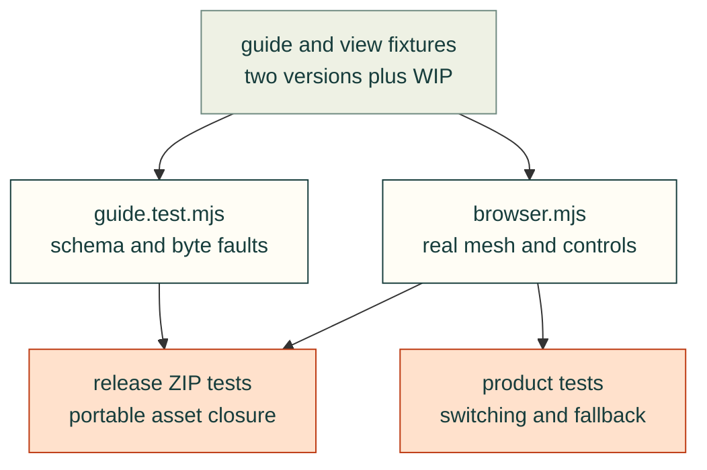

# Assembly guide feature tests

This document accompanies the [design and API](assembly-guide.md). It distinguishes checks actually executed
from planned feature acceptance. CAD illustrations and browser presentation are not physical qualification.

The arrows show where the same snapshot travels through increasingly complete consumers. Each layer keeps its
own rejection controls; passing shared components does not stand in for portable release or product acceptance.



## Requirement-to-test matrix

<details>
<summary>Feature cases, owners and verified versus pending acceptance</summary>

| Requirement | Test owner / concrete case | Status at this source checkpoint |
|---|---|---|
| Strict guide schema, snapshot identity, explicit mm/z-up and per-instance mesh hashes | `tests/webkit/assembly/guide.test.mjs`: legacy versus guide manifest; invalid guide cases; duplicate mesh/frame/hash cases | 31 Node contract tests passed on Node 22; final entry-hash counterexample is included |
| Required model members, repeated screws, unknown/duplicate instances, prerequisites and finite vectors | Same file: invalid guide cases and absolute-state test | Passed in the above Node run |
| HTTP/body deadline, wrong hash, byte cap, abort, missing/corrupt version | Same file: download failure controls and loadGuide binding | Passed in the above Node run |
| Absolute direct/backward states, previous/future membership and unchanged source pose | `tests/webkit/assembly/browser.mjs`: each v1/v2/WIP Previous/direct step; assembled reset | Chromium and WebKit component suites passed at `cdbee23b`; portable release acceptance is separate |
| Selected-instance transparent/wireframe override, unrelated meshes unchanged, clear-on-new-step/reset | Node visible-only/invalid appearance controls plus browser selected-screw DOM/material assertions | Node and both actual browser suites passed at `cdbee23b` |
| Real highlighted/ghost/wireframe/solid states and visible multipart output | Browser suite: real materials/visibility plus retained screenshots | Chromium and WebKit component suites passed at `cdbee23b`; portable release acceptance is separate |
| CAD units/frame applied exactly once | Browser suite: independently hard-coded +25 mm CAD-Z→+0.025 m stage-Y delta, plus wrong 1000x, wrong-axis and doubled-offset fault controls | Chromium and WebKit component suites passed at `cdbee23b`; portable release acceptance is separate; expectations do not read guide offsets |
| Authored underside camera direction, with ordinary orbit behavior retained | Browser suite: independent CAD direction and actual camera-target vector; restored old clamp must reject | Both actual engines passed the underside vector and old-clamp rejection; ordinary limit retained; current CI required |
| Picking, selection and explicit isolation | Browser suite: actual projected canvas click plus two repeated screw identities | Chromium and WebKit component suites passed at `cdbee23b`; portable release acceptance is separate |
| Framing, reset and legacy `?manifest=&explode=&section=` behavior, spaced filenames, CSS colours, absolute/root/CORS URLs and ordinary redirects | Browser suite: existing route and API round trip | Chromium and WebKit component suites passed at `cdbee23b`; portable release acceptance is separate |
| Resource teardown and cancelled load | Browser suite: geometry/material dispose events, repeated dispose, no canvas, aborted creation | Chromium and WebKit component suites passed at `cdbee23b`; portable release acceptance is separate |
| Two frozen versions and exact-commit WIP use independent scenes/instructions | Browser suite: differing dimensions, steps, hashes, UUIDs and snapshot IDs | Chromium and WebKit component suites passed at `cdbee23b`; portable release acceptance is separate; product selector/deep links/progress are Gyropup #266 acceptance |
| Phone portrait/landscape and keyboard navigation | Browser suite: actual previous/next controls and overflow checks | Chromium and WebKit component suites passed at `cdbee23b`; portable release acceptance is separate |
| Runtime and complete asset closure in release ZIP; preserve old output on rejection | `tests/publish/test_release_guides.py` and `tests/webkit/assembly/release-browser.mjs` | Publisher tests and actual extracted-ZIP Chromium/WebKit suites passed at `47b07508`; [packaging test plan](../../tests/publish/README.md#assembly-guide-release-test-plan) states exact scope |
| Current recipe/neutral transforms/posters and static/Markdown fallback | Gyropup #266 producer and product tests | Product-owned, pending; no stale turret illustration accepted here |
| Rapid switch race, progress isolation, no-WebGL fallback, touch/reduced motion, complete requirement UI | Gyropup #266 tests, with shared abort/dispose primitives | Product acceptance still pending; not implied by this shared module |

</details>

<details>
<summary>Retained corrective failures and current component evidence</summary>

The product's existing ordinary-viewer fixtures also exposed a legacy absolute/root URL regression. Ordinary
HTTP(S) URL resolution and external CORS/redirect behavior are retained separately from strict guide paths;
pure and real browser cases passed in both engines at `cdbee23b`. The held ordinary load uses an absolute
mesh URL. Programmatic slider readouts and first-usable-frame readiness are reconciled with the existing product
viewer. The portable reader's assembled reset now synchronizes mode/explosion/section labels, with actual DOM
assertions in the component suite; both engines passed these corrective cases at `cdbee23b`.

The rendered WebKit CI at `ca70ce09` also rejected uninterrupted design/testing-page stretches of 2810/1332 px.
Native disclosures now keep schema/API/reference evidence available without that initial wall. A bounded actual
two-route check measured Chrome 629/237 px and WebKit 627/235 px against the unchanged 1200 px limit; both real
diagrams rendered and each named reference opened. Two earlier local probe failures selected the diagram source
disclosure rather than the named reference, so they are retained as probe failures, not product-wall results.

The first current-head Chromium CI stopped before component execution on missing parent README links and a
fixture row outside its ownership table. After those fixes, the local structural suite also exposed a stale
`docs/map.md`; the unchanged generator refreshed its inventory from 1034 to 1039 folders. The final structural
map suite passed 28 tests with one explicit CI-only drawing skip. These failures remain classified separately
from browser interaction evidence; actual themed map rendering still belongs to current CI.

</details>

## Commands and CI

<details>
<summary>Run the existing suites and interpret their evidence</summary>

Use installed Node 22 and the existing `tools/site` npm context:

```sh
node --test tests/webkit/assembly/guide.test.mjs
npm --prefix tools/site run test:webkit-unit
PLAYWRIGHT_BROWSER=chromium npm --prefix tools/site run test:assembly-guide
PLAYWRIGHT_BROWSER=webkit npm --prefix tools/site run test:assembly-guide
```

The per-instance corrective multipart suites at `cdbee23b` recorded 18 case rows per engine, zero page errors, and terminal
owned service cleanup. They include selected-instance appearance and actual reset-control assertions, ordinary
absolute/root/CORS/redirect loads, slider readouts, first-frame readiness and abort-after-late-response controls.
The earlier `e219d2ac` pair recorded 13 rows per engine and remains the narrower historical result. The final
underside-camera correction then passed the existing suite in both engines with 19 case rows each, zero page
errors and terminal owned cleanup. It preserves the ordinary orbit limit and detects reinstating the old guide
clamp; these are shared-component results, not product or portable-release acceptance. The earlier `65d7dcd9` WebKit picking failure and changed `5fe0132d` offscreen-projection failure
remain retained failures; camera matrices and overlay fitting were corrected with strict projected-bound checks.
The final top-guide hash forwarding changes only the portable entry binding; its explicit Node corruption control
passes, while actual extracted-ZIP valid/corrupt-entry browser acceptance belongs to the release integration.
The composed release suite subsequently passed seven case rows in both engines at `47b07508`, using runtime
bytes from `cdbee23b`. It removes the original source/release, checks real draw and DOM/material reset, selected
appearance, corruption refusal and no-script instructions, and allows no outside requests. Synthetic released
fixtures establish version independence; they are not claims of historical Gyropup releases. The final-runtime
portable pair with `d0d13ee3` subsequently passed seven cases per engine, including the independent underside
camera vector, zero page errors/foreign requests and owned cleanup. The publisher reference wall was folded
after its actual CI failure and measured 265/264 px against the unchanged 1200 px bound.
The focused existing and new Node suites passed 37 tests; exporter/render/layout/area/packaging checks passed
138 tests with two optional-extra skips. The corrective layout/area/package checks passed 120 tests, and the structural map suite passed 28 with its
explicit CI-only drawing skip. These counts do not substitute for current-head CI or product acceptance.

The existing `webkit.yml` runs the new browser suite in both engines; it does not waive the existing site,
file-viewer, part-table or diagram suites. Browser reports and screenshots use `TEST_OUTPUT`, defaulting to a
private temporary output directory. Failure receipts remain failures; a corrected source needs a fresh run.

Existing `tests/publish/test_view.py` checks exporter/packing/frame metadata and Python↔JavaScript decoding.
`tests/review/test_packet.py` checks source hashes, staleness and step-derived offsets. Existing rigid-subassembly
and assembly gates remain separate. Release tests already check deterministic ZIPs, source/dirty state, rewritten
links, stale print sets and destination collisions; extending guide packaging must retain those controls.

The composed publisher CI also caught the missing visual flows on these two newly published pages. The diagrams
above follow real loader/controller calls and test consumers; the website visual gate stays unchanged.

</details>
