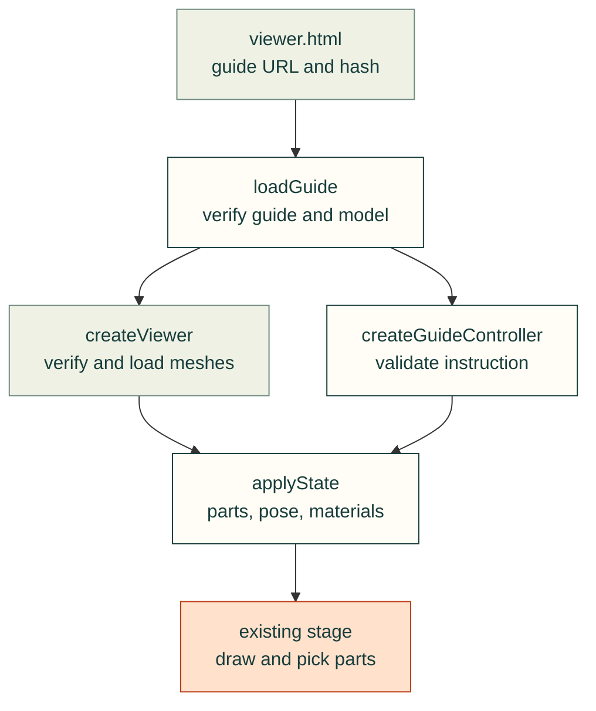

# Version-bound assembly instructions

Assembly instructions extend the existing `cad-agent view` meshes and `webkit/viewer.js`, not a second renderer.
The instruction controller changes presentation only. It does not prove assembly order, tool access, physical fit,
fastener engagement or build qualification. Those claims retain their own source-bound checks.

See the [feature testing matrix](assembly-guide-testing.md) and [shared module map](../../software/cadagent/webkit/assembly/README.md).

The arrows follow the reader's calls and verified inputs: the entry binds the guide, the loader checks the model,
and the controller applies each complete instruction state to the existing viewer.



## Data and identity

<details>
<summary>Schema, instance identity and asset bindings</summary>

A guide uses `schema: cad-agent.assembly-guide/1`. It binds an ordinary view manifest by SHA-256. Every part in
that guide-bound manifest must carry its mesh SHA-256; ordinary legacy viewers may omit hashes. Mesh coordinates
already contain the **assembled placement in CAD millimetres, z-up**. The viewer performs the existing mm→metres,
z-up→y-up conversion once. `offsets_mm` are absolute translations in that same CAD frame, applied relative to the
unchanged assembled mesh. They are illustrative offsets, not certified insertion paths.

```json
{
  "schema": "cad-agent.assembly-guide/1",
  "snapshot": {"id": "frame-v1", "revision": "1.0", "status": "released", "source_commit": "1111111111111111111111111111111111111111"},
  "model": {"file": "view.json", "sha256": "<64 lowercase hexadecimal digits>"},
  "subassemblies": [{"id": "frame", "title": "Frame", "parts": ["base", "screw#1", "screw#2"]}],
  "steps": [{"id": "screws", "title": "Fit both screws", "subassembly": "frame",
    "parts": ["base", "screw#1", "screw#2"], "highlight": ["screw#1", "screw#2"],
    "offsets_mm": {"screw#1": [0, 0, 25], "screw#2": [0, 0, 25]},
    "camera": {"direction": [1, -1, 1]}, "text": "Fit both screws using the specified tool."}]
}
```

`parts` is the complete visible membership for the step, not a cumulative addition. It may include already assembled previous chapters. `highlight` is a subset of both visible membership and the active subassembly.
`requires`, when present, names unique earlier step IDs. Subassembly membership is an explicit visibility set,
not a joint or rigid-body declaration. Exact mesh names identify repeated instances; catalogue/BOM keys are
separate and may be retained in optional `source` metadata. Intentionally unmodelled hardware must be disclosed
by the product's instruction/BOM records, not invented as geometry or silently counted as a modelled instance.

Optional `poster` is `{file, sha256}`; optional camera `direction` is a nonzero CAD-frame vector from the scene
towards the camera. Guide-bound viewers allow underside inspection; ordinary viewers retain the existing stage orbit limit. Unknown guide/step fields, duplicate IDs, unknown instances, bad prerequisites, invalid frame,
nonfinite vectors and absent mesh hashes reject. Product-specific instruction requirements belong in `source`
metadata rather than undocumented step keys.

Data asset references are relative local URLs without credentials, query or fragment. Parent `../` references
are allowed within a proved project/bundle boundary. `loadGuide` supports `assetRoot` for browser containment;
the release publisher must validate real filesystem containment, symlinks and complete dependency closure before
replacing a prior release. Browser HTTP redirects are rejected. Never substitute a missing snapshot asset from
another release or from current WIP.

</details>

## Existing viewer API and optional controller

<details>
<summary>Viewer methods, instruction states and portable reader controls</summary>

```js
import {loadGuide, createGuideController} from './kit/assembly/guide.js';
import {createViewer} from './kit/viewer.js';
const loaded = await loadGuide(guideURL, {signal, assetRoot: bundleURL});
const viewer = await createViewer({app, panel, title,
  manifestUrl: loaded.manifestUrl, manifest: loaded.manifest,
  guideBound: true, signal, onProgress: text => showStatus(text), onSelect: name => showPart(name), onStateChange: state => updateControls(state)});
const instructions = createGuideController(viewer, loaded.guide);
instructions.applyStep('screws', {explode: 1, mode: 'ghost'});
```

`manifest` passes the already hash-verified manifest without a second fetch. Guide callers pass `guideBound: true` (the shared `mountGuide` does this). Ordinary viewers retain relative, root-relative and absolute HTTP(S) mesh URLs, including external CORS responses and ordinary fetch redirects. Only an explicit `assetRoot` restricts an ordinary viewer to a bundle; guide references and redirects remain strict. Fetch credentials keep the browser default (`same-origin`).

Existing `createViewer` callers,
`stage`, `parts`, `setExplode` and `setSection` remain supported. New methods:

| Method | Behavior |
|---|---|
| `applyState({visible, highlight, mode, offsets_mm, selected, isolate, partModes?})` | Validates a complete state before mutation; restores authored materials and replaces every offset |
| `getState()` | Returns a copy, not mutable internal state |
| `setSelection(name)` | Selects a visible part or null and calls `onSelect`; actual canvas picking uses the same method |
| `setPartMode(name, mode)` | Overrides one visible instance with `solid`, `transparent` or `wireframe`; null restores scene mode |
| `frameParts(names, direction?, {includeHidden: false}?)` | Fits visible world bounds by default; explicit hidden-future framing uses stored authored poses without drawing them |
| `reset()` | Restores assembled positions, original visibility/materials, section off and opening camera |
| `dispose()` | Idempotently aborts loading, removes owned events, stops/disposes the stage and disposes model resources |

`partModes` defaults to an empty mapping. Its keys must be visible instances; overrides affect only those parts and clear on reset or a new instruction state. The portable reader exposes one selected-part appearance menu, not one menu per mesh. `onStateChange` lets a product keep its controls synchronized with programmatic state.

`mode` is `solid`, `wireframe` or `ghost`; ghosting makes nonhighlighted installed parts translucent while keeping
highlighted parts opaque. `isolate` is null or an explicit array of visible names, never a boolean. Selection must
remain visible and inside isolation. Programmatic state is absolute: direct/backward navigation must equal
sequential navigation. No animation or geometry-convergence sleep is required to establish the final state.

`createGuideController(viewer, guide)` returns `applyStep(id, {explode, mode, frame})`, `reset`, `current` and
`dispose`. `explode` is 0..1 and scales authored offsets only. A product can keep its own version picker and text
layout. A release must bind the entry itself with `viewer.html?guide=<relative guide URL>&sha256=<guide SHA-256>`. `mountGuide` accepts the same optional `expectedHash`; ad hoc previews may omit it. A changed instruction with unchanged model bytes must still fail the release entry hash. A validated relative `back` query links the portable reader to its release guide.

The existing `viewer.html?guide=<relative guide URL>` uses `mountGuide` for minimal previous/next, direct
step selection, material mode, assembled reset and instruction text. Assembled reset synchronizes the displayed mode and explode/section controls with the mesh state and shows an explicit overview entry. The ordinary `?manifest=` route is retained.

</details>

## Inspection and ordered playback follow-up

<details>
<summary>Orthogonal inspection, shared pointer events and explicit installation order</summary>

These optional methods extend the same viewer, guide controller and stage. They are a separate follow-up to
v0.30.0; a product must pin their published source and capability-check an older imported runtime. Current
source/CI/release acceptance is tracked in PR #509; component evidence is listed in the testing matrix.

- `setSectionPlane({axis: 'x'|'y'|'z', flipped: boolean})` preserves the current normalized depth;
  `getSectionState()` returns a copy of `{axis, flipped, depth}`. `setSection(depth)` and default CAD-X behavior
  stay exact. Depth 1 disables the section for either direction. Reset restores X, unflipped, off. CAD axes are
  explicit; product labels must follow their source frame (the robot uses X forward, Y left, Z up).
- Optional `onHover(name|null, {clientX, clientY})` shares the click hit resolver, checks all visible ancestors,
  excludes section-discarded ray hits, clears on orbit/wheel/leave/dispose and is throttled to the existing browser frame cadence. It never intercepts orbit
  input. A pointer selection supplies optional coordinates/pointer type to `onSelect`; a repeated click on the
  same selected instance still notifies once. Programmatic unchanged selection remains quiet.
- `createGuidePlayback(controller, {installOrderByStep, referenceStepIDs, durationMs, onState, onStep})` provides
  `play`, `pause`, `setSpeed`, `setLoop`, `tick(dtSeconds)`, `getState` and `dispose`. `tick` receives seconds, clamps a delta to 0.1s, and speed is 0.25..4;
  `durationMs` is 100..60000 per instance. Status is `idle`, `playing`, `paused`, `ended` or `disposed`. The caller supplies explicit
  exact instance order; no BOM/manifest order or insertion direction is invented. Complete coverage, duplicates,
  unknown names and non-monotone installation steps reject. Authored compounds remain one instance.

Each installation begins with previous parts assembled and solid, reveals only the current new instance and
moves its authored CAD-mm offset absolutely to zero; future installation instances remain hidden. A zero-offset
foundation stays static. Pause freezes its pose, speed is bounded, oversized frame deltas cannot cause catch-up,
and looping restarts the ordered presentation. Manual navigation/reset pauses playback and applies the requested
deterministic controller state. Player callbacks update text/URLs without recursively reapplying the step.
`onStep(id, {partId, operationIndex})` fires once per operation change, including a repeated step ID for the next
instance. `onState` receives a copy with status, step/part IDs, operation index, elapsed milliseconds, normalized
progress, speed and loop. Terminal Play restarts the first installation; a manually selected installation starts
that step with its prior assembled baseline, and an explicit reference overview starts the first installation.
Only one player can own a controller at a time; disposing the controller also disposes its player. No procurement
or completed-step storage is written.

The product owns camera/UI composition. `frameParts(names, direction, {includeHidden: true})` can frame all future
step instances at their retained authored offsets without showing them; the default remains visible-only.
Subscribe once to the existing stage, then unsubscribe before discarding a player. The product explicitly pauses
for manual view/list actions, hidden-page and reduced-motion changes; pointer metadata distinguishes a real pick
from a programmatic selection clear.

```js
import {createGuidePlayback} from './kit/assembly/guide.js';
const player = createGuidePlayback(instructions, {
  referenceStepIDs: [],
  installOrderByStep: {screws: ['base', 'screw#2', 'screw#1']},
  durationMs: 1000,
  onStep: (id, operation) => showInstruction(id, operation.partId),
});
const untick = viewer.stage.onFrame((_time, dtSeconds) => player.tick(dtSeconds));
// User controls call player.play(), pause(), setSpeed() and setLoop().
// Teardown while keeping the viewer alive:
untick(); player.dispose();
```

The order and reference IDs in this example must exist in the caller's actual guide. This is illustrative
presentation, not inferred physical assembly order, collision avoidance or a certified insertion trajectory.

</details>

## Versions and publication

A released snapshot pins its source, guide, model, BOM, posters and viewer runtime together. `released` describes
publication, not physical qualification. A WIP entry has `status: wip` and an exact source commit; it is not a
claimed historical release. The product's small published snapshot index owns selection and immutable deep links.

The first pilot must exercise **two deliberately different frozen fixture versions and exact-commit WIP**, not
invent historical product releases. Progress belongs to the snapshot/recipe identity and must remain separate
from procurement and printed-part status. A failed switch retains the previous coherent scene and an explicit
error. The product owns that switching transaction; one `createViewer` instance owns only its own scene.

The existing release publisher owns portable runtime and dependency inclusion. An interactive bundle needs HTTP
serving for module/fetch APIs; static instructions and illustrations remain its script-free fallback. Static VTK
and interactive Three pictures share semantic pose, instances, camera direction and authored offsets, not exact
pixels or identical camera projection.

## Validate the trajectories shown by playback

`cadagent.review.gates.playback` feeds explicit instance order and finite authored offsets into the existing
assembly insertion engine. It checks every newly arriving instance against all previously installed instances,
including earlier arrivals within the same guide step. A failed arrival remains in the report while later
operations are evaluated with their declared installed sets. This diagnoses the authored sequence; a later
clear operation does not rescue the earlier failure.

<details>
<summary>Export binding, Python API and interpretation</summary>

The ordinary dossier assembly gate retains its sweep from beyond each obstacle. Playback checks only the actual
finite segment from `offsets_mm[name]` to the assembled pose. Zero offsets establish no insertion path and warn.
Offsets remain presentation data unless a producer separately establishes manufacturing intent.

A source-bound check needs the exact BREP inputs as well as the displayed mesh inputs. During the native export,
use the same `Assembly` source shapes for the guide meshes and the binding helper:

```python
from cadagent.publish.guides import collect_guides
from cadagent.review.gates.playback import bind_playback_geometry, playback_gate

bundle = collect_guides(project_root, ["exports/guide/guide.json"])[0]
# source_assembly is the SAME shape/placement set just used to export the guide meshes.
binding, breps = bind_playback_geometry(source_assembly, bundle)
# Persist binding as JSON and breps[name] as BREP bytes beside the export's source/runtime receipt.
report = playback_gate(bundle, binding, breps,
    install_order_by_step={"install": ["base", "insert", "cover"]},
    reference_step_ids=["overview"])
```

The example IDs must be replaced with the actual guide's complete instance order. Omitting
`install_order_by_step` reads `guide.source.install_order_by_step`; reference overview IDs remain explicit, just
as in the browser player. The adapter verifies the guide/model/mesh hashes and every BREP payload hash before path queries. It also
compares located CAD bounds with the actual captured STL vertices and the model bounds, recording all three.
`bounds_tolerance_mm` is explicit in the report and restricted to 0..1 mm. Its default 0.5 mm is a gross frame
screen with slack around the 0.25 mm tessellation used by the reference producer; use the producer's recorded
linear tessellation tolerance when available. Model bounds may describe exact CAD or mesh vertices, with an
extra 0.01 mm allowance for two-decimal rounding. This is not a clearance allowance or proof of correspondence;
coarser geometry should be re-exported rather than disabling the frame check. Missing or stale evidence produces a failing verdict. BREP read-back preserves
the original content hash from its verified serialized bytes, following the existing geometry-cache convention.
A producer cannot reconstruct this evidence merely by matching instance names. A frozen older producer can
emit original BREP bytes through its existing `shape_brep_text` helper while exporting STL, then a newer
consumer calls `bind_playback_breps(bundle, breps, producer_hash_platform=original_platform,
placements=original_matrices)` without importing or reserializing those bytes. The original producer platform
must come from its receipt; the consumer runtime is recorded separately. CAD-to-mesh correspondence is an
explicit producer declaration; the adapter does not prove that a tessellation mathematically equals its BREP.

`run_playback_sequence(world, guide, order)` supplies kernel-free rule testing through the existing
`SequenceWorld` interface; it establishes no source identity. `playback_operations` exposes the deterministic
operation list for consumers and tests. No intended-overlap waiver is inferred. Compound meshes remain one
instance; use the separately qualified subassembly API for internal assembly and rigid-module claims.

Reports keep per-pair blocked, final-overlap, unknown and sample-budget states, contact witnesses, finite travel,
exact input hashes, order/options digests and runtime platform. A kernel exception becomes an unknown pair and
preserves earlier findings. A geometric pass still carries explicit unknown support/stability and unverified
physical assembly: the adapter does not simulate gravity, retention, fixtures, tools, fastener engagement or
compliance. See the [testing and physics follow-through](assembly-guide-testing.md#geometric-playback-validation-follow-through-512).

</details>

## Source-bound serial assembly plans (#542)



*Source illustration from the native serial-plan fixture, drawn by `tools/figures/motion_figures.py`:
plate and roof waypoints, rail datums and separate component/tool obstruction controls. Native clearance
checks and actual rendered world-vertex traces remain separate evidence.*

The first executable scope extends the dossier and playback owners with one optional
`cad-agent.assembly-plan/1` resource. A guide and packed mini-model bind the **same bytes** by relative
file and SHA-256. Legacy guides remain illustrative. A malformed or stale declared plan fails loading;
plan-enabled consumers never select radial motion as a fallback.

<details>
<summary>Bounded mechanical contract and validation limits</summary>

The bounded contract is mm, assembly-home/Z-up, exact source instance identities, fixed context and a
serial list of rigid translations. Each operation declares an ID, preceding dependencies, moving members,
finite piecewise-linear offsets from its parked pose to the assembled zero offset, independent intent
provenance and stage tool references. Every instance belongs to fixed context or exactly one operation.
All future/removed parts occupy their declared parked poses; none disappear. Multiple members are one
rigid module whose internal qualification remains separate. Rotations, nesting, concurrency, process
inverses and display regrouping of independently moving instances are unsupported.

Installation evaluates absolute source-rest-derived poses. Disassembly evaluates the identical trajectory
at reversed global time: reverse operation order **and** each segment's parameter. Seeking, resetting and
rapid reversal must not accumulate offsets. Presentation may compress duration but cannot change order,
membership or path. Existing tick/lifecycle owners remain responsible for rendering and suspension.

The source declaration binds source revision/closure, producer, original BREP, source mesh and exact placed
matrix per instance. Hash agreement establishes freshness, not mechanical intent. Geometry checks reuse
finite `sweep_pair` segments against occupied stages, including parked parts and every attached member.
Tools reuse the fastener gate's ordinary axial envelopes and sector swing, with explicit finite axial
approach/retraction. Insertion, tool access, internal qualification, support and retention/process remain
separate results; sampled clearance never means physical assembly qualification. No product geometry is
changed by this slice. Product migration and richer paths require their own acceptance evidence.

</details>

<details>
<summary>Opt-in schema and existing owner APIs</summary>

The opt-in JSON is authored under dossier `assembly: {plan: ...}` and exported as a separate resource.
`collect_guides` captures `assembly_plan: {file, sha256}`; `pack_view(..., assembly_plan=Path(...))`
validates original mesh hashes, preserves instance partitions and copies the identical resource when needed.
Guide steps project operation IDs in the same order and keep `offsets_mm` empty. Full-plan subsets are the
only supported presentation in this slice. `loadGuide` returns `plan`; `createGuideController(viewer, guide,
{plan})` and `createViewer({assemblyPlan: plan, ...})` bind the same validated data. A consumer adapter using
its own scene must apply the same CAD-root rest/parent contract; arbitrary articulation composition is unsupported.

The plan has `schema`, `units`, `frame`, `source`, `clearance_mm`, `fixed`, and `operations`. Source carries
`revision`, `closure_sha256`, `producer`, `tooling_sha256`, and `instances` (original `mesh_sha256`,
`brep_sha256`, rigid 3×4 row-major `matrix`). Each operation carries `id`, `type: "translate"`, exact
`members`, `requires`, `path_mm`, independent `intent`, and `tools`. Tool references carry `fastener`, `tool`
and positive finite `approach_mm`. The tooling digest binds existing fastener specs/axes and tool declarations,
so shrinking an ordinary driver under the same name is stale input. An ordinary tool declaration needs its
`identity`, `ordinary: true` and a `drive` matching the fastener spec, in addition to existing envelope/swing data.
Positive tool allowance remains explicitly unverified by the current envelope owner; no special smaller tool is
silently selected. Drive engagement, holding-side tools, support and retention remain unqualified in this slice.

`playback_gate(..., tools=..., fastener_specs=..., reverse=True)` validates the captured plan against the original
producer binding before loading CAD. `bind_playback_breps` accepts the producer's `source_closure_sha256` and
`producer` alongside its existing mesh/BREP/placement receipt. Pure `run_plan_sequence` establishes no source
identity. Public player `seek(0..operationCount)`, `reverse()` and `reset()` are absolute; `reset()` presents
assembled home. A loop traverses the same path back and forth, preserving each terminal frame. The existing
guide policy still clears selection/material overrides on instruction/playback transitions; no new articulation
owner is introduced. Mini-viewer turns, hover and pointer controls remain owned by that viewer.

</details>

## Preflight a native collection and retain progress

<details>
<summary>Input-only scope, checkpoint events and incomplete runs</summary>

`playback_gate(..., preflight_only=True)` runs the same captured-input, BREP and CAD/STL/model frame checks and
returns `gate: assembly-playback-preflight`, `limits.paths_checked: false` and no operations. Its input-only pass
never qualifies an insertion path. A full check remains the default.

The optional synchronous `on_progress(event)` receives isolated `cad-agent.playback-progress/1` JSON snapshots. Phase events
identify inputs, global and per-instance load/frame work and world-bounds construction. Operation and pair events
carry `state: starting|complete`, exact step/instance IDs and operation/pair indices; completed events include
the recorded result. The preflight-complete event binds input digests and frame evidence. Starting events precede
potentially slow native work, so a capped process can identify its last active phase or pair.

```python
import json, os

with progress_path.open("x", encoding="utf-8") as stream:
    def checkpoint(event):
        stream.write(json.dumps(event, allow_nan=False) + "\n")
        stream.flush()
        os.fsync(stream.fileno())
    report = playback_gate(bundle, binding, breps,
        preflight_only=True, on_progress=checkpoint)
```

The product owns the fresh output path, durable storage, detached process and external runtime cap. Callback
exceptions or an unsupported awaitable, generator or async-generator result stop and fail validation.
Deferred callback bodies are never iterated or awaited by the gate; checkpoint work must finish synchronously. Earlier completed collisions and the current partial operation's recorded
pairs remain in the final failure report; remaining pairs are explicitly unchecked. A checkpoint failure after
all geometry queries still fails the run. Mutating a callback snapshot cannot change the checked geometry or
internal evidence. `run_playback_sequence` accepts the same optional observer for kernel-free consumers.

This is progress reporting, not automatic resumption or a clearance certificate. A killed process may leave only
the flushed event prefix; uncompleted/unrecorded work remains unchecked. Keep original failures and source/input
identities when retrying. No output is written by the toolkit unless the caller supplies a callback.

</details>
