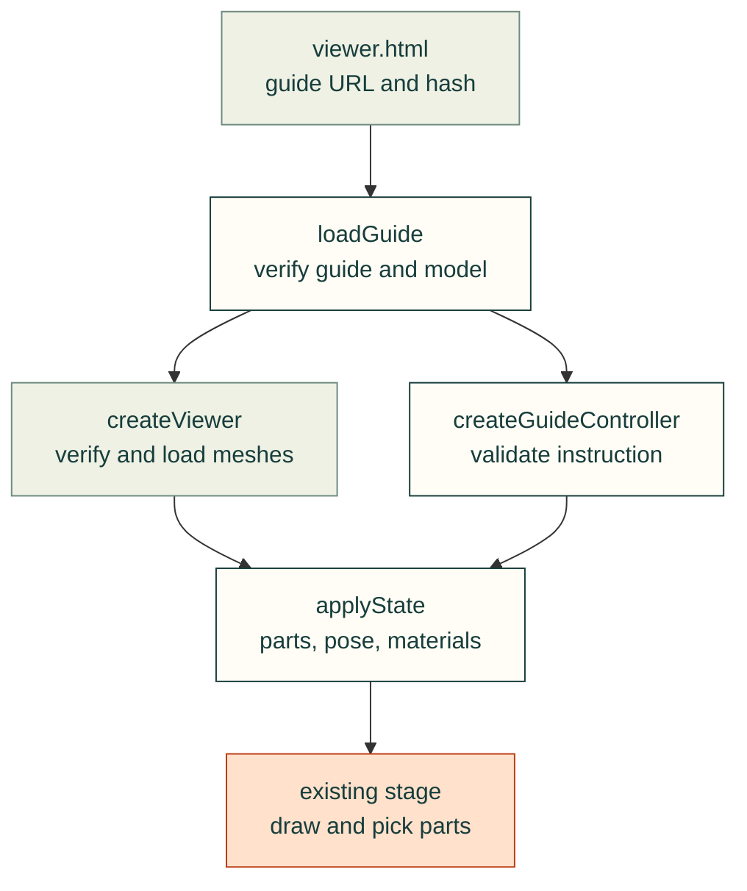

# Version-bound assembly instructions

Assembly instructions extend the existing `cad-agent view` meshes and `webkit/viewer.js`, not a second renderer.
The instruction controller changes presentation only. It does not prove assembly order, tool access, physical fit,
fastener engagement or build qualification. Those claims retain their own source-bound checks.

See the [feature testing matrix](assembly-guide-testing.md) and [shared module map](../../software/cadagent/webkit/assembly/README.md).

The arrows follow the reader's calls and verified inputs: the entry binds the guide, the loader checks the model,
and the controller applies each complete instruction state to the existing viewer.



## Data and identity

<details>
<summary>Schema, instance identity and asset bindings</summary>

A guide uses `schema: cad-agent.assembly-guide/1`. It binds an ordinary view manifest by SHA-256. Every part in
that guide-bound manifest must carry its mesh SHA-256; ordinary legacy viewers may omit hashes. Mesh coordinates
already contain the **assembled placement in CAD millimetres, z-up**. The viewer performs the existing mm→metres,
z-up→y-up conversion once. `offsets_mm` are absolute translations in that same CAD frame, applied relative to the
unchanged assembled mesh. They are illustrative offsets, not certified insertion paths.

```json
{
  "schema": "cad-agent.assembly-guide/1",
  "snapshot": {"id": "frame-v1", "revision": "1.0", "status": "released", "source_commit": "1111111111111111111111111111111111111111"},
  "model": {"file": "view.json", "sha256": "<64 lowercase hexadecimal digits>"},
  "subassemblies": [{"id": "frame", "title": "Frame", "parts": ["base", "screw#1", "screw#2"]}],
  "steps": [{"id": "screws", "title": "Fit both screws", "subassembly": "frame",
    "parts": ["base", "screw#1", "screw#2"], "highlight": ["screw#1", "screw#2"],
    "offsets_mm": {"screw#1": [0, 0, 25], "screw#2": [0, 0, 25]},
    "camera": {"direction": [1, -1, 1]}, "text": "Fit both screws using the specified tool."}]
}
```

`parts` is the complete visible membership for the step, not a cumulative addition. It may include already assembled previous chapters. `highlight` is a subset of both visible membership and the active subassembly.
`requires`, when present, names unique earlier step IDs. Subassembly membership is an explicit visibility set,
not a joint or rigid-body declaration. Exact mesh names identify repeated instances; catalogue/BOM keys are
separate and may be retained in optional `source` metadata. Intentionally unmodelled hardware must be disclosed
by the product's instruction/BOM records, not invented as geometry or silently counted as a modelled instance.

Optional `poster` is `{file, sha256}`; optional camera `direction` is a nonzero CAD-frame vector from the scene
towards the camera. Guide-bound viewers allow underside inspection; ordinary viewers retain the existing stage orbit limit. Unknown guide/step fields, duplicate IDs, unknown instances, bad prerequisites, invalid frame,
nonfinite vectors and absent mesh hashes reject. Product-specific instruction requirements belong in `source`
metadata rather than undocumented step keys.

Data asset references are relative local URLs without credentials, query or fragment. Parent `../` references
are allowed within a proved project/bundle boundary. `loadGuide` supports `assetRoot` for browser containment;
the release publisher must validate real filesystem containment, symlinks and complete dependency closure before
replacing a prior release. Browser HTTP redirects are rejected. Never substitute a missing snapshot asset from
another release or from current WIP.

</details>

## Existing viewer API and optional controller

<details>
<summary>Viewer methods, instruction states and portable reader controls</summary>

```js
import {loadGuide, createGuideController} from './kit/assembly/guide.js';
import {createViewer} from './kit/viewer.js';
const loaded = await loadGuide(guideURL, {signal, assetRoot: bundleURL});
const viewer = await createViewer({app, panel, title,
  manifestUrl: loaded.manifestUrl, manifest: loaded.manifest,
  guideBound: true, signal, onProgress: text => showStatus(text), onSelect: name => showPart(name), onStateChange: state => updateControls(state)});
const instructions = createGuideController(viewer, loaded.guide);
instructions.applyStep('screws', {explode: 1, mode: 'ghost'});
```

`manifest` passes the already hash-verified manifest without a second fetch. Guide callers pass `guideBound: true` (the shared `mountGuide` does this). Ordinary viewers retain relative, root-relative and absolute HTTP(S) mesh URLs, including external CORS responses and ordinary fetch redirects. Only an explicit `assetRoot` restricts an ordinary viewer to a bundle; guide references and redirects remain strict. Fetch credentials keep the browser default (`same-origin`).

Existing `createViewer` callers,
`stage`, `parts`, `setExplode` and `setSection` remain supported. New methods:

| Method | Behavior |
|---|---|
| `applyState({visible, highlight, mode, offsets_mm, selected, isolate, partModes?})` | Validates a complete state before mutation; restores authored materials and replaces every offset |
| `getState()` | Returns a copy, not mutable internal state |
| `setSelection(name)` | Selects a visible part or null and calls `onSelect`; actual canvas picking uses the same method |
| `setPartMode(name, mode)` | Overrides one visible instance with `solid`, `transparent` or `wireframe`; null restores scene mode |
| `frameParts(names, direction?)` | Fits current visible world bounds, with optional CAD camera direction |
| `reset()` | Restores assembled positions, original visibility/materials, section off and opening camera |
| `dispose()` | Idempotently aborts loading, removes owned events, stops/disposes the stage and disposes model resources |

`partModes` defaults to an empty mapping. Its keys must be visible instances; overrides affect only those parts and clear on reset or a new instruction state. The portable reader exposes one selected-part appearance menu, not one menu per mesh. `onStateChange` lets a product keep its controls synchronized with programmatic state.

`mode` is `solid`, `wireframe` or `ghost`; ghosting makes nonhighlighted installed parts translucent while keeping
highlighted parts opaque. `isolate` is null or an explicit array of visible names, never a boolean. Selection must
remain visible and inside isolation. Programmatic state is absolute: direct/backward navigation must equal
sequential navigation. No animation or geometry-convergence sleep is required to establish the final state.

`createGuideController(viewer, guide)` returns `applyStep(id, {explode, mode, frame})`, `reset`, `current` and
`dispose`. `explode` is 0..1 and scales authored offsets only. A product can keep its own version picker and text
layout. A release must bind the entry itself with `viewer.html?guide=<relative guide URL>&sha256=<guide SHA-256>`. `mountGuide` accepts the same optional `expectedHash`; ad hoc previews may omit it. A changed instruction with unchanged model bytes must still fail the release entry hash. A validated relative `back` query links the portable reader to its release guide.

The existing `viewer.html?guide=<relative guide URL>` uses `mountGuide` for minimal previous/next, direct
step selection, material mode, assembled reset and instruction text. Assembled reset synchronizes the displayed mode and explode/section controls with the mesh state and shows an explicit overview entry. The ordinary `?manifest=` route is retained.

</details>

## Inspection and ordered playback follow-up

<details>
<summary>Draft API contract — implementation and complete validation pending</summary>

This follow-up is separate from the frozen v0.30.0 delivery. It extends the same viewer, guide controller and
stage; no second renderer or animation loop is introduced. Until its own reviewed source and complete tests
land, callers must capability-check the following methods rather than infer their availability from a draft.

- `setSectionPlane({axis: 'x'|'y'|'z', flipped: boolean})` preserves the current normalized depth;
  `getSectionState()` returns a copy of `{axis, flipped, depth}`. `setSection(depth)` and default CAD-X behavior
  stay exact. Depth 1 disables the section for either direction. Reset restores X, unflipped, off. CAD axes are
  explicit; product labels must follow their source frame (the robot uses X forward, Y left, Z up).
- Optional `onHover(name|null, {clientX, clientY})` shares the click hit resolver, checks all visible ancestors,
  clears on leave/drag/dispose and is throttled to the existing browser frame cadence. It never intercepts orbit
  input. A pointer selection supplies optional coordinates/pointer type to `onSelect`; a repeated click on the
  same selected instance still notifies once. Programmatic unchanged selection remains quiet.
- `createGuidePlayback(controller, {installOrderByStep, referenceStepIDs, durationMs, onState, onStep})` provides
  `play`, `pause`, `setSpeed`, `setLoop`, `tick(dtSeconds)`, `getState` and `dispose`. The caller supplies explicit
  exact instance order; no BOM/manifest order or insertion direction is invented. Complete coverage, duplicates,
  unknown names and non-monotone installation steps reject. Authored compounds remain one instance.

Each installation begins with previous parts assembled and solid, reveals only the current new instance and
moves its authored CAD-mm offset absolutely to zero; future installation instances remain hidden. A zero-offset
foundation stays static. Pause freezes its pose, speed is bounded, oversized frame deltas cannot cause catch-up,
and looping restarts the ordered presentation. Manual navigation/reset pauses playback and applies the requested
deterministic controller state. Player callbacks update text/URLs without recursively reapplying the step.
No procurement or completed-step storage is written. The product owns camera/UI composition; playback uses one
subscription to the existing `stage.onFrame`, with an unsubscribe path when the player is disposed.

</details>

## Versions and publication

A released snapshot pins its source, guide, model, BOM, posters and viewer runtime together. `released` describes
publication, not physical qualification. A WIP entry has `status: wip` and an exact source commit; it is not a
claimed historical release. The product's small published snapshot index owns selection and immutable deep links.

The first pilot must exercise **two deliberately different frozen fixture versions and exact-commit WIP**, not
invent historical product releases. Progress belongs to the snapshot/recipe identity and must remain separate
from procurement and printed-part status. A failed switch retains the previous coherent scene and an explicit
error. The product owns that switching transaction; one `createViewer` instance owns only its own scene.

The existing release publisher owns portable runtime and dependency inclusion. An interactive bundle needs HTTP
serving for module/fetch APIs; static instructions and illustrations remain its script-free fallback. Static VTK
and interactive Three pictures share semantic pose, instances, camera direction and authored offsets, not exact
pixels or identical camera projection.
