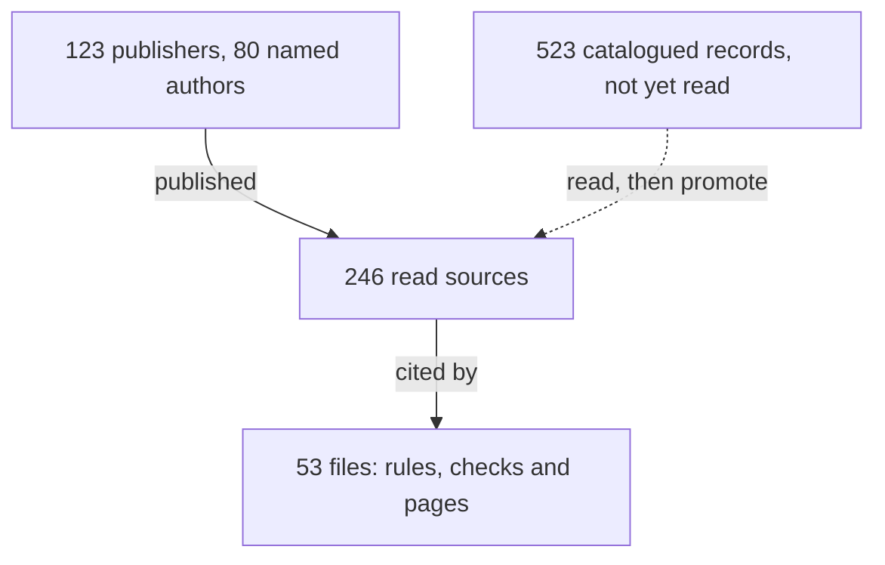

<!-- Generated by tools/site/compiler/site-references.mjs from docs/research/references.yaml and docs/research/references/*.yaml. Do not edit: change a record, then run `node tools/site/compiler/site-references.mjs --experts` (also to settle a merge conflict here). -->
# Experts and sources

The people and organisations whose published work cad-agent's rules and checks stand on: 123 publishers and 80 named authors, in 246 read sources. They did the work. cad-agent cites it by name and never copies it. A rule, check or page that relies on a source names it by id: a `[ref:<id>]` tag in text (which the site links to the source), a module's source table, a material's `source` or a process rule's `source`.

## Who they are

Each row is one publisher (or the authors, where a source names no organisation), largest first. Areas link to the record on the site.

| Publisher | People | Contributed | Areas | Cited by |
|---|---|---|---|---|
| SendCutSend |  | [SendCutSend engineering specifications (sendcutsend-specs.json, schema 1.0)](https://cdn.sendcutsend.com/specs/sendcutsend-specs.json); [SendCutSend ordering guide (sendcutsend-ordering-guide.md)](https://cdn.sendcutsend.com/specs/sendcutsend-ordering-guide.md); [Designing Sheet Metal Parts With Tab and Slots](https://sendcutsend.com/blog/designing-sheet-metal-parts-with-tab-and-slots/); [How to Design Bend Reliefs & Corner Reliefs for Sheet Metal Parts](https://sendcutsend.com/blog/guide-to-designing-bend-reliefs/); [Countersink Design Best Practices](https://sendcutsend.com/blog/countersink-design-best-practices); [SendCutSend ordering catalogue (sendcutsend-catalog.json, schema 1.0)](https://cdn.sendcutsend.com/specs/sendcutsend-catalog.json); [Sheet Cutting Guidelines](https://sendcutsend.com/guidelines/sheet-cutting/); [Sheet Metal Bending Services (bending guidelines)](https://sendcutsend.com/services/cnc-bending/); [Bending Deformation Guidelines](https://sendcutsend.com/guidelines/bend-deformation/); [Online Hardware Installation Service (hardware guidelines)](https://sendcutsend.com/services/hardware/); [Hardware Catalog](https://sendcutsend.com/guidelines/hardware/catalog/); [Sheet Metal Tapping Services (tapping guidelines)](https://sendcutsend.com/services/tapping/); [Online Countersinking Services (countersink guidelines)](https://sendcutsend.com/services/countersinking/); [Online Dimple Forming Services (dimple guidelines)](https://sendcutsend.com/services/dimple-forming/); [Anodizing, Plating and Powder Coating services (finishing guidelines)](https://sendcutsend.com/services/powder-coating/); [What are the thicknesses for your finishes? (FAQ)](https://sendcutsend.com/faq/what-are-the-thicknesses-for-your-finishes/); [Laser Cutting Online Quotes & Pricing](https://sendcutsend.com/pricing/); [Sheet Metal Bending Calculator](https://sendcutsend.com/bending-calculator/); [A Guide to PEM Hardware Inserts in Sheet Metal](https://sendcutsend.com/blog/pem-hardware-inserts-in-sheet-metal/); [How to Avoid Galvanic Corrosion on Your Laser Cut Parts](https://sendcutsend.com/blog/how-to-avoid-galvanic-corrosion-on-your-laser-cut-parts/); [How to Save Time with Locating Features for Weldments](https://sendcutsend.com/blog/how-to-save-time-with-locating-features-for-weldments/) | [Sheet metal](https://cad-agent.valpatel.com/references/sheet-metal), [Laser cutting](https://cad-agent.valpatel.com/references/laser-cutting), [Fasteners, bought hardware and assembly](https://cad-agent.valpatel.com/references/fasteners-and-hardware) | 9 files: `docs/research/manufacturing/process-profiles.md`, `docs/research/manufacturing/sheet-metal-guides.md`, `docs/research/manufacturing/sheet-metal-joining.md`, `docs/research/manufacturing/sheet-metal.md`, `docs/research/process-profiles.yaml`, `docs/research/sheet-hardware.yaml`, `docs/sheet-metal-hardware.md`, `software/cadagent/mechanical/sheet_hardware.py`, `software/vendor/text-to-cad/skills/sendcutsend/references/official-sources.md` |
| Protolabs |  | [Living Hinge Basics for Injection Molding](https://www.protolabs.com/resources/blog/living-hinge-basics-for-injection-molding/); [Plastic Injection Molding Design Guidelines](https://www.protolabs.com/services/injection-molding/plastic-injection-molding/design-guidelines/); [Stereolithography (SLA) Design Guidelines and Capabilities](https://www.protolabs.com/services/3d-printing/stereolithography/); [Design Guidelines for Selective Laser Sintering (SLS)](https://www.protolabs.com/services/3d-printing/selective-laser-sintering/); [Design Guidelines for Multi Jet Fusion](https://www.protolabs.com/services/3d-printing/multi-jet-fusion/); [Nylon 3D Printing Tips for Quality Parts](https://www.protolabs.com/resources/design-tips/how-to-design-for-nylon-3d-printing/); [How to Use Multi Jet Fusion for Functional 3D-Printed Parts](https://www.protolabs.com/resources/design-tips/how-to-use-multi-jet-fusion-for-functional-3d-printed-parts/); [Design Stronger Molded Parts: Ribs, Gussets, and Materials](https://www.protolabs.com/resources/design-tips/design-stronger-molded-parts/); [Plastic Boss Design on Molded Parts](https://www.protolabs.com/resources/design-tips/plastic-boss-design-on-molded-parts/); [Design Guidelines: CNC Milling](https://www.protolabs.com/services/cnc-machining/cnc-milling/design-guidelines/); [Design Guidelines: CNC Turning](https://www.protolabs.com/services/cnc-machining/cnc-turning/design-guidelines/); [Design Guidelines for Sheet Metal Fabrication](https://www.protolabs.com/services/sheet-metal-fabrication/design-guidelines/); [Sheet Metal Tolerances (one-pager)](https://protolabs.com/media/roognect/sheet-metal-tolerances-one-pager-2.pdf); [Guidelines for Threaded Holes in CNC Machining](https://protolabs.com/en-gb/services/cnc-machining/threaded-holes-guidelines); [Threaded Inserts with Heat Staking and Ultrasonic Welding](https://www.protolabs.com/en-gb/resources/blog/threaded-inserts-with-heat-staking-and-ultrasonic-welding/) | [Compliant mechanisms](https://cad-agent.valpatel.com/references/compliant-mechanisms), [Mould design](https://cad-agent.valpatel.com/references/mould-design), [Not yet placed](https://cad-agent.valpatel.com/references/unplaced), [Fasteners, bought hardware and assembly](https://cad-agent.valpatel.com/references/fasteners-and-hardware), [CNC machining](https://cad-agent.valpatel.com/references/cnc-machining), [Sheet metal](https://cad-agent.valpatel.com/references/sheet-metal) | 7 files: `docs/research/compliant-mechanisms.md`, `docs/research/fea-and-process-tools.md`, `docs/research/manufacturing/process-profiles.md`, `docs/research/manufacturing/sheet-metal-guides.md`, `docs/research/manufacturing/sheet-metal.md`, `docs/research/process-profiles.yaml`, `software/vendor/text-to-cad/skills/dfm/references/sheet-metal.md` |
| PennEngineering (PEM) |  | [PEM self-clinching nuts types S, SS, CLS, CLSS, SP: catalogue pages CLS-M3-1 and SP-M3-1](https://catalog.pemnet.com/item/nuts-types-s-ss-cls-clss-cla-sp/self-clinching-nuts-types-s-ss-cls-clss-sp-metric/cls-m3-1); [The Self Clinching Fastener Handbook](https://www.pemnet.com/wp-content/uploads/sites/2/2022/06/self-clinching-fastener-handbook.pdf); [CL Self-Clinching Nuts (Bulletin CL)](https://www.pemnet.com/wp-content/uploads/sites/2/2022/06/cldata.pdf); [FH Self-Clinching Studs and Pins (Bulletin FH)](https://www.pemnet.com/wp-content/uploads/sites/2/2022/06/fhdata.pdf); [SO Self-Clinching Standoffs (Bulletin SO)](https://www.pemnet.com/wp-content/uploads/sites/2/2022/06/sodata.pdf); [F PEMSERT Self-Clinching Flush Nuts (Bulletin F)](https://www.pemnet.com/wp-content/uploads/sites/2/2022/06/fdata.pdf); [Tech Sheet PEM REF/ C/L to Edge: Minimum distance hole C/L to edge](https://www.pemnet.com/wp-content/uploads/sites/2/2022/06/CLtoEdgeRev419.pdf); [Tech Sheet PEM REF/ Fasteners for use in stainless steel sheets](https://www.pemnet.com/wp-content/uploads/sites/2/2022/06/Stainless_Steel_Sheets.pdf); [Tech Sheet PEM REF/ Choosing a fastener finish: metal fasteners in contact with metal panels](https://www.pemnet.com/wp-content/uploads/sites/2/2022/06/Fastener_Finish.pdf); [Axial Strength and Mating Screw Recommended Tightening Torque for PEM Brand Self-clinching Nuts (Unified)](https://www.pemnet.com/wp-content/uploads/sites/2/2022/06/Mating-Screw-tightening-torque-10_28_21-Unified.pdf); [Tech Sheet PEM REF/ Surface finishing sheet metal assemblies](https://www.pemnet.com/wp-content/uploads/sites/2/2022/06/Surface_Finish.pdf); [The Design Engineer's Fastener Guide](https://www.pemnet.com/wp-content/uploads/sites/2/2022/09/Fastener-Guide_9-02-22.pdf); [Terms of Use](https://www.pemnet.com/terms-of-use/) | [Sheet metal](https://cad-agent.valpatel.com/references/sheet-metal), [Fasteners, bought hardware and assembly](https://cad-agent.valpatel.com/references/fasteners-and-hardware), [Not yet placed](https://cad-agent.valpatel.com/references/unplaced) | 6 files: `docs/research/manufacturing/process-profiles.md`, `docs/research/manufacturing/sheet-metal-guides.md`, `docs/research/manufacturing/sheet-metal-joining.md`, `docs/research/manufacturing/sheet-metal.md`, `docs/research/process-profiles.yaml`, `software/cadagent/mechanical/clinch.py` |
| Protolabs Network (formerly Hubs) |  | [How do you design snap-fit joints for 3D printing?](https://www.hubs.com/knowledge-base/how-design-snap-fit-joints-3d-printing/); [How to design parts for FDM 3D printing](https://www.hubs.com/knowledge-base/how-design-parts-fdm-3d-printing/); [What can't 3D printers do? Understanding and overcoming 3D printing geometry limitations](https://www.hubs.com/knowledge-base/3d-printing-geometry-restrictions/); [What is dimensional accuracy in 3D printing and how do you achieve it?](https://www.hubs.com/knowledge-base/dimensional-accuracy-3d-printed-parts/); [How do you assemble 3D-printed parts? Practical tips on threads & screws for 3D printing](https://www.hubs.com/knowledge-base/how-assemble-3d-printed-parts-threaded-fasteners/); [How to design parts for SLA 3D printing](https://www.hubs.com/knowledge-base/how-design-parts-sla-3d-printing/); [How to design parts for SLS 3D printing](https://www.hubs.com/knowledge-base/how-design-parts-sls-3d-printing/); [How to design parts for CNC machining](https://www.hubs.com/knowledge-base/how-design-parts-cnc-machining/); [14 proven design tips to reduce the cost of CNC machining](https://www.hubs.com/knowledge-base/reducing-cnc-machining-costs-design-tips/); [Sheet metal fabrication: The manufacturing & design guide](https://www.hubs.com/guides/sheet-metal-fabrication/) | [Compliant mechanisms](https://cad-agent.valpatel.com/references/compliant-mechanisms), [3D printing](https://cad-agent.valpatel.com/references/3d-printing), [Fasteners, bought hardware and assembly](https://cad-agent.valpatel.com/references/fasteners-and-hardware), [Not yet placed](https://cad-agent.valpatel.com/references/unplaced), [CNC machining](https://cad-agent.valpatel.com/references/cnc-machining), [Sheet metal](https://cad-agent.valpatel.com/references/sheet-metal), [Laser cutting](https://cad-agent.valpatel.com/references/laser-cutting) | 7 files: `docs/research/compliant-mechanisms.md`, `docs/research/fea-and-process-tools.md`, `docs/research/manufacturing/process-profiles.md`, `docs/research/manufacturing/sheet-metal-guides.md`, `docs/research/manufacturing/sheet-metal.md`, `docs/research/process-profiles.yaml`, `software/vendor/text-to-cad/skills/dfm/references/sheet-metal.md` |
| Bambu Lab |  | [Bambu Filament Technical Data Sheet V2.0: PLA Basic](https://www.additive-x.com/shop/mpattachments/file/viewonline/id/494/product_id/2236); [Bambu Filament Technical Data Sheet V2.0: PLA Matte](https://www.additive-x.com/shop/mpattachments/file/viewonline/id/513/product_id/2261); [Bambu Filament Technical Data Sheet V2.0: PETG Basic](https://www.additive-x.com/shop/mpattachments/file/viewonline/id/580/product_id/2330); [Bambu Filament Technical Data Sheet V1.0: PETG HF](https://botland.com.pl/img/art/inne/25540_karta_produktu.pdf); [Bambu Filament Technical Data Sheet V2.0: PETG-CF](https://www.additive-x.com/shop/mpattachments/file/viewonline/id/596/product_id/2346); [Bambu Filament Technical Data Sheet V2.0: ASA](https://www.additive-x.com/shop/mpattachments/file/viewonline/id/612/product_id/2399); [Bambu Filament Technical Data Sheet V1.0: TPU 95A HF](https://www.additive-x.com/shop/mpattachments/file/viewonline/id/823/product_id/2584); [Bambu Lab PA6-CF Technical Data Sheet V3.0](https://store.bblcdn.com/b2abc59ac250492b979a52f1ce3e61b3.pdf); [Bambu Lab PAHT-CF Technical Data Sheet V3.0](https://store.bblcdn.com/7166b20bc68f4c87b32c972b856eeb4b.pdf) | [3D printing](https://cad-agent.valpatel.com/references/3d-printing) | 8 files: `docs/lessons/simulation/simulation-and-material.md`, `docs/mechanical/compliant.md`, `docs/research/compliant-mechanisms.md`, `docs/research/simulation-tools.md`, `software/cadagent/manufacturing/process.py`, `software/cadagent/mechanical/compliant/allowables.py`, `software/cadagent/simulation/fea.py`, `tests/simulation/test_fea_materials.py` |
| Xometry | Joel Schadegg, Aaron Lichtig, Greg Paulsen, Dean McClements | [Fused Deposition Modeling (FDM) Mini-Guide](https://www.xometry.com/resources/3d-printing/mini-guide-fdm-3d-printing/); [Multi Jet Fusion 3D Printing Service](https://www.xometry.com/capabilities/3d-printing-service/hp-multi-jet-fusion/); [Selective Laser Sintering (SLS) 3D Printing Service](https://www.xometry.com/capabilities/3d-printing-service/selective-laser-sintering/); [Video: 10 Tips to Improve Your CAD Designs for CNC Machining](https://www.xometry.com/resources/machining/10-tips-improve-cad-cnc-design/); [CNC Machining Design Tip: Optimizing Internal Corner Radii](https://www.xometry.com/resources/machining/cnc-machining-optimizing-internal-corner-radii/); [Quick Design Guide for Fused Deposition Modeling](https://xometry.pro/en-uk/3d-printing-design-guide/quick-guide/fused-deposition-modeling/); [HP Multi Jet Fusion: Design Guidelines and Best Practices](https://f.hubspotusercontent00.net/hubfs/340051/Design_Guides/Xometry-HP-MJF-DesignGuide.pdf); [HP Multi Jet Fusion Design Guide (Europe)](https://xometry.pro/wp-content/uploads/2024/05/EN-EU-MJF-Design-Guide.pdf) | [3D printing](https://cad-agent.valpatel.com/references/3d-printing), [Not yet placed](https://cad-agent.valpatel.com/references/unplaced), [CNC machining](https://cad-agent.valpatel.com/references/cnc-machining) | 2 files: `docs/research/manufacturing/process-profiles.md`, `docs/research/process-profiles.yaml` |
| Formlabs |  | [Form 4 Design Guide](https://formlabs.com/white-papers/form-4-design-guide/); [Explore the Next-Generation Technology Powering the Form 4](https://formlabs.com/blog/technology-behind-form-4/); [Design specifications for 3D models (Form 3/Form 3B)](https://formlabs.com/support/Design-specifications-for-3D-models-form-3/); [Design specifications for 3D models (Form 2)](https://formlabs.com/support/Design-Specs/); [How to Hollow Out 3D Models With Meshmixer & PreForm to Save Material and Time](https://formlabs.com/blog/how-to-hollow-out-3d-models/); [Fuse Series SLS Design Guide](https://formlabs-media.formlabs.com/rs/060-UIG-504/images/WP-EN-fuse-series-sls-design-guide.pdf); [3D Printing Threads and Adding Threaded Inserts to 3D Printed Parts](https://formlabs.com/blog/adding-screw-threads-3d-printed-parts/) | [3D printing](https://cad-agent.valpatel.com/references/3d-printing), [Not yet placed](https://cad-agent.valpatel.com/references/unplaced), [Fasteners, bought hardware and assembly](https://cad-agent.valpatel.com/references/fasteners-and-hardware) | 2 files: `docs/research/manufacturing/process-profiles.md`, `docs/research/process-profiles.yaml` |
| HP |  | [HP Multi Jet Fusion Handbook: Design for accuracy](https://images.marketingcontent.ext.hp.com/Web/HPMartech/%7B4ad48959-344d-47d0-8bbc-066708df7dbd%7D_1_2.pdf); [How to design a 3D print model for HP Multi Jet Fusion](https://www.hp.com/us-en/printers/3d-printers/learning-center/how-to-design-3d-print-model.html); [Designing 3D printed joints](https://www.hp.com/us-en/printers/3d-printers/learning-center/3d-printed-joint-design.html); [HP 3D HR PA 11, HP 3D HR PA 12 GB, and HP 3D HR PP enabled by BASF for the HP Jet Fusion 5200 Series: Dimensional Capability](https://xometry-marketing.cdn.prismic.io/xometry-marketing/648ab46b-2162-4f28-9540-dab79a07e399_DimensionalAccuracy_PA11_PA12GB_PP_Sept2020.pdf); [HP MJF Handbook (Design for HP Multi Jet Fusion)](https://cdn.prod.website-files.com/643676897bd14f7b040359ad/65bfbea060bcfa83d9957f88_HP-MJF-Design-Handbook-min%20%281%29.pdf); [HP MJF Handbook: Design for cleaning](https://cdn.prod.website-files.com/643676897bd14f7b040359ad/65b24aafc7d250a8cbe1ccd0_mjg%20design%20for%20cleaning%20HP.pdf); [HP MJF Handbook: Dimensional tolerancing](https://cdn.prod.website-files.com/643676897bd14f7b040359ad/65b249dfd19cfcdd0132de32_dimensional%20tollerancing.pdf) | [Not yet placed](https://cad-agent.valpatel.com/references/unplaced), [3D printing](https://cad-agent.valpatel.com/references/3d-printing) | 2 files: `docs/research/manufacturing/process-profiles.md`, `docs/research/process-profiles.yaml` |
| ISO |  | [ISO 2768-1:1989 General tolerances - Part 1: Tolerances for linear and angular dimensions without individual tolerance indications](https://www.iso.org/standard/7748.html); [ISO 10642 Fasteners - Hexagon socket countersunk head screws with reduced loadability](https://evs.ee/en/iso-10642-2026); [ISO 273:1979 Fasteners - Clearance holes for bolts and screws](https://evs.ee/en/iso-273-1979); [ISO 20457:2026 Plastics moulded parts - Tolerances and acceptance conditions](https://www.evs.ee/en/iso-20457-2026); [ISO 68-1:1998 ISO general purpose screw threads - Basic profile - Part 1: Metric screw threads](https://evs.ee/en/iso-68-1-1998); [ISO 898-1:2013 Mechanical properties of fasteners made of carbon steel and alloy steel - Part 1: Bolts, screws and studs with specified property classes](https://evs.ee/en/iso-898-1-2013); [ISO 76:2006 Rolling bearings - Static load ratings](https://www.evs.ee/en/iso-76-2006) | [Sheet metal](https://cad-agent.valpatel.com/references/sheet-metal), [Fasteners, bought hardware and assembly](https://cad-agent.valpatel.com/references/fasteners-and-hardware), [Not yet placed](https://cad-agent.valpatel.com/references/unplaced) | 10 files: `docs/lessons/mechanical/fasteners-and-assembly-access.md`, `docs/mechanical/bearings.md`, `docs/research/manufacturing/process-profiles.md`, `docs/research/manufacturing/sheet-metal-guides.md`, `docs/research/manufacturing/sheet-metal.md`, `software/cadagent/formulas/_registry.py`, `software/cadagent/formulas/bearings.py`, `software/cadagent/formulas/screws.py`, `software/cadagent/mechanical/bearings.py`, `software/cadagent/mechanical/inserts.py` |
| Polymaker |  | [PolyLite PLA Technical Data Sheet V5.4](https://wiki.polymaker.com/polymaker-products/more-about-our-products/documents/technical-data-sheets/pla/polylite-tm-pla); [PolyLite PETG Technical Data Sheet V5.4](https://wiki.polymaker.com/polymaker-products/more-about-our-products/documents/technical-data-sheets/petg-pet/polylite-tm-petg); [PolyLite ASA Technical Data Sheet V5.4](https://wiki.polymaker.com/polymaker-products/more-about-our-products/documents/technical-data-sheets/abs-asa/polylite-tm-asa); [PolyMide CoPA Technical Data Sheet V5.4](https://wiki.polymaker.com/polymaker-products/more-about-our-products/documents/technical-data-sheets/nylon/polymide-tm-copa); [PolyFlex TPU95 Technical Data Sheet V5.4](https://wiki.polymaker.com/polymaker-products/more-about-our-products/documents/technical-data-sheets/tpu/polyflex-tm-tpu95); [Fiberon PA6-CF20 Technical Data Sheet V1.1](https://cdn.shopify.com/s/files/1/0548/7299/7945/files/TDS_FIBERON_PA6-CF20_V1.1_EN.pdf) | [3D printing](https://cad-agent.valpatel.com/references/3d-printing) | 5 files: `docs/mechanical/compliant.md`, `docs/research/compliant-mechanisms.md`, `software/cadagent/manufacturing/process.py`, `software/cadagent/mechanical/compliant/allowables.py`, `tests/mechanical/test_snapfit.py` |
| SPIROL International Corporation | K. Ionkin, Christie L. Jones | [Inserts for Plastics Design Guide](https://www.spirol.com/assets/files/ins-threaded-inserts-design-guide-us.pdf); [How to Select a Threaded Insert for Your 3D Printed Assembly](https://www.spirol.com/assets/files/inserts-for-3d-printed-assemblies-us.pdf); [Compression Limiters Design Guide (edition 04/21)](https://www.spirol.com/library/main_catalogs/cmpl_us.pdf); [Compression Limiters Design Guide (edition 05/26, Canada)](https://ca.spirol.com/assets/files/cmpl-compression-limiter-design-guide-ca.pdf); [How To Properly Mate Compression Limiters and Threaded Inserts in Plastic Assemblies](https://www.spirol.com/resources/white-papers/how-to-properly-mate-compression-limiters-and-threaded-inserts-in-plastic-assemblies/) | [3D printing](https://cad-agent.valpatel.com/references/3d-printing), [Not yet placed](https://cad-agent.valpatel.com/references/unplaced) | 4 files: `docs/research/process-profiles.yaml`, `software/cadagent/formulas/_registry.py`, `software/cadagent/formulas/inserts.py`, `software/cadagent/mechanical/inserts.py` |
| CNC Kitchen | Stefan Hermann | [Tips & Tricks for Heat-Set Inserts used in 3D printing](https://cnckitchen.com/blog/tips-and-tricks-for-heat-set-inserts); [Are Our Heat-Set Insert Datasheets Wrong?](https://cnckitchen.com/blog/are-our-heat-set-insert-datasheets-wrong); [Threaded Inserts for 3D Prints - Cheap VS Expensive](https://www.cnckitchen.com/blog/threaded-inserts-for-3d-prints-cheap-vs-expensive); [Helicoils, Threaded Insets and Embedded Nuts in 3D Prints - Strength & Strength Assessment](https://www.cnckitchen.com/blog/helicoils-threaded-insets-and-embedded-nuts-in-3d-prints-strength-amp-strength-assessment) | [3D printing](https://cad-agent.valpatel.com/references/3d-printing), [Fasteners, bought hardware and assembly](https://cad-agent.valpatel.com/references/fasteners-and-hardware) | 4 files: `docs/mechanical/inserts.md`, `docs/research/manufacturing/process-profiles.md`, `docs/research/process-profiles.yaml`, `software/cadagent/mechanical/inserts.py` |
| Materialise |  | [Design Guidelines for Taurus \| Stereolithography](https://www.materialise.com/en/academy/industrial/design-am/taurus); [Design Guidelines for PA 12 (SLS) \| Laser Sintering](https://www.materialise.com/en/academy/industrial/design-am/pa12-sls); [Design Guidelines for PA 12 (MJF) \| Multi Jet Fusion](https://www.materialise.com/en/academy/industrial/design-am/pa12-mjf); [Design for Additive Manufacturing — material-specific guidelines](https://www.materialise.com/en/academy/industrial/design-am) | [Not yet placed](https://cad-agent.valpatel.com/references/unplaced), [3D printing](https://cad-agent.valpatel.com/references/3d-printing) | 2 files: `docs/research/manufacturing/process-profiles.md`, `docs/research/process-profiles.yaml` |
| McGraw-Hill | Warren C. Young, Richard G. Budynas, Ali M. Sadegh, J. Keith Nisbett, Robert L. Norton, Frank M. White | Roark's Formulas for Stress and Strain, 8th edition (ISBN 978-0-07-174247-4); Shigley's Mechanical Engineering Design, 8th edition (ISBN 978-0-07-312193-2); Design of Machinery: An Introduction to the Synthesis and Analysis of Mechanisms and Machines, 5th edition (ISBN 978-0-07-352935-6); Fluid Mechanics, 7th edition (ISBN 978-0-07-352934-9) | [Not yet placed](https://cad-agent.valpatel.com/references/unplaced), [Fasteners, bought hardware and assembly](https://cad-agent.valpatel.com/references/fasteners-and-hardware), [Mechanisms](https://cad-agent.valpatel.com/references/mechanisms) | 7 files: `software/cadagent/formulas/_registry.py`, `software/cadagent/formulas/beams.py`, `software/cadagent/formulas/limiters.py`, `software/cadagent/formulas/linkages.py`, `software/cadagent/formulas/thermal.py`, `software/cadagent/formulas/torsion.py`, `software/cadagent/mechanical/inserts.py` |
| Fictiv | David Willson | [Injection Molding Design Guide: Best Practices for Molded Plastic Parts](https://www.fictiv.com/articles/injection-molding-design-guide); [Fictiv CNC Machining Design Guide](https://www.fictiv.com/articles/fictiv-cnc-machining-design-guide); [Tabs and Slots for Sheet Metal Part Design](https://www.fictiv.com/articles/sheet-metal-tabs-and-slots-assembly) | [Not yet placed](https://cad-agent.valpatel.com/references/unplaced), [Sheet metal](https://cad-agent.valpatel.com/references/sheet-metal), [Laser cutting](https://cad-agent.valpatel.com/references/laser-cutting), [Fasteners, bought hardware and assembly](https://cad-agent.valpatel.com/references/fasteners-and-hardware) | 4 files: `docs/research/manufacturing/process-profiles.md`, `docs/research/manufacturing/sheet-metal-guides.md`, `docs/research/manufacturing/sheet-metal.md`, `docs/research/process-profiles.yaml` |
| ISO (ISO/TC 2) |  | [ISO 15977 to ISO 15984: Open end blind rivets with break pull mandrel and protruding or countersunk head](https://committee.iso.org/home/tc2); [ISO 14588:2000 Blind rivets - Terminology and definitions](https://committee.iso.org/home/tc2); [ISO 14589:2000 Blind rivets - Mechanical testing](https://committee.iso.org/home/tc2) | [Fasteners, bought hardware and assembly](https://cad-agent.valpatel.com/references/fasteners-and-hardware), [Not yet placed](https://cad-agent.valpatel.com/references/unplaced) | 1 file: `docs/research/manufacturing/sheet-metal-guides.md` |
| Xometry Asia | Niko Mroncz | [SLA 3D Printing Design Guidelines: 8 Essential Tips](https://xometry.asia/en/sla-3d-printing-design-guidelines-8-essential-tips/); [8 Essential Design Tips for SLS 3D Printing](https://xometry.asia/en/8-essential-design-tips-for-sls-3d-printing/); [HP Multi Jet Fusion (MJF) 3D Printing Design Guidelines](https://xometry.asia/en/hp-mjf-3d-printing-design-guidelines/) | [Not yet placed](https://cad-agent.valpatel.com/references/unplaced) | 2 files: `docs/research/manufacturing/process-profiles.md`, `docs/research/process-profiles.yaml` |
| ASTM International |  | [ASTM D5961/D5961M Standard Test Method for Bearing Response of Polymer Matrix Composite Laminates](https://store.astm.org/d5961_d5961m-17.html); [ASTM B209/B209M-21 Standard Specification for Aluminum and Aluminum-Alloy Sheet and Plate](https://store.astm.org/b0209_b0209m-21.html) | [Not yet placed](https://cad-agent.valpatel.com/references/unplaced), [Sheet metal](https://cad-agent.valpatel.com/references/sheet-metal) | 2 files: `docs/research/manufacturing/sheet-metal-guides.md`, `software/cadagent/mechanical/printed_joints.py` |
| Covestro LLC |  | [Engineering Polymers: Part and Mold Design - Thermoplastics, A Design Guide](https://solutions.covestro.com/-/media/covestro/solution-center/brands/downloads/imported/1557214249.pdf); [Engineering Polymers: Joining Techniques - A Design Guide](https://solutions.covestro.com/-/media/covestro/solution-center/brands/downloads/imported/1557214197.pdf) | [Not yet placed](https://cad-agent.valpatel.com/references/unplaced), [Fasteners, bought hardware and assembly](https://cad-agent.valpatel.com/references/fasteners-and-hardware) | 5 files: `docs/research/manufacturing/process-profiles.md`, `docs/research/process-profiles.yaml`, `software/cadagent/formulas/_registry.py`, `software/cadagent/mechanical/inserts.py`, `software/cadagent/mechanical/printed_joints.py` |
| FreeCAD community (github.com/shaise) | Shai Seger, Cerem Cem Aslan, Ulrich Brammer | [FreeCAD SheetMetal Workbench](https://github.com/shaise/FreeCAD_SheetMetal); [FreeCAD Fasteners Workbench](https://github.com/shaise/FreeCAD_FastenersWB) | [Sheet metal](https://cad-agent.valpatel.com/references/sheet-metal), [Fasteners, bought hardware and assembly](https://cad-agent.valpatel.com/references/fasteners-and-hardware) | 3 files: `docs/research/fea-and-process-tools.md`, `docs/research/manufacturing/sheet-metal-guides.md`, `docs/research/manufacturing/sheet-metal.md` |
| IEC |  | [IEC 61032:1997 Protection of persons and equipment by enclosures - Probes for verification](https://evs.ee/en/iec-61032-1997); [IEC 60529:1989 Degrees of protection provided by enclosures (IP Code)](https://evs.ee/en/iec-60529-1989) | [Not yet placed](https://cad-agent.valpatel.com/references/unplaced) | 0 files:  |
| ISO/ASTM |  | [ISO/ASTM 52910:2018 Additive manufacturing - Design - Requirements, guidelines and recommendations](https://www.iso.org/standard/67289.html); [ISO/ASTM 52911-2 Additive manufacturing - Design - Part 2: Laser-based powder bed fusion of polymers](https://store.astm.org/f3281-19r25.html) | [Not yet placed](https://cad-agent.valpatel.com/references/unplaced) | 1 file: `docs/research/manufacturing/process-profiles.md` |
| OSH Cut |  | [Metal Bending Design Rules](https://www.oshcut.com/design-guide/metal-bending-design-rules); [Stainless Steel 304 #1 Finish (material details)](https://www.oshcut.com/materialdetails/stainless-steel-304-1-finish) | [Sheet metal](https://cad-agent.valpatel.com/references/sheet-metal), [Laser cutting](https://cad-agent.valpatel.com/references/laser-cutting) | 2 files: `docs/research/manufacturing/sheet-metal-guides.md`, `docs/research/manufacturing/sheet-metal.md` |
| PCBWay |  | [Welded Sheet Metal Parts Design Guidelines](https://www.pcbway.com/blog/Welding/Welded_Sheet_Metal_Parts_Design_Guidelines_a79851e3.html); [Hardware Installation Design Guidelines](https://www.pcbway.com/blog/CNC_Machining/Hardware_Installation_Design_Guidelines_15aa42f5.html) | [Sheet metal](https://cad-agent.valpatel.com/references/sheet-metal), [Fasteners, bought hardware and assembly](https://cad-agent.valpatel.com/references/fasteners-and-hardware) | 0 files:  |
| Prusa Research (Prusa Knowledge Base) |  | [Modeling with 3D printing in mind](https://help.prusa3d.com/article/modeling-with-3d-printing-in-mind_164135); [Elephant foot compensation](https://help.prusa3d.com/article/elephant-foot-compensation_114487) | [3D printing](https://cad-agent.valpatel.com/references/3d-printing) | 2 files: `docs/research/manufacturing/process-profiles.md`, `docs/research/process-profiles.yaml` |
| SNIA SFF Technology Affiliate |  | [SFF-8201 2.5" Form Factor Drive Dimensions, Rev 3.4](https://members.snia.org/document/dl/25851); [SFF-8301 3.5" Form Factor Drive Dimensions, Rev 1.9](https://members.snia.org/document/dl/25862) | [Fasteners, bought hardware and assembly](https://cad-agent.valpatel.com/references/fasteners-and-hardware) | 2 files: `docs/lessons/mechanical/enclosure-features.md`, `docs/lessons/mechanical/fasteners-and-assembly-access.md` |
| SPIROL | Christie Jones | [How to Design the Proper Hole for Heat/Ultrasonic Inserts (SPIROL white paper)](https://www.spirol.com/resources/white-papers/how-to-design-the-proper-hole-for-heat-ultrasonic-inserts/); [Compression Limiter Design Guide](https://uk.spirol.com/assets/files/cmpl-compression-limiter-design-guide-uk.pdf) | [Fasteners, bought hardware and assembly](https://cad-agent.valpatel.com/references/fasteners-and-hardware), [Mould design](https://cad-agent.valpatel.com/references/mould-design) | 4 files: `docs/mechanical/inserts.md`, `docs/research/manufacturing/process-profiles.md`, `docs/research/process-profiles.yaml`, `software/cadagent/mechanical/inserts.py` |
| The FABRICATOR (FMA Communications) | Gerald Davis, Steve Benson | [Design tips for sheet metal: Bend relief, small holes, hole distortion near bends, and minimum flange widths](https://www.thefabricator.com/article/bending/design-tips-for-sheet-metal-bend-relief-small-holes-hole-distortion-near-bends-and-minimum-flange-widths); [Predicting the inside radius when bending with the press brake](https://www.thefabricator.com/thefabricator/article/bending/predicting-the-inside-radius-when-bending-with-the-press-brake) | [Sheet metal](https://cad-agent.valpatel.com/references/sheet-metal) | 4 files: `docs/research/manufacturing/process-profiles.md`, `docs/research/manufacturing/sheet-metal-guides.md`, `docs/research/manufacturing/sheet-metal.md`, `docs/research/process-profiles.yaml` |
| Al-Mustaqbal University College | Luay Hashem Abbud | [Riveted Joints (Mechanical Engineering Design, 3rd class, lecture notes)](https://uomus.edu.iq/img/lectures21/MUCLecture_2023_1147353.pdf) | [Not yet placed](https://cad-agent.valpatel.com/references/unplaced) | 3 files: `software/cadagent/formulas/_registry.py`, `software/cadagent/formulas/rivets.py`, `tests/formulas/test_rivet_formulas.py` |
| Albany County Fasteners |  | [Helicoil install guide (Albany County Fasteners)](https://www.albanycountyfasteners.com/media/cf/c2/cc/1764619189/insert-installation-guide.pdf) | [Fasteners, bought hardware and assembly](https://cad-agent.valpatel.com/references/fasteners-and-hardware), [CNC machining](https://cad-agent.valpatel.com/references/cnc-machining) | 0 files:  |
| Aluminum Association |  | [Aluminum Design Manual 2020](https://www.aluminum.org/aluminum-design-manual-2020) | [Fasteners, bought hardware and assembly](https://cad-agent.valpatel.com/references/fasteners-and-hardware) | 1 file: `docs/research/manufacturing/sheet-metal-guides.md` |
| Approved Sheet Metal |  | [Resources (sheet metal design charts)](https://www.approvedsheetmetal.com/resources/) | [Sheet metal](https://cad-agent.valpatel.com/references/sheet-metal) | 1 file: `docs/research/manufacturing/sheet-metal-guides.md` |
| Arconic Fastening Systems (Marson; now Howmet) |  | [Marson Rivets, Rivet Nuts and Installation Tools (AFS6010 0518)](https://mm.digikey.com/Volume0/opasdata/d220001/medias/docus/5880/a3862.pdf) | [Fasteners, bought hardware and assembly](https://cad-agent.valpatel.com/references/fasteners-and-hardware) | 3 files: `docs/research/manufacturing/sheet-metal-guides.md`, `docs/research/manufacturing/sheet-metal-joining.md`, `software/cadagent/mechanical/rivets.py` |
| BASF, published on UL Prospector Knowledge Center | Chul Lee | [Improving Snapfit Design (Part 3)](https://ulprospector.ul.com/1248/snapfit-3/) | [Compliant mechanisms](https://cad-agent.valpatel.com/references/compliant-mechanisms) | 1 file: `docs/research/compliant-mechanisms.md` |
| Battelle |  | [Metallic Materials Properties Development and Standardization (MMPDS)](https://www.mmpds.org/) | [Fasteners, bought hardware and assembly](https://cad-agent.valpatel.com/references/fasteners-and-hardware) | 1 file: `docs/research/manufacturing/sheet-metal-guides.md` |
| Blueprints-org (github.com/Blueprints-org) |  | [Blueprints (blue-prints), structural engineering calculations in Python](https://github.com/Blueprints-org/blueprints) | [Fasteners, bought hardware and assembly](https://cad-agent.valpatel.com/references/fasteners-and-hardware) | 1 file: `docs/research/manufacturing/sheet-metal-guides.md` |
| Boothroyd Dewhurst, Inc. |  | [Design for Manufacturing design review checklist](https://www.dfma.com/resources/pdf/dfm-design-review-checklist.pdf) | [Sheet metal](https://cad-agent.valpatel.com/references/sheet-metal) | 5 files: `docs/research/compliant-mechanisms.md`, `docs/research/fea-and-process-tools.md`, `docs/research/manufacturing/process-profiles.md`, `docs/research/manufacturing/sheet-metal.md`, `docs/research/process-profiles.yaml` |
| Bossard |  | [Self-clinching nuts, studs and standoffs by PennEngineering (PEM), Bossard Americas web shop](https://americas.bossard.com/self-clinching-hardware/self-clinching-nuts/) | [Not yet placed](https://cad-agent.valpatel.com/references/unplaced) | 4 files: `docs/research/manufacturing/sheet-metal-joining.md`, `docs/research/sheet-hardware.yaml`, `docs/sheet-metal-hardware.md`, `software/cadagent/mechanical/sheet_hardware.py` |
| build123d project (github.com/gumyr) | Roger Maitland | [build123d sheet metal (BuildSheet, unfold; dev branch)](https://github.com/gumyr/build123d/tree/dev/docs/sheet_metal) | [Sheet metal](https://cad-agent.valpatel.com/references/sheet-metal) | 4 files: `docs/research/agent-workflow/agent-toolkits-2026-10.md`, `docs/research/fea-and-process-tools.md`, `docs/research/manufacturing/sheet-metal-guides.md`, `docs/research/manufacturing/sheet-metal.md` |
| Bulten AB |  | [Compression Limiters & Captive Bolt Assemblies](https://www.bulten.com/media/luvfra41/compression-limiters-bulten.pdf) | [Not yet placed](https://cad-agent.valpatel.com/references/unplaced) | 1 file: `software/cadagent/mechanical/inserts.py` |
| Bulten AB (made under licence from EJOT) |  | [DELTA PT: a superior thread-former for plastics (brochure version 250422)](https://www.bulten.com/media/b5eby1nc/deltapt-version-250422.pdf) | [Fasteners, bought hardware and assembly](https://cad-agent.valpatel.com/references/fasteners-and-hardware) | 2 files: `software/cadagent/formulas/_registry.py`, `software/cadagent/mechanical/bosses.py` |
| Cambridge University Press | K. L. Johnson | [Contact Mechanics](https://doi.org/10.1017/CBO9781139171731) | [Not yet placed](https://cad-agent.valpatel.com/references/unplaced) | 2 files: `software/cadagent/formulas/_registry.py`, `software/cadagent/formulas/bearings.py` |
| Cengage Learning | James M. Gere, Barry J. Goodno | Mechanics of Materials, 8th edition (ISBN 978-1-111-57773-5) | [Not yet placed](https://cad-agent.valpatel.com/references/unplaced) | 1 file: `software/cadagent/mechanical/printed_joints.py` |
| Century Tywood (fabricator, Holliston, MA) |  | [Manufacturing Reference for Sheet Metal Products](https://www.pblprojects.org/wp-content/uploads/2019/03/Manufacturing-Reference-Guide_for_Sheet_Metal_Products.pdf) | [Sheet metal](https://cad-agent.valpatel.com/references/sheet-metal) | 3 files: `docs/research/manufacturing/process-profiles.md`, `docs/research/manufacturing/sheet-metal.md`, `docs/research/process-profiles.yaml` |
| CNC Kitchen (TwoChefs GmbH) |  | [Heat-Set Insert Dimensions and Design Guidelines (poster)](https://www.cnckitchen.com/s/CNCKitchen_Heat-Set-Insert-Dimensions-and-Design-Guidelines.pdf) | [3D printing](https://cad-agent.valpatel.com/references/3d-printing) | 1 file: `software/cadagent/mechanical/inserts.py` |
| Covestro Deutschland AG |  | [Self-tapping screws for thermoplastics (COV00073610)](https://solutions.covestro.com/-/media/covestro/solution-center/whitepapers/self-tapping-screws-for-thermoplastics.pdf) | [Fasteners, bought hardware and assembly](https://cad-agent.valpatel.com/references/fasteners-and-hardware) | 3 files: `docs/research/process-profiles.yaml`, `software/cadagent/formulas/_registry.py`, `software/cadagent/formulas/screws.py` |
| Covestro LLC (formerly Bayer MaterialScience LLC) |  | [Snap-Fit Joints for Plastics - A Design Guide](https://cdn.sparkfun.com/assets/home_page_posts/1/4/1/0/Plastic_Snap_fit_design.pdf) | [Compliant mechanisms](https://cad-agent.valpatel.com/references/compliant-mechanisms) | 9 files: `docs/mechanical/compliant.md`, `docs/research/compliant-mechanisms.md`, `docs/research/process-profiles.yaml`, `software/cadagent/formulas/_registry.py`, `software/cadagent/formulas/beams.py`, `software/cadagent/formulas/torsion.py`, `software/cadagent/mechanical/compliant/snapfit.py`, `software/cadagent/mechanical/printed_joints.py`, `tests/mechanical/test_snapfit.py` |
| Dassault Systemes SolidWorks Corporation |  | [K-Factor - 2022 - SOLIDWORKS Design Help](https://help.solidworks.com/2022/English/SolidWorks/sldworks/c_K_Factor.htm) | [Sheet metal](https://cad-agent.valpatel.com/references/sheet-metal) | 3 files: `docs/research/manufacturing/process-profiles.md`, `docs/research/manufacturing/sheet-metal.md`, `docs/research/process-profiles.yaml` |
| Deutsches Institut für Bautechnik (DIBt), for GESIPA Blindniettechnik GmbH |  | [European Technical Assessment ETA-13/0255 (GESIPA blind rivets)](https://www.dibt.de/pdf_storage/2022/ETA-13!0255(8.06.02-495!16)e.pdf) | [Fasteners, bought hardware and assembly](https://cad-agent.valpatel.com/references/fasteners-and-hardware) | 2 files: `docs/research/manufacturing/sheet-metal-guides.md`, `docs/research/manufacturing/sheet-metal-joining.md` |
| DIN |  | [DIN 16742:2013-10 Plastics moulded parts - Tolerances and acceptance conditions](https://www.dinmedia.de/en/standard/din-16742/192658755) | [Not yet placed](https://cad-agent.valpatel.com/references/unplaced) | 1 file: `docs/research/manufacturing/process-profiles.md` |
| DIN (sold by DIN Media) |  | [DIN 6935:2011-10 Kaltbiegen von Flacherzeugnissen aus Stahl (Cold bending of flat rolled steel)](https://dinmedia.de/en/standard/din-6935/144419944) | [Sheet metal](https://cad-agent.valpatel.com/references/sheet-metal) | 2 files: `docs/research/manufacturing/sheet-metal-guides.md`, `docs/research/manufacturing/sheet-metal.md` |
| E-Z LOK |  | [E-Z LOK Brochure 2026](https://www.ezlok.com/assets/documents/literature/EZ-LOK%20Brochure%202026.pdf) | [Fasteners, bought hardware and assembly](https://cad-agent.valpatel.com/references/fasteners-and-hardware) | 1 file: `docs/mechanical/inserts.md` |
| E. I. du Pont de Nemours and Company |  | [General Design Principles for DuPont Engineering Polymers (Design Guide - Module I)](https://www.emcoplastics.com/assets/pdf/acetal/General%20Design%20Principles%20for%20Engineering%20Polymers.pdf) | [Compliant mechanisms](https://cad-agent.valpatel.com/references/compliant-mechanisms), [Housings and enclosures](https://cad-agent.valpatel.com/references/housings-and-enclosures) | 7 files: `docs/mechanical/compliant.md`, `docs/research/compliant-mechanisms.md`, `docs/research/fea-and-process-tools.md`, `docs/research/manufacturing/process-profiles.md`, `docs/research/process-profiles.yaml`, `software/cadagent/mechanical/compliant/allowables.py`, `software/cadagent/mechanical/compliant/snapfit.py` |
| ELEGOO |  | [Mastering Hollowing and Adding Holes in ELEGOO SatelLite](https://www.elegoo.com/blogs/3d-printer-user-guide/mastering-hollowing-and-adding-holes-in-elegoo-satellite) | [Not yet placed](https://cad-agent.valpatel.com/references/unplaced) | 2 files: `docs/research/manufacturing/process-profiles.md`, `docs/research/process-profiles.yaml` |
| Embedded Computing | Jeremy S. Cook | [3D Printed Fasteners: Part 1 - Inserts](https://embeddedcomputing.com/home-page/3d-printed-fasteners-part-1-inserts) | [3D printing](https://cad-agent.valpatel.com/references/3d-printing), [Fasteners, bought hardware and assembly](https://cad-agent.valpatel.com/references/fasteners-and-hardware) | 1 file: `docs/research/process-profiles.yaml` |
| Emhart Teknologies (Stanley Engineered Fastening) |  | [POP Blind Riveting Systems (catalogue P3100 Rev. D)](https://res.cloudinary.com/syndigo-sbd-ps/image/upload/q_auto/Stanley%20Engineered%20Fastening%20%28SEF%29/Public/sef-resources/library/user-manuals-and-documentation/POP-Rivet-Catalog.pdf) | [Fasteners, bought hardware and assembly](https://cad-agent.valpatel.com/references/fasteners-and-hardware) | 5 files: `docs/research/manufacturing/process-profiles.md`, `docs/research/manufacturing/sheet-metal-guides.md`, `docs/research/manufacturing/sheet-metal-joining.md`, `docs/research/process-profiles.yaml`, `software/cadagent/mechanical/rivets.py` |
| Engineering Proceedings 157, 40 (The Sustainable Mobility and Transportation Symposium 2026) | Kornél László, Brigitta Fruzsina Szívós, Vivien Nemes | [Mechanical Performance of Heat-Set Threaded Inserts in FDM-Printed PLA Components](https://doi.org/10.3390/engproc2026157040) | [3D printing](https://cad-agent.valpatel.com/references/3d-printing) | 1 file: `software/cadagent/mechanical/inserts.py` |
| EOS GmbH | Franz-Josef Kerl | [Design Rules Overview LS (Formiga P100)](https://www.3dimpuls.com/sites/default/files/download/design_rules_overview_ls_-_formiga_p100-v1_1.pdf) | [Not yet placed](https://cad-agent.valpatel.com/references/unplaced) | 2 files: `docs/research/manufacturing/process-profiles.md`, `docs/research/process-profiles.yaml` |
| EPFL Make |  | [How to use threaded inserts (EPFL makerspace wiki)](https://make.epfl.ch/wiki/public/spot_-_3d_printing/how_to_use_threaded_inserts) | [3D printing](https://cad-agent.valpatel.com/references/3d-printing), [Fasteners, bought hardware and assembly](https://cad-agent.valpatel.com/references/fasteners-and-hardware) | 3 files: `docs/mechanical/inserts.md`, `docs/research/process-profiles.yaml`, `software/cadagent/mechanical/inserts.py` |
| GESIPA Blindniettechnik GmbH |  | [Calculate the length of blind rivets](https://www.gesipa.com/service/gesipa-makes-it-clear/calculate-the-length-of-blind-rivets/) | [Not yet placed](https://cad-agent.valpatel.com/references/unplaced) | 4 files: `docs/research/manufacturing/process-profiles.md`, `docs/research/manufacturing/sheet-metal-guides.md`, `docs/research/manufacturing/sheet-metal-joining.md`, `docs/research/process-profiles.yaml` |
| GitHub |  | [About the repository README file](https://docs.github.com/en/repositories/managing-your-repositorys-settings-and-features/customizing-your-repository/about-readmes) | [Not yet placed](https://cad-agent.valpatel.com/references/unplaced) | 1 file: `docs/lessons/electronics/pcb-evidence-and-review.md` |
| github.com/aklofas | Andrew Klofas | [kicad-happy](https://github.com/aklofas/kicad-happy) | [Not yet placed](https://cad-agent.valpatel.com/references/unplaced) | 1 file: `software/vendor/kicad-happy` |
| github.com/gumyr | Roger Maitland | [bd\_warehouse](https://github.com/gumyr/bd_warehouse) | [Fasteners, bought hardware and assembly](https://cad-agent.valpatel.com/references/fasteners-and-hardware) | 2 files: `docs/research/manufacturing/sheet-metal-guides.md`, `software/vendor/bd_warehouse` |
| github.com/jdilla1277 | James Edward Dillard | [agentcad](https://github.com/jdilla1277/agentcad) | [Not yet placed](https://cad-agent.valpatel.com/references/unplaced) | 1 file: `software/vendor/agentcad` |
| github.com/oaslananka | Osman Aslan | [kicad-mcp-pro](https://github.com/oaslananka/kicad-mcp-pro) | [Not yet placed](https://cad-agent.valpatel.com/references/unplaced) | 1 file: `software/vendor/kicad-mcp-pro` |
| github.com/pzfreo | Paul Fremantle | [build123d-mcp](https://github.com/pzfreo/build123d-mcp) | [Not yet placed](https://cad-agent.valpatel.com/references/unplaced) | 1 file: `software/vendor/build123d-mcp` |
| github.com/tpw809 |  | [ranf\_thread\_fast, threaded fastener and bolted joint analysis](https://github.com/tpw809/ranf_thread_fast) | [Fasteners, bought hardware and assembly](https://cad-agent.valpatel.com/references/fasteners-and-hardware) | 1 file: `docs/research/manufacturing/sheet-metal-guides.md` |
| Harvey Tool |  | [Miniature End Mills - Square - Long Reach, Standard Flute / Long Flute](https://www.harveytool.com/products/miniature-end-mills---square---long-reach-standard-flute) | [Not yet placed](https://cad-agent.valpatel.com/references/unplaced) | 2 files: `docs/research/manufacturing/process-profiles.md`, `docs/research/process-profiles.yaml` |
| Henkel |  | [LOCTITE 243 Technical Data Sheet](https://datasheets.tdx.henkel.com/LOCTITE-243-en_GL.pdf) | [Fasteners, bought hardware and assembly](https://cad-agent.valpatel.com/references/fasteners-and-hardware) | 1 file: `software/cadagent/mechanical/printed_joints.py` |
| Henkel Loctite |  | [Design Guide Bonding Plastics](https://dm.henkel-dam.com/is/content/henkel/Design-Guide-Bonding-Plastics) | [Fasteners, bought hardware and assembly](https://cad-agent.valpatel.com/references/fasteners-and-hardware) | 0 files:  |
| Hex Technology |  | [K-Factor: Finding Torque Values for Bolted Joints](https://www.hextechnology.com/articles/bolt-k-factor/) | [Fasteners, bought hardware and assembly](https://cad-agent.valpatel.com/references/fasteners-and-hardware) | 0 files:  |
| HP Development Company, L.P. |  | [HP 3D Printing materials for the HP Jet Fusion 5200 Series 3D Printing Solution - Mechanical Properties (white paper 4AA7-7084ENW)](https://info.sculpteo.com/hubfs/Material%20documentation/PA11%20HP/TDS%20HP%20pa12%20pa12gb%20pa11%20pp%20(1).pdf) | [Not yet placed](https://cad-agent.valpatel.com/references/unplaced) | 2 files: `docs/research/compliant-mechanisms.md`, `docs/research/process-profiles.yaml` |
| HydraRaptor (blog) | nophead | [Polyholes](https://hydraraptor.blogspot.com/2011/02/polyholes.html) | [3D printing](https://cad-agent.valpatel.com/references/3d-printing), [Fasteners, bought hardware and assembly](https://cad-agent.valpatel.com/references/fasteners-and-hardware) | 5 files: `docs/mechanical/inserts.md`, `docs/research/process-profiles.yaml`, `software/cadagent/formulas/_registry.py`, `software/cadagent/formulas/inserts.py`, `software/cadagent/mechanical/inserts.py` |
| IEEE Transactions on Robotics and Automation 6 (3) | C. Gosselin, J. Angeles | [Singularity analysis of closed-loop kinematic chains](https://doi.org/10.1109/70.56660) | [Mechanisms](https://cad-agent.valpatel.com/references/mechanisms) | 2 files: `software/cadagent/formulas/_registry.py`, `software/cadagent/formulas/linkages.py` |
| Jawstec |  | [Jawstec: Why Heat-Set Insert Specifications Need Scrutiny](https://www.jawstec.com/?p=76921) | [Fasteners, bought hardware and assembly](https://cad-agent.valpatel.com/references/fasteners-and-hardware), [Design process](https://cad-agent.valpatel.com/references/design-process) | 0 files:  |
| JLC3DP (JLCPCB) |  | [3D Printing Design Guidelines: Size, Tolerance & Design Rules](https://jlc3dp.com/help/article/3d-printing-design-guideline) | [Not yet placed](https://cad-agent.valpatel.com/references/unplaced) | 2 files: `docs/research/manufacturing/process-profiles.md`, `docs/research/process-profiles.yaml` |
| Journal of Composite Materials 22 (12) | John C. Brewer, Paul A. Lagace | [Quadratic Stress Criterion for Initiation of Delamination](https://doi.org/10.1177/002199838802201205) | [3D printing](https://cad-agent.valpatel.com/references/3d-printing) | 1 file: `software/cadagent/simulation/fea.py` |
| Journal of Lubrication Technology 105 (2) | B. J. Hamrock, D. Brewe | [Simplified Solution for Stresses and Deformations](https://doi.org/10.1115/1.3254558) | [Not yet placed](https://cad-agent.valpatel.com/references/unplaced) | 2 files: `software/cadagent/formulas/_registry.py`, `software/cadagent/formulas/bearings.py` |
| Journal of Manufacturing and Materials Processing 7 (1), 42 | Tobias Kastner, Juliane Troschitz, Christian Vogel, Thomas Behnisch, Maik Gude, Niels Modler | [Investigation of the Pull-Out Behaviour of Metal Threaded Inserts in Thermoplastic Fused-Layer Modelling (FLM) Components](https://doi.org/10.3390/jmmp7010042) | [3D printing](https://cad-agent.valpatel.com/references/3d-printing) | 1 file: `software/cadagent/mechanical/inserts.py` |
| KiCad project |  | [KiCad Command-Line Interface (9.0)](https://docs.kicad.org/9.0/en/cli/cli.html) | [Not yet placed](https://cad-agent.valpatel.com/references/unplaced) | 2 files: `docs/lessons/electronics/pcb-evidence-and-review.md`, `docs/pcb.md` |
| LulzBot |  | [Tips and Tricks: Heat-Set Inserts](https://lulzbot.com/learn/tips-and-tricks-heat-set-inserts) | [3D printing](https://cad-agent.valpatel.com/references/3d-printing), [Fasteners, bought hardware and assembly](https://cad-agent.valpatel.com/references/fasteners-and-hardware) | 4 files: `docs/mechanical/inserts.md`, `docs/research/manufacturing/process-profiles.md`, `docs/research/process-profiles.yaml`, `software/cadagent/mechanical/inserts.py` |
| Machine Design |  | [Best Practices for Using Blind Rivets](https://www.machinedesign.com/fastening-joining/article/21831968/best-practices-for-using-blind-rivets) | [Fasteners, bought hardware and assembly](https://cad-agent.valpatel.com/references/fasteners-and-hardware) | 0 files:  |
| Machine Design (Paulsen was Director of Applications Engineering at Xometry) | Greg Paulsen | [Tips for Making Sheet-Metal Parts](https://www.machinedesign.com/mechanical-motion-systems/article/21835979/tips-for-making-sheet-metal-parts) | [Sheet metal](https://cad-agent.valpatel.com/references/sheet-metal) | 4 files: `docs/research/manufacturing/process-profiles.md`, `docs/research/manufacturing/sheet-metal-guides.md`, `docs/research/manufacturing/sheet-metal.md`, `docs/research/process-profiles.yaml` |
| Mango3D (Lychee Slicer) |  | [Voxels Hollowing 3D: We Made Hollowing Way Better](https://lychee.co/whats-new/new-feature-voxels-hollowing-3-d-we-made-hollowing-way-better) | [Not yet placed](https://cad-agent.valpatel.com/references/unplaced) | 2 files: `docs/research/manufacturing/process-profiles.md`, `docs/research/process-profiles.yaml` |
| Massachusetts Institute of Technology (PhD thesis; supervisor Alexander H. Slocum) | Jin Qiu | [An Electrothermally-Actuated Bistable MEMS Relay for Power Applications](https://pergatory.mit.edu/research/jqiu/thesisscreen.pdf) | [Compliant mechanisms](https://cad-agent.valpatel.com/references/compliant-mechanisms) | 1 file: `docs/research/compliant-mechanisms.md` |
| Materials 18 (11), 2591 | Miloš R. Vasić, Snežana Vučetić, Vesna Miljić, Miloš Vorkapić, Anja Terzić, Mladen Ćosić, Danica M. Bajić | [Assessment of the Drone Arm's Plastic-Metal Joint Mechanical Resistance Following Natural and Artificial Aging of the 3D-Printed Plastic Component](https://doi.org/10.3390/ma18112591) | [3D printing](https://cad-agent.valpatel.com/references/3d-printing) | 1 file: `software/cadagent/mechanical/inserts.py` |
| Materials 18 (14), 3262 | Aneta Liber-Kneć, Sylwia Łagan | [Effect of Mass Reduction of 3D-Printed PLA on Load Transfer Capacity - A Circular Economy Perspective](https://doi.org/10.3390/ma18143262) | [3D printing](https://cad-agent.valpatel.com/references/3d-printing) | 1 file: `software/cadagent/mechanical/inserts.py` |
| McGraw-Hill Education | Richard G. Budynas, J. Keith Nisbett | Shigley's Mechanical Engineering Design, 10th edition (ISBN 978-0-07-339820-4) | [Fasteners, bought hardware and assembly](https://cad-agent.valpatel.com/references/fasteners-and-hardware) | 6 files: `software/cadagent/formulas/_registry.py`, `software/cadagent/formulas/inserts.py`, `software/cadagent/formulas/limiters.py`, `software/cadagent/formulas/screws.py`, `software/cadagent/formulas/springs.py`, `software/cadagent/mechanical/printed_joints.py` |
| McMaster-Carr |  | [Blind rivets (aluminium, 18-8 stainless and zinc-plated steel domed head), McMaster-Carr catalogue pages](https://www.mcmaster.com/products/blind-rivets/) | [Not yet placed](https://cad-agent.valpatel.com/references/unplaced) | 5 files: `docs/research/manufacturing/sheet-metal-joining.md`, `docs/research/sheet-hardware.yaml`, `docs/sheet-metal-hardware.md`, `software/cadagent/mechanical/rivets.py`, `software/cadagent/mechanical/sheet_hardware.py` |
| NASA |  | [NASA-STD-5020B: Requirements for Threaded Fastening Systems in Spaceflight Hardware](https://standards.nasa.gov/standard/NASA/NASA-STD-5020) | [Fasteners, bought hardware and assembly](https://cad-agent.valpatel.com/references/fasteners-and-hardware) | 1 file: `docs/research/manufacturing/sheet-metal-guides.md` |
| NASA Lewis Research Center | Richard T. Barrett | [Fastener Design Manual (NASA Reference Publication 1228)](https://ntrs.nasa.gov/citations/19900009424) | [Fasteners, bought hardware and assembly](https://cad-agent.valpatel.com/references/fasteners-and-hardware) | 6 files: `docs/research/manufacturing/process-profiles.md`, `docs/research/manufacturing/sheet-metal-guides.md`, `docs/research/manufacturing/sheet-metal-joining.md`, `docs/research/process-profiles.yaml`, `software/cadagent/mechanical/printed_joints.py`, `software/cadagent/mechanical/rivets.py` |
| NSK Ltd. |  | [Technical Report (CAT. No. E728h)](https://www.nsk.com/content/dam/nsk/common/catalogs/ctrgPdf/bearings/e728.pdf) | [Not yet placed](https://cad-agent.valpatel.com/references/unplaced) | 3 files: `docs/mechanical/bearings.md`, `software/cadagent/formulas/_registry.py`, `software/cadagent/formulas/bearings.py` |
| open-mrp (github.com/open-mrp) |  | [open-mrp/dfm, a deterministic DFM engine for laser cutting and bending](https://github.com/open-mrp/dfm) | [Sheet metal](https://cad-agent.valpatel.com/references/sheet-metal) | 1 file: `docs/research/manufacturing/sheet-metal-guides.md` |
| PADT (Stratasys reseller) |  | [Adding Inserts to 3D Printed Parts: Hardware Tips (GrabCAD Print)](https://www.padtinc.com/2019/08/06/adding-inserts-to-3d-printed-parts-hardware-tips-plus-one-click-design-in-grabcad-print-advanced-fdm/) | [3D printing](https://cad-agent.valpatel.com/references/3d-printing), [Fasteners, bought hardware and assembly](https://cad-agent.valpatel.com/references/fasteners-and-hardware) | 4 files: `docs/mechanical/inserts.md`, `docs/research/manufacturing/process-profiles.md`, `docs/research/process-profiles.yaml`, `software/cadagent/mechanical/inserts.py` |
| PennEngineering PEM (hosted copy) |  | [Self-clinching nuts bulletin CL (PEM, hosted copy)](https://static.chipdip.ru/lib/234/DOC027234353.pdf) | [Sheet metal](https://cad-agent.valpatel.com/references/sheet-metal), [Fasteners, bought hardware and assembly](https://cad-agent.valpatel.com/references/fasteners-and-hardware) | 0 files:  |
| Plastics Technology |  | [Brass insert installation: comparing heat vs ultrasonic vs press fit (Plastics Technology)](https://www.ptonline.com/articles/brass-insert-installation-comparing-heat-vs-ultrasonic-vs-press-fit) | [Fasteners, bought hardware and assembly](https://cad-agent.valpatel.com/references/fasteners-and-hardware), [Mould design](https://cad-agent.valpatel.com/references/mould-design) | 0 files:  |
| Polymers 13 (23), 4132 | Catalin Gheorghe Amza, Aurelian Zapciu, Florin Baciu, Mihai Ion Vasile, Adrian Ionut Nicoara | [Accelerated Aging Effect on Mechanical Properties of Common 3D-Printing Polymers](https://doi.org/10.3390/polym13234132) | [3D printing](https://cad-agent.valpatel.com/references/3d-printing) | 1 file: `software/cadagent/mechanical/inserts.py` |
| Polymers 15 (7), 1660 | Mohammad Reza Khosravani, Hadi Sadeghian, Majid R. Ayatollahi, Tamara Reinicke | [On the Pin-Bearing Strength of Additively Manufactured Polymer Parts](https://doi.org/10.3390/polym15071660) | [3D printing](https://cad-agent.valpatel.com/references/3d-printing) | 1 file: `software/cadagent/mechanical/printed_joints.py` |
| Procedia CIRP 50 (KITopen repository) | Christoph Klahn, Daniel Singer, Mirko Meboldt | [Design Guidelines for Additive Manufactured Snap-Fit Joints](https://publikationen.bibliothek.kit.edu/1000142464) | [Compliant mechanisms](https://cad-agent.valpatel.com/references/compliant-mechanisms), [3D printing](https://cad-agent.valpatel.com/references/3d-printing) | 4 files: `docs/mechanical/compliant.md`, `docs/research/compliant-mechanisms.md`, `docs/research/fea-and-process-tools.md`, `docs/research/manufacturing/process-profiles.md` |
| Protocase |  | [Design & Manufacturing Guides (resources index and component pages)](https://www.protocase.com/resources/guides/) | [Sheet metal](https://cad-agent.valpatel.com/references/sheet-metal) | 1 file: `docs/research/manufacturing/sheet-metal-guides.md` |
| Prusa Research |  | [Hollowing](https://help.prusa3d.com/article/hollowing_117285) | [Not yet placed](https://cad-agent.valpatel.com/references/unplaced) | 2 files: `docs/research/manufacturing/process-profiles.md`, `docs/research/process-profiles.yaml` |
| PTC Onshape |  | [Sheet Metal (Onshape Help)](https://cad.onshape.com/help/Content/sheetmetal.htm) | [Sheet metal](https://cad-agent.valpatel.com/references/sheet-metal) | 1 file: `docs/research/manufacturing/sheet-metal.md` |
| RapidDirect |  | [Screw boss design injection molding](https://www.rapiddirect.com/blog/screw-boss-design-injection-molding/) | [Mould design](https://cad-agent.valpatel.com/references/mould-design), [Fasteners, bought hardware and assembly](https://cad-agent.valpatel.com/references/fasteners-and-hardware) | 0 files:  |
| RepRap project (RepRap wiki) |  | [Arc Compensation](https://reprap.org/wiki/ArcCompensation) | [3D printing](https://cad-agent.valpatel.com/references/3d-printing), [Fasteners, bought hardware and assembly](https://cad-agent.valpatel.com/references/fasteners-and-hardware) | 5 files: `docs/mechanical/inserts.md`, `docs/research/process-profiles.yaml`, `software/cadagent/formulas/_registry.py`, `software/cadagent/formulas/inserts.py`, `software/cadagent/mechanical/inserts.py` |
| runtosolve (github.com/runtosolve) |  | [AISIS100.jl, AISI S100 cold-formed steel design in Julia](https://github.com/runtosolve/AISIS100.jl) | [Fasteners, bought hardware and assembly](https://cad-agent.valpatel.com/references/fasteners-and-hardware) | 1 file: `docs/research/manufacturing/sheet-metal-guides.md` |
| ruthex |  | [ruthex Gewindeeinsatz M3 (RX-M3x5.7): size table](https://www.ruthex.de/products/ruthex-gewindeeinsatz-m3-100-stuck-rx-m3x5-7-messing-gewindebuchsen) | [3D printing](https://cad-agent.valpatel.com/references/3d-printing) | 1 file: `software/cadagent/mechanical/inserts.py` |
| SAE Transactions 78, SAE technical paper 690055 | Gerhard H. Junker | [New Criteria for Self-Loosening of Fasteners Under Vibration](https://doi.org/10.4271/690055) | [Fasteners, bought hardware and assembly](https://cad-agent.valpatel.com/references/fasteners-and-hardware) | 1 file: `software/cadagent/mechanical/printed_joints.py` |
| SKF Group |  | [Rolling bearings (PUB BU/P1 17000/1 EN)](https://www.skf.com/binaries/pub12/Images/0901d196802809de-Rolling-bearings---17000_1-EN_tcm_12-121486.pdf) | [Not yet placed](https://cad-agent.valpatel.com/references/unplaced) | 4 files: `docs/mechanical/bearings.md`, `software/cadagent/formulas/_registry.py`, `software/cadagent/formulas/bearings.py`, `software/cadagent/mechanical/bearings.py` |
| slehmann1 (GitHub) |  | [Fastenating](https://github.com/slehmann1/Fastenating) | [Fasteners, bought hardware and assembly](https://cad-agent.valpatel.com/references/fasteners-and-hardware) | 0 files:  |
| SMACNA (sold by ICC) |  | [HVAC Duct Construction Standards - Metal and Flexible, 4th edition](https://shop.iccsafe.org/hvac-duct-construction-standards-metal-and-flexible-4th-edition.html) | [Sheet metal](https://cad-agent.valpatel.com/references/sheet-metal) | 1 file: `docs/research/manufacturing/sheet-metal-guides.md` |
| Smiths Metal Centres Ltd |  | [Brass Alloy C36000 data sheet](https://www.smithmetal.com/pdf/brass/c36000.pdf) | [Laser cutting](https://cad-agent.valpatel.com/references/laser-cutting) | 1 file: `software/cadagent/mechanical/inserts.py` |
| Stanley Engineered Fastening (POP, Avdel) |  | [POP Avdel Breakstem Riveting Systems (NA P3200 02 2015)](https://www.stanleyengineeredfastening.com/) | [Fasteners, bought hardware and assembly](https://cad-agent.valpatel.com/references/fasteners-and-hardware) | 2 files: `docs/research/manufacturing/sheet-metal-guides.md`, `docs/research/manufacturing/sheet-metal-joining.md` |
| Stratasys Direct |  | [Multi Jet Fusion Design Guide](https://www.stratasys.com/siteassets/sdm/content---website-storage/design-guides/dg_mjf_stratasys_direct_03062023.pdf) | [Not yet placed](https://cad-agent.valpatel.com/references/unplaced) | 2 files: `docs/research/manufacturing/process-profiles.md`, `docs/research/process-profiles.yaml` |
| Thompson Labs LLC (github.com/earthtojake) |  | [text-to-cad](https://github.com/earthtojake/text-to-cad) | [Sheet metal](https://cad-agent.valpatel.com/references/sheet-metal), [3D printing](https://cad-agent.valpatel.com/references/3d-printing) | 4 files: `docs/research/agent-workflow/landscape.md`, `docs/research/manufacturing/sheet-metal-guides.md`, `docs/research/manufacturing/sheet-metal.md`, `software/vendor/text-to-cad` |
| Transactions of the ASME 77 (6) | Ferdinand Freudenstein | [Approximate Synthesis of Four-Bar Linkages](https://doi.org/10.1115/1.4014513) | [Mechanisms](https://cad-agent.valpatel.com/references/mechanisms) | 2 files: `software/cadagent/formulas/_registry.py`, `software/cadagent/formulas/linkages.py` |
| US Department of Defense |  | [MIL-HDBK-5J: Metallic Materials and Elements for Aerospace Vehicle Structures](https://everyspec.com/MIL-HDBK/MIL-HDBK-0001-0099/MIL_HDBK_5J_139/) | [Laser cutting](https://cad-agent.valpatel.com/references/laser-cutting) | 10 files: `docs/research/manufacturing/process-profiles.md`, `docs/research/manufacturing/sheet-metal-guides.md`, `docs/research/manufacturing/sheet-metal-joining.md`, `docs/research/process-profiles.yaml`, `software/cadagent/formulas/_registry.py`, `software/cadagent/formulas/rivets.py`, `software/cadagent/mechanical/rivets.py`, `software/cadagent/simulation/fea.py`, `tests/formulas/test_rivet_formulas.py`, `tests/simulation/test_fea_materials.py` |
| US Department of Defense (NAVAIR) |  | [MIL-STD-889C: Dissimilar Metals](https://quicksearch.dla.mil/qsDocDetails.aspx?ident_number=36032) | [Fasteners, bought hardware and assembly](https://cad-agent.valpatel.com/references/fasteners-and-hardware) | 3 files: `docs/research/manufacturing/sheet-metal-guides.md`, `docs/research/manufacturing/sheet-metal-joining.md`, `software/cadagent/mechanical/rivets.py` |
| US Federal Aviation Administration |  | [AC 43.13-1B with Change 1: Acceptable Methods, Techniques, and Practices - Aircraft Inspection and Repair](https://www.faa.gov/documentLibrary/media/Advisory_Circular/AC_43.13-1B_w-chg1.pdf) | [Sheet metal](https://cad-agent.valpatel.com/references/sheet-metal) | 4 files: `docs/research/manufacturing/process-profiles.md`, `docs/research/manufacturing/sheet-metal-guides.md`, `docs/research/manufacturing/sheet-metal-joining.md`, `docs/research/process-profiles.yaml` |
| VDI |  | [VDI 3405 Blatt 3:2015-12 — Design rules for laser sintering and laser beam melting](https://www.dinmedia.de/en/technical-rule/vdi-3405-blatt-3/241795108) | [3D printing](https://cad-agent.valpatel.com/references/3d-printing) | 1 file: `docs/research/manufacturing/process-profiles.md` |
| Wiley | Theodore L. Bergman, Adrienne S. Lavine, Frank P. Incropera, David P. DeWitt | Fundamentals of Heat and Mass Transfer, 7th edition (ISBN 978-0-470-50197-9) | [Not yet placed](https://cad-agent.valpatel.com/references/unplaced) | 2 files: `software/cadagent/formulas/_registry.py`, `software/cadagent/formulas/thermal.py` |
| Wind Energy Science 9 (4) | Oliver Menck, Matthias Stammler | [Review of rolling contact fatigue life calculation for oscillating bearings and application-dependent recommendations for use](https://doi.org/10.5194/wes-9-777-2024) | [Not yet placed](https://cad-agent.valpatel.com/references/unplaced) | 4 files: `docs/mechanical/bearings.md`, `software/cadagent/formulas/_registry.py`, `software/cadagent/formulas/bearings.py`, `software/cadagent/mechanical/bearings.py` |
| Xometry Europe |  | [FDM 3D Printing Design Tips: Best Practices and Techniques for Stronger Prints](https://xometry.pro/en/articles/fdm-design-tips/) | [3D printing](https://cad-agent.valpatel.com/references/3d-printing) | 2 files: `docs/research/manufacturing/process-profiles.md`, `docs/research/process-profiles.yaml` |
| Xometry, Inc. |  | [Manufacturing Standards](https://www.xometry.com/manufacturing-standards/) | [Sheet metal](https://cad-agent.valpatel.com/references/sheet-metal) | 2 files: `docs/research/manufacturing/sheet-metal-guides.md`, `docs/research/manufacturing/sheet-metal.md` |

## Catalogued, not yet read

523 more records, from 397 publishers, are catalogued from the Reference Map: open projects and design guides seen in search snippets. They join the table above when someone reads one and a rule or check relies on it. Browse them by area on the [references pages](https://cad-agent.valpatel.com/references).
