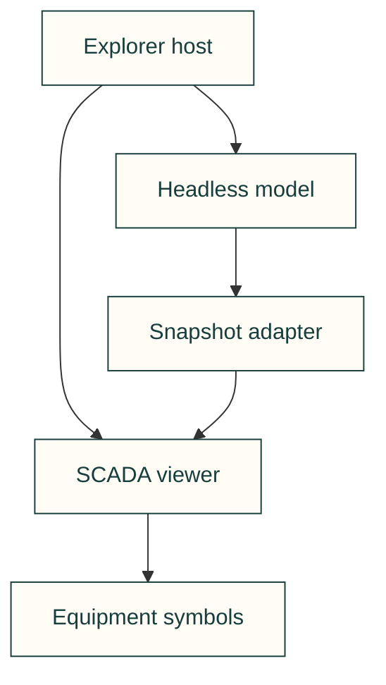

# SCADA diagrams and simulations

Use animated equipment and shared process models in cad-agent, from a single
symbol to a wastewater-treatment simulation with multiple views.

The picture shows implemented source ownership. Models and UI remain separate;
the Explorer supplies the session and host policy.

| Start here | What it explains |
| --- | --- |
| [Architecture](architecture.md) | Source owners, system/model/snapshot formats, controllers and replacement seams |
| [Local use](local-use.md) | Complete local checkout, browser examples, tools and isolated consumers |
| [Resources and growth](resources-and-growth.md) | Skills, studied references, physical local resources and future toolkits |
| [UI library](../../../software/cadagent/webkit/scada/ui/README.md) | Equipment, visual states, system format, public APIs and style guide |
| [Simulation library](../../../software/cadagent/webkit/scada/sim/README.md) | Engines, swappable equations, scenario models and limitations |
| [Equipment gallery](../../../software/cadagent/webkit/scada/ui/img/README.md) | Library-owned animated SVGs and thumbnails |
| [Simulation gallery](../../../software/cadagent/webkit/scada/sim/img/README.md) | Captured previews linked to actual source scenarios |

The Toolkit provides elements and example simulations under `/toolkit/scada/`.
The [wastewater example](../../../software/cadagent/webkit/scada/sim/scenarios/wastewater-digester/README.md)
uses editable teaching assumptions, not a measured plant model. Equipment can be
controlled or faulted through its model; several layouts and the read-only observer
share one session. The host owns sound permission and the clock.

Cad-agent contains the maintained source, examples, schemas, galleries, generators,
tests and agent procedures. No old-repository checkout, remote import or hosted
image dependency is required. Project-owned SCADA source, artwork and documentation use the
[MIT license](../../../software/cadagent/webkit/scada/LICENSE.txt).

[Practice map](../README.md) · [SCADA owner map](../../../software/cadagent/webkit/scada/README.md)
