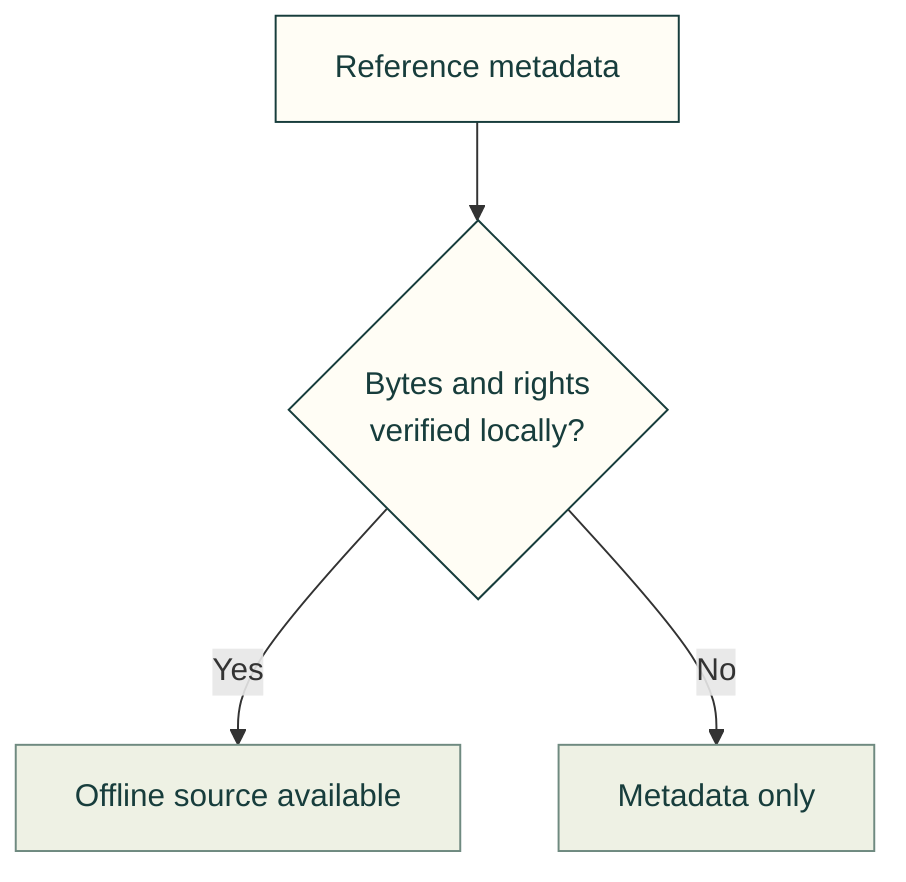

# Resources, agent skills and toolkit growth

Folder structure is part of the design process. Review it during each addition,
not only after a release: can a GitHub reader find the source, explanation,
references, examples, tests and generator without guessing which copy is canonical?

## One owner for each kind of resource

| Resource | Current owner and growth rule |
| --- | --- |
| Domain runtime and schemas | `software/cadagent/<domain>/`; browser modules under the relevant `webkit/` domain |
| Equipment artwork and previews | The library's own `img/`, linked from that library's README; no shared root image bucket |
| Model/session behavior | Headless domain code and independently checked equations, not UI event handlers |
| Public workflows | `docs/<domain>/` or an existing practice domain, with topic registration in `docs/areas.yaml` |
| Agent procedures | Canonical `.agents/skills/<name>/SKILL.md`, real prerequisites, source references and executable acceptance steps |
| Studied reference records | Existing research/reference owners and upstream registry, with evidence and rights status |
| Maintenance producers | `tools/<domain>/`; each generated artifact names its owner |
| Tests and fixtures | `tests/<domain>/`, exercising real consumers and negative controls |

The [repository rules](../../../AGENTS.md) describe when a populated domain splits,
README ownership and the no-new-root-folder rule. Apply them to mechanical, process,
PCB, panel and harness work alike. Share HUD/lifecycle/selection components only
when at least two real consumers exercise the same contract. Add a specialized
parser or solver at its domain boundary; a common shell does not erase units,
coordinate frames, identity or command authority.

## Studied references are not merely bookmarks

SCADA's [visual](../../../software/cadagent/webkit/scada/ui/docs/VISUAL_REFERENCES.md),
[power](../../../software/cadagent/webkit/scada/ui/docs/POWER_REFERENCES.md) and
[agriculture](../../../software/cadagent/webkit/scada/ui/docs/AGRICULTURE_REFERENCES.md)
guides record sources and applicability. They are physically included with the
library, alongside the assumptions and known limitations they inform.

A reference's local availability is an evidence state, not a consequence of listing its URL.

Cad-agent's existing [reference engine](../../../software/cadagent/review/references.py)
and [upstream registry](../../../software/vendor/upstreams/README.md) distinguish
catalogued, read/studied, checked and physically evidenced knowledge. Keep that
status honest. A source listed by an agent is not automatically read, a successful
simulation is not a physical measurement, and an upstream repository's availability
is not proof that its license permits redistribution.

The generated `catalog/references/records.json` feed is a mirror inventory of
reference metadata. It is not the referenced PDFs, books, source repositories or
model files. Each source still needs an exact edition/revision, acquired bytes,
hash and applicable rights before an offline claim can be made about that source.

## Physical resources on a home-hosted machine

A full source clone already includes the maintained SCADA modules, artwork,
examples and maintenance sources. Existing `software/vendor/` and webkit vendor
owners include their admitted runtime dependency bytes with notices/receipts.
Prepare the Python/Node/browser development dependencies locally as described in
[local use](local-use.md); a browser cache is not the resource archive.

External references and upstream repositories need a separate materialized
collection. Keep large mirrors outside the source checkout in a configurable home
resource store. A useful local layout is `sources/<stable-id>/<content-digest>/`
for immutable documents/artifacts and `repositories/<stable-id>/` for actual Git
mirrors. This is a storage recommendation, not an implemented acquisition command.
Private local absolute paths never belong in the public reference catalog.

Requirements for a future reference materializer

A future materializer should consume the existing stable reference/upstream IDs,
record source URL/revision or edition, exact SHA-256/commit, acquisition result,
notice/rights disposition and local availability, and verify bytes before use.
States must distinguish present-and-verified, absent, changed, restricted/manual
acquisition and failed. A source can remain useful metadata when its bytes cannot
be acquired; it must not be labelled locally available. Shared private credentials
and restricted documents must not be added to public exports.

Document an acquisition command only after its real manifest, downloader/clone
behavior, bounded IO and tests exist. The existing
reference format's archive field records a digest and redistribution disposition;
it is not a private filesystem path or a guarantee that a source was downloaded.
When that capability is implemented, prove actual local files and offline queries
with the network disabled and the original source checkout unavailable where
appropriate. This separates complete local source ownership from unfinished
external-resource acquisition.

## A repeatable growth loop

Add a concrete example, identify source/model/view/controller owners, implement and
test its behavior, record studied references/assumptions, generate its owned
previews, then update the folder and capability maps. Review the result as both a
human browsing GitHub and an agent following a skill. Remove duplicate or obsolete
instructions as canonical APIs change. Future PCB review keeps KiCad as the editor;
mechanical and SCADA renderers keep separate geometry/physics while sharing proven
presentation services.

[Guide map](README.md) · [Documentation skill](../../../.agents/skills/repository-documentation/SKILL.md)
