# Made with cad-agent

Give your project a little credit trail. Add this badge to a README, project page or gallery when cad-agent helped you build it.

<picture>
  <source media="(prefers-reduced-motion: reduce)" srcset="../img/hero/made-with-cad-agent-still.svg">
  
</picture>

The 248 × 56 badge stays sharp at any size. Its crystal, instrument ring and circuit traces move; the lettering stays readable.

## Show our badge

**Markdown.** This always-still version works anywhere Markdown images work:

```markdown
[](https://github.com/Valpatel/cad-agent)
```

**GitHub or your website.** This version animates and selects a complete still when the reader requests reduced motion:

```html
<a href="https://github.com/Valpatel/cad-agent">
  <picture>
    <source media="(prefers-reduced-motion: reduce)"
      srcset="https://raw.githubusercontent.com/Valpatel/cad-agent/main/docs/img/hero/made-with-cad-agent-still.svg">
    
  </picture>
</a>
```

You can also download [the animated SVG](../img/hero/made-with-cad-agent.svg) and [the still SVG](../img/hero/made-with-cad-agent-still.svg) and host both with your project. Use `max-width: 100%; height: auto` in your site's image styles for containers narrower than the badge. To keep a particular edition, replace `main` in the image URLs with that release's tag or commit.

<details>
<summary>Artwork and regeneration</summary>

The emblem reinterprets Valpatel's existing violet crystal and blue V in newly drawn vector geometry. The chamfered lettering is original path artwork. There are no bitmap images, external fonts, scripts or remote resources inside either SVG.

Both variants come from [`tools/anim/made_with_badge.py`](../../tools/anim/made_with_badge.py), using the toolkit's existing SVG writer and embed checks:

```bash
PYTHONPATH=software python3 tools/anim/made_with_badge.py
PYTHONPATH=software python3 tools/anim/made_with_badge.py --check
```

The still has the same geometry and unconditional motion disablement. A `picture` chooses it in the containing page, including browsers that do not forward their motion preference into an SVG image. The artwork follows this repository's [MIT license](../../LICENSE).

</details>

[Contribute](../../.github/CONTRIBUTING.md) · [Explore examples](../examples/README.md) · [Animated figures](animated-figures.md)
