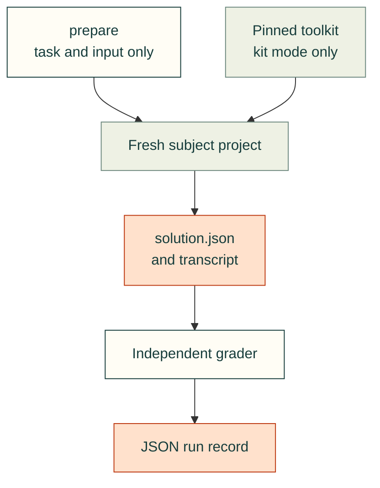
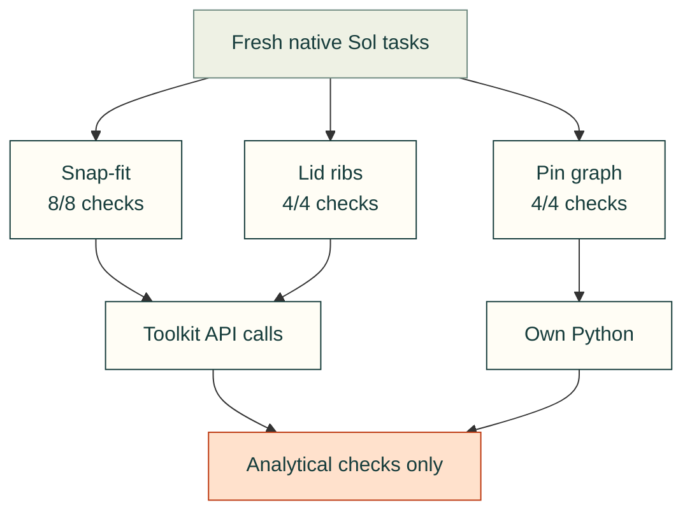

# Standard analytical evaluations

The initial corpus for [#142](https://github.com/Valpatel/cad-agent/issues/142), scoped by [#612](https://github.com/Valpatel/cad-agent/issues/612), measures three small jobs with independently recomputed checks. These are analytical calculations and explicit geometry/connectivity declarations. They do not establish that an agent can produce working CAD or a routed PCB.

## Planned CAD design evaluations

The next question is whether cad-agent helps a local or lower-cost model make better **design decisions backed by
facts**: joining, materials, dimensions, tolerances and access. The design and testing contract below is proposed;
no new adapter, native-CAD task or model performance is qualified by it. The existing v1 API and recorded attempts
remain unchanged. [Architecture study and source audit](https://github.com/Valpatel/cad-agent/issues/142#issuecomment-6831782191).

<details>
<summary>Reuse decision, execution boundary and compact evidence contract</summary>

| Candidate | Decision |
|---|---|
| [Inspect AI, ff0acb3](https://github.com/UKGovernmentBEIS/inspect_ai/tree/ff0acb3de3cb2fec0b1b35d0f46d40e234289dc8) | Provisionally use its existing ReAct agent, providers, sandboxes and logs. Pin a separate evaluation environment; MIT, Python 3.11+. Qualify it with inert controls before adoption; no core dependency, new agent loop or scheduler. |
| [Harbor, feea734](https://github.com/harbor-framework/harbor/blob/feea734de84bf2479b329dc6315a6d98d1596f4f/src/harbor/trial/trial.py) | Defer until native coding-agent system comparisons are needed. Its separate verifier is useful, but artifact collection before optional service shutdown does not establish settled outputs. Preserve original measurements rather than assuming normalized usage is complete. |
| [CADGenBench](https://github.com/huggingface/cadgenbench/tree/33304cf771fc5639144b1df9611e347251052cf8), [native FreeCAD verifier](https://github.com/gNucleus-AI/freecad-validator/tree/716159c9fd0cc1d7278c75985623858e3247fa42) | Adapt STEP validity, interface-volume and native-artifact checking techniques after testing their limits. Reference-shape similarity cannot decide whether a different design meets the requirements. |

The proposed flow is: freeze task → prepare subject → execute → stop every writer → seal exports → independently
grade → publish. Inspect owns execution; cad-agent owns acceptance. An in-session scorer cannot finalize a result.
Use one isolated output mount per attempt, verify termination of subject/tool/helper processes, then copy bounded
regular files into a sealed snapshot. Regenerate submitted CAD source in a separate capped sandbox; never import
it into the controller. Inspect's [sandbox contract](https://inspect.aisi.org.uk/sandboxing.html) must be tested,
not inferred from its name.

**Compare toolkit availability.** Both arms receive the same CAD runtime, raw-source packet, requirements and
budgets; kit adds cad-agent. Freeze resolved model/weight identity where available, quantization, effort, server
template, harness, common tools and settings per pair. Unknown identities remain unknown. Randomize and interleave
arm order, register every attempt before execution, and report observed toolkit use separately. Do not discard
kit trials that fail to find or use a tool. Live-web research is a later, separately declared condition.

A clean released checkout is not an answer-free subject bundle: it can contain test references, solved reports
and history. New controlled studies require a hashed allowlist of generic toolkit runtime, docs, skills and
sources, with controllers, task solutions, held-outs, history and provider credentials inaccessible. Do not mount
the whole checkout. The historical `59441e75` toolkit predates the shipped corpus; this changes future study
preparation, not the interpretation of those retained smoke attempts.

Disable result-cache reuse and automatic retry/log cleanup. Every retry gets another attempt ID and remains in
the denominator. [Inspect token/cost limits](https://inspect.aisi.org.uk/setting-limits.html) are checked at generation boundaries:
combine per-call output limits with an outer deadline and record requested, enforced and observed limits
separately. They are not strict billing ceilings. [Retry behavior](https://inspect.aisi.org.uk/eval-sets.html).

Extend `standard_eval.py` through explicit v2 dispatch; reject unsupported schemas and preserve v1 results.
Reuse `runner.py`'s collect/finalize boundary and the existing evidence and verdict helpers. A canonical run
manifest binds five groups, rather than parallel reports with independent numbers:

| Group | Retained evidence |
|---|---|
| Identity | Experiment, task/version, pair and attempt IDs; task, prompt, input, source-packet and subject-bundle hashes. |
| Execution | Requested/resolved model, available weight identity, runtime/hardware, settings, limits and actual settlement receipt. |
| Artifacts | Role, relative identity, media type, byte size and SHA-256 for source, exports, findings and selected media. |
| Findings | Independent CAD constraints, source applicability, design decisions, observed kit use, failure class and unknowns. |
| Resources | Elapsed time, provider-native usage, dated API prices and measured compute use; development/review effort separately. Missing values stay null. |

</details>

<details>
<summary>First experiment: a useful cover, with more than one valid design</summary>

Start with Gyropup's current shell service door. The [pinned source](https://github.com/Valpatel/gyropup/blob/3a40891962b0b0a04625e070700f1d130bea3c7b/hardware/cad/body/body_shell.py)
defines a 55 × 94 mm aperture and four receivers; extract only the recipient interface and nearby keepouts,
excluding the existing door solution. Freeze units, frames, hardware, source packet and numeric acceptance bounds
before trials. A missing or conflicting fact required by a hard check blocks launch. Printed leg geometry stays
unchanged; this is a computational WIP interface, not a measured assembly.

Require editable CAD, STEP/STL, a small fit coupon and concise source-linked decisions. Allow different material,
wall, rib and edge choices while preserving the receiver interfaces. Independently inspect reopened exports for
aperture coverage, hole axes, assembly clearance and screwdriver access; verify print/process claims against
their applicable source. Two distinct valid reference designs must pass before any model is tested. Physical fit,
strength and repeated-service durability remain unverified until tested.

Run one matched local bare/kit pilot. Diagnose a specific failure, improve the reusable fact/tool/discovery path,
then run fresh pairs and a held-out interface variation frozen before that improvement. Publish both/neither,
kit-only and bare-only outcomes and every failed attempt. A pilot demonstrates feasibility, not reliable uplift.
Add a lower-cost hosted pair after the local path works; sheet-metal and CNC tasks follow the same contract.

</details>

<details>
<summary>Testing plan: gates before model trials and publication</summary>

| Gate | Required controls |
|---|---|
| Execution | A deterministic fake provider must exercise real sandbox tools: success, malformed calls, timeout/OOM, detached writers, interrupted collection and failed cleanup. Verify denied controller/answer/synthetic-credential reads, traversal and symlink escapes. Keep missing usage unknown. |
| Artifacts | Reject missing/oversized/nonregular files, traversal, altered hashes, stale grades, wrong units and invalid solids. Prove late writes cannot affect the sealed snapshot. Separately cap source regeneration, then inspect its actual exports. |
| Design | Two different good designs pass. Wrong hole axes, uncovered aperture, colliding ribs, inadequate declared feature dimensions and obstructed assembly/service paths fail. Similar appearance, volume or subject-reported dimensions cannot substitute. |
| Facts | Omitted and incompatible material/process sources remain unresolved in the evidence rubric. Correctly identifying the gap earns no hard-design pass. Citation existence alone is insufficient; verify the fact and its applicability. |
| Transfer | Fresh sessions, frozen held-outs, original failed records and immutable task/grader versions. Report end-to-end success over all registered attempts separately from artifact success among evaluable attempts. |
| Presentation | Source/hash mutation controls; deterministic SVG regeneration; honest failure labels. Extend existing Chromium/WebKit checks for mobile overflow, focus, contrast, reduced motion, no-JS fallback, broken media and source links. |

Keep exact artifact hashes and CAD/runtime provenance. BREP bytes may differ across OCCT versions or CPU
architectures; geometric signatures help diagnose this but do not prove complete equivalence or design quality.
Preserve v1 validation and recorded results with compatibility checks; real sandbox controls are a separate
qualification gate, not replaceable by mocked cleanup tests.

</details>

<details>
<summary>One Explore experience, with small visual evidence</summary>

Extend this existing Evaluation article within the topic tree; preserve routes and the reader layout. Open with
one comparison SVG, outcome counts and the concrete limitation. Expandable checks, actual CAD downloads and
opt-in video follow. Derive every displayed number and asset link from the same run manifest; no second dashboard.

Reuse `publish.anim` CAD/SVG/raster/text primitives and the [animated-figure contract](animated-figures.md): a small
scene extracted from sealed outputs, deterministic rendering, ≤250 KB and a reduced-motion still. Reuse the
hash-bound assembly guide for actual geometry. Solver videos require actual solver results; ordinary CAD playback
is presentation. Keep code, compact manifests, selected SVGs and summaries in git. Store bulky CAD/transcripts and
selected short videos in the established artifact storage with stable identities, hashes and size limits. Retain
success and failure evidence equally; only disposable render frames/cache expire after verified collection.

</details>

Rollout: qualify the optional adapter with inert controls, freeze the door task and independent references, run
one local pair, improve a demonstrated gap, then repeat and test transfer. Implementation remains tracked in
[#142](https://github.com/Valpatel/cad-agent/issues/142); this proposal does not close it.

## Design

The corpus lives in `tests/fixtures/evaluation/jobs/`, the existing shared-data owner. A job directory contains `job.json`, `input.json` and `reference.json`. Reference solutions and graders stay in the controller checkout. The evaluation subject receives only task text and the input file in a fresh project directory; its output is `solution.json`. Run the subject outside the controller checkout, with a separately pinned released toolkit checkout for kit mode. A subject that reads the controller corpus invalidates the trial. A directory boundary is not OS security isolation: the CLI runs as the existing OS user and can access other paths.

Whole-checkout kit access below is legacy v1 smoke-test behavior, **deprecated for new controlled studies**.
Those require the qualified subject bundle and access boundary described above.



<details>
<summary>Run a trial: commands, service lifecycle and session controls</summary>

`tools/evaluation/standard_eval.py` uses only the Python standard library. Its commands are:

```sh
python3 tools/evaluation/standard_eval.py validate
python3 tools/evaluation/standard_eval.py prepare --job snapfit-sizing --mode bare --work /tmp/unique-eval-run
# A separate fresh CLI collector runs prompt.txt in project/ and settles all processes.
python3 tools/evaluation/standard_eval.py grade --job snapfit-sizing --work /tmp/unique-eval-run
python3 tools/evaluation/standard_eval.py ingest-run --job snapfit-sizing --work /tmp/unique-eval-run
```

The Linux collector has two phases. A retained user service owns all descendants,
including tools that create a new process group. Use a new unit and work path:

```sh
systemd-run --user --unit=cad-eval-example-1.service \
  --property=RemainAfterExit=yes --property=KillMode=control-group \
  --property=CPUQuota=100% --property=MemoryMax=1G --property=TasksMax=128 \
  --property=RuntimeMaxSec=210 --property=TimeoutStopSec=5 \
  --setenv=PATH="$PATH" /usr/bin/python3 "$PWD/tools/evaluation/runner.py" collect \
  --job snapfit-sizing --mode bare --harness codex --model MODEL_ID \
  --python /usr/bin/python3 --work /tmp/another-unique-run
# After SubState is exited or failed (never while the collector is running):
python3 tools/evaluation/runner.py finalize --work /tmp/another-unique-run \
  --unit cad-eval-example-1.service
# Use --harness claude for Claude Code; kit mode also needs --kit and --kit-revision.
# --python may point to an existing interpreter; the same interpreter is offered in paired runs.
```

The collector records its argv and actual prompt hash in `invocation.json`, streams stdout to `transcript.jsonl`, retains `stderr.txt`, and writes `collection.json`. It **never grades**. `finalize`, called outside that service, binds the exact unit to the collector's recorded cgroup, requires the main collector to have exited, records its retained result, stops the unit, and verifies no cgroup members remain. Only then does it write `metadata.json` and grade `result.json`. An active, mismatched, unloaded or nonempty unit is rejected. An outer timeout, OOM or unsuccessful exit cannot become a usable trial. `RemainAfterExit` preserves real service status: querying an already unloaded unit gives defaults, not evidence.

Normal OS login is preserved without credential copying. Child PATH excludes user-installed commands; the same supplied interpreter should have no ambient cad-agent import in bare mode. Kit mode adds its explicit pinned source path. This remains a cooperative same-user trial, not hostile-code isolation. The runner cannot prevent a subject deliberately leaving its service or reading another directory.

Requested output-token caps and seeds are recorded as unenforced/unknown where the CLI exposes no equivalent control. Codex requests ephemeral execution with user config, project instructions, skill discovery, memories, hooks, plugins, apps, delegation, shell snapshots and web search disabled. Claude requests SafeMode, empty settings sources and MCP configuration, no session persistence, explicit file/shell tools and no permission prompts. These controls depend on the recorded CLI versions; `fresh_session` remains null unless independently established. Claude SafeMode disables native skill discovery, so kit access uses the explicit checkout path.

Provider usage fields retain their provider meaning. Cached-input and cache-creation tokens are separate collector fields, not an invented common context measurement. Tool counts cover recognized retained events only. Resolved model, success event, malformed transcript lines and session IDs (hashed) are collected when emitted. Structured error items conservatively exclude a usable trial, including warnings that the CLI emits as error items; this is not a diagnosis that a shell command failed. Kit use remains null until independent review of actual successful tool execution; artifact correctness does not fill that field.

Kit preparation additionally requires `--kit /path/to/clean/released-checkout --kit-revision FULL_40_CHARACTER_SHA`. It verifies HEAD and a clean worktree. The prompt presents this path, its docs, canonical skills and the Python import path explicitly. This is explicit toolkit availability; it does not demonstrate native harness skill discovery. A successful toolkit command or import must be observed in executed tool evidence before a trial can claim toolkit use. Writing code containing an import, printing a command or merely reading documentation is insufficient.

</details>

<details>
<summary>Manifest, grading and run-record contracts</summary>

The manifest has exactly these fields:

| Field | Contract |
|---|---|
| `schema_version`, `version` | Integer 1 in this initial API; change job version whenever prompt, input, output contract or grading semantics change |
| `id`, `domain`, `area` | Stable job ID and the toolkit's area vocabulary |
| `task` | Subject-visible instructions, including output schema and assumptions |
| `input_file`, `output_file` | Fixed `input.json` and `solution.json`; no arbitrary grader paths |
| `grader` | Allowlisted versioned name: `snapfit-v1`, `lid-v1`, `breakout-v1` |
| `budget` | Positive integer `wall_seconds` and requested `max_output_tokens`; collectors must say if their CLI cannot enforce the token cap |
| `limits` | Plain-language scope of what passing proves |

`load_job(id)` validates every manifest. `grade_solution(job, inputs, solution)` returns named Boolean checks without executing subject code. `grade(id, work)` reads a bounded-size regular JSON output, rejects duplicate object keys, non-finite values and symlinked output, and includes manifest/input and actual grader-source SHA-256. Arithmetic checks use relative tolerance 1e-6 and absolute tolerance 1e-8. The connectivity graph and enumerated rib choices use exact comparison. Reference answers are test controls, not runtime grading shortcuts.

`prepare(id, mode, work, kit=None, kit_revision=None)` refuses a nonempty work directory. `ingest_run(id, work)` verifies the preparation hash, combines artifact checks with `metadata.json`, and hashes `transcript.jsonl`. Collector metadata fields are `harness`, `harness_version`, `model`, `seed`, `wall_seconds`, `exit_code`, `timed_out`, `tokens_in`, `tokens_out`, `peak_context`, `cost_usd`, `tool_calls`, `fresh_session`, `kit_use_observed`, and `session_boundary`. Missing measurements remain JSON null. `passed` concerns artifact checks; `trial_completed` separately requires exit 0 and explicitly false timeout. `usable_trial` also requires successful service completion, a terminal success event, zero malformed lines or structured diagnostic error items, and exactly one observed session. It concerns the recorded execution, independently of artifact correctness. None of these fields alone proves a clean session or kit use. Keep raw transcripts external to git; published records should use stable relative evidence paths/hashes and omit credentials/private paths.

A subject trial must start a new CLI session without resume/history. Bare and kit runs use the same task, numeric budget and inputs; the kit prompt adds the pinned toolkit paragraph requesting discovery and relevant tool use (or a tooling-gap report). Record the exact CLI version, argv with private paths redacted, session controls and their limits. Do not move or copy credentials, change accounts, install dependencies, or repurpose HOME/CODEX_HOME. An ordinary existing login can authorize the fresh session; it does not imply isolation from ambient settings. Preserve errors, partial transcripts and timeout status. Settle the entire service cgroup before grading to avoid accepting artifacts still being changed.

</details>

## Jobs and what they prove

- `snapfit-sizing`: independently recomputes the rounded guide-model coefficient (0.67), repeated-use/process allowable, minimum valid discrete length, root radius and hook force. The kit's `mechanical.compliant.snapfit` functions can solve this model. No contact, large deflection, creep, fatigue, manufacturing strength or coupon validation is tested.
- `lid-rib-clearance`: enumerates allowed rib center pairs and recomputes rectangular strip versus cylindrical keepout separation in XY, retained dimensions, minimum movement and deterministic tie break. It grades declarations, not STEP geometry, topology or full 3D tool accessibility.
- `connector-breakout`: recomputes the exact pin/net graph from explicit authoritative pin numbers, including the wire-side view. It catches mirror swaps, omissions, shorts and duplicates. It does not parse KiCad files or prove routing, DRC, signal integrity or electrical safety.

These jobs intentionally have complete small inputs. They do not evaluate source research, manufacturer-part selection, open-ended design, renders or real-world fit. Their simplicity may cause ceiling effects; repeated paired runs and harder geometry jobs are needed before interpreting differences between models or tool modes.

## Existing tools considered

<details>
<summary>How this corpus extends the existing evaluators</summary>

The repository's [landscape](../research/landscape.json) records CADGenBench use by agentcad/build123d-mcp and Multi-Agent-CAD's feature benchmark. Those CAD generation suites serve geometry/modeling comparison; this first corpus instead needs explicit design-rule calculations and pin declarations, so their benchmark scores are not imported or presented as equivalent. No fresh external benchmark claims are made here.

`tools/quickstart_eval.py` already grades installer/discovery transcripts. Its separation of observed evidence from subject claims informs the run-record design, but its install flow and HOME/auth routes are not reused. The vendored `kicad-mcp-pro` corpus and task-outcome/geometry/connectivity differential graders are useful for later native PCB jobs; wrapping that service for a four-net declaration would introduce unrelated runtime requirements. Existing snap-fit toolkit formulas remain available to subjects, while the controller independently expresses the published arithmetic to avoid accepting a shared solver bug. No dependencies or vendored code are added.

</details>

## Testing and initial controls

The tests must reject wrong designs and invalid execution records, as well as accept the known-good references.
An artifact passing its checks does not by itself establish a usable trial or actual toolkit use.

<details>
<summary>Negative controls, process teardown and initial test evidence</summary>

`tests/repo/test_standard_eval.py` validates every manifest and all three reference solutions. Negative controls alter length, reported strain, allowable factors, force, fillet and section; collide, overlap, move off-grid or overmove ribs; and mirror, short, omit or duplicate electrical endpoints. Reordered valid nets remain positive. Invalid JSON, duplicate keys, NaN, wrong schemas, symlinks and oversized files fail. Preparation refuses reuse; ingestion preserves unknown metrics and distinguishes an otherwise correct artifact from a timed-out trial. `tests/repo/test_standard_eval_runner.py` checks adapters, transcript accounting, inert real subprocess completion and timeout, plus active/wrong/unknown units and retained terminal failures. The opt-in `CAD_EVAL_SYSTEMD_CONTROL=1` test creates an actual user service with a detached child, proves the child survives the collector, then proves finalization stops it before grading. Default CI skips this service test explicitly; mocked unit tests are not teardown evidence.

On 2026-11-12 the focused suite passed 25 focused tests using an existing Python environment, without new packages. All three reference artifacts pass; these controller controls are not fresh model results. Actual CLI trials and any aggregate table are reported separately with model, harness, mode, observed kit use, errors and session limits. A single trial has no useful population pass-rate estimate; do not infer reliability or toolkit benefit from these controls.

</details>

## Recorded fresh-agent attempts

The arrows below distinguish API execution from a correct artifact. All three native tasks passed their analytical
checks; two CLI attempts produced no artifact and remain in the record.



The [2026-11-12 records](https://github.com/Valpatel/cad-agent/blob/main/docs/research/bench/standard-evaluation-2026-11-12.jsonl)
retain all five attempts and their hashes, outputs, selected tool-call excerpts and limitations. The toolkit was
pinned to `59441e75` (the released v0.37.2 tree). Three separate native-app conversations requested GPT-6.1 Sol;
their session metadata reports that model with maximum reasoning effort. Controller reference answers were not
provided. Independent graders checked the artifacts after each task completed.

| Attempt | Artifact checks | Observed toolkit use | Time |
|---|---|---|---|
| Codex CLI · snap-fit | No artifact | None retained; model reported a sandbox failure | 15.9 s |
| Claude CLI · snap-fit | No artifact | Provider usage limit prevented task work | 0.9 s |
| Native Sol · snap-fit | 8 checks passed | `rect_section`, `root_strain`, `deflection_force` | 62.8 s |
| Native Sol · lid ribs | 4 checks passed | `box_distance`, with local enumeration and an analytical cross-check | 112.8 s |
| Native Sol · connector | 4 checks passed | Documentation inspected; task-specific Python, no toolkit API invoked | 78.5 s |

These native trials had **unenforced budgets and no bare baseline**. They establish neither reliability nor
a causal toolkit benefit, exported CAD correctness or physical qualification.

<details>
<summary>Interpret the observations and failed attempts</summary>

The connector subject reported that it did not find an applicable pin/net declaration validator. That is a
discoverability observation for this input, not proof that the entire toolkit lacks electrical checks. Its output
still passed the independent graph checks. The snap and rib traces show actual successful API execution, beyond
an agent's claim or a written import.

The Codex CLI transcript contains a structured unstable-feature diagnostic but no retained command trace proving
the reported sandbox failure. Its original collector marked a normally completed model turn usable; the later
conservative diagnostic rule excludes it. The original record is preserved. Claude explicitly reported a provider
limit. Neither is counted as a design failure or a successful toolkit trial.

Native conversations used the working app tool interface with existing user configuration. Their wall/token limits
were **not enforced**, their effort differed from the CLI pilots, and there was no bare baseline. API tool output
was truncated, so only each new task's own local rollout supplied the audited tool records. All observed commands
were synchronous and stayed within the task and pinned toolkit. No clean-user isolation, causal toolkit benefit,
population pass rate, exported CAD correctness or physical qualification follows from these three smoke tasks.

</details>

Next, [#142](https://github.com/Valpatel/cad-agent/issues/142) retains the work on repeatable paired trials in a
working bounded environment, native CAD/PCB artifacts and source-lookup questions. These observations do not close
that broader evaluation program.
