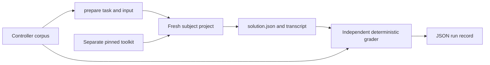

# Standard analytical evaluations

The initial corpus for [#142](https://github.com/Valpatel/cad-agent/issues/142), scoped by [#612](https://github.com/Valpatel/cad-agent/issues/612), measures three small jobs with independently recomputed checks. These are analytical calculations and explicit geometry/connectivity declarations. They do not establish that an agent can produce working CAD or a routed PCB.

## Design

The corpus lives in `tests/fixtures/evaluation/jobs/`, the existing shared-data owner. A job directory contains `job.json`, `input.json` and `reference.json`. Reference solutions and graders stay in the controller checkout. The evaluation subject receives only task text and the input file in a fresh project directory; its output is `solution.json`. Run the subject outside the controller checkout, with a separately pinned released toolkit checkout for kit mode. A subject that reads the controller corpus invalidates the trial. A directory boundary is not OS security isolation: the CLI runs as the existing OS user and can access other paths.



`tools/evaluation/standard_eval.py` uses only the Python standard library. Its commands are:

```sh
python3 tools/evaluation/standard_eval.py validate
python3 tools/evaluation/standard_eval.py prepare --job snapfit-sizing --mode bare --work /tmp/unique-eval-run
# A separate fresh CLI collector runs prompt.txt in project/ and settles all processes.
python3 tools/evaluation/standard_eval.py grade --job snapfit-sizing --work /tmp/unique-eval-run
python3 tools/evaluation/standard_eval.py ingest-run --job snapfit-sizing --work /tmp/unique-eval-run
```

The supported CLI collector runs a complete attempt and retains failures:

```sh
python3 tools/evaluation/runner.py --job snapfit-sizing --mode bare \
  --harness codex --model MODEL_ID --work /tmp/another-unique-run
# Use --harness claude for Claude Code; kit mode also needs --kit and --kit-revision.
# --python may point to an existing interpreter; the same interpreter is offered in paired runs.
```

The collector records its version-sensitive argv and actual prompt hash in `invocation.json`, streams stdout to `transcript.jsonl`, retains `stderr.txt`, then writes `metadata.json` and `result.json`. It preserves normal OS login without copying credentials, starts an owned process group, bounds wall time and confirms the owned group has settled before grading. If settlement cannot be confirmed, it records the failure and refuses to read subject artifacts. Requested output-token caps and seeds are recorded as unenforced/unknown where the installed CLI exposes no equivalent control. The Codex adapter requests ephemeral execution with user config, project instructions, skill discovery, memories, hooks, plugins, apps, delegation and web search disabled. The Claude adapter requests SafeMode, empty settings sources and MCP configuration, no session persistence, explicit file/shell tools and no permission prompts. These controls depend on the recorded CLI versions. Their presence is not proof of an empty OS-user environment; `fresh_session` remains null unless independently established. Claude SafeMode disables native skill discovery, so kit access uses the explicit checkout path.

Provider usage fields retain their provider meaning. Cached-input and cache-creation tokens are separate collector fields, not an invented common context measurement. Resolved model, success event, malformed transcript lines and session IDs (hashed) are collected when emitted. Kit use remains null until independent review of actual successful tool execution; artifact correctness does not fill that field.

Kit preparation additionally requires `--kit /path/to/clean/released-checkout --kit-revision FULL_40_CHARACTER_SHA`. It verifies HEAD and a clean worktree. The prompt presents this path, its docs, canonical skills and the Python import path explicitly. This is explicit toolkit availability; it does not demonstrate native harness skill discovery. A successful toolkit command or import must be observed in executed tool evidence before a trial can claim toolkit use. Writing code containing an import, printing a command or merely reading documentation is insufficient.

The manifest has exactly these fields:

| Field | Contract |
|---|---|
| `schema_version`, `version` | Integer 1 in this initial API; change job version whenever prompt, input, output contract or grading semantics change |
| `id`, `domain`, `area` | Stable job ID and the toolkit's area vocabulary |
| `task` | Subject-visible instructions, including output schema and assumptions |
| `input_file`, `output_file` | Fixed `input.json` and `solution.json`; no arbitrary grader paths |
| `grader` | Allowlisted versioned name: `snapfit-v1`, `lid-v1`, `breakout-v1` |
| `budget` | Positive integer `wall_seconds` and requested `max_output_tokens`; collectors must say if their CLI cannot enforce the token cap |
| `limits` | Plain-language scope of what passing proves |

`load_job(id)` validates every manifest. `grade_solution(job, inputs, solution)` returns named Boolean checks without executing subject code. `grade(id, work)` reads a bounded-size regular JSON output, rejects duplicate object keys, non-finite values and symlinked output, and includes manifest/input and actual grader-source SHA-256. Arithmetic checks use relative tolerance 1e-6 and absolute tolerance 1e-8. The connectivity graph and enumerated rib choices use exact comparison. Reference answers are test controls, not runtime grading shortcuts.

`prepare(id, mode, work, kit=None, kit_revision=None)` refuses a nonempty work directory. `ingest_run(id, work)` verifies the preparation hash, combines artifact checks with `metadata.json`, and hashes `transcript.jsonl`. Collector metadata fields are `harness`, `harness_version`, `model`, `seed`, `wall_seconds`, `exit_code`, `timed_out`, `tokens_in`, `tokens_out`, `peak_context`, `cost_usd`, `tool_calls`, `fresh_session`, `kit_use_observed`, and `session_boundary`. Missing measurements remain JSON null. `passed` concerns artifact checks; `trial_completed` separately requires exit 0 and explicitly false timeout. `usable_trial`, added by the CLI collector, also requires a terminal success event, zero malformed transcript lines and exactly one observed session. It concerns the recorded execution, independently of artifact correctness. None of these fields alone proves a clean session or kit use. Keep raw transcripts external to git; published records should use stable relative evidence paths/hashes and omit credentials/private paths.

A subject trial must start a new CLI session without resume/history. Bare and kit runs use the same task, numeric budget and inputs; the kit prompt adds the pinned toolkit paragraph requesting discovery and relevant tool use (or a tooling-gap report). Record the exact CLI version, argv with private paths redacted, session controls and their limits. Do not move or copy credentials, change accounts, install dependencies, or repurpose HOME/CODEX_HOME. An ordinary existing login can authorize the fresh session; it does not imply isolation from ambient settings. Preserve errors, partial transcripts and timeout status. Settle the entire owned process group before grading to avoid accepting artifacts still being changed.

## Jobs and what they prove

- `snapfit-sizing`: independently recomputes the rounded guide-model coefficient (0.67), repeated-use/process allowable, minimum valid discrete length, root radius and hook force. The kit's `mechanical.compliant.snapfit` functions can solve this model. No contact, large deflection, creep, fatigue, manufacturing strength or coupon validation is tested.
- `lid-rib-clearance`: enumerates allowed rib center pairs and recomputes rectangular strip versus cylindrical keepout separation in XY, retained dimensions, minimum movement and deterministic tie break. It grades declarations, not STEP geometry, topology or full 3D tool accessibility.
- `connector-breakout`: recomputes the exact pin/net graph from explicit authoritative pin numbers, including the wire-side view. It catches mirror swaps, omissions, shorts and duplicates. It does not parse KiCad files or prove routing, DRC, signal integrity or electrical safety.

These jobs intentionally have complete small inputs. They do not evaluate source research, manufacturer-part selection, open-ended design, renders or real-world fit. Their simplicity may cause ceiling effects; repeated paired runs and harder geometry jobs are needed before interpreting differences between models or tool modes.

## Existing tools considered

The repository's [landscape](../research/landscape.json) records CADGenBench use by agentcad/build123d-mcp and Multi-Agent-CAD's feature benchmark. Those CAD generation suites serve geometry/modeling comparison; this first corpus instead needs explicit design-rule calculations and pin declarations, so their benchmark scores are not imported or presented as equivalent. No fresh external benchmark claims are made here.

`tools/quickstart_eval.py` already grades installer/discovery transcripts. Its separation of observed evidence from subject claims informs the run-record design, but its install flow and HOME/auth routes are not reused. The vendored `kicad-mcp-pro` corpus and task-outcome/geometry/connectivity differential graders are useful for later native PCB jobs; wrapping that service for a four-net declaration would introduce unrelated runtime requirements. Existing snap-fit toolkit formulas remain available to subjects, while the controller independently expresses the published arithmetic to avoid accepting a shared solver bug. No dependencies or vendored code are added.

## Testing and initial controls

`tests/repo/test_standard_eval.py` validates every manifest and all three reference solutions. Negative controls alter length, reported strain, allowable factors, force, fillet and section; collide, overlap, move off-grid or overmove ribs; and mirror, short, omit or duplicate electrical endpoints. Reordered valid nets remain positive. Invalid JSON, duplicate keys, NaN, wrong schemas, symlinks and oversized files fail. Preparation refuses reuse; ingestion preserves unknown metrics and distinguishes an otherwise correct artifact from a timed-out trial. `tests/repo/test_standard_eval_runner.py` checks both CLI adapters and transcript accounting, then exercises normal completion, launch errors and timeout/group settlement with inert real subprocesses, without contacting a model.

On 2026-11-12 the focused suite passed 25 focused tests using an existing Python environment, without new packages. All three reference artifacts pass; these controller controls are not fresh model results. Actual CLI trials and any aggregate table are reported separately with model, harness, mode, observed kit use, errors and session limits. A single trial has no useful population pass-rate estimate; do not infer reliability or toolkit benefit from these controls.
