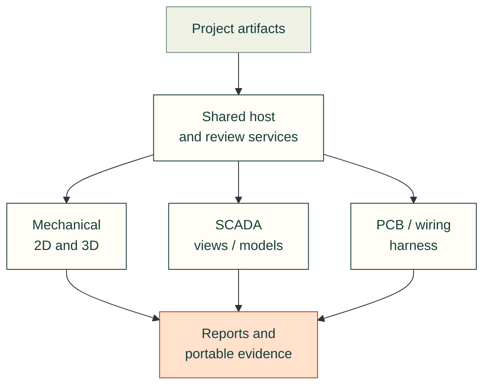

# Engineering workbench design

An implementation plan for bringing engineering viewers, simulation, instructions
and review into one maintained cad-agent toolkit.

**Status: design review, not a shipped workbench.** The source audit starts from
cad-agent `33c3f51b574bdfa9171da62c4573beaf840daa95`. This work belongs to
[#682](https://github.com/Valpatel/cad-agent/issues/682), with distribution
[#683](https://github.com/Valpatel/cad-agent/issues/683), SCADA
[#684](https://github.com/Valpatel/cad-agent/issues/684) and navigation study
[#685](https://github.com/Valpatel/cad-agent/issues/685) under
[#527](https://github.com/Valpatel/cad-agent/issues/527).

Cad-agent is the permanent home. All reusable SCADA source, models, symbols,
galleries, examples, documentation, tests, generators and agent procedures will
physically move here. The old repository remains an untouched historical example;
the maintained toolkit must work without access to it. No submodule, remote runtime
import or documentation dependency is part of the design.

The arrows below describe proposed composition, not existing imports. Each domain
keeps its own document, renderer and solver; the host composes their capabilities.

| Read next | Purpose |
| --- | --- |
| [Integration plan](integration-plan.md) | Decisions, ownership, domain boundaries and product experience |
| [Contracts](contracts.md) | Proposed artifact, viewer, session and review contracts |
| [Migration and validation](migration-and-validation.md) | Ordered implementation slices, transfer inventory and acceptance gates |
| [Source audit](source-audit.md) | Current capabilities, concrete gaps and existing tools to reuse |

The design does not replace KiCad, invent one universal solver, or require a new
application framework. Cross-viewer seamless zoom remains an experiment. Existing
standalone viewers and offline exports remain supported throughout migration.

[Practice map](../README.md) · [Web parts](../web-parts.md) ·
[Assembly guide](../assembly-guide.md) · [File viewer](../file-viewer.md)
