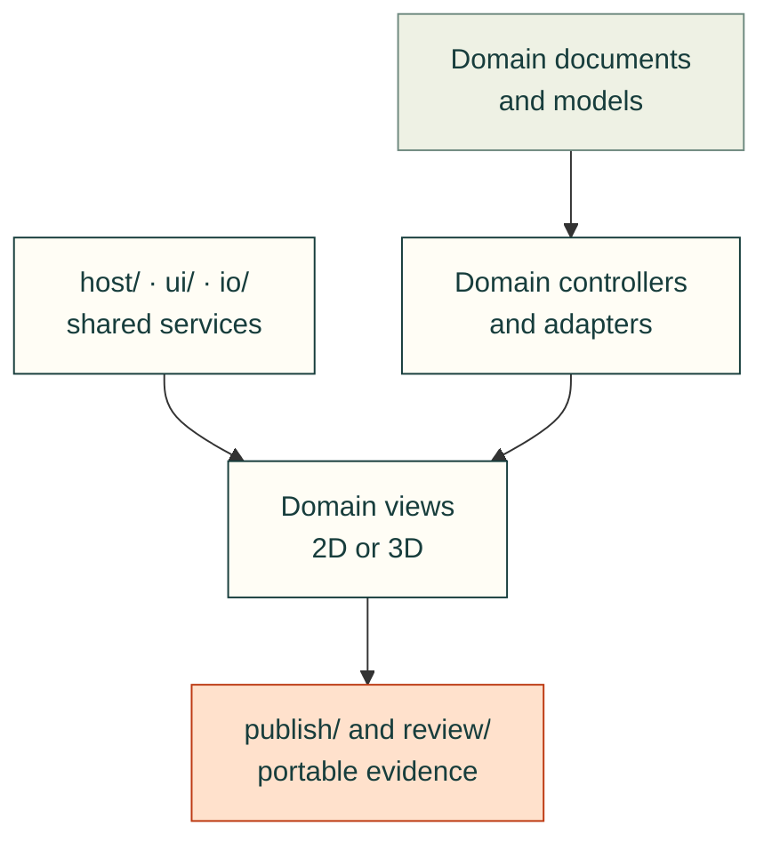

# One toolkit, specialised engineering views

**Proposed architecture for implementation review.** Cad-agent becomes the only
maintained home for the transferred SCADA toolkit. The old repository stays
untouched as a historical example. This plan has no runtime imports, submodules,
build downloads or documentation dependencies on it. The [source audit](source-audit.md)
distinguishes current capabilities from the work proposed here.

## The product and the boundary

Cad-agent serves both agents doing engineering work and people understanding,
reviewing and building that work. The same project can contain a mechanical
assembly, process system, circuit board, harness, instructions and evidence. It
needs specialised views of those artifacts inside a coherent experience, with
standalone viewers and portable reports still available.

Adopt a **thin optional viewer host over domain-owned toolkits**. It provides
layout, navigation, loading/error presentation, selection handoff and review
services. A renderer can also run without that host. Retain vanilla ES modules
and existing Python publishing; neither a new frontend framework nor a plugin
marketplace is needed to make this boundary real.

| Alternative | Decision and cost |
| --- | --- |
| Keep independent pages/iframes | Retain as compatibility and untrusted-content boundaries. They do not by themselves provide shared selection, a session or coordinated review. |
| Thin host, small adapters, domain toolkits | Recommended. Prove shared services with two existing consumers before integrating SCADA. Some viewer lifetimes and global CSS must first be repaired. |
| Universal scene/document/solver or large plugin framework | Defer. Different coordinate spaces, domain identities and clocks would make this an expensive rewrite before a useful shared contract is demonstrated. |

The dependency rule is domain document/model → domain controller/adapter →
domain view. Shared host/UI/IO may be used by multiple domains; they must not
import the SCADA solver, Three.js or KiCad parser merely to render a toolbar.
Domain models remain usable headlessly. Cross-domain mappings live in explicit
project adapters, not circular renderer imports.

The diagram shows proposed dependency direction. Host services do not own the
physics or document semantics of the domains they compose.



## What is shared, and why

| Shared ownership | First real consumers | Remains domain-owned |
| --- | --- | --- |
| Scoped theme tokens, toolbar/status/inspector/modal shell, focus and reduced motion | Ordinary assembly/STL (`createViewer`) and original-file (`createFileViewer`) viewers | Equipment symbols, layer controls, mesh probes, assembly-step contents |
| Bounded asset acquisition, cancellation and integrity receipt | Ordinary model/assembly asset reads and file-loader worker inputs | Parser formats, limits and worker implementation; model/guide validation |
| Mount lifetime, container sizing, loading/error state | Ordinary assembly/STL (`createViewer`) and original-file (`createFileViewer`) viewers | 2D pan/zoom math, 3D orbit, FEA picking, renderer resource cleanup |
| Artifact references, selection envelopes and return context | Model inspection and source-bound assembly instructions | Part/instance identity, SCADA equipment/ports, PCB UUIDs, connector cavities |
| Currentness display and assumption/evidence inspector | Existing PCB report evidence and source-bound assembly/model evidence | Each domain's validity checks and engineering conclusions |
| Annotation shell and portable sidecar format | Model/build review and later SCADA | Domain anchor resolver; review permission and persistence supplied by host |
| Run controls displaying adapter capabilities | SCADA session and later robot/result playback | Clock integration, solver commands, physical units, replay semantics |

The last row is a later extraction: identical Play icons alone are insufficient
evidence that simulation and recorded playback share a clock. Stage already has
multiple 3D consumers; keep it as a shared **3D** primitive, not a mandatory
dependency of every toolkit. Text tables, build progress and reports do not need
to become canvases to participate in the project.

## Intended source ownership

This is a destination map, **not folders to scaffold in advance**. Create populated
owners when their implementation slice lands, following the repository growth
rule. Existing URLs receive compatibility entrypoints during moves.

```text
software/cadagent/
  webkit/
    ui/                 scoped tokens and proven shared controls
    host/               viewer lifetime, capability/selection/navigation glue
    io/                 shared bounded reads and asset resolution
    model/              ordinary/packed mechanical views, inline embed, 3D Stage
    files/              original-file viewer, parsers and workers
    assembly/           guide, playback, source-bound build progress
    fea/                field/result view and its controls
    documents/          document diagrams and progressive enhancement
    calculators/        existing formula illustrations
    scada/
      ui/               viewer, symbols, states, schemas, styles, metadata, img/
      sim/              headless engines, equation providers, schemas, img/
    vendor/             existing pinned upstream layout and notices
    <legacy entrypoints retained through announced migration>
  electrical/           PCB evidence/export adapters; future panel/harness logic
  mechanical/           geometry/motion checks and domain adapters
  simulation/           robot, FEA, CFD and real solver integration
  publish/              runtime profiles, portable artifacts, reports and sites
  review/               evidence/currentness and review records
tools/webkit/scada/      metadata, gallery, topology and thumbnail generators
tests/webkit/scada/      model, UI, browser and transfer regression tests
docs/practice/scada/     APIs, format/model guides, style and authoring references
docs/examples/          target-owned SCADA examples and catalogue entrypoints
.agents/skills/         canonical reusable workflows; installed by existing kit
```

The existing repository-level tests/scripts convention takes precedence over
copying the old package tree verbatim. Each library still owns its `img/` gallery,
schemas and runtime metadata; its README links the target-owned generators and
tests. Electrical and harness libraries will own their own galleries when built.
An unrelated export must not include those galleries just because they live under
`webkit/`. Runtime inclusion is controlled separately by profiles.

The model modules may be shipped as browser/Node assets under `scada/sim` without
becoming UI code. Keep their DOM-free dependency boundary and public export map.
Any eventual npm distribution is built from this same target source; introducing
a second maintained source package or repository is out of scope. Python solver
adapters stay in the appropriate existing Python domain rather than translating
all JavaScript models for symmetry.

## Domain capabilities and planned extensions

| Toolkit | Current basis | First integrated experience | Deliberate limits |
| --- | --- | --- | --- |
| Mechanical 3D | Packed models, STL/STEP/3MF file viewer, Stage, assembly/explode, FEA and robot tools | Inspect a model, select a mapped assembly instance, open instructions, return with camera preserved | Original-file meshes may lack assembly identity; model names are not universal IDs |
| Mechanical 2D | Existing SVG/diagram and document publishing | Source-bound drawing review with sheets/layers, units and explicit object map where available | DXF/native drawing semantics require a selected importer; SVG proximity conveys no assembly relationship |
| SCADA | Framework-free symbols/viewer; separate v1/v2 engines and swappable providers | One process session, two layouts, equipment inspector, editable assumptions/fault controls, read-only observer | Normalized example kernels are not a general hydraulic/multiphysics solver |
| PCB | Existing KiCad-related evidence, routing metrics and parts-library tooling | Read-only layer stack, board side, UUID-based picking, component/net cross-probe, existing ERC/DRC evidence | KiCad stays the editor; artwork-only Gerber has no inferred net semantics |
| Electrical panel/wiring | Existing area ownership; viewer planned | Schematic sheets and physical panel linked by explicit terminal/device/net IDs | Schematic coordinates are not physical placement; no inferred connectivity or live PLC control |
| Harness | Existing area ownership; viewer planned | Connector/pinout, bundle topology, wire/splice tracing, linked build instructions | Mating face, cavity identity and physical cut length cannot be inferred from drawing orientation or line length |
| Reports/instructions | Existing review/report/site/release pipeline | Readable evidence, source-bound steps and portable comments reachable from the same project | A comment, procurement checkbox, simulation action and engineering approval are different operations |

Future-domain planning descriptors belong to the existing topic/catalogue system
with `planned` availability and no enabled Launch action. Implemented input formats
must be listed separately from proposed ones. Do not create empty renderer folders
or mark existing electrical tools unimplemented merely because their new viewer
is still planned. Each importer needs positive/negative fixtures before promotion.

## A coherent human interface

The host sizes a contained viewer to the space its page or app provides. The
camera surface has no horizontal or vertical scrollbars; mouse/touch pan and zoom,
keyboard navigation and an always-visible **Zoom to fit** provide navigation.
Keep inspector/forms accessible, with normal content scrolling where needed, and
preserve top-level page scrolling. Existing poster-first inline model embeds keep
their page-scroll gesture policy; entering the contained workspace changes that
policy explicitly.

Use the shared token/control layer for typography, contrast, focus, status,
spacing and theme selection. SCADA retains its animated equipment vocabulary.
State needs a readable label as well as colour or motion. Inspector text must not
shrink with diagram zoom. Reduced motion, muted audio, pause and fault status
remain discoverable. The host owns audio enablement and alarm deduplication;
switching layouts must not restart sounds or duplicate alarms. Expensive effects
and render loops pause or reduce detail according to explicit visibility policy,
without silently pausing the simulation session.

**Explore** presents design work: assemblies, systems, investigated alternatives,
examples and their evidence. **Toolkit** presents reusable capabilities: viewers,
symbol/state galleries, simulation adapters, build/report tools and agent skills.
Generate both from the existing catalogue/area owners, preserving IDs, `/explore`,
`/catalog`, search/deep links and machine feeds. Add a capability landing route
such as `/toolkit`; retain `/docs/toolkit` as the command/Python manual. Do not
reinterpret the catalogue's existing external-project kind as a first-party
artifact. A versioned metadata extension should express these relationships.

## Navigation across toolkits

A project relationship graph may connect a process, pump assembly, motor board,
harness, BOM and report. Its edges describe explicit relationships such as
`contains`, `represented-by` or `evidence-for`; they do not create a physics or
electrical connection. Navigation records artifact revision, viewer/view ID,
selection and opaque camera/step state so Back returns to the prior context.

The first proposed experiment uses explicit node portals and breadcrumbs. Study
semantic level of detail within the diagram separately: summary → equipment →
detail, with hysteresis and readable aggregate alarms/unknown states. Seamlessly
zooming from a graph into a PCB or 3D renderer remains unselected research. It
requires resource budgets, cancellation and clear coordinate transitions; visual
continuity is not evidence of a common coordinate space or solver.

## Decisions carried into implementation

The chosen direction is one maintained repository, specialised domain modules,
small shared services, optional host composition and compatibility-first moves.
The [contracts](contracts.md) define the proposed boundaries; the
[migration plan](migration-and-validation.md) gives finite implementation slices.

Before code redistribution, record source rights and preserve notices: the
transfer candidate declares private/UNLICENSED packages while cad-agent declares
MIT. This design does not silently relicense that code. Before selecting a new
PCB/drawing parser or remote comment store, compare concrete fixtures and existing
tools. Neither decision blocks the initial host/packaging work. Model units,
confidence and external-solver choices remain explicit domain configuration.

[Design map](README.md) · [Source audit](source-audit.md)
