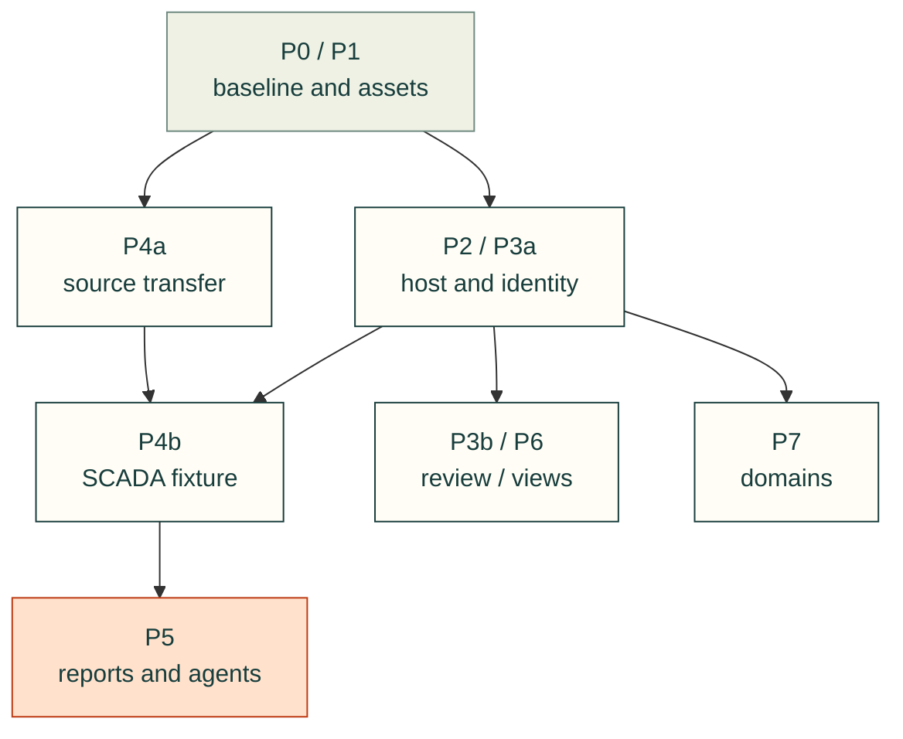

# Migration and acceptance plan

**Design review; the slices below are proposed work, not completed checks.**
Cad-agent becomes the permanent home of the reusable SCADA toolkit, including its
maintenance machinery. Start with current viewer distribution and lifetime before
importing the full corpus. Keep the original repository untouched as a historical
example; maintained code, guides and agent procedures must work without it.

Each slice gets a bounded implementation issue under the existing design owners,
an isolated branch, independent review, evidence and a rollback commit. Preserve
standalone viewers and frozen releases throughout. Do not close an ongoing program
because one slice passes. [Contracts](contracts.md) defines the proposed interfaces;
[source audit](source-audit.md) identifies the current code they must accommodate.

## Order and ownership

Arrows express the minimum implementation prerequisites, not current imports.
Source transfer and host work can proceed in parallel after distribution is ready.
Portable comments, later viewer adaptation and navigation experiments do not block
the first SCADA fixture. The table and slices distinguish their smaller PRs.

The paths below are target owners, not instructions to pre-create empty folders.
P1 separates the runtime contract from subsequent populated-module moves. New
SCADA ownership is created in P4a. The letters below name separately reviewable
PRs, not one broad change per phase. No first PR combines distribution changes,
the full code import and a new shell.

| Slice | Existing design owner | Main target owners |
| --- | --- | --- |
| P0–P1 | [#683](https://github.com/Valpatel/cad-agent/issues/683) | `publish/`, package data, `webkit/`, CLI and distribution tests |
| P2–P3 | [#682](https://github.com/Valpatel/cad-agent/issues/682) | `webkit/{ui,host,io,model,files,assembly}/`, `review/` |
| P4–P5 | [#684](https://github.com/Valpatel/cad-agent/issues/684) | `webkit/scada/`, `publish/`, canonical agent kit, evaluation |
| P6 | [#527](https://github.com/Valpatel/cad-agent/issues/527), [#104](https://github.com/Valpatel/cad-agent/issues/104) | `webkit/{fea,assembly,documents}/`, existing site compiler/catalog |
| P7 | Electrical areas in `docs/areas.yaml` | `electrical/`, future populated review adapters in `webkit/` |
| Navigation | [#685](https://github.com/Valpatel/cad-agent/issues/685) | Host routing and a bounded project-graph example |

The first implementation tickets are [#690](https://github.com/Valpatel/cad-agent/issues/690)
for P1a and [#691](https://github.com/Valpatel/cad-agent/issues/691) for the two-viewer
host. Both are bounded and labelled for design review; later PRs are created when
their prerequisites and fixtures are concrete.

## P0 — Transfer inventory, rights and compatibility baseline

Record exact source/target commits and an old-path → target-owner inventory for
runtime, schemas, model metadata, examples, scenarios, images, generators, tests,
docs, skills, notices and historical evidence. Every source item needs a disposition:
transferred, regenerated from a transferred owner, historical-only, or excluded with
a reason. Reconcile the release9.3 inventory of 142 equipment types, 97 variants,
60 scenarios and 195 views; counts alone do not prove that their dependencies moved.

Record ownership and redistribution terms before public code import. The source
packages currently say private/UNLICENSED; retaining provenance does not silently
make them MIT. Preserve original terms until the applicable rights disposition is
recorded, including any third-party assets. Plant inputs, workbook, photographs,
hosting identity and product-only policies are outside generic toolkit publication.
Their retention decision must be explicit; exclusion does not authorize deletion.

Capture the existing root viewer URLs/imports, CLI full-copy behavior, wheel contents,
assembly reader archive membership/size, report/currentness behavior and browser
journeys. Include both working behavior and known defects. Keep this baseline and
the eventual transfer receipt in cad-agent; old URLs may appear only as historical
provenance, never as installation or maintenance dependencies.

**Done when:** the inventory has no unexplained items, rights blockers are explicit,
and current installed/copied/offline consumers have reproducible baselines.
**Rollback:** documentation/inventory changes only. P1 may proceed while unresolved
SCADA redistribution terms continue to block P4 code publication.

## P1 — Runtime profiles and a compatibility-safe existing kit

**P1a, first implementation PR:** extend the current release asset inventory into a versioned profile/closure owner
under `software/cadagent/publish/`. Cover ESM, CSS URLs/imports, workers, WASM,
decoders, fonts and notices with exact versions/hashes. Explicitly list dynamic
dependencies; a static import scan alone cannot prove closure. Keep the capability
catalog and project artifact document separate from this distribution manifest.
Start with the existing assembly-reader closure and standalone viewer entry paths.
Do not move modules in this PR. Compare a source-free wheel and extracted offline
assembly export, with missing/tampered dependencies as negative controls.

**P1b:** adopt the same resolver in CLI/local/static/public-site consumers. Keep
full-copy behavior as the default while adding explicit profile use in exports.
Owned-file update receipts can be a separate follow-up to this consumer migration.

**P1c, one domain move per PR:** move existing runtime modules into populated `webkit/{ui,io,model,files,assembly,fea,documents}/`
owners. Keep Stage as a 3D primitive in `model/`; SVG viewers need no Three.js import.
Retain legacy entry files and URLs, adapting imports and HTML boot references.
Update `pyproject.toml`, `cli.py:cmd_webkit`, `publish/site.py`, `publish/release.py`
and `tools/site/` for the affected move. Preserve the CLI's full-copy default. Profile-specific
exports omit unrelated viewers, galleries and development assets.

Replace the broad flat-folder exception through a reviewed layout-gate change:
canonical implementations are grouped; any retained root compatibility files are
enumerated, small forwarding entries with tested exports/URLs and an announced
removal release. Do not hide new root implementations in that allowance or relax
the general folder limit. The first host proof need not wait for every domain move.

Use an owned-file manifest for copied-kit updates: remove only files previously
recorded as toolkit-owned and unchanged, preserve project edits, and report
conflicts/unknown stale files. Never infer ownership from a filename alone.

**Done when:** a built wheel outside its removed build checkout loads all nested
dependencies; copied/local/static/public-kit consumers retain old URLs; an assembly
archive carries only its closure and notices. Missing/tampered CSS, worker, WASM and
notice fixtures fail. Test copy upgrades with project-created and edited files.
**Rollback:** revert one move/profile consumer at a time through retained entries;
never rewrite published frozen releases. Depends on P0 compatibility evidence.

## P2 — Scoped host with two existing consumers

Introduce only the common contract proven by `createViewer` (ordinary assembly/STL manifest) and
`createFileViewer` (original-file input). `webkit/host/` owns mount lifetime, cancellation, resize, focus, active
presentation and host services. `ui/` owns scoped tokens, toolbar/status/inspector
primitives; `io/` owns shared bounded acquisition. Domain adapters retain parsing,
camera meaning, object validation and renderer resources. Keep standalone entry
points usable without loading a project host.

Prove independent sibling mounts, resize and teardown before generalizing controls.
Contained canvases pan/zoom with mouse, touch and keyboard and expose pinned Fit;
page and inspector/form scrolling remain available. Pointer gestures cannot move
another viewer. Reduced motion alters presentation, not solver/playback state.

**Done when:** two unlike current viewers load in one page, survive rapid switch,
detach during fetch/worker parsing and repeated reopen, with no leaked listeners,
workers or WebGL contexts. Test wide/narrow containers, keyboard focus, Fit,
fallback/error states and reduced motion in Chromium and WebKit.
**Rollback:** disable host mounting while retained standalone entries still work.
Depends on P1a and the affected consumer/owner moves, not a complete webkit rewrite;
do not extract speculative shared renderer or camera classes.

## P3 — Revision identity, build selection and portable review

**P3a:** implement artifact/object references and explicit mapping adapters for ordinary model
instances and source-bound assembly steps. Add selection propagation with origin
tokens and bounded subscriptions; loops and missing mappings must be visible.
Keep document identity, session state, presentation state and progress separate.
Comments, completion checkboxes, engineering approvals and process commands have
different authority and must not share a generic writable flag.

**P3b, independent follow-up:** implement a portable review sidecar and export/reopen path in existing `review/`
and `publish/` owners. Local annotations may identify their author as unverified;
they are not authenticated sign-off. A future remote store supplies identity,
permissions and conflict handling through a separate adapter. View-only model
access may still allow comments when that independent review capability exists.

**Done when:** model → build → model preserves the artifact and selected instance;
wrong revisions, deleted objects, duplicate labels and unresolved mappings never
silently retarget comments. Round-trip sidecars preserve anchors and provenance.
Existing source-bound assembly progress/currentness behavior remains intact.
**Rollback:** retain existing independent review groups and legacy progress stores;
new sidecars remain exportable and never overwrite old sign-off records. P3a depends
on P2; P3b follows P3a and does not gate SCADA source transfer or its first fixture.

## P4 — Complete source transfer, one integrated SCADA fixture

**P4a:** physically transfer the reusable corpus after P1 prevents unrelated archive growth.
Commit the full library/scenario/gallery maintenance source early in this slice;
wire one representative public fixture first. Catalog remaining examples with their
actual integration status. A first-fixture milestone must not silently discard the
other scenarios, types, variants, states, examples or provenance.

| Transferred content | Permanent target owner |
| --- | --- |
| SVG equipment, registry, viewer, controls and styles | `software/cadagent/webkit/scada/ui/` |
| Headless v1/v2 engines, equations, schemas and metadata | `software/cadagent/webkit/scada/sim/` |
| Symbol/state previews and model/scenario previews | `scada/ui/img/` and `scada/sim/img/`, integral but optional runtime assets |
| Reusable scenario JSON and focused package examples | Their `scada/sim/` or `scada/ui/` owner; integrated project fixture in `docs/examples/` |
| Generation, gallery, capture and transfer checks | `tools/webkit/scada/`, with source-relative inputs and a README |
| Model, component, scenario and browser tests | `tests/webkit/scada/`, registered in actual test entrypoints |
| Maintained APIs, authoring, style and adaptation guides | `docs/practice/scada/`, with package maps pointing locally |
| Repeatable agent procedures and scoped instructions | Canonical `.agents/skills/` and affected target `AGENTS.md` files |

Keep UI and simulation import graphs independent: model tests run without DOM and
UI imports no solver. Preserve stable component IDs, schema versions, public exports
and compatibility tests. Preserve actual v1/v2 equation providers, atomic binding
changes, owned provider state and exact replay; do not replace these with a guide.
Whole external solvers retain the separate viewer-adapter seam. Provider receipts
bind implementation bytes/dependencies as well as declared versions and parameters.

**P4b:** the first integrated fixture has two layouts, one session/clock, a read-only observer, editable
assumptions, one fault/repair experiment and compatible snapshot restore. Include a
provider swap with an independently calculated expected result. Keep normalized
kernel units explicit; physical local equations do not establish a general network
solver. Sound/effect policy belongs to the host and must not replay old incidents.

**Done when:** the inventory reconciles; complete corpus tests/generators run in
cad-agent; the first fixture works from installed/copied/offline assets; one command
updates both layouts once and view removal cannot reset/double-tick the model.
Invalid commands, provider failures and snapshot mismatches reject atomically.
**Rollback:** keep SCADA capability disabled and preserved source available for repair;
existing domains still use their tested profiles. P4a depends on the inventory,
recorded rights and distribution closure/exclusions (P1a/P1b). P4b additionally
depends on P2 and P3a, not portable comments or the later agent evaluation.

## P5 — Reports, installer readiness and qualified agent workflow

Use existing `cad.steps`, `cad.checks` and `cad.html_pages`. A Node-backed producer
needs an explicit Python wrapper because `steps.run` names a Python script; do not
document a nonexistent `cad-agent scada` command. The wrapper propagates nonzero
exit, timeout and missing output, then validates a strict receipt binding required
system/config/provider inputs, tool versions and output hashes. Currentness follows
those required inputs; a plausible old pass file cannot conceal producer failure.

Adapt transferred skills to target paths and executed commands. Extend
`agentkit.py` readiness for actual Node/browser requirements before adding metadata
keys. Test checkout, copied-skill and explicit-source modes honestly; the existing
installer does not promise standalone wheel-only skill installation. Register
skills/pages in `docs/areas.yaml` and the actual plugin/catalog discovery path.
Qualify a SCADA evaluation job and independent grader with good/defective outputs
before running a fresh-agent trial; existing analytical graders do not cover SCADA.

| Procedure to bring into the canonical agent kit | Permanent responsibility |
| --- | --- |
| `scada-component-authoring` | Registry/schema entries, distinct symbols and animated states, model placeholders, library-owned previews and component tests |
| `scada-system-authoring` | System JSON, stable equipment/port IDs, multiple layouts over one model, editable assumptions and scenario validation |
| `scada-model-adaptation` | Replace executable providers or complete adapters, state/units/provenance contracts, independent equation cases and replay/failure tests |
| `scada-viewer-review` | Screen-by-screen readability, controls, fault states, audio/motion, container gestures, lifecycle and browser evidence |
| `repository-documentation` | Adapt to cad-agent's area map, folder/style rules, generator ownership and executable link/diagram checks; do not install a conflicting duplicate policy |
| `scada-transfer-readiness` | Use during the one-time migration, then retire or fold its durable consumer checks into normal target maintenance |

Keep instructions beside the APIs they maintain, with scoped `AGENTS.md` files
for actual domain rules. Skills call the existing work-tracking, review and supply
chain workflows rather than inventing a parallel governance loop. Add domain-neutral
viewer-authoring procedures only after another implemented toolkit demonstrates
that the same operations and checks apply.

**Done when:** valid, dangling-port, stale/missing-input and producer-failure cases
reach the report correctly; installed skills complete one bounded author/review
task using target-only resources. Record deterministic tests and agent-trial evidence
separately. **Rollback:** retain raw results and failure receipts; disable the new
integration without weakening existing report validation. Depends on P4.

## P6–P7 — Existing views, discovery and subsequent domains

**P6:** adapt existing FEA and build viewers to the proven host incrementally. Fix
container/global-overlay coupling without translating their domain models. Reuse
the existing site compiler and catalog for Toolkit capabilities versus Explore
projects/evidence; preserve current catalog IDs, routes and API-manual anchors.
Capability cards expose supported formats, availability, limits, gallery, examples,
API and agent workflow. Planned adapters have no enabled Launch action.
Acceptance includes existing assembly playback/releases, FEA result controls and
offline reports, plus real cross-links and accessible narrow-screen navigation.
Rollback selects old entries/catalog projections. Existing viewer adaptation
depends on P2 and applicable P3a identity, and can proceed alongside SCADA. General
discovery can follow implemented capability metadata; SCADA Launch requires P4b,
and an evaluated-agent claim requires P5. Neither gates unrelated FEA work.

**P7a:** add read-only PCB layer/net/component review from version-pinned KiCad
exports, with UUID/refdes mapping and existing ERC/DRC evidence. KiCad remains the
editor. Reuse `electrical/pcb.py`, `pcb_routing.py` and library utilities where they
fit; refresh upstream/license research before choosing any parser dependency.
Test layer order/visibility, units, native IDs, net highlighting, mismatched source
hashes and unresolved comment anchors. No CAD pass implies fabrication readiness.
**P7b:** then add panel/wiring and harness review with explicit terminal/pin/cavity,
wire/net/shield, mating-face orientation and route-versus-schematic semantics.
Stub capabilities first; create runtime folders only with an actual adapter.
Rollback disables each new capability while keeping portable original files and
review sidecars. Each domain needs its own bounded issue and fixtures after the
host/identity and applicable review contracts, not completion of all SCADA work.

The separate navigation experiment opens a typed artifact from a project graph and
returns to the same graph/camera/selection context through browser history. Bound
heavy renderer mounts and cancel superseded loads. Prove explicit portals first;
semantic LOD and seamless cross-renderer zoom remain separate research with
performance, alarm aggregation and accessibility gates. Logical graph positions
never imply physical coordinates or simulation coupling.

## Executable validation and retirement gate

These commands already exist; they are entrypoints to extend, not evidence that
the proposed checks have run. Use the declared Python/Node/browser prerequisites.

| Existing entrypoint | Proposed coverage to add |
| --- | --- |
| `PYTHONPATH=software python tests/cli/test_init.py --wheel-smoke` | Actual committed-source wheel build, install and source deletion; the ordinary pytest entry does not invoke this separate smoke |
| `python -m pytest -q tests/cli/test_init.py tests/publish/test_release_guides.py tests/publish/test_site.py` | Removed-source wheel, profile closure, copied/static/offline consumers and guide size/membership |
| `npm --prefix tools/site run test:webkit-unit` | Nested host/adapter/SCADA tests; its current globs require updating |
| `npm --prefix tools/site run test:file-viewer` | Two-consumer host cancellation, resize and lifecycle |
| `npm --prefix tools/site run test:assembly-guide` and `test:assembly-release` | Source-bound selection/progress and frozen release compatibility |
| `python -m pytest -q tests/cli/test_agentkit.py tests/repo/test_standard_eval.py tests/repo/test_standard_eval_runner.py` | Real readiness, local skill paths and qualified new job/grader |
| `npm --prefix tools/site run test:site` and `test:diagrams` | Discovery, preserved routes, responsive presentation and diagram rendering |
| `python -m pytest -q tests/repo/test_areas.py tests/repo/test_layout.py tests/repo/test_skills.py` | Registered owners, scoped instructions and canonical procedures |

Each slice adds focused positive and negative fixtures and records exact commands,
commits, consumers and results. Browser harnesses must run through both supported
browser suites; package success alone cannot establish readability or gesture
behavior. Preserve provider/default-state regression baselines during transfer.
The normal CI, independent review and release gates remain required.

Before declaring cad-agent the complete home, remove access to the old checkout and
block its repository/site domains in a clean-room run. Build runtime profiles,
regenerate metadata/gallery/docs, execute all transferred scenario checks, install
skills, run the first project fixture and reopen its exported report. Scan active
imports, commands, docs, CSS/assets and manifests for old-repository dependencies;
allow only explicitly historical provenance entries. Record a transfer manifest,
not a dependency on a remote source archive. Keep the original repository unchanged;
this completion gate concerns independence, not deleting history or old hosting.

[Design map](README.md) · [Integration plan](integration-plan.md) ·
[Contracts](contracts.md) · [Source audit](source-audit.md)
