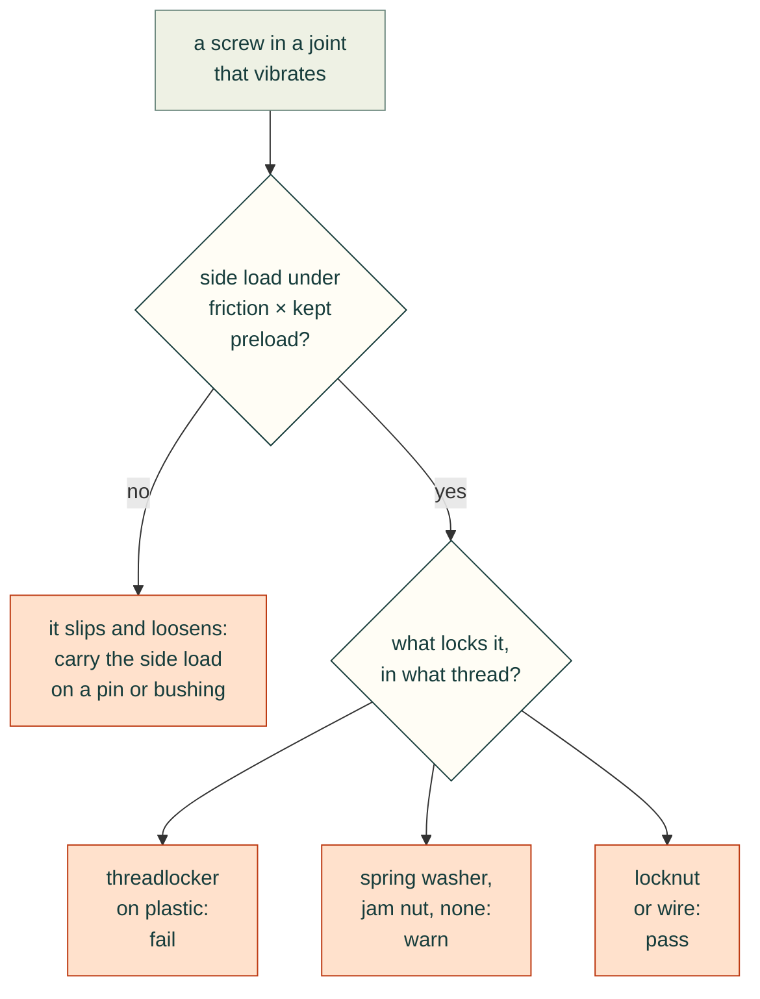
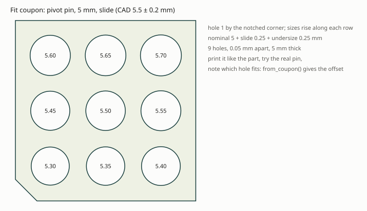

# Printed load-bearing joints

A printed part that carries load usually fails at a joint: an eye round a pin, the root of a boss, a screw. Those
failures are often found only after the part is printed: a hole worn oval, a boss snapped off along a layer line, a
screw backed out, a pin that will not go in. `cadagent.mechanical.printed_joints` checks the joints before printing,
and `cadagent.manufacturing.fit_coupons` makes the first print a calibration of the fits. Each check returns pass,
warn or fail with its margin, the source of every number and its limits. **A check screens a design. It does not
rate one: print the part or a coupon and test it.**

| Pitfall | Check | What it computes | Fix it points to |
|---|---|---|---|
| A pin wears or tears its printed eye | `pin_eye` | bearing, shear-out and net-tension stress, each against the layers; whether the eye fails gradually or suddenly | a metal bushing, more edge distance, printing the eye flat |
| A boss or rib snaps off along a layer at its root | `root_peel` | the root's bending stress across the layers; the clamp a through-bolt must keep to hold the layer seam closed | a threaded rod and nuts through the boss, a wider root |
| A screw backs out of a vibrating joint | `thread_locking` | transverse slip (Junker), the locking element against the thread it is in, preload held by plastic | carry side loads on a pin or bushing; a locknut on a through-bolt; no threadlocker on plastic |
| Pins, bushings, bearings and inserts do not fit the printed holes | `fit_coupons` | a coupon per fit, holes swept round nominal + allowance + the process profile's undersize, and a measurement sheet | the hole size that fitted on the coupon |

## A pin through a printed eye


*Drawn by `tools/printed_joint_figures.py` from `pin_eye` on a worked example: a 5 mm pin pulling 900 N through an
eye 6 mm thick in Bambu PETG Basic, its centre 10 mm from the end, 16 mm wide, bare or with an 8 mm metal bushing,
printed flat (pin upright) or on its side.*

`pin_eye` takes the three classic sections of a lug: **bearing** on the hole, P / (D t), and **net tension** across
the hole, P / ((w − D) t) (Shigley 10th ed., Section 8-12); **shear-out** along two planes from the hole's sides to
the end, P / (2 t (e − D/2)), the usual lug convention for the mode Shigley names. Each nominal stress is resolved on the print's layers by the criterion of the FEA
[layer check](toolkit.md#stiffness-and-strength-cadagentsimulationfea) (`cadagent.simulation.fea.layer_modes`): opening across the layers and shear along them
against the across-layer strength, the rest against the in-plane strength. What the example shows:

- **Bearing is the first worry in a bare eye.** 900 N on a 5 mm pin in 6 mm of PETG is 30 MPa. The check holds it
  to the in-plane datasheet strength, 48 MPa: a factor of 1.60, a warn. That is a cautious stand-in. Printed PLA and
  ABS reached 107 to 189 MPa ultimate in bearing (Khosravani et al., 2023), but a held bearing load creeps the hole
  oval long before.
- **A bushing spreads the bearing but costs edge distance.** An 8 mm bushing brings bearing to 2.56. Its hole is 8 mm
  now, so less plastic is left beyond it: shear-out falls from 2.77 to 2.22.
- **On its side, the shear-out planes are layers.** With the pin lying in the bed plane, the two shear-out planes
  (and the line along which the end splits) are layer planes, so shear-out is judged against the across-layer
  strength: 2.02 bare, 1.62 bushed. The `layers` row warns whenever the pin is more than 10° off the build direction.
- **The failure mode.** A short or narrow eye is more likely to break suddenly in net tension, shear-out or cleavage
  than to yield in bearing. Printed PLA failed in bearing from e/D 3 and w/D 6 (ASTM D5961's advice), but printed ABS
  cleaved there and needed 4.5 and 9 (Khosravani et al., 2023). The `failure mode` row takes PLA's ratios for PLA,
  ABS's for ASA, and ABS's, the stricter, for a filament with no test (PETG, CoPA, PA6-CF), and warns below them,
  whatever the stresses.
- **A pin that turns** (`pivots=True`) in a bare printed bore wears it: the `pivot` row warns until a bushing carries
  the rotation.

## The root of a boss or rib


*Drawn by `tools/printed_joint_figures.py` from `root_peel` on a worked example: a Bambu PLA Basic boss 16 mm across
on a 5.5 mm bore, loaded 20 mm above its root, with an M5 rod tightened to 3 N·m.*

A boss or rib built upright and loaded from the side bends at its root, and its bending stress, M c / I, crosses the
layers: the bond peels open on the tension side. `root_peel` checks the tension side, the compression side and the
neutral axis (shear: 4V/3A for a solid round, up to 2V/A for a thin tube, 3V/2A for a rectangle) against the layers.

In a highly stressed joint, a common fix is **a threaded rod and nuts through the boss**: its preload squeezes the
layers together, so a side load must first undo that squeeze before the seam opens. `root_peel` with
`bolt=through_bolt(...)` puts a number on it:

- **Closed.** The seam stays shut while the kept preload is at least the root's bending stress times its area
  (1102 N for a 12 mm boss at 100 N; 894 N for the 16 mm one). The `layers closed` row warns below it: a seam that
  opens on every step fatigues.
- **Kept, not tightened.** Torque gives preload only through a nut factor (0.18 to 0.30, Shigley's Table 8-15), and
  plastic in the clamp relaxes. The check counts on the least preload times `retained`, 0.5 by default, an assumption:
  no long-term preload figure for printed plastic was found ([#230](https://github.com/Valpatel/cad-agent/issues/230)
  holds the relaxation data).
- **Not crushed.** The most preload, plus the bending, squeezes the compression side. In the example the rod at
  3 N·m keeps the 16 mm boss closed, but squeezes it to a factor of 1.47, a warn. `advice["torque_window_nm"]` gives
  the torque that keeps it closed (2.68 N·m and up) against the torque the squeezed side takes (1.99 N·m at most):
  here no torque does both, so widen the root. For the 12 mm boss the two ends are far apart (3.31 N·m against
  0.42), so the rod alone cannot save it.

## A screw that backs out



A screw loosens when the joint slips sideways under its head and in its thread (Junker, 1969): a joint that slips
loses its preload, and friction or a prevailing-torque nut does not stop it turning off. `thread_locking` checks that friction holds the side load: the friction of steel on plastic is taken at its low
end (0.20, Covestro's table), on the preload the plastic keeps. Then it checks the locking element against the
thread it is in:

- **An anaerobic threadlocker on a printed thread fails.** Henkel's own data sheets do not recommend it on
  thermoplastics, where it can stress-crack the part. In an insert it warns: it wicks out onto the plastic.
- **A helical spring lock washer warns.** It is flat once the screw is tight and does not lock (NASA RP-1228).
- **A jam nut warns.** NASA's manual finds it too unpredictable to be reliable, and a locknut the more practical
  choice (RP-1228, p. 7).
- **A prevailing-torque locknut on a through-bolt passes**, and so does a screw held captive by wire or a pin. They
  keep the nut on, though a joint that slips still loses its preload, so the slip row still counts.
- **Plastic in the clamp path warns** under vibration: its preload relaxes. A metal sleeve or bushing through the
  plastic keeps the clamp in metal (#230's limiters).

## Fit coupons: let the first print calibrate the fits

A printed hole comes out smaller than drawn, by an amount that depends on the printer, the filament and whether the
hole stands up or lies down. `fit_coupons` makes a plate per fit with holes swept round the expected CAD size,
nominal + allowance + undersize, from [research/process-profiles.yaml](../research/process-profiles.yaml):

- **Undersize** 0.25 mm (`fdm-hole-undersize-cnckitchen`, one printer in PLA).
- **Allowance** by fit: `slide` 0.25 (Xometry's 0.2 to 0.3), `free` 0.3 (Prusa's minimum for moving parts), `insert`
  0 over the insert maker's hole, so the undersize gives CNC Kitchen's 0.2 to 0.3 mm, and `press` 0: no interference
  for a press fit in a printed hole is published, so the sweep finds it.
- **Orientation.** A fit with `axis="horizontal"` is exported standing on its edge, its holes in the bed plane, as
  the part's will be.
- **Wall.** A press fit's grip depends on the plastic round the hole. Give `wall_mm` the part's own wall there, or the
  hole that presses right in the coupon may be too tight or too loose in the part.



*Drawn by `tools/printed_joint_figures.py` from `fit_coupons.layout` for a 5 mm pin in a sliding fit.*

`write` exports a STEP and a print-oriented STL per coupon, a measurement sheet (`fit-coupons.csv`, a row per hole
with blanks for the measured size and the fit) and the plan. Print the coupons in the part's filament, try the real
pin, bushing, bearing or insert in each hole, and `from_coupon(fit, cad_mm)` gives the offset to draw the part's
holes with. Print them again when the printer, the filament or the slicer settings change.

## From Python

```python
from cadagent.mechanical import printed_joints as pj
from cadagent.manufacturing import fit_coupons as fc

pj.pin_eye("petg-bambu-basic", 900, pin_mm=5, thickness_mm=6, edge_mm=10, width_mm=16, bushing_mm=8,
           pin_axis=(0, 1, 0))["verdict"]                         # 'warn': shear-out on the layers, 1.62
r = pj.root_peel("pla-bambu-basic", 100, 20, pj.tube(16, 5.5), bolt=pj.through_bolt(5, 0.8, torque_nm=3))
r["advice"]["torque_window_nm"]                                    # (2.68, 1.99): no torque does both
pj.thread_locking("printed", "anaerobic")["verdict"]               # 'fail'
fc.write([fc.Fit("pivot pin", 5.0, "slide"), fc.Fit("608 seat", 22.0, "press", depth_mm=7)], "exports/coupons")
```

Every result has `verdict`, `margin` (the lowest safety factor of its stress rows), `rows` (check, verdict, value,
limit, detail, source), the inputs, the material's strengths with their data-sheet editions, and `limits`. A stress
row passes at a factor of 2 (`safety`, a judgement for short-term datasheet strengths, not a published value), warns
from 1 and fails below 1. Materials are the keys of `cadagent.mechanical.compliant.allowables.PRINTED`.

## Limits

<details>
<summary>What the checks assume: nominal stresses, datasheet strengths, an assumed preload kept, a static slip margin</summary>

- **Nominal stresses, not peaks.** A printed part is notch sensitive: model the fillet and run the FEA layer check for
  the peak at a hole's edge or a sharp root.
- **Datasheet strengths** are short-term, for 100 % infill bars. Fewer walls or sparse infill round a joint are
  weaker, and a held load creeps.
- **Bearing** is held to the in-plane tensile strength, a stand-in well below every measured printed bearing
  strength. A loose pin bears on a narrower arc than the nominal stress assumes.
- **Preload kept** (`retained`) is assumed. The plastic under a washer and the rod itself are #230's
  `check_clamp`'s. A metal sleeve the full length of a boss takes the preload itself, so it does not close the seam.
- **Junker's criterion** is a static margin against slip. It does not count cycles: shake the joint (a transverse
  vibration test) when it matters.
- **Coupons** calibrate the printer, filament and settings they were printed with, nothing more.

</details>

## Sources and survey

<details>
<summary>The sources of every number, and what the survey of 2026-11-01 found (adopt or build)</summary>

- Relations: Shigley's *Mechanical Engineering Design*, 10th ed., Sections 3-9 to 3-11 (axial, bending and the
  largest transverse shear), 8-8 (torque and preload, Table 8-15) and 8-12 (joints in shear: the failure modes);
  Gere and Goodno, *Mechanics of Materials*, 8th ed., Section 5.9 (shear in a hollow circular beam).
- Layer criterion: `cadagent.simulation.fea.layer_modes`, after Brewer and Lagace (1988), as the FEA layer check uses it.
- Strengths: the makers' data sheets, edition by edition, in
  [`allowables.py`](../src/cadagent/mechanical/compliant/allowables.py).
- Pin bearing in printed parts: M. R. Khosravani, H. Sadeghian, M. R. Ayatollahi and T. Reinicke, *On the
  Pin-Bearing Strength of Additively Manufactured Polymer Parts*, Polymers 15 (2023) 1660 (CC BY), Tables 2 and 3;
  ASTM D5961 (paid, cited by number) for the w/D 6 and e/D 3 advice.
- Loosening: G. H. Junker, *New criteria for self-loosening of fasteners under vibration*, SAE paper 690055 (1969);
  R. T. Barrett, *Fastener Design Manual*, NASA RP-1228 (1990), pp. 6 to 8; Henkel, *LOCTITE 243 Technical Data
  Sheet* (April 2025), General Information.
- Friction of steel on plastic: Covestro, *Snap-Fit Joints for Plastics*, Table 3 (as [screw bosses](screw-bosses.md)).
- **Survey.** Lug calculators exist for metal lugs only: MechaniCalc's (a closed web calculator, the Air Force method)
  and a Python GUI app after Niu (no licence, so not adoptable); ESDU and Bruhn's methods rest on metal material
  classes. No open-source VDI 2230 implementation was found (KISSsoft, MITCalc and SDC Verifier are commercial), and
  VDI 2230's tables list no plastics. Khosravani et al. (2023) is the only printed pin-bearing test found. So the
  checks are **built** here, from closed forms, and the layer resolution is **adopted** from cad-agent's own FEA layer
  check. For coupons, OrcaSlicer's built-in tolerance test (a hex peg in six hex holes, 0 to 0.4 mm, for the slicer's
  XY compensation) calibrates the printer, not a part's own fits, so `fit_coupons` builds coupons from the fits
  themselves, with credit to that idea.

</details>

## Tests that keep it honest

`tests/mechanical/test_printed_joints.py` checks each stress against golden vectors worked by hand, the layer resolution
against the FEA layer check on the same tensor, a planted defect per check (an overloaded bearing, a slack rod, a
threadlocker on a printed thread, a joint that slips) and the case each one lets through, and that the figures here
are current. `tests/manufacturing/test_fit_coupons.py` keeps the coupon's numbers in step with the process profile, and checks the
coupon solid's holes, volume and print files.
