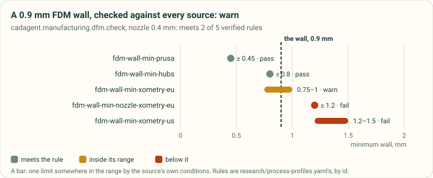
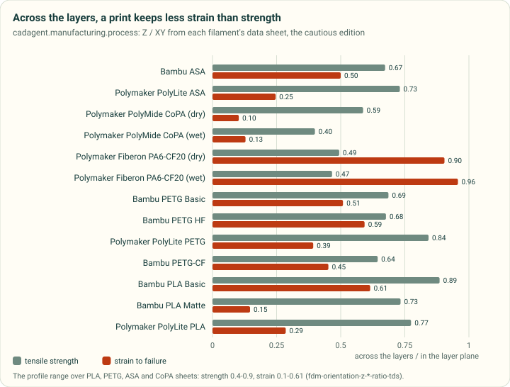
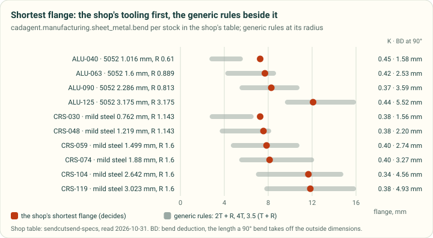

# Process profiles in code: minimum features and sheet-metal bends

A part is made by a process, and the process sets its limits: how thin a printed wall can be, how far a bridge can
span, how short a bent flange can be. Those limits used to live as numbers typed into each tool. Now they are read
from one cited file, [research/process-profiles.yaml](../research/process-profiles.yaml): 377 rules from bureaus,
makers and textbooks for FDM, SLA, SLS, MJF, moulding, sheet metal and CNC, each with its source. Three modules read
it. **A rule from a design guide says a part is likely to be made well. It does not prove that it fits or holds.**

| Module | What it does | What it reads |
|---|---|---|
| `cadagent.manufacturing.process` | Loads the profiles as typed values: rules, limits, tolerances, FDM layer factors, a shop's bend table. Every value carries its rule id and source id | the YAML; the data sheets in `cadagent.mechanical.compliant.allowables` |
| `cadagent.manufacturing.dfm` | **The check.** Holds walls, holes, pins, gaps, bridges, overhangs, flanges and hole-to-bend distances against every verified source, and says which way a printed feature's stress crosses the layers | the rules by `compare` key; the material's layer factors |
| `cadagent.manufacturing.sheet_metal` | **The calculator.** K-factor, bend allowance and deduction, flat length, shortest flange and relief | the shop's table first, then the generic rules and the bend-allowance formula |
| `cadagent.manufacturing.fit_coupons` | Its hole undersize and fit allowances are now read from the profile by rule id, not typed in | `fdm-hole-undersize-cnckitchen`, `fdm-clearance-*` |

## The check: every source, side by side



*Drawn by `tools/process_figures.py` from `cadagent.manufacturing.dfm.check` on a worked example: a 0.9 mm FDM wall,
0.4 mm nozzle. Each row is one rule from the profile, coloured by its verdict.*

Sources disagree. Prusa prints a 0.45 mm wall from a single 0.4 mm extrusion, while Xometry's industrial machines ask
for 1.2 mm. So `dfm.check` keeps every source rather than choosing one. A feature **passes** when it meets every
verified rule. It **fails** when it is beyond every verified rule, so no source would accept it. Anything between is a
**warn** that names the rules it does not fully meet. A rule with a range ("0.75 mm supported, 1.0 mm unsupported")
passes above its strict end and warns inside it, because the source's own conditions decide. Each rule's `applies` text (machine, material, part size) comes with it.

```python
from cadagent.manufacturing import dfm
r = dfm.check("fdm", [dfm.Feature("lid wall", "wall", 0.9),
                      dfm.Feature("vent roof", "bridge", 8.0),
                      dfm.Feature("latch arm", "wall", 1.6, stress_dir=(0, 0, 1), flexes=True)],
              material="petg-bambu-basic", nozzle_mm=0.4)
r["verdict"]                      # "fail": the 8 mm bridge is over both sources' 5 mm
[(f["name"], f["verdict"], f["detail"]) for f in r["features"]]
```

**Unverified rows.** A rule whose `status` is `u` has not been read in its source. Today that is one row,
`sls-gap-vs-wall-eos`, which was read off a chart. The check lists such a rule as advisory with `(u)` after it, and
it never passes or fails a part on it. `Profile.verified_rule()` refuses one, for code that would enforce it.

## Which way the layers run



*Drawn by `tools/process_figures.py` from `cadagent.manufacturing.process`. These are Z / XY ratios from each
filament's data sheet, taking the edition with the lower ratio. The values come from data sheets, not from coupons
printed here.*

A printed part is weaker across its layers. It loses much more strain to failure than strength, so a snap arm that
bends across the layers breaks first. Give a feature `stress_dir`, the direction its bending or pulling stress runs
in the part's frame, and give `build`, the layer normal (default +Z). The check then says whether the stress crosses
the layers (more than 10° out of the layer plane). Across the layers, it gives the material's strength and strain
factors with the data sheet they came from. A feature marked `flexes` warns there: lay it in the layer plane, or size
it to the across-layer allowables (`cadagent.mechanical.compliant.allowables`).

The FDM materials come from the data sheets that `allowables` already holds, so the numbers live in one place:
PETG, PLA, ASA, CoPA, PETG-CF and PA6-CF, in 13 entries. Their source ids, such as `bambu-petg-basic-tds`, are the
reference registry's (#118): `python -m cadagent.review.references bambu-petg-basic-tds` prints the sheet's
citation. A copy of the data file with no `research/references.yaml` beside it still loads, and each factor then cites
its sheet's own link.

## The calculator: sheet-metal bends



*Drawn by `tools/process_figures.py` from `cadagent.manufacturing.sheet_metal.bend` for every stock in the shop's
table (`sendcutsend-specs`, read 2026-10-31). The generic rules are evaluated at the shop's own radius.*

`sheet_metal.bend` reads the numbers in the order the profile asks:

1. a value you give;
2. the shop's row for the material and thickness: its radius, its K, its shortest flange and its relief depth;
3. the generic rules.

Under the generic rules, the inside radius is the largest verified minimum (T for 5052 and mild steel). K comes from
Protolabs Network's air-bending table, by hardness class and R / T. The flange and relief take the strictest verified
rule, and every rule is listed with it. A radius other than the shop's drops the shop's K and flange, because those
belong to its tooling.

```python
from cadagent.manufacturing import sheet_metal as sm
b = sm.bend("5052", 1.6)            # SendCutSend ALU-063: R 0.889, K 0.42, shortest flange 7.696 mm
b["allowance_mm"], b["deduction_mm"]  # 2.452, 2.526 mm at 90 degrees
sm.flat_length([20, 30, 20], "mild-steel", 1.499)   # a U channel: 70 mm less two bend deductions
```

The equations: bend allowance `BA = π (R + K T) A / 180` (the profile's formula `sm-bend-allowance`, from
SolidWorks' K-factor page). Outside setback `OSSB = (R + T) tan(A / 2)`. Bend deduction `BD = 2 OSSB − BA`, the length
a bend takes off the sum of the legs measured to the outside. The tests check them against vectors worked by hand
(`tests/test_sheet_metal.py`).

This calculator gives a bend's numbers; it does not unfold a model. Unfolding a 3D part into its flat pattern is the
job of build123d's `BuildSheet` and `unfold` (to adopt once released) or FreeCAD's SheetMetal workbench, which take
the same K-factor and radius ([the survey](../research/fea-and-process-tools.md#4-sheet-metal-unfold-and-bend-tables)).

<details>
<summary>Feature kinds the check knows, and the limits it states</summary>

| Kind | Limit | Rules it reads |
|---|---|---|
| `wall`, `hole`, `pin` | at least | `compare: min-wall`, `min-hole` (`sm-hole-min` for sheet), `min-pin`; for FDM also `fdm-wall-min-nozzle-xometry-eu` (three nozzle widths) |
| `gap` | at least (a fit's band at its lower end) | `compare: clearance-fit`, and clearance rules with no compare key |
| `rib`, `slot`, `text` | at least | the FDM rib and text rules, the SLA slot rule |
| `bridge`, `overhang` | at most | `bridge-max`; `overhang-max` (FDM, degrees from vertical) |
| `flange`, `bend-radius`, `relief-depth` | at least (the shop's row decides) | `sm-flange-min`, `sm-bend-radius-min`, `sm-relief-depth` |
| `hole-to-bend`, `slot-to-bend`, `hole-to-edge`, `hole-spacing`, `relief-width`, `hem` | at least | the `sm-*` compare keys |

Limits, stated in every report:

- These are published rules for typical machines and settings, not measurements of your printer or shop. A rule's
  `applies` text is shown, not parsed. Pass `exclude=[...]` for rules that do not apply, and record why.
- Sizes are what you declare. `dfm` does not measure a model; `cadagent.review.gates.wall` measures walls by rays.
- K depends on the lot, the tooling and the method (air bending here). The flat length is a starting blank, and the
  shop's CAD or a test bend sets the final one. Most sources do not state the datum their minimum flange is measured
  from. Cracking at a tight radius, a hard temper or a bend across the grain is not predicted.
- The data file is read from the cad-agent checkout the package runs from. Set `CADAGENT_PROCESS_PROFILES` to use
  another copy.

</details>

## Related

[Process profiles: the sources](../research/process-profiles.md) · [Printed joints and fit coupons](printed-joints.md) ·
[FDM anisotropy data](../research/compliant-mechanisms.md) · [Manufacturing package](../src/cadagent/manufacturing/README.md)
