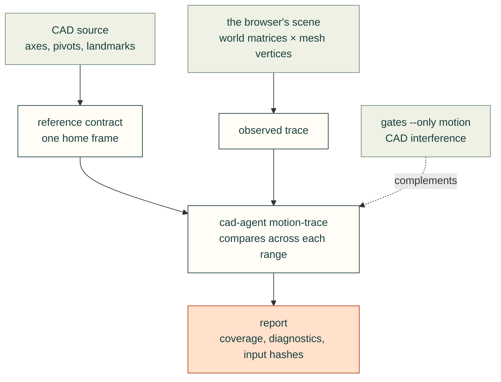

# Rendered joint motion validation

The maintained [trace protocol](../skills/cad-motion-validation/references/trace-protocol.md) ships with the
[cad-motion-validation skill](../skills/cad-motion-validation/SKILL.md), including when the workflow installer
copies the skill to a different machine. It documents the independent CAD reference, actual renderer capture,
`cad-agent motion-trace` CLI, required coverage, diagnostics and evidence limits.

Two independent paths meet only in the comparison: the reference comes from the CAD, the observation from the
renderer that people actually look at, so a pivot error in either shows up.
