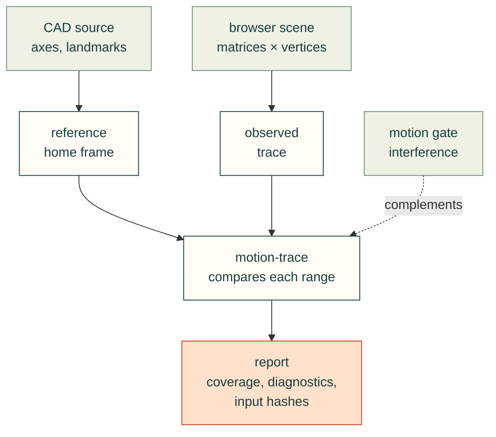

# Rendered joint motion validation

The maintained [trace protocol](../skills/cad-motion-validation/references/trace-protocol.md) ships with the
[cad-motion-validation skill](../skills/cad-motion-validation/SKILL.md), including when the workflow installer
copies the skill to a different machine. It documents the independent CAD reference, actual renderer capture,
`cad-agent motion-trace` CLI, required coverage, diagnostics and evidence limits.

Two independent paths meet only in the comparison: the reference comes from the CAD, the observation from the
renderer that people actually look at, so a pivot error in either shows up.

*`validate_motion_trace` compares, pose by pose, where a renderer drew each landmark with where the CAD's own joint
matrices put it. An illustration of the analytic shaft in `tests/mechanical/test_motion_trace.py`: renderer A is the test's
independent renderer, B its offset-pivot defect; the poses, errors and verdicts are the validator's.*

A closed loop, such as a four-bar or a five-bar leg, is declared under `loops` on top of the joint tree. Its inputs are
sampled together, its other joints are solved, and each sample's loop must close where the solver closes it. See the
protocol, and [Linkages](linkages.md) for the solver.
