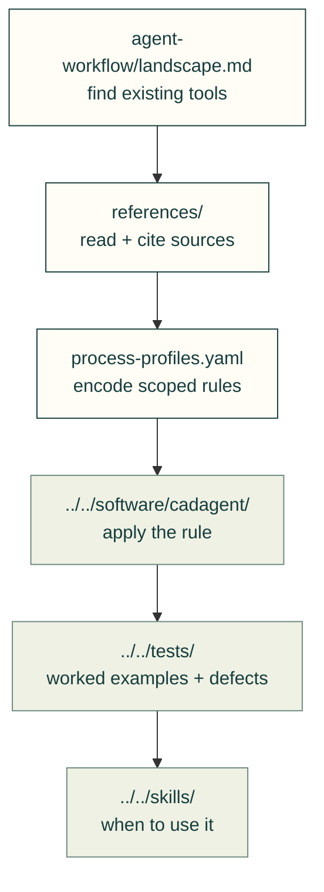

# Research

Find what already works, read the source, then promote only what the evidence supports.

The arrows show the route from discovery to a tested reusable method.

| Evidence | Files and use |
|---|---|
| Research collections | [Agent tools and workflows](agent-workflow/README.md), [manufacturing](manufacturing/README.md) |
| Reference registry | [Core sources](references.yaml), [shards, evidence ladder and promotion procedure](references/README.md); one id space, not one confidence level |
| Tools to adopt or wrap | [Landscape](agent-workflow/landscape.md) and [data](landscape.json), [agent toolkits](agent-workflow/agent-toolkits-2026-10.md), [upstream registry](../../software/vendor/upstreams/registry.yaml) |
| Process rules | [Profiles and limits](manufacturing/process-profiles.md), [rule data](process-profiles.yaml); unread rules cannot drive checks |
| Compliant mechanisms | [Survey](compliant-mechanisms.md) → [snap-fit method](../mechanical/compliant.md) |
| Simulation | [Tools](simulation-tools.md), [FEA/process survey](fea-and-process-tools.md) → [toolkit](../toolkit.md) |
| Sheet metal | [Survey](manufacturing/sheet-metal.md), [guides](manufacturing/sheet-metal-guides.md), [joining](manufacturing/sheet-metal-joining.md), [parts data](sheet-hardware.yaml) |
| Review practice | [Design workflows](agent-workflow/design-workflows.md) and [data](design-workflows.json) → [pitfall checks](../practice/common-issues.md) |
| Supply chain | [Dated report](security-report.md), [machine report](security-report.json), [accepted findings](security-accepted.yaml); regenerate rather than hand-edit reports |
| Benchmarks | [Gate timing script](bench/gate_timing.py); timings describe its selected cases and environment |

`cad-agent rules <feature>` serves scoped rule cards; `cad-agent choose joining --load N` starts a joining decision. [Profiles and card limits](manufacturing/process-profiles.md) explain the inputs, source confidence and gaps; the cards are generated from the rule data, not copied into this map.

`python -m cadagent.review.references --check` checks registry consistency and citation/evidence rules. It does not verify every source claim or prove a physical result. The [existing evaluation paths and limits](../lessons/process/2026-11-05-recovery-audit.md#evidence-that-can-improve-the-toolkit-today) distinguish deterministic regression checks from the planned model-comparison framework.

[Home](../../README.md) · [Guides](../README.md) · [Skills](../../.agents/skills/README.md) · [Lessons](../lessons/README.md)
