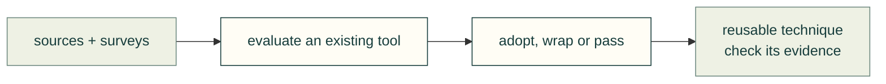

# Agent tools and workflows

Compare existing tools before adding a capability. These surveys record what was read and evaluated, with dates and limits.

| Survey | Use |
|---|---|
| [Landscape](landscape.md) | Tools, libraries and benchmarks we track |
| [Agent toolkits](agent-toolkits-2026-10.md) | Dated agent-tool comparisons and adoption notes |
| [Design workflows](design-workflows.md) | Methods, gaps and evaluation evidence |

[Research map](../README.md) · [Skills](../../../skills/README.md)
