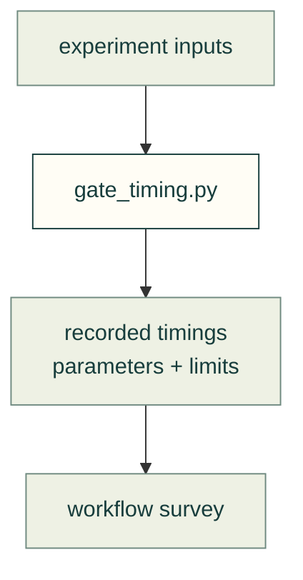

# Recorded experiments

`gate_timing.py` records the timing experiment in the [workflow survey](../agent-workflow/design-workflows.md). The standard-evaluation records retain fresh-agent attempts, including failures. Each result is dated evidence with its own limits, not a claim about every model or machine.

Recorded experiment flow

| File | Purpose |
|---|---|
| [gate_timing.py](gate_timing.py) | Reproduce the documented experiment with explicit inputs |
| [standard-evaluation-2026-11-12.jsonl](standard-evaluation-2026-11-12.jsonl) | Dated fresh-agent attempts, independent artifact checks, retained failures and explicit runtime limits; [method](../../practice/standard-evaluation.md) |

[Research map](../README.md)
