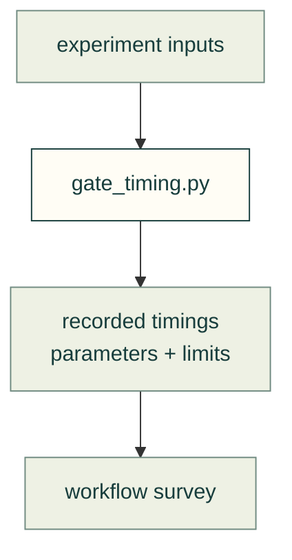

# Recorded timing experiment

`gate_timing.py` is the source of the recorded experiment described in the [workflow survey](../agent-workflow/design-workflows.md). Its old measurements remain dated evidence, not a claim about a current machine or a production model.

Recorded experiment flow

| File | Purpose |
|---|---|
| [gate_timing.py](gate_timing.py) | Reproduce the documented experiment with explicit inputs |

[Research map](../README.md)
