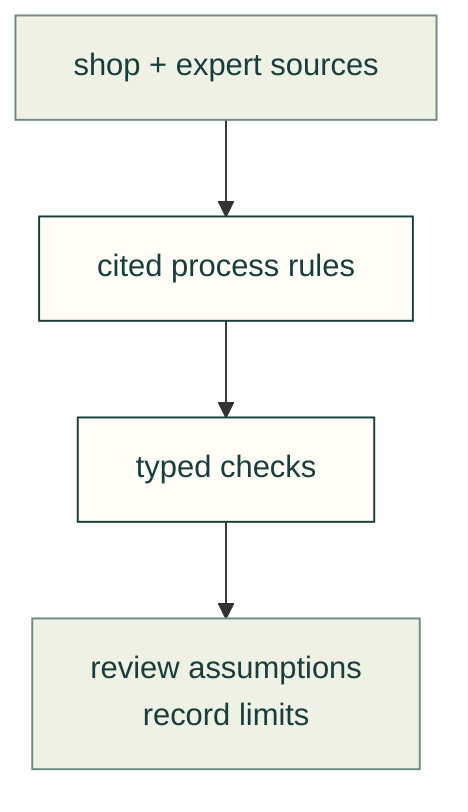

# Manufacturing research

Read the source before applying a generic limit. The typed process data stays in [process-profiles.yaml](../process-profiles.yaml), beside its [reference registry](../references.yaml).

| Topic | Start here |
|---|---|
| Moulding review | [Walls, bonding and part release](moulding-wall-bond-and-release-review.md) |
| Process rules | [Profiles and confidence](process-profiles.md) |
| Printer observation | [Bambu cloud evidence and existing skills](bambu-cloud.md) |
| PEM micro-fasteners | [Family selection and qualified evidence](pem-micro-fasteners.md) |
| Sheet metal | [Survey](sheet-metal.md), [expert guides](sheet-metal-guides.md), [joining](sheet-metal-joining.md) |

[Research map](../README.md) · [Process checks](../../process-checks.md) · [Sheet-metal hardware](../../sheet-metal-hardware.md)
