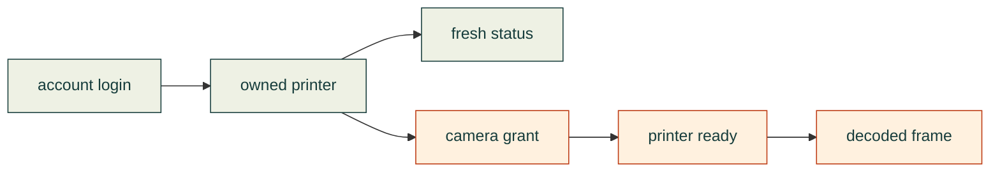

# Bambu cloud: what we have actually proved

An agent can observe a printer without running a new service. On **2026-11-07**, a normal account login, existing Python libraries and the installed Bambu media runtime produced fresh P1S/X1E telemetry and a real P1S camera frame. X1E video remains unresolved. This is a connection experiment, not a shipped printer-control command.

| Evidence | P1S | X1E |
|---|---|---|
| Normal cloud login and owned-device listing | Verified | Verified |
| Fresh status and matched firmware reply | Verified | Verified |
| Actual decoded cloud camera frame | 1280 × 720 JPEG | Not obtained |
| Motion, heating, print submission | Not tested | Not tested |

The X1E returned a camera grant, then rejected preparation of that **same grant** with `84033543`. Its camera works in the official app, according to the owner. A grant is therefore insufficient evidence of a working stream. The error's precise meaning in this camera context is not established by the official error tables.

Repeatable investigation method

1. Use normal sign-in and verification. Keep credentials in an owner-only local session outside the repository. Verify the owned-device list before selecting a device.
2. Connect to the correct regional cloud MQTT broker with verified TLS. Subscribe only to the selected owned device's report topic. A subscription acknowledgement or empty heartbeat does not prove current printer state.
3. After acknowledgement, request one standard `pushing.pushall` and one `info.get_version`. Require a fresh, nonretained state and a version response matching the request's sequence ID. Merge sparse deltas; retain model-specific temperature decoding.
4. Select the camera protocol from actual firmware and the official model compatibility data. Observe status while requesting a normal cloud camera grant. Correlate preparation replies by the grant identifier; timing alone is insufficient.
5. Start a bounded reader only with readiness evidence. Decode the actual image and inspect it. Preserve unsuccessful stages separately. A URL, byte buffer or successful mock is not a frame.

Keep raw device reports, grants and camera images private. Record dated, sanitized outcomes and exact source identities publicly. These steps describe the reviewed experiment; there is no production CLI that automatically performs them yet.

Existing code and agent skills considered

| Source | Useful part and observed limit |
|---|---|
| [Bambu Studio](https://github.com/bambulab/BambuStudio/tree/355d71eee5a9ebc794693fe57e63674806019770) | Authoritative request shapes, model compatibility and media ABI. Installed media runtime decoded the P1S frame. Its networking SDK did not establish our fresh local session; that is not a cloud-login failure. |
| [Bambuddy](https://github.com/maziggy/bambuddy/blob/75c9c2db740b74d17803c82119803f6ae7088783/backend/app/services/bambu_cloud.py) | Normal account/verification flow informed the successful small probe. No server installation was needed. |
| [voska's Bambu skill](https://github.com/voska/bambu/blob/72fde5d67e2ceba27d1ef03c9031800f2dca2722/skills/bambu/SKILL.md) | Existing Go CLI and LAN workflow; inspected version does not supply this cloud-camera path. |
| [Printing Press Bambu skill](https://github.com/mvanhorn/printing-press-library/blob/a672844a2e7dca35b6e0a7828e00d61ecb32302d/library/devices/bambu/SKILL.md) | Read-only local telemetry patterns; inspected version has no cloud camera/control. |
| [Text-to-CAD Bambu skill](https://github.com/earthtojake/text-to-cad/blob/4099cac3ddc56a5e696138c53fd7bee685e8ad9d/skills/bambu-labs/SKILL.md) | Official-client model handoff, with the person choosing the printer and starting the job. |

None of these skills was installed. Their source inspection does not qualify an untested printer or justify transferring their dependencies, licenses or transport assumptions into cad-agent.

[Dated investigation and remaining work](https://github.com/Valpatel/cad-agent/issues/405) · [Evidence discipline](../../lessons/review/verification-and-evidence.md#prove-each-stage-of-an-external-connection) · [Manufacturing research](README.md)
