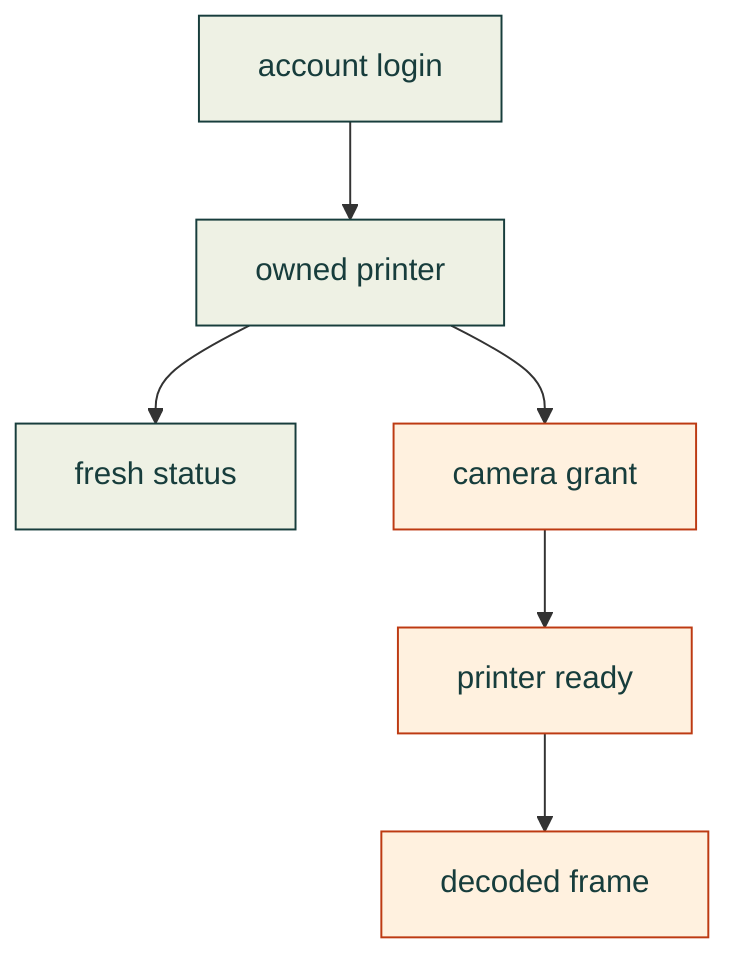

# Bambu cloud: what we have actually proved

An agent can observe a printer without running a new service. On **2026-11-07**, a normal account login, existing Python libraries and the installed Bambu media runtime produced fresh P1S/X1E telemetry and a real P1S camera frame. X1E video remains unresolved. These are dated experiment results, not proof of a complete printer-control workflow.

The [read-only adapter](../../../software/cadagent/manufacturing/devices/bambu/README.md) exposes cached-session reuse,
fresh owned-device listing and a selected printer's status/version query as `cad-agent bambu-status`.
On **2026-11-08**, one bounded trial of source `f822af44` reused the existing cache without another verification
email and obtained fresh observed state plus correlated firmware for both P1S and X1E. The four status/version
queries completed in about four seconds; the process exited cleanly and source/cache preservation checks passed
([independent acceptance](https://github.com/Valpatel/cad-agent/issues/405#issuecomment-6715577418)).
Sparse fields may satisfy that observation; it is not a complete snapshot or print-readiness proof. Login,
refresh, camera capture, clear-bed verification and job submission are not implemented by this command.
The existing P1S frame remains evidence from the separate prototype.

The reusable P1S camera draft remains **unqualified as of 2026-11-08**. Both native trials produced no frame;
the second returned `-90` from `Bambu_Open`. A separate observation received a nonretained preparation report
matching its exact grant, with error `84033543`, normalized result `unknown`, and disabled TUTK telemetry
([independent readback](https://github.com/Valpatel/cad-agent/issues/405#issuecomment-6716312332)). No reader ran
in that observation. The exact error cause, and its relationship to the two native failures, remain unknown.

Production work belongs inside the existing [manufacturing hierarchy](../../../software/cadagent/manufacturing/README.md#where-machine-automation-belongs): separate artifact preparation, device adapters, execution and evidence. Bambu is one integration; its cloud protocol must not define the workflow for every machine.

| Evidence | P1S | X1E |
|---|---|---|
| Normal cloud login and owned-device listing | Verified | Verified |
| Fresh status and matched firmware reply | Verified | Verified |
| Actual decoded cloud camera frame | Earlier prototype: 1280 × 720 JPEG; reusable reader not qualified | Not obtained |
| Motion, heating, print submission | Not tested | Not tested |

The X1E returned a camera grant, then rejected preparation of that **same grant** with `84033543`. Its camera works in the official app, according to the owner. A grant is therefore insufficient evidence of a working stream. The error's precise meaning in this camera context is not established by the official error tables.

The intended application is a manufacturing experiment loop: generate technique-test specimens, stamp their part
numbers, pack plates, verify the printer and a clear bed, submit the job, and connect physical feedback to each
specimen's exact design and settings. An occupied or uncertain bed must stop submission. The observations above
establish some prerequisites; they do not establish that the complete loop is implemented.

Each stamped short ID should resolve to a full UUID and a version-controlled experiment record: immutable source
repository/commit, model parameters, geometry identity and manufacturing settings. Check short IDs for collisions.
Record print attempts and human function/durability feedback against the exact specimen. Source identity remains
fixed as later observations guide the next design; the source commit precedes the generated record, avoiding a
self-referential commit hash.

Repeatable investigation method

1. Use normal sign-in and verification. Keep credentials in an owner-only local session outside the repository. Verify the owned-device list before selecting a device.
2. Connect to the correct regional cloud MQTT broker with verified TLS. Subscribe only to the selected owned device's report topic. A subscription acknowledgement or empty heartbeat does not prove current printer state.
3. After acknowledgement, request one standard `pushing.pushall` and one `info.get_version`. Require a fresh, nonretained state and a version response matching the request's sequence ID. Merge sparse deltas; retain model-specific temperature decoding.
4. Select the camera protocol from actual firmware and the official model compatibility data. Observe status while requesting a normal cloud camera grant. Correlate preparation replies by the grant identifier; timing alone is insufficient.
5. Start a bounded reader only with readiness evidence. Decode the actual image and inspect it. Preserve unsuccessful stages separately. A URL, byte buffer or successful mock is not a frame.

Keep raw device reports, grants and camera images private. Record dated, sanitized outcomes and exact source identities publicly. These steps describe the reviewed experiment; the adapter covers account/status observations only.

Existing code and agent skills considered

| Source | Useful part and observed limit |
|---|---|
| [Bambu Studio](https://github.com/bambulab/BambuStudio/tree/355d71eee5a9ebc794693fe57e63674806019770) | Authoritative request shapes, model compatibility and media ABI. Installed media runtime decoded the P1S frame. The complete cached session was later recognized locally, but SDK HTTP and X1E camera calls remained unsuccessful; local session recognition is a separate boundary. |
| [Bambuddy](https://github.com/maziggy/bambuddy/blob/75c9c2db740b74d17803c82119803f6ae7088783/backend/app/services/bambu_cloud.py) | Normal account/verification flow informed the successful small probe. No server installation was needed. |
| [voska's Bambu skill](https://github.com/voska/bambu/blob/72fde5d67e2ceba27d1ef03c9031800f2dca2722/skills/bambu/SKILL.md) | Existing Go CLI and LAN workflow; inspected version does not supply this cloud-camera path. |
| [Printing Press Bambu skill](https://github.com/mvanhorn/printing-press-library/blob/a672844a2e7dca35b6e0a7828e00d61ecb32302d/library/devices/bambu/SKILL.md) | Read-only local telemetry patterns; inspected version has no cloud camera/control. |
| [Text-to-CAD Bambu skill](https://github.com/earthtojake/text-to-cad/blob/4099cac3ddc56a5e696138c53fd7bee685e8ad9d/skills/bambu-labs/SKILL.md) | Official-client model handoff, with the person choosing the printer and starting the job. |

None of these skills was installed. Their source inspection does not qualify an untested printer or justify transferring their dependencies, licenses or transport assumptions into cad-agent.

[Dated investigation and remaining work](https://github.com/Valpatel/cad-agent/issues/405) · [Evidence discipline](../../lessons/review/verification-and-evidence.md#prove-each-stage-of-an-external-connection) · [Manufacturing research](README.md)
