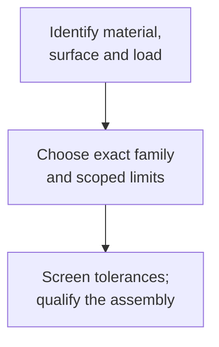

# Joint interfaces: finish, fit and retention

Select a joint from the actual surfaces, loading and hardware family. These manufacturer studies identify what must be checked before an interface is qualified; they do not establish physical fit or strength.

Anodizing: dimensional buildup, masking and a derived example

protect the functional dimensions

OMW's guide distinguishes oxide-layer thickness from the portion projecting beyond the original surface (PDF pp.2–3). A coating-thickness reading alone does not establish the dimensional buildup. Its approximate outward fractions are one third for Type II and one half for Type III; pretreatment can remove material, and local thickness varies (pp.3–4). Use the anodizer's agreed allowance and inspection plan for precision fits rather than treating either fraction as a guaranteed conversion.

For drawing review, identify tight holes, fine threads and sliding interfaces, then decide which features require masking. Show acceptable rack-contact locations and process the components before assembly unless the finisher approves a different route (pp.3,10–11). The document's Type II/III and Class 1/2 examples describe a 2014 guide; verify the current governing specification and revision with the supplier. The guide does not establish the latest revision of MIL-A-8625 or its successors.

A **derived arithmetic illustration**, not a measured result: assume the finisher agrees a Type III layer thickness of 0.002 inch and outward buildup of exactly half. Each treated wall projects 0.001 inch = 0.0254 mm. Two opposed outside surfaces increase their span by 0.0508 mm; a bore coated on both sides loses 0.0508 mm of diameter. An initially 10.0000 mm bore would become 9.9492 mm under these assumptions. Masked walls must not receive this modeled allowance. Etching, process scatter and dimensional tolerances still require separate agreement.

For a finisher-confirmed planning scenario, run `cad-agent rules anodize-planning-growth --process cnc`. Its values are approximate assumptions, with no min/max pass limits.

Negative review controls: reject a calculation that uses the full oxide thickness as outward buildup, changes a bore in the outside-growth direction, applies a two-wall allowance to only one treated surface, or silently treats the illustrative half-growth value as a universal Type II value. OMW's corner sketch on p.10 recommends relieving very sharp corners (it quotes 0.015 inch); treat that as supplier guidance requiring confirmation, not a universal minimum-radius check.

[Source: OMW][ref:omw-anodizing]

## Bearing fits: classify the load first

NSK's two-page Technical Insight explains creep from insufficient fit and lost internal clearance or ring stress from excessive interference (p.1). Its p.2 Table 1 gives three qualitative cases:

| Operating case in the source | Inner-ring fit | Outer-ring fit |
|---|---|---|
| Inner ring rotating, outer stationary; stationary-direction load | Tight | Loose |
| Inner stationary, outer rotating; stationary-direction load | Loose | Tight |
| Load direction indeterminate, including changing or unbalanced loading | Tight | Tight |

Use the loading case, not simply the word "rotating", to select the branch. A conveyor roller is the source's outer-ring case; copying the common motor inner-ring fit to it reverses the recommendation. The indeterminate-load row must override a simplistic single-ring rule. These cases do not determine a shaft/housing tolerance code: Figure 1 is schematic and provides no micrometre limits, nominal-diameter bands or numerical interference prescription.

Before selecting actual dimensions, review load magnitude, thermal/material differences, wall stiffness and vibration. NSK warns about tight outer-ring fits with split housings and explains that aluminium/steel expansion differences matter (p.2). Inspect replacement seats against the original manufacturer's specification. Do not convert this short article into a blanket H7/g6 recommendation or a claim of bearing life.

A bounded decision-test set can check the three table rows and reject missing load classification, a motor/conveyor row reversal, or a numerical fit-code result generated without a dimensional tolerance source. Such tests reproduce the qualitative table only; they do not validate a bearing assembly.

[Source: NSK][ref:nsk-ti-0001]

General Bearing 6203 example: inch deviations and material limits

The exact seven-page excerpt is General Bearing material hosted on SKF’s media service, not a complete modern SKF catalogue. Its printed p.32 example uses a 17 × 40 × 12 mm 6203 bearing, inner ring rotating, 20 lbf radial load and a cited 2153 lbf dynamic rating. The load ratio is about 0.00929, below its light-load threshold of 0.07 C. The example chooses shaft h5 and housing H6, with outer ring stationary and housing not split axially.

The exact named `cad-agent rules bearing-6203-source-example --process cnc --material steel` card reproduces only this steel-housing subset; it is not a general fit selector.

The deviation columns are **inches**, although diameter bands also show millimetres. For this named example, shaft h5 is +0/−0.0003 inch = +0/−0.00762 mm; housing H6 is +0/+0.0006 inch = +0/+0.01524 mm. The source’s rounded absolute inch dimensions do not convert to exactly the same nominal 17/40 mm, so keep deviations and rounded example dimensions distinct. Bearing-ring tolerances are also needed to determine actual interference.

The light-load ball-bearing shaft h5 branch includes d = 18 mm; the next branch above 18 mm uses j6 subject to its accuracy note. The shaft footnote assumes solid steel, and housing guidance assumes cast iron/steel with non-ferrous exceptions. A hollow shaft, polymer, split housing, different loading or different bearing cannot silently inherit this case. This is no FDM interference or bearing-life qualification.

[Source: General Bearing excerpt][ref:general-bearing-fits]

Reading receipts and limits

The OMW guide was read in full: 13 PDF pages, copyright 2014 Joseph H Osborn; visual checks pp.2,3,10. NSK Ref TI/E/0001 was read in full: two pages, Table 1 and schematic fit-code figure visually checked on p.2. The General Bearing excerpt was read in full: seven PDF pages, printed pp.31–37, with tables/footnotes visually checked on PDF pp.2–4; its shaft table attributes ABMA1995. No current standard revision or physical assembly is verified. The source records retain exact URLs, digests and dated scope; licensed PDFs remain outside the repository.

