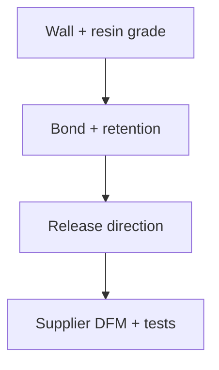

# Review moulding walls, bonding and part release together

A sensible wall or a compatible material pair does not establish a mouldable, qualified part. Keep the resin grade, local section, retention mechanism and release direction in the review before requesting supplier DFM.



## Wall ranges belong to a material and process

The Protolabs chart gives ABS 0.045–0.140 inch and polycarbonate 0.040–0.150 inch. The imported universal 0.040–0.140 range mixed material-specific endpoints and is removed. A **derived unit example** converts the ABS recommendation to 1.143–3.556 mm; it is review context, not a universal acceptance envelope. [ref:pl-mould-walls]

Its FAQ and rib drawing clarify that roughly 40–60% concerns secondary ribs/boss walls relative to adjacent walls. Do not apply this as a general minimum ratio between every pair of walls. Prefer coring or supporting ribs to a thick intersection, then confirm the actual grade, flow, cooling and draft with the supplier. None of these moulding recommendations qualifies FDM parts. [ref:pl-mould-walls]

## Geometric overlay thickness does not prove adhesion

Protolabs recommends an overlay no thicker than its underlying substrate. A 1 mm overlay over a 2 mm substrate meets that geometric recommendation but proves no bond. Its table distinguishes particular grades: Texin 983-000000 TPU over ABS Lustran is a chemical-bond candidate; Santoprene 101-87 TPV over that ABS calls for mechanical retention. Unlisted pairs require consultation. [ref:pl-overmould]

The interlock drawing illustrates ways to retain an overlay. The table's C/M distinction is not a measured peel-strength claim, and a dash is not a demonstrated incompatibility. Confirm the actual processing window and substrate thermal resistance; the article's generic melting-temperature sentence must not become a universal rule for thermosetting LSR. Keep the overlay flush or slightly recessed as described, without claiming an unmeasured peel benefit. [ref:pl-overmould]

## Preserve the required feature and plan its release

Fictiv describes parting-line changes, side actions, bump-offs, shutoffs, hand loads and secondary machining. Selection depends on geometry, resin, quantity and cost. An essential lateral port needs a release or machining plan; deleting it to avoid an undercut fails the functional requirement. Bump-off needs deformation without damage, not merely a convenient radius. [ref:fictiv-mould-undercuts]

| Review situation | What remains unresolved |
|---|---|
| A port is trapped along the chosen straight pull | Compare parting-line, side-action or secondary-operation options with the toolmaker. |
| Bump-off is proposed for an unqualified brittle resin | Do not approve ejection; material strain and damage evidence are missing. |
| Sliding-shutoff draft is quoted for an unrelated feature | Reject the scope transfer; no universal draft angle follows. |

The source photographs illustrate features, not dimensions or strain capacity. The article is accessible in full; the old “gated content unseen” note no longer describes this reading. [ref:fictiv-mould-undercuts]

<details>
<summary>Executable unit, grade and release-assumption illustrations</summary>

These are original, self-contained review illustrations, exercised by the existing process-profile tests. They are not public toolkit APIs or a manufacturing solver. No result grants supplier acceptance, peel strength or ejection qualification.

```python
def wall_range_mm(material):
    # Selected inch recommendations only; no inferred range for an unknown grade.
    inch_ranges = {"ABS": (0.045, 0.140), "polycarbonate": (0.040, 0.150)}
    if material not in inch_ranges:
        raise ValueError("consult the source and supplier for this material")
    return tuple(value * 25.4 for value in inch_ranges[material])


def bond_route(overmold, substrate):
    selected = {
        ("Texin 983-000000", "ABS Lustran"): "chemical-candidate-qualify",
        ("Santoprene 101-87", "ABS Lustran"): "mechanical-retention-review",
    }
    return selected.get((overmold, substrate), "unlisted-consult")


def release_review(*, feature_required, pull_named, method, brittle, qualified):
    if not feature_required:
        return "consider removing unnecessary undercut"
    if not pull_named:
        return "name pull direction and parting line"
    if method == "bump-off" and not qualified:
        if brittle:
            return "do not approve unqualified brittle deformation"
        return "do not approve unqualified deformation"
    # Even a qualified-material assumption cannot select tooling or approve the part.
    return "toolmaker review required"
```

Selected material ranges are not grade-specific flow studies. The two bond examples preserve exact table labels; swapping substrate and overlay or dropping the grade must not inherit a candidate. The release example detects missing assumptions only. It calculates no strain, draft, force or tool clearance; every feature still needs toolmaker review. Tests also plant inch/mm and material substitutions.

</details>

<details>
<summary>Exact-source audit and full-reading receipt, 2026-11-11</summary>

All three existing records were catalogued before this pass. Full articles, including Protolabs wall FAQ, were read; linked material datasheets, other guides, videos and supplier qualification were not claimed read. Native Protolabs figures and tables and all four Fictiv photographs were visually inspected. No manufacturer artwork or full table is redistributed here. Same-publisher guidance is not independent corroboration.

| Existing source | Exact downloaded HTML SHA-256 |
|---|---|
| Protolabs wall article, metadata dated 2017-04-14 | `eee820adb5c02c9f4beadc7c54b80a1dd9fd8fd8818b19b11c0869fc6e706f49` |
| Protolabs overmoulding article, metadata dated 2017-07-25 | `db025432acae71b6f6e2652f63e89335fd1b2ad9d2ef042390d8e75dcff0cc3e` |
| Fictiv undercuts article, Steve Melito, dated 2022-12-08 | `b87dd3e88726bdca3e1bbc8a3a65f2c1973f508ee9f626f474788f8839959d8d` |

The complete [dated reading/visual/claim audit](https://github.com/Valpatel/cad-agent/issues/323#issuecomment-6806527420) preserves the source-resolution asset digests. One overmoulding table row visibly contains a publisher typo; the selected examples avoid that row rather than silently repairing a product specification. Retaining the original source identity avoids duplicate document counts. These reads add neither independent corroboration nor measured evidence.

</details>

[Manufacturing research](README.md) · [Existing process rules](process-profiles.md)
