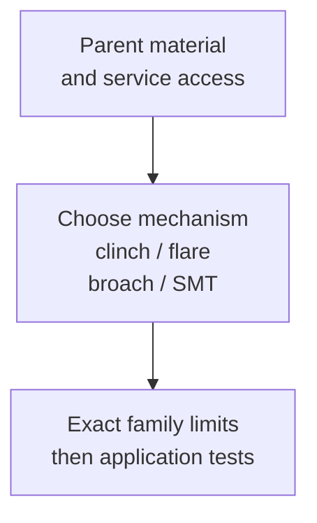

# PEM micro-fasteners: select the attachment mechanism first

Choose the attachment mechanism from the parent material and required service. The M2 shield example below screens geometry; an exact drawing, installation tooling and application tests still govern the joint.



<details>
<summary>Sources, editions and reading boundaries</summary>

The two user-selected guides serve different purposes. The 2022 *Design Engineers Fastener Guide* is an industry overview; the consumer-electronics PDF contains family tables, installation drawings and qualified performance data. Read both as manufacturer guidance, not as proof that a purchased part or printed assembly works. [ref:pem-fastener-guide-2022] [ref:pem-ce-guide-2021]

Read on 2026-11-11: all 20 PDF pages of the first guide, and all 16 PDF pages of the consumer-electronics guide (printed pages 1–31, many as facing-page spreads). The latter URL says October 2021; its last page says **July 2021**. Identify it by both strings and this SHA-256:

```text
396c9d3c1172c2d0bda54e2ac9fc452798febaa5551b28aa37030f8db4c1c2f7
```

This reading includes the full extracted text and visual inspection of the selected dimension/material/installation spreads (PDF pages7,10,12,14); it does not include linked videos, every current product drawing, or outside application certification. No vendor PDF or image is redistributed.

</details>

<details>
<summary>Choose among nine retention families</summary>

| Need and parent material | Family to investigate | Boundary that changes the decision |
|---|---|---|
| Reusable threads in a thin ductile metal panel | MSO4 self-clinching standoff | Parent metal must flow into the undercut; fastener hardness must exceed panel hardness. A stainless fastener is not automatically suitable for a stainless panel. |
| Captive spacing in a thin panel that cannot cold-flow | MSOFS flaring standoff | The fastener flares; the MSO4 cold-flow/hardness rules do not transfer. Standard part thickness windows still govern. |
| Sheet attachment with no intended service removal | TA/T4 TackPin | Distinguish top-sheet clearance hole from base engagement hole, and blind from through base thickness. |
| Sheet attachment that must be removed | TS4 TackScrew | Press to install; removal is by unscrewing. The guide's reinstall procedure adds adhesive and uses a 2IP Torx Plus driver; do not promise unlimited dry press-in reuse. |
| Plastic or brittle casting attachment | TKA/TK4 TackSert | Broaching engagement, not a self-clinch substitute. Compute engagement after subtracting the entire top-sheet stack; qualify cracking and retention. |
| Plastic component requiring an internal thread | MSIA/MSIB SI insert | Aluminium/brass alternatives; boss-wall figures were tested in ABS and polycarbonate. They are not an FDM material qualification. |
| Board spacing during SMT assembly | SMTSO | Solder-pad, paste, reflow and board conditions govern; sheet-clinch pushout data do not apply. |
| Tolerance take-up in a permanent sheet stack | TFA FlexTack | Belleville head flattens at seating; distinguish this from a rigid TackPin. |
| Retaining a stack on a pin | CDS ClampDisk | Disk grips the pin, not the panel. The guide requires a new disk after removal. |

The mechanism distinctions come from the overview printed pp.4–6,12–17 and CE printed pp.3–5,11–21,24–27. The overview's thinnest-sheet statements are examples across a portfolio, never interchangeable limits for every family.

</details>

## Worked screening example: an electronics shield

This is an invented screening problem, not a Gyropup geometry change. A designer has an annealed stainless shield, thickness 0.25 ±0.02 mm, measured hardness HRB 85, a hole 3.52 ±0.01 mm, and hole-center-to-edge distance 2.50 ±0.05 mm. They need an M2 spacing thread and have access to a press.

Use worst-case intervals: thickness 0.23–0.27, hole 3.51–3.53 and minimum edge distance 2.45 mm. The MSO4 card rejects this combination on thickness, hole and edge distance even though the reported hardness is below its ceiling. The MSOFS card leaves the standard geometry as a **candidate**: all three intervals fit. A normal flat punch is still insufficient evidence; confirm the flaring tool, recessed support, seating endpoint and exact drawing.

If the top thickness tolerance grows to 0.25 ±0.06 mm, neither endpoint fits the MSOFS standard thickness window. A nominal-only comparison would miss that. A printed polymer replacement does not inherit either sheet candidate verdict; select the plastic attachment mechanism and qualify coupons separately.

<details>
<summary>M2 installation, material exclusions and table conflicts</summary>

Get dimensions from `cad-agent rules pem-mso4-m2` or `cad-agent rules pem-msofs-m2`. These cards read the existing process-profile registry; no new strength calculator is claimed. The scoped rows are CE printed p.12 (MSO4) and p.19 (MSOFS). Length codes 2 and 3 are offered in these metric rows; verify the current exact product drawing before ordering.

For MSO4, CE p.12 limits sheet hardness to HRB 88 / HB 183 or less, with harder sheet requiring supplier consultation. CE p.22 also excludes hardened 400-series families MSO4/T4/TK4/TS4 when appreciable corrosion, nonmagnetic service or temperatures above the ceiling stated in its material note matter. Do not reuse that exclusion as a universal property of all PEM stainless products. The existing handbook and sheet-joint checks remain the starting point for already supported S/CLS/SP, FH and SO hardware. [ref:pem-handbook]

CE p.23 requires annealed stainless, sharp hole punching to limit local work hardening, punch-side installation and catalogued centerline-to-edge spacing near cold-worked bends. Its punch-maintenance tolerance is narrower than the generic hole table: investigate that process condition instead of silently treating every table-compliant laser hole as qualified. No secondary deburring is prescribed for MPP/MSO4 (p.23) or MSOFS (p.26).

MSO4 seats its head flush using parallel punch/anvil faces and a supporting anvil. MSOFS uses a **flaring punch and recessed anvil**, stopping when the punch contacts the sheet (CE p.26). Identical thread size does not imply identical tooling or mounting hole.

The MSOFS p.19 heading advertises no minimum sheet thickness, but its standard metric table specifies a sheet window. This batch uses the table for those listed standard parts; it does not extrapolate to a thinner custom solution. The nearby thinner-sheet illustrations are alternatives requiring supplier information.

</details>

<details>
<summary>Qualify the joint: loads, failure modes and coupon evidence</summary>

No working load can be accepted from this screening. CE p.29 reports MSOFS tests in 0.2 mm 300-series stainless, while MSO4 p.28 separates sheet thickness and tightening torque from pushout, torque-out and pull-through. Installation loads are setup references; other values are averages, sensitive to holes, parent material and procedure. A screw may fail before the standoff. Qualification must preserve the real material, hole process, tool access, seating, mating screw, clamp path, repeated service, load direction and environment, then measure the applicable failure mode.

For an experiment, predeclare the required loads and service cycles from the product requirements, make coupons with the worst permitted sheet/hole conditions, verify seating, and test pushout/torque-out/pull-through as applicable. Record individual results and failures; an average catalog value is not a lower-bound design allowable.

</details>

<details>
<summary>Other detailed findings and unfinished source checks</summary>

CE p.18 gives separate insert hole depth, diameter, wall and style by thread/length; p.30's MSIA/MSIB tests used heat-staked flat ABS/PC sheet. Do not convert those tests to printed pullout capacity. CE p.15 defines TackSert engagement as length minus top-sheet thickness and distinguishes blind-hole depth from through-sheet protrusion. Those families deserve a separate numerical batch before a checker is added.

CE p.30's SMTSO results name the board, oven, paste, stencil and sample count. The extraction says “RF-4”; do not silently rewrite it to FR-4 or infer qualification of another laminate. Reel tape width also differs between pp.20 and27. Resolve those details against the exact current SMT datasheet before use; this batch encodes neither. Current product revisions, independent corroboration and physical qualification remain unfinished.

</details>

Use the [PEM family selection skill](../../../.agents/skills/pem-fastener-selection/SKILL.md) for repeatable intake, and [existing sheet joints](sheet-metal-joining.md) for supported checks.
