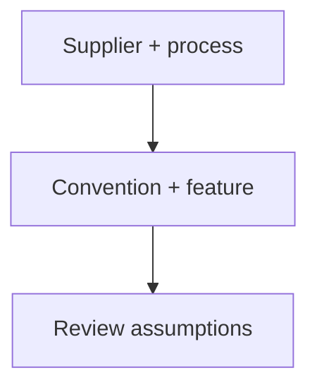

# Review bend files and CNC hole features before ordering

Use the supplier's conventions, then inspect the complete feature. These are advisory review examples, not new toolkit checks or proof of fit, strength or supplier acceptance.



## Bend callouts need a named angle convention

SendCutSend's design guide illustrates bend callouts of 130° and 45° for enclosed angles of 50° and 135°. Label the convention rather than copying an enclosed angle into a bend callout. Its flat-pattern illustration is one particular aluminium example, not a general deduction table. Use the selected material/thickness radius and K-factor for air bending; the article does not establish a universal flange limit. [ref:sendcutsend-designing-for-online-sheet-metal-bending]

The later step-by-step article distinguishes software and file format: SolidWorks DXF requires a dashed centreline rather than Hidden; Illustrator AI uses a separate bend-line colour. Inspect the exported representation. Its flange limits defer to material/thickness data: the imported `max(0.500 inch, 4 × thickness)` claim was not supported by this reading. Both articles share a publisher and do not independently corroborate one another. [ref:sendcutsend-step-by-step-guide-to-sheet-metal-bending]

## Inspect the recess, not just the pilot

Protolabs distinguishes cylindrical counterbores for socket heads from conical countersinks matching a flat-head screw's angle. Its edge review includes the largest recess diameter. In a **derived containment example**, an 8 mm recess centred 3 mm from an edge overhangs by 1 mm even though a 4 mm pilot fits. This establishes containment only, not an acceptable strength-based edge distance. [ref:protolabs-cnc-hole-design-through-blind-tapped-and-more]

A 4 mm hole extending 28 mm is beyond the article's roughly six-diameter review trigger. Request a manufacturability check; do not turn the advisory into a prohibition or a promise of two-sided machining. The article supplies no numerical blind-thread tool allowance or FDM hole correction. Keep a blind hole where the opposite surface must remain intact, and specify a countersink angle rather than assuming all screws use 90°. [ref:protolabs-cnc-hole-design-through-blind-tapped-and-more]

<details>
<summary>Executable review illustrations and negative controls</summary>

This self-contained example is exercised by the existing process-profile test harness. It expresses convention conversion and geometric containment only; it is not a public API, a supplier quotation or a manufacturing gate. Units are millimetres except the named angle in degrees. The centre offset is perpendicular to one straight edge.

```python
import math


def bend_callout(angle, convention):
    if not math.isfinite(angle) or not 0 < angle < 180:
        raise ValueError("an angle strictly between 0 and 180 degrees is required")
    if convention == "enclosed":
        return 180 - angle
    if convention == "supplier-bend":
        return angle
    raise ValueError("name the angle convention")


def edge_margin(pilot, recess, centre_to_edge):
    values = (pilot, recess, centre_to_edge)
    if not all(math.isfinite(v) and v > 0 for v in values):
        raise ValueError("positive finite dimensions required")
    if recess < pilot:
        raise ValueError("a recess cannot be smaller than its pilot")
    return centre_to_edge - max(pilot, recess) / 2


assert bend_callout(50, "enclosed") == 130
assert bend_callout(135, "enclosed") == 45
assert edge_margin(4, 8, 3) == -1
```

A negative margin means the circular envelope crosses that edge. A nonnegative margin says nothing about strength, tooling, other edges or material. Reject missing conventions, non-finite dimensions and pilot-only substitutions. No supplier minimum is inferred from zero containment margin.

</details>

<details>
<summary>Full-reading and visual evidence, 2026-11-11</summary>

All three existing identities were read in full, including the Protolabs FAQ and both SendCutSend preflight sections. Linked calculators, material tables, other guides and videos were not claimed read. Manufacturer artwork stays outside the repository; the diagram above is original.

| Existing source | Reading boundary and inspected visual | Exact downloaded HTML SHA-256 |
|---|---|---|
| SendCutSend design guide, dated 2022-11-01 | Whole article; angle and flat-pattern illustrations | `2b44274e65f01072cd227a57ac2c41ac0831ea99096371b22400fe75ad02537b` |
| SendCutSend step-by-step guide, dated 2024-05-31 | Whole article; software-format table and corner-relief image | `29d55858f6814ef608ff7aeb6e4c1c66702d7012446ff12f55dbb40b09c4d478` |
| Protolabs hole guide, dated 2026-08-20 | Whole article/FAQ; live six-row feature table and two part photographs | `639cef92ba4b07ab4c626831cc0f19ec0430c3d5d6c2a4b48fea4a77760282c7` |

The photographs establish no dimensional values. Dated source/visual receipts are retained in [#323](https://github.com/Valpatel/cad-agent/issues/323#issuecomment-6805460913) and its [hole-guide checkpoint](https://github.com/Valpatel/cad-agent/issues/323#issuecomment-6805534112). These reads add no document identities, independent corroboration or measured evidence.

</details>

[Manufacturing research](README.md) · [Sheet-metal workflow](../../../.agents/skills/sheet-metal-hardware/SKILL.md) · [Existing process rules](process-profiles.md)
