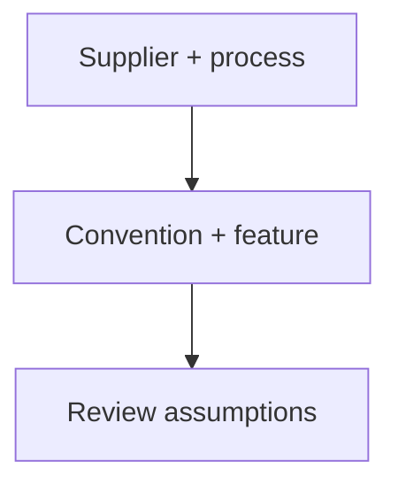

# Review bend files and CNC hole features before ordering

Use the supplier's conventions, then inspect the complete feature. These are advisory review examples, not new toolkit checks or proof of fit, strength or supplier acceptance.



## Bend callouts need a named angle convention

SendCutSend's design guide illustrates bend callouts of 130° and 45° for enclosed angles of 50° and 135°. Label the convention rather than copying an enclosed angle into a bend callout. Its flat-pattern illustration is one particular aluminium example, not a general deduction table. Use the selected material/thickness radius and K-factor for air bending; the article does not establish a universal flange limit. [ref:scs-bend-files]

The later step-by-step article distinguishes software and file format: SolidWorks DXF requires a dashed centreline rather than Hidden; Illustrator AI uses a separate bend-line colour. Inspect the exported representation. Its flange limits defer to material/thickness data: the imported `max(0.500 inch, 4 × thickness)` claim was not supported by this reading. Both articles share a publisher and do not independently corroborate one another. [ref:scs-bend-steps]

## Inspect the recess, not just the pilot

Protolabs distinguishes cylindrical counterbores for socket heads from conical countersinks matching a flat-head screw's angle. Its edge review includes the largest recess diameter. In a **derived containment example**, an 8 mm recess centred 3 mm from an edge overhangs by 1 mm even though a 4 mm pilot fits. This establishes containment only, not an acceptable strength-based edge distance. [ref:protolabs-hole-guide]

A 4 mm hole extending 28 mm is beyond the article's roughly six-diameter review trigger. Request a manufacturability check; do not turn the advisory into a prohibition or a promise of two-sided machining. The article supplies no numerical blind-thread tool allowance or FDM hole correction. Keep a blind hole where the opposite surface must remain intact, and specify a countersink angle rather than assuming all screws use 90°. [ref:protolabs-hole-guide]

<details>
<summary>Executable review illustrations and negative controls</summary>

This self-contained example is exercised by the existing process-profile test harness. It expresses convention conversion and geometric containment only; it is not a public API, a supplier quotation or a manufacturing gate. Units are millimetres except the named angle in degrees. The centre offset is perpendicular to one straight edge.

```python
import math


def bend_callout(angle, convention):
    if not math.isfinite(angle) or not 0 < angle < 180:
        raise ValueError("an angle strictly between 0 and 180 degrees is required")
    if convention == "enclosed":
        return 180 - angle
    if convention == "supplier-bend":
        return angle
    raise ValueError("name the angle convention")


def edge_margin(pilot, recess, centre_to_edge):
    values = (pilot, recess, centre_to_edge)
    if not all(math.isfinite(v) and v > 0 for v in values):
        raise ValueError("positive finite dimensions required")
    if recess < pilot:
        raise ValueError("a recess cannot be smaller than its pilot")
    return centre_to_edge - max(pilot, recess) / 2


assert bend_callout(50, "enclosed") == 130
assert bend_callout(135, "enclosed") == 45
assert edge_margin(4, 8, 3) == -1
```

A negative margin means the circular envelope crosses that edge. A nonnegative margin says nothing about strength, tooling, other edges or material. Reject missing conventions, non-finite dimensions and pilot-only substitutions. No supplier minimum is inferred from zero containment margin.

</details>

<details>
<summary>Full-reading and visual evidence, 2026-11-11</summary>

All three existing identities were read in full, including the Protolabs FAQ and both SendCutSend preflight sections. Linked calculators, material tables, other guides and videos were not claimed read. Manufacturer artwork stays outside the repository; the diagram above is original.

| Existing source | Reading boundary and inspected visual | Exact downloaded HTML SHA-256 |
|---|---|---|
| SendCutSend design guide, dated 2022-11-01 | Whole article; angle and flat-pattern illustrations | `2b44274e65f01072cd227a57ac2c41ac0831ea99096371b22400fe75ad02537b` |
| SendCutSend step-by-step guide, dated 2024-05-31 | Whole article; software-format table and corner-relief image | `29d55858f6814ef608ff7aeb6e4c1c66702d7012446ff12f55dbb40b09c4d478` |
| Protolabs hole guide, dated 2026-08-20 | Whole article/FAQ; live six-row feature table and two part photographs | `639cef92ba4b07ab4c626831cc0f19ec0430c3d5d6c2a4b48fea4a77760282c7` |

The photographs establish no dimensional values. Dated source/visual receipts are retained in [#323](https://github.com/Valpatel/cad-agent/issues/323#issuecomment-6805460913) and its [hole-guide checkpoint](https://github.com/Valpatel/cad-agent/issues/323#issuecomment-6805534112). These reads add no document identities, independent corroboration or measured evidence.

</details>


## A bracket workflow starts with its service and datums

For a removable electronics tray, start with a bent 5052-H32 bracket candidate. Select an actual thickness and its **bending** service specification before drawing flanges. SendCutSend's material page lists services separately for each thickness; a cutting listing does not establish a bending specification. Its broad temper-dependent radius advice is not the stock's radius/K-factor/flange tooling row. The article's thickness counts disagree between its main list and FAQ, so use the selected row rather than a total count. [ref:sendcutsend-5052-h32-aluminum-sheet-metal]

Use the existing [sheet-metal workflow](../../../.agents/skills/sheet-metal-hardware/SKILL.md) in this order:

1. Record the intended shop, alloy/temper, selected stock and supplier row/date. `cadagent.manufacturing.sheet_metal.bend` reports the row/rule provenance for radius, K-factor and allowance; refresh a stale or unavailable row with the supplier before ordering.
2. Give `check_bends` outside-mould-line flange lengths, the turned angle from flat, relief dimensions and the actual hardware/box/channel conditions. `flat_length` is an allowance/deduction calculation for those declarations, not a general STEP unfolding engine.
3. For `feature_to_bend`, measure **nearest feature edge to bend tangent** on the flat. For `cadagent.mechanical.clinch.check_placement`, use **hole centre to cut edge** and **hole centre to bend centreline**, with the bend allowance. Converting these datums requires the actual hole radius and bend geometry. Passing a centre distance as an edge distance can hide a collision.
4. Select hardware with `sheet_hardware.choose_clinch`, then check each placement. Use the exact part's hole, thickness and hardness requirements; a nominal “PEM hole” is not a specification. The existing hardware workflow handles sourcing and part models.
5. Export the bent STEP and flat DXF. Independently inspect thickness, hole coordinates, bend radius/angle and flat dimensions. Plant a short flange, insufficient relief, moved hole and angle/datum substitution; each should fail the relevant check. Retain an unchanged passing control.

For a Gyropup accessory, first obtain a reviewed attachment-datum and envelope extract from the product's current committed model. Catalogue estimates and a generated electronics bounding box are not measured mounting patterns. This workflow does not change printed legs, qualify the bracket's loads, or establish press-brake sequencing and physical fit.

## A simple CNC plate needs a machining-service contract

A first 2.5D example can be a 6061-T6 accessory plate with through holes and one shallow rounded pocket. Keep bearing fits and actuator load paths out of this initial example. SendCutSend's CNC guide asks for one solid STEP at model scale, without modeled threads. For its tapping setup, the model hole uses the thread's major diameter, then the preferred hole is confirmed in the order UI. That is a service convention, **not a machinist's tap-drill recommendation**. The guide distinguishes wall-to-wall corner fillets from wall-to-floor corners; do not apply an “all corners rounded” rule. [ref:sendcutsend-sheet-cnc-machining-design-guidelines]

The guide prints a minimum overall size of 0.5 × 0.5 × 0.5 inches. Its linked [CNC 6061 material FAQ](https://sendcutsend.com/materials/cnc/6061-aluminum/) says the design determines dimensions rather than fixed thickness offerings, and repeats “overall part dimensions.” This supports a service-envelope reading, rather than a universal material thickness. The material page also incorrectly lists 5052 material certificates under its 6061 heading; do not treat those certificates as 6061 qualification. A 6 mm plate needs supplier clarification against the published envelope; a 12.7 mm coupon is not thereby guaranteed accepted. No automatic thin-plate rejection is added. [ref:sendcutsend-sheet-cnc-machining-design-guidelines]

Use `cadagent.manufacturing.process.profile('cnc').verified_rule(id).limit(...)` to retrieve a **named, applicable** published rule, retaining its source and variables. For example, `cnc-corner-radius-hubs` uses pocket depth; `cnc-corner-radius-xometry` uses tool diameter. They are different publishers' recommendations, not SendCutSend's tooling contract. `dfm.Feature`/`dfm.check` do not currently offer CNC pocket/corner feature kinds. Those profile equations do not inspect a STEP model.

Before ordering, independently measure one solid, units, through-hole pattern, pocket depth, remaining floor and internal radii, then review tool access from the declared setup. Negative controls should include wrong units, an extra solid, a blind-for-through hole substitution, breached floor, sharp internal corner, mirrored hole coordinates and inaccessible undercut. This is a proposed demo acceptance plan; no CAD, CAM, model-generation or physical trial was run for this source batch. Automatic STEP feature extraction, fixturing and tool-access proof remain gaps.

<details>
<summary>Executable service-convention illustrations and controls</summary>

These original review examples preserve an unresolved supplier decision. They are not a new manufacturing checker. Envelope observations never return “pass”; even dimensions above the printed minimum still require a quote and full service review. Only the selected M3 tapping illustration is supported here—no vendor table is copied.

```python
from decimal import Decimal, InvalidOperation


def _positive_mm(value):
    try:
        number = Decimal(str(value))
    except InvalidOperation as exc:
        raise ValueError("finite positive millimetres required") from exc
    if not number.is_finite() or number <= 0:
        raise ValueError("finite positive millimetres required")
    return number


def scs_cnc_envelope_review(dimensions_mm):
    if len(dimensions_mm) != 3:
        raise ValueError("three overall dimensions in millimetres required")
    dimensions = tuple(_positive_mm(v) for v in dimensions_mm)
    published_min_mm = Decimal("0.5") * Decimal("25.4")
    return {
        "published_min_each_axis_mm": published_min_mm,
        "below_published_min": any(v < published_min_mm for v in dimensions),
        "decision": "confirm-service-envelope-and-quote",
        "scope": "SendCutSend CNC service; not a universal stock or machining limit",
    }


def scs_m3_tapping_model_hole(service, thread):
    if service != "sendcutsend-cnc" or thread != "M3x0.5":
        raise ValueError("only this named service and selected M3 example were reviewed")
    return {"model_hole_mm": Decimal("3"),
            "decision": "confirm-preferred-hole-in-tapping-setup",
            "scope": "service model convention; not tap-drill diameter"}
```

A 6 mm thickness triggers the envelope observation, while 12.7 mm does not; both retain the supplier-confirmation state. Substituting inches as millimetres, a 2.5 mm tap drill as the service's model hole, a different supplier, or a generic “accepted” verdict must not silently pass these examples.

</details>

<details>
<summary>Primary-source receipts and limits, 2026-11-12</summary>

Both existing source URLs were fetched directly as HTTP 200 without redirect and read in substantive article text, including service/setup and final sections. These undated HTML pages have no displayed numbered edition or page numbers. No manufacturer illustrations, interactive stock-specification dialogs, linked material certificates, quoting UI or manufacturing process was validated. Licence terms were not read; source text and images remain cite-only and outside git. The supporting CNC material page is the same publisher, not independent corroboration or a new registry identity.

| Existing identity or supporting receipt | Section anchors | Original HTML SHA-256 |
|---|---|---|
| `sendcutsend-5052-h32-aluminum-sheet-metal` (611090 bytes) | Size/thickness options; service specifications; bending radius/formability; FAQ | `9ff54e9519003deeae40fe837fb96154e2f52c0b4aab8d42aaa1b601af781026` |
| `sendcutsend-sheet-cnc-machining-design-guidelines` (285237 bytes) | Minimum/maximum sizes; file setup; wall corners; tapping setup; finished-part expectations | `42edec9fa3c451e388eb3db4c41ab0b52542e9e907ea345e1874c4506dd6703d` |
| Linked CNC 6061 material page (343443 bytes) | Size limits; material quality; thickness and minimum-size FAQ | `c81bdd503b57c693e86566ba5f22d706da102df1ee57917f642a131cf78f8201` |

These reads do not add automatic process-profile gates, encoded evidence or measured qualification. Existing generic and shop-specific rules retain their sources and behavior. See [#615](https://github.com/Valpatel/cad-agent/issues/615) for the source receipt and independent review.

</details>

[Manufacturing research](README.md) · [Sheet-metal workflow](../../../.agents/skills/sheet-metal-hardware/SKILL.md) · [Existing process rules](process-profiles.md)
