# Sheet metal: bending, cutting and the SendCutSend deep dive (2026-11-01)

This page is for Valpatel/cad-agent#283, which follows the first sweep of #118. Part A is a deep dive into one shop,
SendCutSend: what it cuts and bends, the limits it enforces, and how it prices. Part B records the generic rules that
named fabricators, practitioners and CAD vendors publish, where they agree and where they disagree.

The guide survey, [`sheet-metal-guides.md`](sheet-metal-guides.md), decides which source leads each topic. PEM
hardware and blind rivets are on [`sheet-metal-joining.md`](sheet-metal-joining.md). The numbers that checks use live
in [`process-profiles.yaml`](../process-profiles.yaml): the generic rules, and SendCutSend's own rules and tables under
`shop: sendcutsend`.

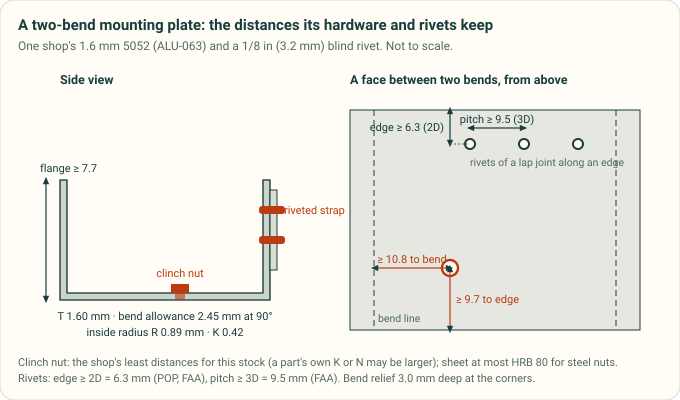

*Diagram drawn by `tools/process_profile_figures.py` from [`process-profiles.yaml`](../process-profiles.yaml): SendCutSend's
tables for 1.6 mm 5052 (ALU-063) and the rivet rules for a 1/8 in rivet. A test redraws it and fails if the committed
file differs.*

**How this was checked.**
- Part A was read on 2026-11-01. It draws on SendCutSend's two machine feeds, the specs file [ref:sendcutsend-specs]
  and the ordering catalogue [ref:sendcutsend-catalog]; its ordering guide [ref:sendcutsend-ordering-guide]; and its
  guideline, service, FAQ and pricing pages.
- SendCutSend asks crawlers not to scrape its material pages, so this page takes per-material numbers from the feeds
  only. Requests were spaced at least a second apart.
- Part B was read on 2026-10-31, except where it says otherwise.
- **[derived]** marks a number calculated here from cited data; the method is stated beside it.
- Guides are summarised, not copied. Paid standards are named by number and title only.

Symbols: T is the sheet thickness, R the inside bend radius, and K the K-factor (where the neutral sheet sits, as a
fraction of T from the inside face). BA is the bend allowance, and BD the bend deduction.

## Part A. SendCutSend

## A1. What it is, and how cad-agent uses it

SendCutSend is an online shop. You upload a flat DXF or a STEP of one sheet-metal body. It cuts the part by fibre
laser, waterjet or router, then can bend it, press in PEM hardware, tap, countersink, form dimples, and anodise,
plate or powder coat.

It bends by air bending on fixed tooling. That gives one radius and one K per stock, and it offers no custom radii
[ref:sendcutsend-bending-service]. A part must therefore be drawn with its R and K, or the flat pattern will not match
[ref:sendcutsend-sheet-cutting].

In cad-agent, SendCutSend is a **named shop profile** (`shops: sendcutsend` in the YAML):
- its per-stock tooling and limits are `shop_tables`;
- its shop-wide limits are rules marked `shop: sendcutsend`;
- `cadagent.manufacturing.process` leaves those rules out unless a caller names the shop, so the generic rules stay
  supplier-neutral; the bend calculator and the sheet DFM check read the `shop_tables` rows by default (`shop=False`
  drops them);
- a project's chosen suppliers (#284) will select the profile.

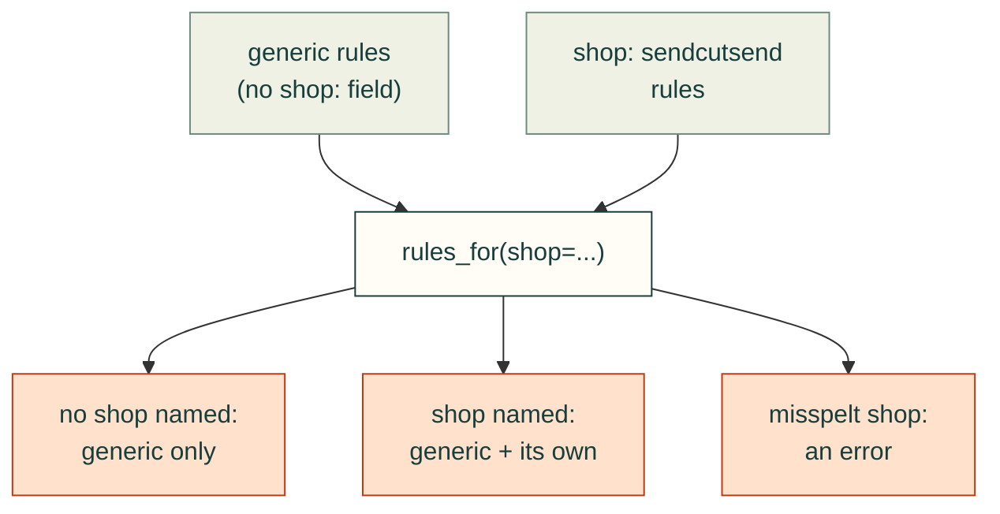

*How `cadagent.manufacturing.process` picks the rules a check sees. Each arrow means "feeds". A rule marked `shop:`
reaches a check only when the caller names that shop, and a shop the data file does not list raises an error. The
per-stock tooling rows (`shop_tables`) are different: `sheet_metal.bend` and the sheet DFM check read them by default
(`shop=True`), because a bend is always made on some shop's tooling, and `shop=False` drops them.*

The vendored text-to-cad `sendcutsend` skill [ref:text-to-cad] reads the same feeds for a preflight.

## A2. Materials and thicknesses

| Service | Materials (stocks) and range | Source |
|---|---|---|
| Bending | 10 materials, 0.030–0.250 in: 5052-H32 (8), mild steel (9), 304 (8), 316 (4), G90 (4), 4130 (5), brass (5), copper (6), polycarbonate (3), titanium grade 2 (1) | [ref:sendcutsend-bending-service] |
| PEM hardware | 7 materials, 0.040–0.500 in: 5052, 6061-T6, 7075-T6, G90, mild steel, 304, 316 | [ref:sendcutsend-hardware-service] |
| Tapping | 14 materials, from 0.059 in | [ref:sendcutsend-tapping] |
| Countersinks | aluminium and plastics only, from 0.125 in; no steel or stainless | [ref:sendcutsend-countersinking-service] |
| Dimples | 7 materials, 0.025–0.125 in | [ref:sendcutsend-dimple-forming] |

**What the feed holds** [ref:sendcutsend-specs]. The specs file was generated 2026-04-29 and lists 178 materials. For
each stock it gives:
- the thickness, with its plus and minus tolerance (5052 0.063 in: ±0.004 in);
- the cutting process and the smallest hole, bridge and hole-to-edge distance;
- for a bendable stock, R, K, the bend deduction, the die width, the shortest flange and the relief depth;
- for hardware, the least hole-to-edge, hole-to-bend and same-part distances, and the thread range;
- Brinell hardness and strength.

The YAML keeps the rows a bent plate with hardware needs: 23 bend rows (5052, mild steel, 304, 316, G90) and 27 stocks
with cutting and hardware limits.

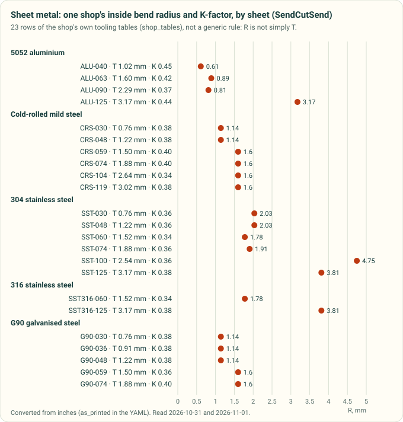

*Diagram drawn by `tools/process_profile_figures.py` from the SendCutSend tooling tables in
[`process-profiles.yaml`](../process-profiles.yaml) (`shop_tables`). A test redraws it and fails if the committed chart
differs.*

## A3. Cutting

From the cutting guidelines [ref:sendcutsend-sheet-cutting]:

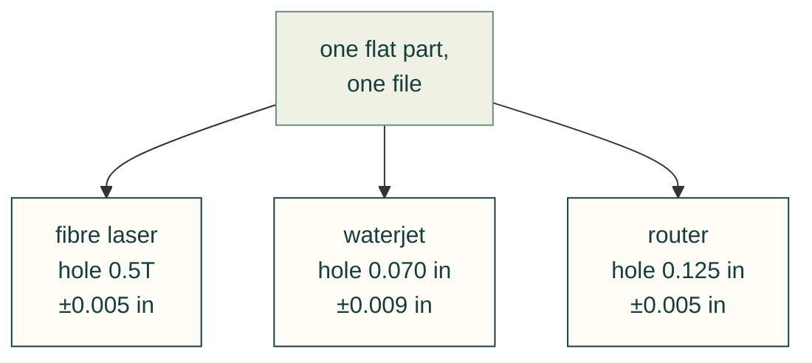

*The three cutting processes SendCutSend's cutting guidelines name, with the smallest hole and the tolerance each
holds [ref:sendcutsend-sheet-cutting]; the feed also lists a CO2 laser for some stocks. The process follows the material and thickness, not the buyer's choice.*

- **Smallest hole or cut-out:**
  - laser: at least 50 % of T;
  - waterjet: 0.070 in;
  - router: 0.125 in.

  The feed's per-stock `min_hole_size` is smaller, at 0.35T for 0.063 in 5052 [derived].
- **Inside corners:** about the kerf for the laser, 0.032 in for the waterjet and 0.063 in for the router.
- **Tolerances:** ±0.005 in for laser and router, ±0.009 in for waterjet. Taper adds 0.001–0.002 in under 0.250 in
  stock, and up to 0.010 in at 0.500 in.
- **Nesting:** one part per file. There is no common-line cutting; a real gap of 0.006–0.012 in stays between parts.
- **3D files:** one solid sheet-metal body of uniform thickness. Model holes as plain through holes; countersinks and
  taps are ordered as services. Use square bend reliefs, because rounded ones give open-contour errors.

## A4. Bending

From the bending guidelines [ref:sendcutsend-bending-service] and the deformation page
[ref:sendcutsend-bend-deformation]:

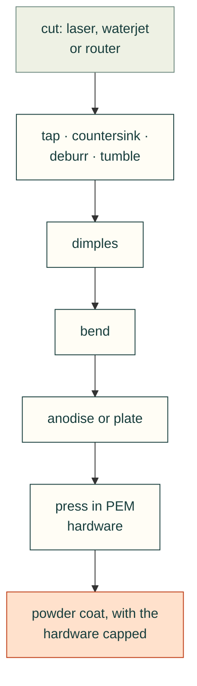

*The order SendCutSend runs its processes, from its dimple, hardware and finishing pages
[ref:sendcutsend-dimple-forming] [ref:sendcutsend-hardware-service] [ref:sendcutsend-finishing]. Each arrow means
"comes before". Hardware goes in after anodising and plating, but before powder coat. PEM's own handbook says never to
install after paint or powder ([`sheet-metal-joining.md`](sheet-metal-joining.md)).*

- **Part and bend size:** the flat part from 0.375 × 1.5 in to 30 × 44 in. A bend is 16–44 in long, depending on the
  thickness.
- **Angle:** at most 130°, and at least 5°. It does no hems, curls, rolls or coining.
- **Tolerances:**
  - bend to edge ±0.015 in, plus at least 0.015 in for each further bend;
  - angle ±1° up to 24 in long and ±2° above.
- **Flanges:**
  - each stock has its own minimum flange (`shop_tables`);
  - a U channel's base is at least twice its flange;
  - a box with hardware has flanges of 3.00 in at most, and 5 in without;
  - flanges 3.5–5 in long must be at least 1.1 in wide.
- **Features near a bend:** keep cut features at least half the die width from the bend line, or they distort. The
  dies run 0.472–1.575 in. Example: 0.104 in mild steel bends on a 0.630 in die, so keep features 0.315 in clear.
- **Unsupported bends:** a flange tapering below the minimum length distorts, so relieve it along the bend. From
  0.187 in up, the minimum flange may be needed on both sides along the whole bend.

**Its bend allowance reproduces [derived].** The bending calculator [ref:sendcutsend-bending-calculator] prints
K = t/T, BA = π(R + K·T)·A/180 and BD = 2·OSSB − BA. Those formulas, applied to each stock's R, K and T from the feed,
reproduce its published 90° bend deduction within 0.005 in for 53 of its 56 bendable SKUs. The other three differ by
−0.021 in (brass 0.187 in), −0.017 in (brass 0.250 in) and +0.012 in (hot-rolled 0.188 in). So a flat pattern built
from the feed's R and K matches the shop's own, except on those three stocks. (The calculator page's own worked
example prints two different flat lengths, 17.612 and 17.765 in, for the same part.)

## A5. Hardware, taps, countersinks and dimples

- **PEM hardware** [ref:sendcutsend-hardware-service] [ref:sendcutsend-hardware-catalog]:
  - The catalogue feed lists 151 nuts, flush nuts, standoffs and studs, from $0.77 to $5.73 each (median $1.23)
    [derived from `unit_price`].
  - For each part it gives the hole H (+0.003/−0 in), the edge distance K, the bend distance N and the same-part
    spacing M.
  - A hardware hole's centre must be at least BA/2 + N from the bend centre.
  - No hardware goes on a part with an acute bend.
  - The full analysis is on [`sheet-metal-joining.md`](sheet-metal-joining.md).

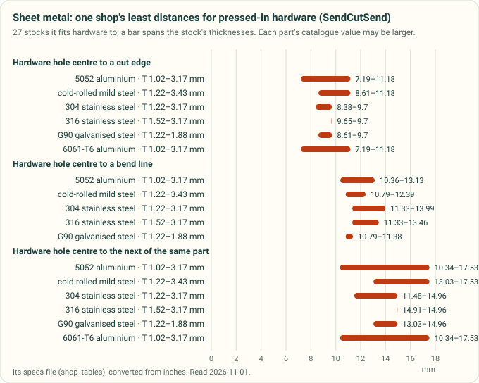

  *Drawn by `tools/process_profile_figures.py` from SendCutSend's `sendcutsend-cut-and-hardware-limits` table in
  [`process-profiles.yaml`](../process-profiles.yaml): the per-stock minimums of its specs feed, across 27 stocks.*

- **Tapping** [ref:sendcutsend-tapping]:
  - sheet from 0.059 in;
  - holes drawn at the tap-drill size (M3 0.102 in, M4 0.134 in, #10-32 0.164 in);
  - a tapped hole's centre at least half the tap hole plus the stock's tap hole-to-edge from any other cut;
  - at least half the die width from a bend.
- **Countersinks** [ref:sendcutsend-countersinking-service]:
  - depth at most 60 % of T;
  - 82° for inch screws and 90° for metric;
  - ±0.015 in;
  - aluminium and plastics only, from 0.125 in.
- **Dimples** [ref:sendcutsend-dimple-forming]:
  - 0.5–3 in across, in 0.025–0.125 in stock;
  - a dimple's centre at least its listed distance plus BA/2 from a bend;
  - formed before bending and hardware.

## A6. Finishes

| Finish | Build-up per side | Notes | Source |
|---|---|---|---|
| Type II anodise (clear, black, blue, gold, red) | 0.0002–0.0009 in | 5052, 6061 and 7075, 0.063 in and up; parts up to 23 × 23 in; a hanging hole of at least 0.063 in | [ref:sendcutsend-finishing] [ref:sendcutsend-finish-thickness] |
| Zinc plate (ASTM B633) | about 0.0003 in | mild steel and 4130, 0.187 in and up | [ref:sendcutsend-finishing] [ref:sendcutsend-finish-thickness] |
| Powder coat (15 colours) | 0.002–0.005 in | parts up to 30 × 36 in; holes under 0.040 in may fill; installed hardware is capped, tapped holes are not | [ref:sendcutsend-finishing] [ref:sendcutsend-finish-thickness] |

Add powder build-up to slots and tab fits on both faces.

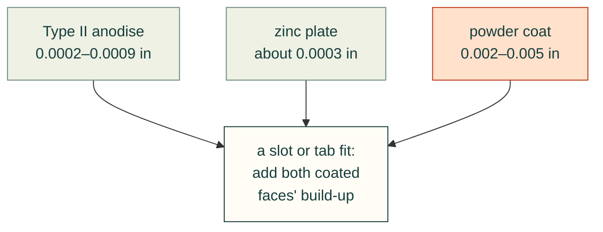

*Finish build-up per side from SendCutSend's finish-thickness FAQ [ref:sendcutsend-finish-thickness]. Powder is 5–25
times the others, so it is the one that closes a fit.*

## A7. Pricing and lead time

From the pricing page [ref:sendcutsend-pricing]:
- **Terms:** no minimum quantity, volume discounts up to 80 %, and free US shipping from $39.
- **What sets the price:** size, material and thickness, quantity, cut complexity, the production method and
  post-processing. No formula is published.
- **Quantity:** the page's example prices fall 60–75 % per part from 1 to 100 parts [derived]. For example, 0.100 in
  5052 cut, bent and tapped costs $37.49 for one and $11.06 each for 100. That drop is the visible set-up share.
- **Lead time:** standard orders ship in 2–4 business days. Bending adds 1–2 days and hardware 1–3.

## A8. Where SendCutSend's own pages disagree

Seven topics where SendCutSend's newer and older pages disagree

| Topic | Newer or more authoritative | Older or conflicting |
|---|---|---|
| Thinnest tapped sheet | tapping page (2026): 0.059 in | blog (2023): 1/8 in |
| Bend relief depth | the feed: a value per stock | blog: T + R + 0.020 in; deformation page: R + 0.020 in |
| Powder colours | service page (2026-09): 15 | FAQ (2025-09): 11, with other codes |
| Anodise type | service page (2026-10): Type II only | enclosure blog (2023): Type III |
| #10-32 nut hole | catalogue page, SS-032-1: 0.250 in | catalogue feed: 0.253 in; blog (2025): 0.252 in |
| M3 nut hole | catalogue page, S-M3-0: 0.168 in | catalogue feed: 0.171 in |
| Flat length in the calculator example | 17.612 in | 17.765 in on the same page |

The hardware feed also has rows that contradict their own SKU. SP-440-1 is labelled #6-32, FH4-M3-12 is labelled
M4 × 0.7, and SO4-440-12 is labelled #6-32. The catalogue page prints "A236" where PEM's A286 is meant.
[`sheet-metal-joining.md`](sheet-metal-joining.md) lists them. Re-fetch the feeds before relying on any number here.

## Part B. Generic sheet-metal rules (the #118 sweep)

The rest of this page is the generic sweep drafted in #119, read on 2026-10-31. Its rules are in
[`process-profiles.yaml`](../process-profiles.yaml) without a `shop:` field.

## B1. Minimum inside bend radius

The six bend-radius rules, by source and process

| Rule | Who | Process |
|---|---|---|
| R ≥ T | Boothroyd Dewhurst checklist [ref:dfma-dfm-checklist]; Hubs [ref:hubs-sheet-metal]; Greg Paulsen [ref:paulsen-2017-machine-design-sheet-metal] | press brake, generic |
| R ≥ T for mild steel 0.02–0.13 in. Coining can reach nearly zero. Air bending is set by the V-die, "normally" 1–2T. Shops stock radii in 1/32 in steps | Gerald Davis [ref:davis-2001-fabricator-design-tips] | press brake |
| 3003 and 5052 bend about like mild steel; 6061 or 2024 may need 4–8T | Gerald Davis [ref:davis-2001-fabricator-design-tips] | press brake |
| An air-formed radius is a share of the die opening: 20–22 % for stainless, about 16 % for 60-KSI cold-rolled steel. A starting point, not exact | Steve Benson [ref:benson-2015-fabricator-inside-radius] | air bending |
| Standard radii 0.030, 0.060, 0.090, 0.120 in; use one radius for every bend | Protolabs [ref:protolabs-sheet-metal] | press brake |
| The radius is set by the tooling and cannot be chosen. For its metals, R/T runs from 0.36 (5052, 0.090 in) to 2.67 (304, 0.030 in) [derived from `bend_radius` / `thickness`] | SendCutSend [ref:sendcutsend-ordering-guide], [ref:sendcutsend-specs] | air bending |

**Agree.** R ≥ T is the common generic default, and everyone says the material and the tooling decide.

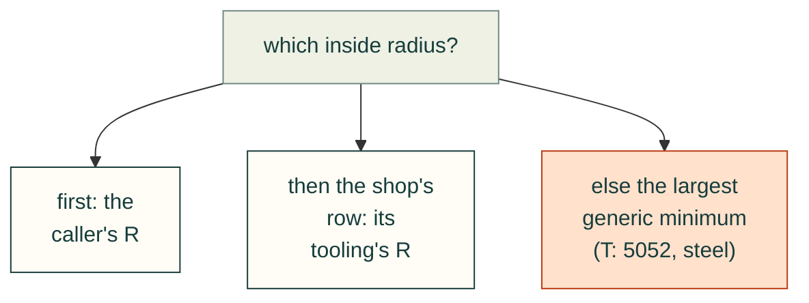

*The order `cadagent.manufacturing.sheet_metal.bend` reads a radius in: a given one, then the shop's row (read by
default; `shop=False` skips it), then the strictest generic rule. A shop's K and shortest flange hold only for its own radius, so a different R drops to the
generic rules for those too.*

**Disagree.**
- SendCutSend's own tooling bends at R < T for half its 5052 SKUs, four of five brass and copper SKUs and seven of
  nine mild-steel SKUs, and bends thin stainless at R > T [derived]. A blanket "R ≥ T" check would fail parts a shop makes every day, and pass a thin stainless
  part drawn at R = T that the shop will make at 2.7T.
- R ≥ T is not safe for hard aluminium. Davis gives 4–8T for 6061 and 2024, and SendCutSend bends none of its
  twelve 6061 or three 7075 SKUs, only 5052 [derived from which SKUs have `bending_specs`].
- Benson's rule over-predicts SendCutSend's listed radii [derived]: 16 % of its 0.472 in die is 0.076 in, against
  0.045–0.063 in listed for mild steel on that die; 20–22 % of its 0.984 in die is 0.197–0.216 in, against
  0.130–0.187 in for stainless. Benson says himself the rule is only a first estimate.

## B2. K-factor and bend allowance

- **Definition.** K = t/T, with t the distance from the inside face to the neutral sheet. Bend allowance
  BA = π(R + K·T)·A/180 with A in degrees (SOLIDWORKS help [ref:solidworks-k-factor]). Hubs gives the same ratio
  [ref:hubs-sheet-metal].
- **Ranges.**
  - Hubs: 0.3–0.5, "average 0.4468". The page writes the K-factor in mm, but it is a ratio with no unit. Its chart
    gives K by forming method (air bending, bottoming, coining), material hardness and R/T band, from 0.33 to 0.50.
    It suggests 3–5 test bends for a real value [ref:hubs-sheet-metal].
  - OSH Cut: about 0.4 for soft metals such as aluminium, about 0.45 for steel and stainless [ref:oshcut-material-304].
  - SendCutSend: per SKU, 0.32–0.48 for metals and 0.33 for polycarbonate [ref:sendcutsend-specs].
- **Defaults in CAD.**
  - Onshape: 0.45, and 0.5 for rolled walls [ref:onshape-sheet-metal].
  - build123d `BuildSheet`: 0.5 [ref:build123d-sheet-metal].
  - FreeCAD SheetMetal: the README's example is 0.38 (ANSI). Its example table (R/T 1 → 0.38, 3 → 0.43, above →
    0.5) is the same as the Hubs row for air bending a medium material such as steel [ref:freecad-sheetmetal].
- **Two conventions.** FreeCAD SheetMetal accepts an "ANSI" or a "DIN" K-factor, and its unfolder halves a DIN
  value to get the ANSI one [ref:freecad-sheetmetal]. DIN 6935 is the German standard for cold bending flat steel
  [ref:din-6935]; its content was not read here. A K-factor without its convention can be off by a factor of two.

**Disagree.** Hubs and OSH Cut put K higher for harder metals. SendCutSend's measured values run the other way:
0.37–0.48 for 5052 against 0.34–0.38 for 304 [derived]. Use the shop's measured K, or a test bend, over any rule.

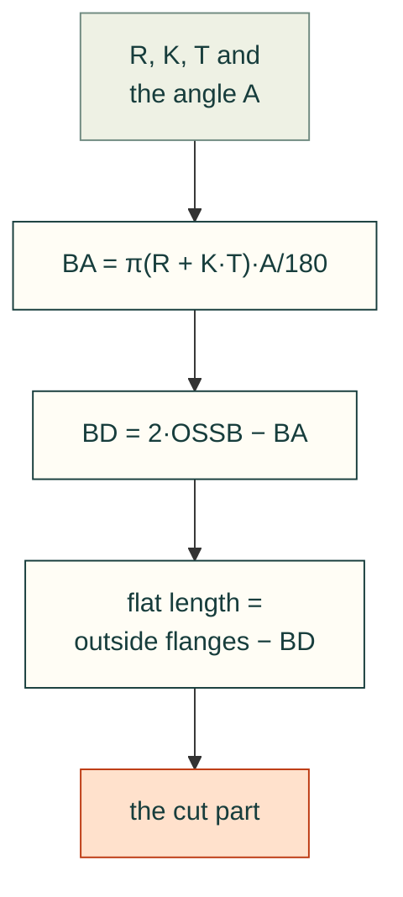

*From the bend's R, K and T to the flat pattern the laser cuts (SOLIDWORKS help [ref:solidworks-k-factor];
SendCutSend's calculator [ref:sendcutsend-bending-calculator]). OSSB is the outside setback, (R + T)·tan(A/2). A wrong K
moves every flat length by the change in BA.*

**Why it matters** [derived]: a 90° bend in 1.5 mm sheet at R = 1.5 mm has BA = 3.13 mm at K = 0.33 and 3.53 mm at
K = 0.5. That is 0.4 mm per bend, more than the cut tolerance, from the default alone.

## B3. Minimum flange length

| Rule | Who |
|---|---|
| ≥ 4T | Protolabs [ref:protolabs-sheet-metal]; Gerald Davis (shorter flanges get tool marks, need a backup strip, or must be milled after forming) [ref:davis-2001-fabricator-design-tips] |
| ≥ 3.5 × (T + R) | Century Tywood [ref:century-tywood-sheet-metal-reference] |
| "Bend height" ≥ 2T + R | Hubs [ref:hubs-sheet-metal] |
| "Minimum flange length met", no number | Boothroyd Dewhurst [ref:dfma-dfm-checklist] |
| Set by the die: a larger radius needs a larger die and more flange | OSH Cut [ref:oshcut-material-304]; SendCutSend [ref:sendcutsend-specs] |

SendCutSend's minimum flange after the bend is 0.286 in on 0.030–0.040 in stock (7–9.5T), about 3.8T on 0.125 in
5052, and 1.37–1.38 in on 0.250 in stock (5.5T) [derived]. It follows the die width (about 0.6–0.9 × the die), not
the thickness alone [derived].

**Disagree.** 4T is too short for thin sheet on SendCutSend's tooling, by up to 2.4×. Century Tywood's 3.5 × (T + R)
comes closer for thin stock (0.26 in against 0.286 in for 0.030 in mild steel) but is longer than SendCutSend needs
at 0.250 in [derived]. No generic rule fits every shop; the die decides.

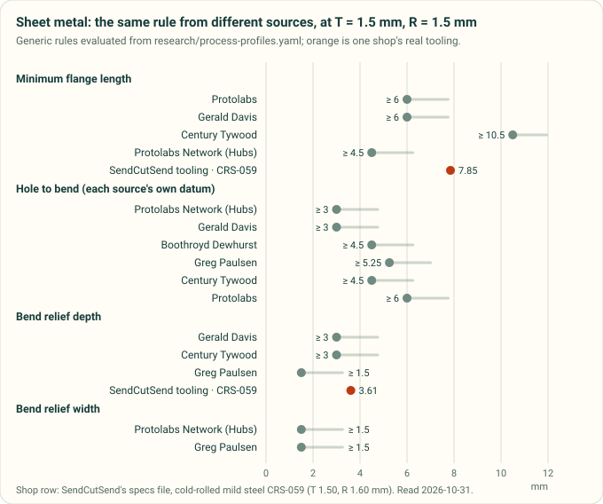

*Diagram drawn by `tools/process_profile_figures.py` from the sheet-metal `compare` rules in
[`process-profiles.yaml`](../process-profiles.yaml), with SendCutSend's tooling table in orange. A test redraws it and
fails if the committed chart differs.*

## B4. Holes: size, edge distance, spacing, distance to a bend

**Minimum diameter.**
- ≥ T: Protolabs; Hubs (smaller is possible but not advised); Greg Paulsen (more for high-strength material);
  Century Tywood.
- Gerald Davis explains why: a punch thinner than about T bends or breaks, so smaller holes are laser-cut.
- Fibre laser shops go smaller. OSH Cut gives a minimum of 0.25T and a recommended 0.5T for 304
  [ref:oshcut-material-304]. SendCutSend's fibre-laser minimum holes are 0.22–0.6T, median 0.37T [derived from
  `min_hole_size` over 92 SKUs].

**Hole to edge.**
- Protolabs: 0.062 in for stock up to 0.036 in, else 0.125 in [ref:protolabs-sheet-metal].
- Century Tywood: 1/16 in for stock up to 1/32 in; thicker stock 2T but not under 1/8 in
  [ref:century-tywood-sheet-metal-reference].
- Boothroyd Dewhurst and Greg Paulsen: ≥ 2T.
- Hubs: ≥ T.
- SendCutSend (fibre laser): 0.22–0.67T per SKU, median 0.3T [derived].
- Protolabs and Century Tywood give nearly the same rule. The others differ by a factor of two.

**Hole to hole.** ≥ 2T (Hubs; Century Tywood for punched holes) against ≥ 6t (Greg Paulsen).

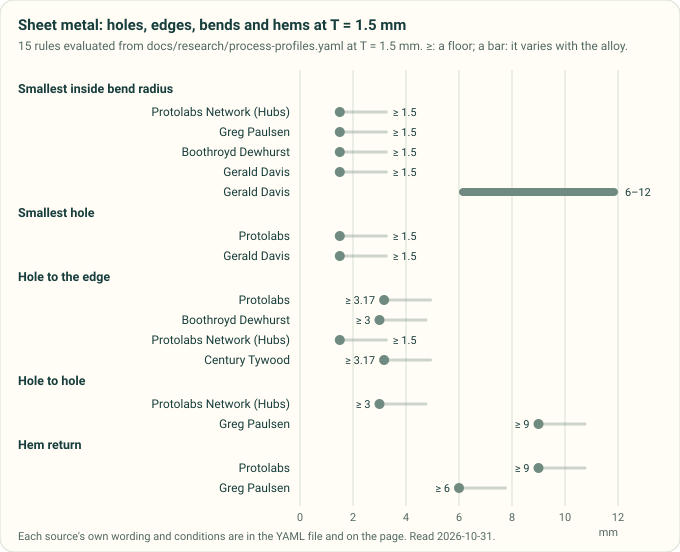

*Diagram drawn by `tools/process_profile_figures.py` from the sheet-metal hole, edge, bend and hem `compare` rules in
[`process-profiles.yaml`](../process-profiles.yaml), at a sheet thickness of 1.5 mm. A test redraws it and fails if the
committed chart differs.*

**Hole to bend.** Every source uses a different datum:

The six hole-to-bend rules and the datum each measures from

| Rule | Datum | Who |
|---|---|---|
| ≥ 2T + R | not stated | Boothroyd Dewhurst [ref:dfma-dfm-checklist] |
| ≥ 2T | from the start of the bend radius (tangent) | Hubs [ref:hubs-sheet-metal]; Gerald Davis, to the hole edge [ref:davis-2001-fabricator-design-tips] |
| ≥ 2.5t + r (holes), 4t + r (slots) | "from bend" | Greg Paulsen [ref:paulsen-2017-machine-design-sheet-metal] |
| ≥ 1.5 × (T + R) | inside dimension from the bend to the hole edge | Century Tywood [ref:century-tywood-sheet-metal-reference] |
| features within about 4T are at risk | "of a bend" | Protolabs [ref:protolabs-sheet-metal] |
| hardware 0.41–0.65 in centre to bend line by thickness; countersinks half the die width from the bend centre | bend line or bend centre | SendCutSend [ref:sendcutsend-specs], [ref:sendcutsend-countersink] |

The vendored text-to-cad DFM checklist already says to state the convention (tangent, centreline or edge) before
comparing [ref:text-to-cad]. These sources show why. `sheet_metal.feature_to_bend` takes the distance from the
feature's edge to the tangent line and checks it against each rule on that rule's datum. For Century Tywood it adds the
inside setback R tan(A/2). A rule that states no datum is read from the tangent and can only warn, never fail.

## B5. Bend relief and corner relief

The five relief rules, by source

| Rule | Who |
|---|---|
| Relief ≥ T + R | Gerald Davis [ref:davis-2001-fabricator-design-tips]; Century Tywood [ref:century-tywood-sheet-metal-reference] |
| Width ≥ T | Hubs [ref:hubs-sheet-metal]; Greg Paulsen, who adds length longer than R [ref:paulsen-2017-machine-design-sheet-metal] |
| Width ≥ T/2; depth ≥ T + R + 0.02 in from the bend line | SendCutSend [ref:sendcutsend-bend-relief] |
| Corner gap between flanges ≥ 0.015 in | SendCutSend [ref:sendcutsend-bend-relief] |
| Reliefs discussed, no numbers | Protolabs [ref:protolabs-sheet-metal] |

- SendCutSend's specs file agrees with its own article: its `bend_relief_depth` equals T + R + 0.020 in for the
  SKUs checked (0.030 in mild steel, 0.063 in 5052, 0.100 in 304) [derived].
- Davis adds two reasons for reliefs: a relief keeps the part from slipping in the tooling, and a relief cut with
  curves, not sharp inside corners, stops cracks from growing under vibration.

**Disagree** on width: T/2 (SendCutSend) against T (Hubs, Paulsen).

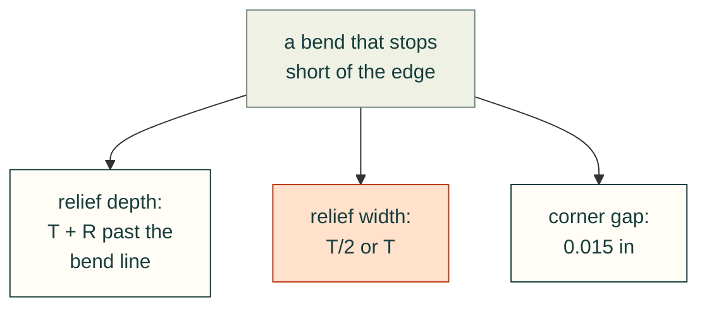

*The three relief sizes of §B5 for one bend. SendCutSend adds 0.020 in to the depth and gives the corner gap. The
width is the one the sources disagree on (T/2 SendCutSend, T Hubs and Paulsen), so it is drawn in orange.*

## B6. Hems, curls, jogs and countersinks

**Hems.**
- Protolabs: inside diameter ≥ T, return 6T [ref:protolabs-sheet-metal].
- Greg Paulsen: open hems, inside diameter ≥ t and return ≥ 4t; tear-drop hems, inside diameter ≥ t, opening ≥ ¼t
  and return ≥ 4t [ref:paulsen-2017-machine-design-sheet-metal].
- Steve Benson: a closed hem has zero radius, and its bend deduction is about 43 % of T "under perfect conditions",
  depending on the operator [ref:benson-2015-fabricator-inside-radius].
- Not every shop hems. SendCutSend bends to 120–130° at most [ref:sendcutsend-ordering-guide]. Xometry quotes hems
  and curls by hand [ref:xometry-manufacturing-standards].
- **Disagree** on the return: 6T (Protolabs) against 4t (Paulsen).

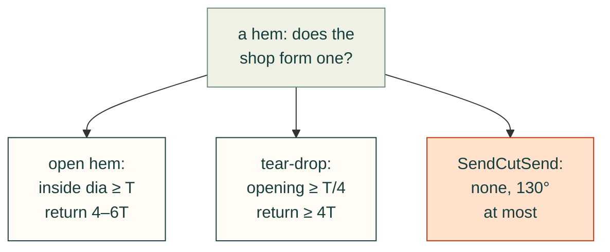

*The hem rules above, by kind (Protolabs [ref:protolabs-sheet-metal], Paulsen
[ref:paulsen-2017-machine-design-sheet-metal]). A shop that only air-bends cannot form one, so check the shop first.*

**Curls** (Greg Paulsen): outside radius ≥ 2t; holes at least the curl radius plus t away. Under the same heading the
article gives bends at least 6t plus the curl radius away.

**Jogs and offsets.**
- Protolabs: recommended offset 0.030 in, standard heights 0.060–0.312 in, height tolerance ±0.012 in.
- SendCutSend gives a minimum and maximum joggle per SKU, from 0.288 in on 0.030 in mild steel to 1.425 in on
  0.250 in stock [ref:sendcutsend-specs].

**Countersinks.**
- Protolabs: major diameter 0.090–0.500 in; 82, 90, 100 or 120°; formed countersinks +0.020/−0.010 in.
- Greg Paulsen: at least 8t apart, 4t from an edge, 3t from a bend. He also gives "maximum depth 3.5t", which cannot
  be right as printed, since a countersink cannot be deeper than the sheet. Do not use that number.
- SendCutSend: edge distance per SKU (0.781 in in its 0.25 in 5052 example), and half the die width from the bend
  centre [ref:sendcutsend-countersink]. It also forms dimples, with a size table per SKU [ref:sendcutsend-specs].

## B7. PEM and other self-clinching hardware

This section moved to [`sheet-metal-joining.md`](sheet-metal-joining.md), which reads PEM's handbook and bulletins
in full.

One finding from the first sweep stays here: "a stainless nut is fine in stainless sheet" is the wrong rule.
- PEM: only its SP and SMPP nuts go into stainless sheet, and 300-series stainless fasteners such as CLS never do,
  because they are not hard enough [ref:pem-bulletin-cl]. Its handbook gives the reason: the fastener must be about
  20 HRB harder than the sheet [ref:pem-handbook].
- SendCutSend lists 304 at HB 123 and 316 at HB 149 [ref:sendcutsend-specs]. Against CLS's rating of HRB 70 (HB 125)
  that leaves no margin in 304, and 316 is harder than CLS's limit.
- An SP nut, rated to HRB 90, covers both [ref:pem-catalog-self-clinching-nuts].

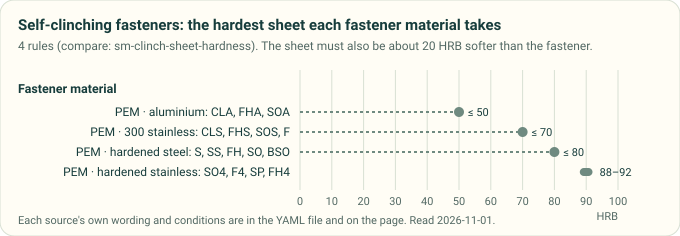

*Drawn by `tools/process_profile_figures.py` from the `compare: sm-clinch-sheet-hardness` rules in
[`process-profiles.yaml`](../process-profiles.yaml).*

## B8. Tabs, slots and notches

The word "tab" means two features here. Protolabs and Paulsen mean a finger in the cut outline. SendCutSend and
Fictiv mean a tab that locates in a slot in another part.

- **Outline tabs and notches.**
  - Protolabs: tab at least the larger of 2T and 0.126 in; notch at least the larger of T and 0.04 in; either no
    longer than 5× its width [ref:protolabs-sheet-metal].
  - Greg Paulsen gives the same numbers, plus notch spacing ≥ 1/8 in and a notch ≥ 3t + r from a bend.
- **Tab-and-slot joints.**
  - SendCutSend: slot width = tab width + 2 × the tab material's cut tolerance. Slot height = tab thickness + its
    plus thickness tolerance + 2 × the slot material's cut tolerance. Allow 0.002–0.005 in per powder-coated
    surface. Make tabs 0.5–0.75 of the mating part's depth [ref:sendcutsend-tab-slot]. The specs file gives a
    `tab_slot_tolerance` per SKU; most are 0.010–0.035 in [ref:sendcutsend-specs].
  - David Willson (Fictiv): tab width 1.0–1.5T (1.2–1.8T for a press fit) and length 1.0–1.2T. Clearance 0.05–0.1 mm
    per side for laser, 0.15–0.2 mm for waterjet. Slot corner radius 0.1–0.2 mm (laser) or 0.2–0.3 mm (waterjet).
    At least 2T from the sheet edge and 1.5T from the bend tangent; tabs 3–6T apart; 2–4 tabs per joint
    [ref:fictiv-tabs-slots].
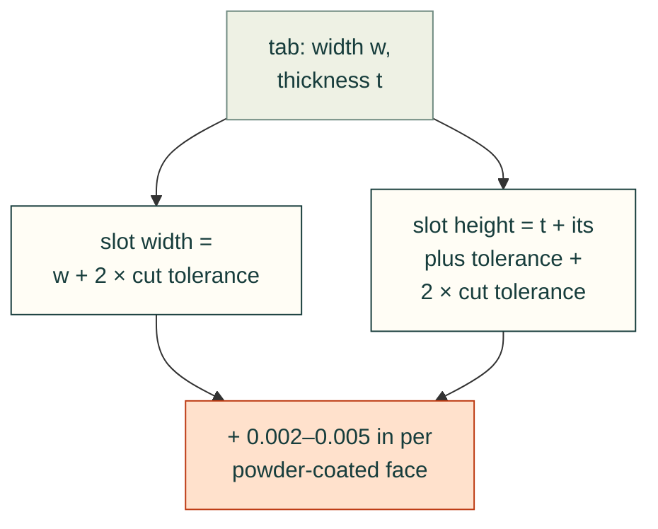

*SendCutSend's tab-and-slot sizing [ref:sendcutsend-tab-slot]: the slot grows by each part's cut tolerance, and by the
powder on every coated face.*

- **Disagree** on tab length: 1.0–1.2T (Willson) against 0.5–0.75 of the mating depth (SendCutSend). They may
  measure different things; neither defines the datum.

## B9. Laser and waterjet: kerf and the smallest features

**Kerf.**
- Hubs: about 0.3 mm on average for laser, 0.5–1 mm for waterjet [ref:hubs-sheet-metal].
- OSH Cut: 0.006 in (0.15 mm) on 304 at every thickness [ref:oshcut-material-304].
- David Willson (Fictiv): 0.1–0.3 mm [ref:fictiv-tabs-slots].
- Compensate for mating parts. Hubs adds half the kerf to the inner part and takes half off the outer. Willson
  enlarges slots by half the kerf per side.
- **Disagree**: 0.15 mm against 0.3 mm. Ask the shop, or measure.

**Smallest features.**
- Laser corners: fillet T/2 (Hubs).
- OSH Cut, 304: minimum channel about 0.2T and wall about 0.33T [derived from its table].
- SendCutSend: minimum bridge per SKU.
- Protolabs: smallest flat part 0.25 × 0.25 in; smallest formed part 0.5 × 0.5 in.

## B10. Grain direction

- Gerald Davis: aluminium "tends to crack, particularly when bending parallel to the natural material grain"; the
  harder alloys need the larger radii in §B1 [ref:davis-2001-fabricator-design-tips].
- Century Tywood: bend across the grain, or at 45° to it, whenever the part allows
  [ref:century-tywood-sheet-metal-reference].
- No source read here gives a number for how much larger the radius must be when bending with the grain. The
  candidate tables (Machinery's Handbook, the Aluminum Association) were not opened (§B14).

## B11. Tolerances by process

The tolerances by process, from six sources and one standard

| Process | Tolerance | Who |
|---|---|---|
| Cut, one surface | ±0.005 in under 0.13 in stock, ±0.015 in above | Protolabs |
| Cut, fibre laser | ±0.005 in | SendCutSend |
| Cut, CO2 laser and waterjet | ±0.009 in | SendCutSend |
| Cut, generic | ±0.010 in edge to edge | Xometry |
| Cut, by process | laser 0.05 mm, waterjet 0.2 mm, plasma 0.5 mm | Hubs |
| Cut, laser | ±0.1 mm | David Willson (Fictiv) |
| Bend to edge, bend to hole | ±0.010–0.025 in by thickness (Protolabs); ±0.015 in (Xometry) | Protolabs; Xometry |
| Across bends | ±0.015–0.025 in for 2 bends and ±0.030–0.040 in for 3 or more, by thickness (Protolabs); ±0.030 in (Xometry) | Protolabs; Xometry |
| Bend angle | ±1° (Protolabs, Xometry, SendCutSend up to 24 in); ±2° over 24 in; ±5° polycarbonate (SendCutSend) | as listed |
| Flatness | grows with length; e.g. 0.005 in up to 1 in | Century Tywood |
| General tolerances | ISO 2768-1 applies to parts formed from sheet metal (scope only; content not read) | [ref:iso-2768-1] |

**Agree.** Protolabs, Xometry and SendCutSend all give bend angle ±1°. Tolerance grows with each bend between two features, so dimension
critical features from one flat face.

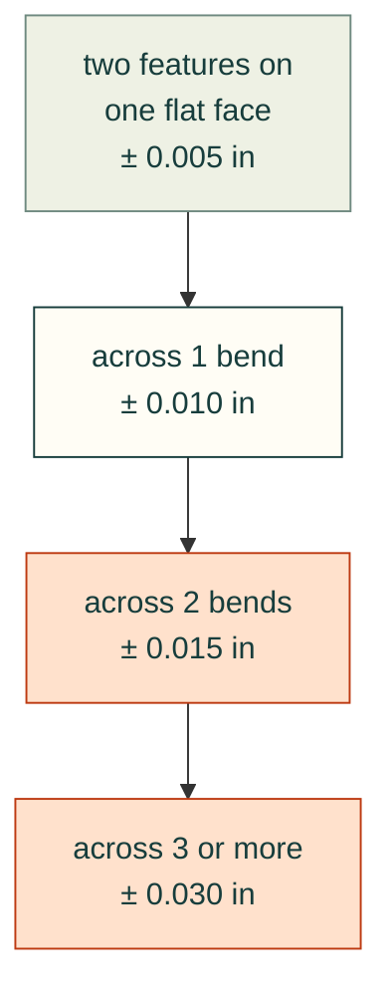

*Protolabs' tolerance between two features in stock under 0.13 in, by the bends between them (its guidelines
[ref:protolabs-sheet-metal]; the one-pager gives the 2- and 3-bend values [ref:protolabs-sheet-metal-tolerances]).
In thicker stock the steps are ±0.015, ±0.020, ±0.025 and ±0.040 in. The
band grows with every bend between them, so a hole pattern that must line up belongs on one face.*

## B12. What this changes in cad-agent

Since the #118 sweep, `cadagent.manufacturing.sheet_metal` computes bends from the profiles: a shop row first, then the
generic K table and the strictest generic rule. With #283 the YAML adds four things:
- SendCutSend as a named shop profile, with its own limits as rules;
- its 304, 316 and G90 bend rows;
- its per-stock cutting and hardware limits;
- supplier-neutral rules for clinch hardware and blind rivets.

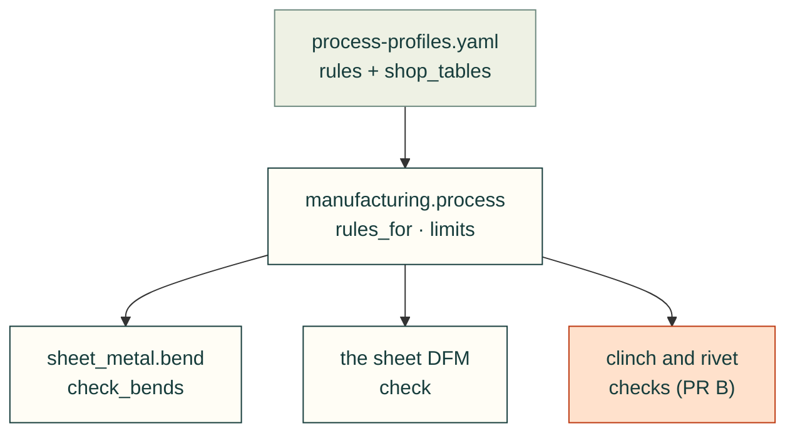

*Where the rules go. Each arrow means "read by". The DFM check takes only the generic rules, beside the shop's bend
row for the stock (read by default; `shop=False` drops it). The orange box is the next step, not yet merged.*

The six planned checks: what the sources say and where each stands

| Planned check | What the sources say | Status |
|---|---|---|
| Minimum flange | 4T (Protolabs, Davis) is too short on SendCutSend's thin stock (7–9.5T) | `sheet_metal.bend` uses the shop row first; `check_bends` fails below it and warns below the strictest generic rule |
| Hole to bend | Six rules, each on its own datum or none (§B4); SendCutSend: half the die width | `feature_to_bend` checks each on its datum; the die width is not in the tables |
| R ≥ T | Fails SendCutSend's own 5052 radii; unsafe for 6061 and 2024 | `sheet_metal.bend` reads the shop's R |
| Bend relief | SendCutSend's feed gives a depth per stock | `check_bends`: depth from the row, else the strictest rule; width from the strictest generic rule |
| Clinch hardware near an edge or a bend | PEM: C/L to edge from the outside of the bend radius; SendCutSend: BA/2 + N from the bend centre. On one datum they are the same rule, since the outside of the radius lies BA/2 from the bend centre on the flat | Rules `sm-clinch-*`, both written from the bend centre line; the check is #283's PR B |
| Rivet edge distance and pitch | 2D edge (POP, FAA, NASA nominal), 1.5D minimum; 3D pitch (FAA), 4D nominal | Rules `sm-rivet-*`; the check is #283's PR B |

## B13. Open-source tools for bent parts

The adopt, wrap, borrow or build decision for every tool, fastener libraries included, is in
[`sheet-metal-guides.md`](sheet-metal-guides.md) §7. It was re-checked on 2026-11-01: build123d sheet metal is still
unreleased, and FreeCAD SheetMetal is at 0.8.26. The table below gives the bent-part detail from `gh api` and the
READMEs on 2026-10-31. build123d and FreeCAD SheetMetal were checked twice (registry entries);
the other rows come from a separate survey on the same day and were not re-opened.

The eight bent-part projects: licence, activity, what each does, and the decision

| Project | Licence | Activity | What it does | Use |
|---|---|---|---|---|
| [gumyr/build123d](https://github.com/gumyr/build123d) `BuildSheet`, `unfold`, `sheet_shells` | Apache-2.0 | dev branch, pushed 2026-10-30; not in v0.13.0 (2026-09-21) | Flange, bend, jog, hem, miter, bend and corner relief; unfold with a face map (bend line, angle, radius, up or down); `sheet_shells` takes a solid back to sheet surfaces. One K (default 0.5, ANSI-style); no K table, no DIN | **Adopt** on release: our kernel, pure OCP, permissive |
| [shaise/FreeCAD_SheetMetal](https://github.com/shaise/FreeCAD_SheetMetal) | LGPL-2.1 (from GPL-3 in 2024) | pushed 2026-10-17, 350★ | The most complete set: relief and hem types, K tables by R/T, ANSI and DIN, DXF and SVG export | **Reference**, or run as a separate `freecadcmd` process for a second flat pattern. Do not copy code into the MIT package |
| [andymai/brepjs](https://github.com/andymai/brepjs) `brepjs-sheetmetal` | Apache-2.0 | pushed 2026-10-31, "experimental" | Tab and slot, bend tables, unfold of imported solids, nesting, a JSON bend report, unfold-and-refold tests | **Reference** for features and test ideas (TypeScript) |
| [ManuelMRosa/SheetNest](https://github.com/ManuelMRosa/SheetNest) | MIT | pushed 2026-10-29 | Nesting; unfolds STEP to DXF through `freecadcmd` and the SheetMetal unfolder | **Reference** for the headless pattern |
| [KanadeK/bendseq](https://github.com/KanadeK/bendseq) | MIT | pushed 2026-08-30, 1★ | Press-brake bend-order search with collision checks | Reference (very young) |
| [earthtojake/text-to-cad](https://github.com/earthtojake/text-to-cad) `dfm`, `sendcutsend` skills | MIT | vendored | A sheet-metal review checklist; a SendCutSend preflight against its JSON. Its unfold proposal (#614) is still open | Already vendored; **reference** |
| [richiewillmott/FreeShape](https://github.com/richiewillmott/FreeShape) | GPL-3.0 | pushed 2026-10-30 | Desktop app: flanges, K-factor flat pattern, DXF | Skip (an app, GPL) |
| [alexneufeld/YouCanNotUnfold](https://github.com/alexneufeld/YouCanNotUnfold), [ulrich1a/sheet_ufo](https://github.com/ulrich1a/sheet_ufo) | LGPL-2.1; GPL-2.0+ | merged into SheetMetal; 2018 | Earlier FreeCAD unfolders | Skip (superseded) |

No open-source tool measures a sheet-metal part against DFM rules (hole to bend, flange length, radius against a
shop table). That checker, on top of build123d's face map and the cited rules above, is the real gap. The small
pieces cad-agent would add are a K table by R/T with an ANSI/DIN switch, and the shop-profile reader.

## B14. Not verified, and next steps

Not opened, so not cited (see `unverified` in [`references.yaml`](../references.yaml)):
- Boothroyd, Dewhurst and Knight, *Product Design for Manufacture and Assembly* (print).
- *Machinery's Handbook* bend-allowance and minimum-radius tables (print).
- Xometry's and Fictiv's sheet-metal design eBooks (behind forms). Xometry's rules here come from Greg Paulsen's
  article instead.
- Steve Benson's other columns: die width, minimum flange, 6061 (bot-blocked, no archive copy found).
- Standards content: DIN 6935, ISO 2768-1 (paid). The Aluminum Association bend-radius tables were not found.
- SendCutSend's material pages and its min/max charts: their numbers come from the feeds instead.

Next (#283):
- The clinch and rivet checks with golden vectors (PR B).
- The parts catalogue and the skill for the bent plate + PEM + rivet pattern: [the page](../../sheet-metal-hardware.md).
- Re-fetch the SendCutSend feeds before relying on any value here; they change.
