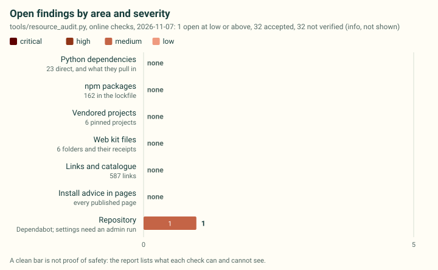

# Supply-chain and resource report

What cad-agent depends on, vendors and links to, checked on 2026-11-07 at revision `d5d746b91f63` (online checks). Findings: 1 medium, 32 info. Generated by `tools/resource_audit.py`; how to read it and what blocks a merge are in the [cad-supply-chain skill](../../.agents/skills/cad-supply-chain/SKILL.md) and on the [supply-chain page](../practice/supply-chain.md).

<strong>Limits.</strong> A clean report is not proof of safety: what each check can and cannot see

- A clean report is not proof of safety: advisory databases (OSV, the npm registry) only know what has been reported.
- Licences come from licence files and registry metadata (GitHub, PyPI, npm), matched by keyword; they are not a legal review.
- Link checks see status codes and redirects, not content: a parked or replaced page that answers 200 passes. Domain expiry is not checked.
- GitHub links are checked at repository level; a missing file or anchor inside a live repository is not seen.
- Python versions are checked at the newest release and the lowest release our range allows, not at every version in between.
- Transitive Python dependencies are checked at the versions deps.dev resolves for our newest direct releases; an existing environment may hold other versions, and --installed checks only the installed versions of our direct dependencies.
- Libraries bundled inside a vendored file (DOMPurify and KaTeX inside mermaid.min.js) are checked at the versions its receipt records; whether the bundling library reaches the affected code is not assessed.
- Repository settings (secret scanning, Dependabot) are read only with an admin token; the weekly workflow cannot see them.
- Offline mode checks only what the checkout shows (pins, hashes, licence files, lockfile, link schemes, install advice).

## Findings

### Medium (1)

1 medium: 1 repo-dependency-graph-empty

| Severity | Subject | Finding | Evidence | Action |
|---|---|---|---|---|
| medium | `repo:Valpatel/cad-agent` | GitHub's dependency graph sees no manifests | dependencyGraphManifests.totalCount = 0; this does not establish the graph setting or advisory coverage. | Owner: inspect the dependency graph and supported manifests on the default branch; verify discovered dependencies before relying on alert coverage. Keep the independent supply-chain audit. |

### Info (32)

32 info: 32 link-unverified

| Severity | Subject | Finding | Evidence | Action |
|---|---|---|---|---|
| info | `url:https://cad.onshape.com/help/Content/sheetmetal.htm` | cad.onshape.com answered HTTP 302 | docs/practice/experts.md:121 | Many sites refuse scripts; check by hand. |
| info | `url:https://doi.org/10.1115/1.3254558` | doi.org answered HTTP 403 | docs/practice/experts.md:97 | Many sites refuse scripts; check by hand. |
| info | `url:https://doi.org/10.1115/1.4014513` | doi.org answered HTTP 403 | docs/practice/experts.md:134 | Many sites refuse scripts; check by hand. |
| info | `url:https://doi.org/10.1177/002199838802201205` | doi.org answered HTTP 403 | docs/practice/experts.md:96 | Many sites refuse scripts; check by hand. |
| info | `url:https://doi.org/10.3390/engproc2026157040` | doi.org answered HTTP 403 | docs/practice/experts.md:76 | Many sites refuse scripts; check by hand. |
| info | `url:https://doi.org/10.3390/jmmp7010042` | doi.org answered HTTP 403 | docs/practice/experts.md:98 | Many sites refuse scripts; check by hand. |
| info | `url:https://doi.org/10.3390/ma18112591` | doi.org answered HTTP 403 | docs/practice/experts.md:105 | Many sites refuse scripts; check by hand. |
| info | `url:https://doi.org/10.3390/ma18143262` | doi.org answered HTTP 403 | docs/practice/experts.md:106 | Many sites refuse scripts; check by hand. |
| info | `url:https://doi.org/10.3390/polym13234132` | doi.org answered HTTP 403 | docs/practice/experts.md:116 | Many sites refuse scripts; check by hand. |
| info | `url:https://doi.org/10.3390/polym15071660` | doi.org answered HTTP 403 | docs/practice/experts.md:117 | Many sites refuse scripts; check by hand. |
| info | `url:https://embeddedcomputing.com/home-page/3d-printed-fasteners-part-1-inserts` | embeddedcomputing.com answered HTTP 403 | docs/practice/experts.md:74 | Many sites refuse scripts; check by hand. |
| info | `url:https://evs.ee/en/iec-60529-1989` | evs.ee answered HTTP 403 | docs/practice/experts.md:40 | Many sites refuse scripts; check by hand. |
| info | `url:https://evs.ee/en/iec-61032-1997` | evs.ee answered HTTP 403 | docs/practice/experts.md:40 | Many sites refuse scripts; check by hand. |
| info | `url:https://evs.ee/en/iso-10642-2026` | evs.ee answered HTTP 403 | docs/practice/experts.md:28 | Many sites refuse scripts; check by hand. |
| info | `url:https://evs.ee/en/iso-273-1979` | evs.ee answered HTTP 403 | docs/practice/experts.md:28 | Many sites refuse scripts; check by hand. |
| info | `url:https://evs.ee/en/iso-68-1-1998` | evs.ee answered HTTP 403 | docs/practice/experts.md:28 | Many sites refuse scripts; check by hand. |
| info | `url:https://evs.ee/en/iso-898-1-2013` | evs.ee answered HTTP 403 | docs/practice/experts.md:28 | Many sites refuse scripts; check by hand. |
| info | `url:https://help.solidworks.com/2022/English/SolidWorks/sldworks/c_K_Factor.htm` | help.solidworks.com answered HTTP 403 | docs/practice/experts.md:67; docs/research/manufacturing/process-profiles.md:967 | Many sites refuse scripts; check by hand. |
| info | `url:https://hull-repository.worktribe.com/output/4511720/interlayer-bonding-has-bulk-material-strength-in-extrusion-additive-manufacturing-new-understanding-of-anisotropy` | hull-repository.worktribe.com answered HTTP 403 | docs/research/compliant-mechanisms.md:326 | Many sites refuse scripts; check by hand. |
| info | `url:https://ntrs.nasa.gov/citations/19900009424` | ntrs.nasa.gov did not answer | The read operation timed out (docs/practice/experts.md:110; docs/research/manufacturing/process-profiles.md:985) | Check by hand; run again later. |
| info | `url:https://reprap.org/wiki/ArcCompensation` | reprap.org answered HTTP 520 | docs/practice/experts.md:123; docs/research/manufacturing/process-profiles.md:906 | Many sites refuse scripts; check by hand. |
| info | `url:https://solutions.covestro.com/-/media/covestro/solution-center/brands/downloads/imported/1557214197.pdf` | solutions.covestro.com answered HTTP 503 | docs/practice/experts.md:38; docs/research/manufacturing/process-profiles.md:909 | Many sites refuse scripts; check by hand. |
| info | `url:https://solutions.covestro.com/-/media/covestro/solution-center/brands/downloads/imported/1557214249.pdf` | solutions.covestro.com answered HTTP 503 | docs/practice/experts.md:38; docs/research/manufacturing/process-profiles.md:948 | Many sites refuse scripts; check by hand. |
| info | `url:https://solutions.covestro.com/-/media/covestro/solution-center/whitepapers/self-tapping-screws-for-thermoplastics.pdf` | solutions.covestro.com answered HTTP 503 | docs/practice/experts.md:65; docs/research/manufacturing/process-profiles.md:910 | Many sites refuse scripts; check by hand. |
| info | `url:https://www.autodesk.com/products/fusion-360/blog/fusion-compute-mcp/` | `www.autodesk.com` answered HTTP 403 | docs/research/agent-workflow/agent-toolkits-2026-10.md:49 | Many sites refuse scripts; check by hand. |
| info | `url:https://www.iso.org/standard/67289.html` | `www.iso.org` answered HTTP 403 | docs/practice/experts.md:41; docs/research/manufacturing/process-profiles.md:971 | Many sites refuse scripts; check by hand. |
| info | `url:https://www.iso.org/standard/7748.html` | `www.iso.org` answered HTTP 403 | docs/practice/experts.md:28; docs/research/manufacturing/process-profiles.md:968 | Many sites refuse scripts; check by hand. |
| info | `url:https://www.mouser.com/pdfDocs/Jetson_AGX_Orin_Series_TDG-10943-001_v11.pdf` | `www.mouser.com` did not answer | The read operation timed out (docs/research/simulation-tools.md:229) | Check by hand; run again later. |
| info | `url:https://www.plasticstoday.com/plastics-processing/can-this-part-be-saved-part-3-living-hinges` | `www.plasticstoday.com` answered HTTP 403 | docs/research/compliant-mechanisms.md:369 | Many sites refuse scripts; check by hand. |
| info | `url:https://xometry.pro/en-uk/3d-printing-design-guide/quick-guide/fused-deposition-modeling/` | xometry.pro answered HTTP 403 | docs/practice/experts.md:25 | Many sites refuse scripts; check by hand. |
| info | `url:https://xometry.pro/en/articles/fdm-design-tips/` | xometry.pro answered HTTP 403 | docs/practice/experts.md:141; docs/research/manufacturing/process-profiles.md:897 | Many sites refuse scripts; check by hand. |
| info | `url:https://xometry.pro/wp-content/uploads/2024/05/EN-EU-MJF-Design-Guide.pdf` | xometry.pro answered HTTP 403 | docs/practice/experts.md:25 | Many sites refuse scripts; check by hand. |

### Accepted (32)

32 read and accepted in <code>docs/research/security-accepted.yaml</code>

| Severity | Subject | Finding | Evidence | Action |
|---|---|---|---|---|
| medium | `npm:esbuild` | esbuild runs an install script | tools/mermaid/package.json: node_modules/esbuild 0.28.2: hasInstallScript | Read the script; in CI prefer npm ci --ignore-scripts where the package works without it. **Accepted:** Maintainer-only tools/mermaid compiler 0.28.2, not a production-site dependency. Its complete install.js was read on 2026-11-07 (#322), SHA256 612294e278914443bdcf81cb17f54afec34dbdd2ebd999a6ee187912320cc315: it validates or downloads/installs a platform executable and can rewrite its wrapper. The dedicated context and provenance CI use npm ci --ignore-scripts, so this hook is not executed. The producer resolves the installed exact optional platform binary and verifies its SHA256 against the pinned esbuild package's binaryHashes before execution; missing/mismatched input fails instead of invoking the hook. This fingerprint includes tools/mermaid/package.json and covers only 0.28.2's known hook, not an advisory, registry drift, a future hook or another context that runs install scripts. (2026-11-07) |
| medium | `npm:fsevents` | fsevents runs an install script (only on darwin) | tools/site/package.json: node_modules/fsevents 2.3.2: hasInstallScript, optional | Read the script; in CI prefer npm ci --ignore-scripts where the package works without it. **Accepted:** Optional, macOS-only dependency of Playwright (os: darwin), so CI and Linux machines never install it. Read on 2026-11-01 (#151): the registry's manifest for 2.3.2 lists install "node-gyp rebuild" (gypfile), but the tarball the lockfile pins (its sha512 matches) has no binding.gyp and its package.json has no install script; it ships a prebuilt fsevents.node, so npm runs nothing at install. The fingerprint is 2.3.2's: when Playwright moves to another fsevents, the finding comes back to be read again. (2026-11-01) |
| medium | `url:https://github.com/google/feabench` | google/feabench is archived (read-only, no fixes) | last push 2025-05-07 | Show it as "unmaintained" (status or note) instead of removing it; plan a replacement if we use its code. **Accepted:** Shown as archived where we name it: its catalogue card (docs/research/landscape.json notes) and docs/research/agent-workflow/agent-toolkits-2026-10.md. Prior art only (it needs COMSOL); we use none of its code. (2026-11-01) |
| medium | `url:https://github.com/microsoft/CADFusion` | microsoft/CADFusion is archived (read-only, no fixes) | last push 2026-07-02 | Show it as "unmaintained" (status or note) instead of removing it; plan a replacement if we use its code. **Accepted:** Shown as archived where we name it (docs/research/agent-workflow/design-workflows.md and design-workflows.json). Cited for its paper's results; ideas only, we use none of its code. (2026-11-01) |
| medium | `url:https://github.com/mixelpixx/Konnect` | mixelpixx/Konnect is archived (read-only, no fixes) | last push 2026-11-02 | Show it as "unmaintained" (status or note) instead of removing it; plan a replacement if we use its code. **Accepted:** GitHub readback on 2026-11-07 shows archived again, last push 2026-11-02. The registry, catalogue notes and landscape page now preserve both this observation and the earlier unarchived observation as dated history. This entry remains rejected; AGPL-3.0 is external-program-only, with no new code adoption. Existing KiCad vendors remain in use. Accept only the visible archive warning, not a new advisory, licence/owner change or a claim that the commercial continuation was re-verified. (2026-11-07) |
| low | `repo:dependabot-npm` | Dependabot does not watch npm (tools/site/package.json) | .github/dependabot.yml ecosystems: github-actions | Add a weekly npm entry targeting dev (owner decision: it opens PRs). **Accepted:** Deliberate maintenance-pass policy under issues 153 and 322, reaffirmed 2026-11-07: retain grouped weekly GitHub Actions version PRs, without starting recurring npm version-PR campaigns during backlog closure. The weekly supply-chain workflow audits both explicit npm locks online and keeps one findings issue; pin updates still require independent review, provenance and browser CI. This accepts only the absence of the npm version-update configuration, not an advisory, stale pin or failed audit. It does not claim Dependabot monitors these manifests or that dependency-graph/SBOM discovery is verified; issue 153 retains that unresolved evidence. Security-fix PRs are enabled separately but their coverage is not proven here. (2026-11-07) |
| low | `repo:dependabot-pip` | Dependabot does not watch pip (pyproject.toml) | .github/dependabot.yml ecosystems: github-actions | Add a weekly pip entry targeting dev (owner decision: it opens PRs). **Accepted:** Deliberate maintenance-pass policy under issues 153 and 322, reaffirmed 2026-11-07: retain grouped weekly GitHub Actions version PRs, without starting recurring pip version-PR campaigns during backlog closure. The weekly online audit checks direct Python requirements and the transitive resolution it can observe; changes to lower bounds or optional dependencies still require independent review and current CI. This accepts only the missing pip version-update configuration, not an advisory or a claim that every installed/transitive version is covered. Dependabot manifest monitoring and dependency-graph/SBOM discovery remain unverified under issue 153; enabled security-fix PR creation is a separate control. (2026-11-07) |
| low | `npm:khroma` | khroma declares no licence | tools/mermaid/package.json: node_modules/khroma 2.1.0 | Read the exact locked archive licence before relying on it; bind an exception to this context and archive. **Accepted:** Metadata omission in the exact tools/mermaid lock entry khroma 2.1.0. The npm archive pinned by sha512-Ls993zuzfayK269Svk9hzpeGUKob/sIgZzyHYdjQoAdQetRKpOLj+k/QQQ/6Qi0Yz65mlROrfd+Ev+1+7dz9Kw== contains its complete MIT licence, copyright Fabio Spampinato and Andrew Maney. Read on 2026-11-07: node_modules/khroma/license SHA256 66b333b0f66759a0b710459e03f7029abe17f4358114a128d2c972e642961b49. The unchanged renderer BUILD.json records that exact licence and THIRD-PARTY-LICENSES.txt retains the text. This fingerprint binds the owning manifest, version, resolved archive and integrity; another context, version or archive needs a new reading. It accepts only absent registry/lock licence metadata, not package integrity failures, advisories or a general legal review. (2026-11-07) |
| low | `url:https://github.com/AutodeskAILab/JoinABLe` | no push to AutodeskAILab/JoinABLe for over a year | last push 2022-04-22 | Check it is still maintained; if not, show it as "unmaintained". **Accepted:** Checked 2026-11-07: last push 2022-04-22; visible maintenance warning in docs/research/agent-workflow/design-workflows.md. Historical CVPR 2022 joint research; MIT code/noncommercial data distinction remains; no runtime adoption. Retain this exact age warning with that disposition; maintenance beyond the recorded activity is unverified. This does not accept a new advisory, archive/owner/licence change or any future adoption. (2026-11-07) |
| low | `url:https://github.com/ElmerCSC/elmerfem-docker` | no push to ElmerCSC/elmerfem-docker for over a year | last push 2021-03-09 | Check it is still maintained; if not, show it as "unmaintained". **Accepted:** Checked 2026-11-07: last push 2021-03-09; visible maintenance warning in docs/research/simulation-tools.md. Inactive 2021 Docker helper is explicitly declined as a current installation route, separately from maintained Elmer. Retain this exact age warning with that disposition; maintenance beyond the recorded activity is unverified. This does not accept a new advisory, archive/owner/licence change or any future adoption. (2026-11-07) |
| low | `url:https://github.com/Gary-code/CADReview` | no push to Gary-code/CADReview for over a year | last push 2025-08-08 | Check it is still maintained; if not, show it as "unmaintained". **Accepted:** Checked 2026-11-07: last push 2025-08-08; visible maintenance warning in docs/research/agent-workflow/design-workflows.md. No-licence research citation, ideas only; no code adoption. Retain this exact age warning with that disposition; maintenance beyond the recorded activity is unverified. This does not accept a new advisory, archive/owner/licence change or any future adoption. (2026-11-07) |
| low | `url:https://github.com/Kamel773/CAD_Code_Generation` | no push to Kamel773/CAD_Code_Generation for over a year | last push 2025-02-28 | Check it is still maintained; if not, show it as "unmaintained". **Accepted:** Checked 2026-11-07: last push 2025-02-28; visible maintenance warning in docs/research/landscape.json. Historical ICLR 2025 benchmark; no licence, ideas only; no code/data adoption. Retain this exact age warning with that disposition; maintenance beyond the recorded activity is unverified. This does not accept a new advisory, archive/owner/licence change or any future adoption. (2026-11-07) |
| low | `url:https://github.com/Mechanical-Python/SnapFit_Calculator` | no push to Mechanical-Python/SnapFit_Calculator for over a year | last push 2022-03-16 | Check it is still maintained; if not, show it as "unmaintained". **Accepted:** Checked 2026-11-07: last push 2022-03-16; visible maintenance warning in docs/research/compliant-mechanisms.md. Existing Skip decision retained: stale project and packaged binaries. Retain this exact age warning with that disposition; maintenance beyond the recorded activity is unverified. This does not accept a new advisory, archive/owner/licence change or any future adoption. (2026-11-07) |
| low | `url:https://github.com/SadilKhan/Text2CAD` | no push to SadilKhan/Text2CAD for over a year | last push 2025-05-15 | Check it is still maintained; if not, show it as "unmaintained". **Accepted:** Checked 2026-11-07: last push 2025-05-15; visible maintenance warning in docs/research/landscape.json and docs/research/agent-workflow/landscape.md. Historical research benchmark; CC-BY-NC-SA-4.0 restriction retained, no runtime/commercial adoption. Distinct from the MIT earthtojake/text-to-cad vendor. Retain this exact age warning with that disposition; maintenance beyond the recorded activity is unverified. This does not accept a new advisory, archive/owner/licence change or any future adoption. (2026-11-07) |
| low | `url:https://github.com/anniedoris/CAD-Coder` | no push to anniedoris/CAD-Coder for over a year | last push 2025-07-17 | Check it is still maintained; if not, show it as "unmaintained". **Accepted:** Checked 2026-11-07: last push 2025-07-17; visible maintenance warning in docs/research/agent-workflow/design-workflows.md. Historical paper/prior art, not a runtime dependency. Retain this exact age warning with that disposition; maintenance beyond the recorded activity is unverified. This does not accept a new advisory, archive/owner/licence change or any future adoption. (2026-11-07) |
| low | `url:https://github.com/artofscience/flexures` | no push to artofscience/flexures for over a year | last push 2023-11-06 | Check it is still maintained; if not, show it as "unmaintained". **Accepted:** Checked 2026-11-07: last push 2023-11-06; visible maintenance warning in docs/research/compliant-mechanisms.md. GPL reference material only, without incorporation. Retain this exact age warning with that disposition; maintenance beyond the recorded activity is unverified. This does not accept a new advisory, archive/owner/licence change or any future adoption. (2026-11-07) |
| low | `url:https://github.com/buxtronix/living-hinge` | no push to buxtronix/living-hinge for over a year | last push 2024-05-31 | Check it is still maintained; if not, show it as "unmaintained". **Accepted:** Checked 2026-11-07: last push 2024-05-31; visible maintenance warning in docs/research/compliant-mechanisms.md. Historical GPL option; the CC0 alternative remains preferred. Retain this exact age warning with that disposition; maintenance beyond the recorded activity is unverified. This does not accept a new advisory, archive/owner/licence change or any future adoption. (2026-11-07) |
| low | `url:https://github.com/calculix/beso` | no push to calculix/beso for over a year | last push 2025-04-03 | Check it is still maintained; if not, show it as "unmaintained". **Accepted:** Checked 2026-11-07: last push 2025-04-03; visible maintenance warning in docs/research/simulation-tools.md. Surveyed LGPL external CalculiX/FreeCAD alternative, not the chosen topology engine. Retain this exact age warning with that disposition; maintenance beyond the recorded activity is unverified. This does not accept a new advisory, archive/owner/licence change or any future adoption. (2026-11-07) |
| low | `url:https://github.com/dimitrismallis/CAD-Assistant` | no push to dimitrismallis/CAD-Assistant for over a year | last push 2025-10-30 | Check it is still maintained; if not, show it as "unmaintained". **Accepted:** Checked 2026-11-07: last push 2025-10-30; visible maintenance warning in docs/research/agent-workflow/design-workflows.md. Custom-licence prior art, ideas only; not a dependency choice. Retain this exact age warning with that disposition; maintenance beyond the recorded activity is unverified. This does not accept a new advisory, archive/owner/licence change or any future adoption. (2026-11-07) |
| low | `url:https://github.com/dl4to/dl4to` | no push to dl4to/dl4to for over a year | last push 2024-11-19 | Check it is still maintained; if not, show it as "unmaintained". **Accepted:** Checked 2026-11-07: last push 2024-11-19; visible maintenance warning in docs/research/simulation-tools.md. Historical stale solver alternative; old installation syntax is descriptive, not a current recommendation. Retain this exact age warning with that disposition; maintenance beyond the recorded activity is unverified. This does not accept a new advisory, archive/owner/licence change or any future adoption. (2026-11-07) |
| low | `url:https://github.com/frasere/ISO-281` | no push to frasere/ISO-281 for over a year | last push 2020-12-09 | Check it is still maintained; if not, show it as "unmaintained". **Accepted:** Checked 2026-11-07: last push 2020-12-09; visible maintenance warning in docs/mechanical/bearings.md. Existing unmaintained calculator warning retained; manufacturer ratings and standards remain the basis. Retain this exact age warning with that disposition; maintenance beyond the recorded activity is unverified. This does not accept a new advisory, archive/owner/licence change or any future adoption. (2026-11-07) |
| low | `url:https://github.com/kovacsv/occt-import-js` | no push to kovacsv/occt-import-js for over a year | last push 2024-12-03 | Check it is still maintained; if not, show it as "unmaintained". **Accepted:** Checked 2026-11-07: last push 2024-12-03; visible maintenance warning in software/vendor/THIRD_PARTY_NOTICES.md. Visible age of the actual retained 0.0.23 runtime, whose separate webkit finding binds package/version/file hashes and records fallback/qualification limits. No advisory, licence or integrity failure is accepted here. Retain this exact age warning with that disposition; maintenance beyond the recorded activity is unverified. This does not accept a new advisory, archive/owner/licence change or any future adoption. (2026-11-07) |
| low | `url:https://github.com/lamaalrajih/kicad-mcp` | no push to lamaalrajih/kicad-mcp for over a year | last push 2025-10-17 | Check it is still maintained; if not, show it as "unmaintained". **Accepted:** Checked 2026-11-07: last push 2025-10-17; visible maintenance warning in software/vendor/upstreams/registry.yaml, docs/research/landscape.json and docs/research/agent-workflow/landscape.md. Inactive KiCad 9 candidate explicitly rejected for this pass; existing KiCad 10 vendors remain the chosen integration. Keep the historical MIT entry; future adoption needs fresh review. Retain this exact age warning with that disposition; maintenance beyond the recorded activity is unverified. This does not accept a new advisory, archive/owner/licence change or any future adoption. (2026-11-07) |
| low | `url:https://github.com/missionlab/fenitop` | no push to missionlab/fenitop for over a year | last push 2024-11-01 | Check it is still maintained; if not, show it as "unmaintained". **Accepted:** Checked 2026-11-07: last push 2024-11-01; visible maintenance warning in docs/research/simulation-tools.md. Already-stale GPL external alternative and its old DolfinX constraint retained, not adopted. Retain this exact age warning with that disposition; maintenance beyond the recorded activity is unverified. This does not accept a new advisory, archive/owner/licence change or any future adoption. (2026-11-07) |
| low | `url:https://github.com/nohkumado/openscad_snapfit` | no push to nohkumado/openscad_snapfit for over a year | last push 2021-11-01 | Check it is still maintained; if not, show it as "unmaintained". **Accepted:** Checked 2026-11-07: last push 2021-11-01; visible maintenance warning in docs/research/compliant-mechanisms.md. Existing Skip decision for this GPL geometry alternative retained. Retain this exact age warning with that disposition; maintenance beyond the recorded activity is unverified. This does not accept a new advisory, archive/owner/licence change or any future adoption. (2026-11-07) |
| low | `url:https://github.com/secnot/rectpack` | no push to secnot/rectpack for over a year | last push 2021-11-24 | Check it is still maintained; if not, show it as "unmaintained". **Accepted:** Checked 2026-11-07: last push 2021-11-24; visible maintenance warning in docs/toolkit.md. Method comparison only; own integer-micrometre MaxRects implementation and tests remain, without adding this old dependency. Retain this exact age warning with that disposition; maintenance beyond the recorded activity is unverified. This does not accept a new advisory, archive/owner/licence change or any future adoption. (2026-11-07) |
| low | `url:https://github.com/sgsellan/swept-volumes` | no push to sgsellan/swept-volumes for over a year | last push 2024-07-18 | Check it is still maintained; if not, show it as "unmaintained". **Accepted:** Checked 2026-11-07: last push 2024-07-18; visible maintenance warning in docs/research/agent-workflow/design-workflows.md. Historical method citation; patent notice and maintained gpytoolbox successor remain visible. Retain this exact age warning with that disposition; maintenance beyond the recorded activity is unverified. This does not accept a new advisory, archive/owner/licence change or any future adoption. (2026-11-07) |
| low | `url:https://github.com/skyneticist/flexure-hinge-calculator` | no push to skyneticist/flexure-hinge-calculator for over a year | last push 2025-06-08 | Check it is still maintained; if not, show it as "unmaintained". **Accepted:** Checked 2026-11-07: last push 2025-06-08; visible maintenance warning in docs/research/compliant-mechanisms.md. Existing Skip decision for the small calculator retained. Retain this exact age warning with that disposition; maintenance beyond the recorded activity is unverified. This does not accept a new advisory, archive/owner/licence change or any future adoption. (2026-11-07) |
| low | `url:https://github.com/slehmann1/Fastenating` | no push to slehmann1/Fastenating for over a year | last push 2022-11-27 | Check it is still maintained; if not, show it as "unmaintained". **Accepted:** Checked 2026-11-07: last push 2022-11-27; visible maintenance warning in docs/research/references/guides-inserts.yaml. Historical read reference with zero used_for paths and no calculator adoption. The generated experts page is regenerated from that source metadata. Retain this exact age warning with that disposition; maintenance beyond the recorded activity is unverified. This does not accept a new advisory, archive/owner/licence change or any future adoption. (2026-11-07) |
| low | `url:https://github.com/tamasmeszaros/libnest2d` | no push to tamasmeszaros/libnest2d for over a year | last push 2024-05-03 | Check it is still maintained; if not, show it as "unmaintained". **Accepted:** Checked 2026-11-07: last push 2024-05-03; visible maintenance warning in docs/toolkit.md. Historical library provenance retained; PrusaSlicer bundles its own copy, and cad-agent does not adopt this old C++ library. Retain this exact age warning with that disposition; maintenance beyond the recorded activity is unverified. This does not accept a new advisory, archive/owner/licence change or any future adoption. (2026-11-07) |
| low | `url:https://github.com/ulrich1a/sheet_ufo` | no push to ulrich1a/sheet_ufo for over a year | last push 2018-09-22 | Check it is still maintained; if not, show it as "unmaintained". **Accepted:** Checked 2026-11-07: last push 2018-09-22; visible maintenance warning in docs/research/manufacturing/sheet-metal.md. Existing Skip decision retained for the 2018 predecessor folded into SheetMetal. Retain this exact age warning with that disposition; maintenance beyond the recorded activity is unverified. This does not accept a new advisory, archive/owner/licence change or any future adoption. (2026-11-07) |
| low | `webkit:occt-import-js` | no push to kovacsv/occt-import-js for over a year | last push 2024-12-03 | Check it is still maintained; if not, show it as "unmaintained". **Accepted:** Retain the existing STEP preview runtime 0.0.23 at c2148e54b456b571238d35cac037d304053d64b2, with OCCT source d2abb6d844231cb8f29be6894440874a4700e4a5, exact npm integrity/file hashes and corresponding LGPL/exception sources recorded in file-viewer-sources.json. Upstream last push 2024-12-03 and unverified maintenance are visible in THIRD_PARTY_NOTICES.md. Same-origin/redirect/download limits, worker deadlines/cancellation and existing real STEP/browser fixtures support bounded retention, not proof of safety or complete native advisory coverage. No code change or advisory waiver. Prefer disabling affected preview with the original desktop-CAD download route if a future security fix cannot be qualified. This age-only fingerprint binds package versions and all recorded component file hashes; a changed runtime must be reviewed again. (2026-11-07) |

## What we depend on

23 Python packages (66 more pulled in), 162 npm packages, 6 vendored projects, 6 web kit folders, 587 links, 14 skills and agents

### Python dependencies

| Extra | Direct | With transitive (deps.dev, newest releases) |
|---|---|---|
| required | 3 | 3 |
| cad | 6 | 44 |
| robot | 1 | unknown |
| sim | 10 | 40 |
| site | 1 | 1 |
| fea | 5 | 22 |
| explore | 1 | 11 |
| dev | 1 | 5 |

66 transitive packages (at the versions deps.dev resolves) were also checked against OSV; findings on them name the direct dependency they come through.

| Package | Extras | Range | Newest | Released | Licence | Lowest allowed | Advisories (newest / lowest) |
|---|---|---|---|---|---|---|---|
| `cadquery` | cad | >=2.8 | 2.8.0 | 2026-06-21 | Apache Public License 2.0 | 2.8.0 | 0 / 0 |
| `gmsh` | fea | >=4.11 | 4.15.2 | 2026-03-24 | GPLv2+ | 4.11.0 | 0 / 0 |
| `imageio` | sim | >=2.30 | 2.38.1 | 2026-10-08 | BSD-2-Clause | 2.30.0 | 0 / 0 |
| `imageio-ffmpeg` | sim | >=0.5 | 0.8.1 | 2026-11-03 | BSD-2-Clause | 0.5.0 | 0 / 0 |
| `manifold3d` | sim | >=2.4 | 3.5.4 | 2026-09-25 | Apache Software License | 2.4.5 | 0 / 0 |
| `markdown` | site | >=3.8.1 | 3.11.3 | 2026-11-05 | BSD-3-Clause | 3.8.1 | 0 / 0 |
| `matplotlib` | cad, fea, sim | >=3.7 | 3.11.2 | 2026-09-11 | Python Software Foundation License | 3.7.0 | 0 / 0 |
| `mujoco` | robot | >=3 | 4.0.0 | 2026-11-06 | Apache-2.0 | 3.0.0 | 0 / 0 |
| `numpy` | cad, required | >=1.22 | 2.5.4 | 2026-10-10 | BSD-3-Clause AND 0BSD AND MIT AND Zlib AND CC0-1.0 | 1.22.0 | 0 / 0 |
| `optuna` | explore | >=3.4 | 5.0.0 | 2026-09-07 | MIT License | 3.4.0 | 0 / 0 |
| `packaging` | required | >=26.3 | 26.3 | 2026-08-04 | Apache-2.0 OR BSD-2-Clause | 26.3 | 0 / 0 |
| `pillow` | cad, sim | >=13.0 | 13.0.0 | 2026-10-16 | MIT-CMU | 13.0.0 | 0 / 0 |
| `pyamg` | fea | >=5 | 5.4.1 | 2026-10-30 | MIT License | 5.0.0 | 0 / 0 |
| `pymoto` | sim | >=2.0 | 2.0.1 | 2026-05-07 | MIT | 2.0.0 | 0 / 0 |
| `pypardiso` | fea | >=0.4 | 0.4.7 | 2025-11-02 | BSD-3-Clause | 0.4.0 | 0 / 0 |
| `pytest` | dev | >=9.0.3 | 9.2.0 | 2026-10-27 | MIT | 9.0.3 | 0 / 0 |
| `pyvista` | sim | >=0.44 | 0.49.2 | 2026-10-28 | MIT | 0.44.0 | 0 / 0 |
| `pyyaml` | required | >=6.0 | 6.0.3 | 2025-09-25 | MIT | 6.0 | 0 / 0 |
| `rtree` | sim | >=1.0 | 1.4.1 | 2025-08-13 | MIT | 1.0.0 | 0 / 0 |
| `scikit-fem` | fea | >=9 | 12.0.2 | 2026-06-05 | BSD License | 9.0.0 | 0 / 0 |
| `scipy` | sim | >=1.10 | 1.18.1 | 2026-08-21 | BSD License | 1.10.0 | 0 / 0 |
| `trimesh` | cad, sim | >=4.0 | 5.2.0 | 2026-10-24 | MIT License | 4.0.0 | 0 / 0 |
| `vtk` | cad | >=9.5.2 | 9.7.2 | 2026-11-03 | BSD | 9.5.2 | 0 / 0 |

### npm (site build and browser tests)

6 direct, 162 packages in the lockfile including transitive.

| Package | Version | Direct | Dev | Licence | Install script | Advisories |
|---|---|---|---|---|---|---|
| `@antfu/install-pkg` | 2.1.0 |  |  | MIT |  | 0 |
| `@braintree/sanitize-url` | 7.1.2 |  |  | MIT |  | 0 |
| `@chevrotain/types` | 11.1.2 |  |  | Apache-2.0 |  | 0 |
| `@esbuild/aix-ppc64` | 0.28.2 |  |  | MIT |  | 0 |
| `@esbuild/android-arm` | 0.28.2 |  |  | MIT |  | 0 |
| `@esbuild/android-arm64` | 0.28.2 |  |  | MIT |  | 0 |
| `@esbuild/android-x64` | 0.28.2 |  |  | MIT |  | 0 |
| `@esbuild/darwin-arm64` | 0.28.2 |  |  | MIT |  | 0 |
| `@esbuild/darwin-x64` | 0.28.2 |  |  | MIT |  | 0 |
| `@esbuild/freebsd-arm64` | 0.28.2 |  |  | MIT |  | 0 |
| `@esbuild/freebsd-x64` | 0.28.2 |  |  | MIT |  | 0 |
| `@esbuild/linux-arm` | 0.28.2 |  |  | MIT |  | 0 |
| `@esbuild/linux-arm64` | 0.28.2 |  |  | MIT |  | 0 |
| `@esbuild/linux-ia32` | 0.28.2 |  |  | MIT |  | 0 |
| `@esbuild/linux-loong64` | 0.28.2 |  |  | MIT |  | 0 |
| `@esbuild/linux-mips64el` | 0.28.2 |  |  | MIT |  | 0 |
| `@esbuild/linux-ppc64` | 0.28.2 |  |  | MIT |  | 0 |
| `@esbuild/linux-riscv64` | 0.28.2 |  |  | MIT |  | 0 |
| `@esbuild/linux-s390x` | 0.28.2 |  |  | MIT |  | 0 |
| `@esbuild/linux-x64` | 0.28.2 |  |  | MIT |  | 0 |
| `@esbuild/netbsd-arm64` | 0.28.2 |  |  | MIT |  | 0 |
| `@esbuild/netbsd-x64` | 0.28.2 |  |  | MIT |  | 0 |
| `@esbuild/openbsd-arm64` | 0.28.2 |  |  | MIT |  | 0 |
| `@esbuild/openbsd-x64` | 0.28.2 |  |  | MIT |  | 0 |
| `@esbuild/openharmony-arm64` | 0.28.2 |  |  | MIT |  | 0 |
| `@esbuild/sunos-x64` | 0.28.2 |  |  | MIT |  | 0 |
| `@esbuild/win32-arm64` | 0.28.2 |  |  | MIT |  | 0 |
| `@esbuild/win32-ia32` | 0.28.2 |  |  | MIT |  | 0 |
| `@esbuild/win32-x64` | 0.28.2 |  |  | MIT |  | 0 |
| `@iconify/types` | 2.0.0 |  |  | MIT |  | 0 |
| `@iconify/utils` | 3.1.7 |  |  | MIT |  | 0 |
| `@mermaid-js/parser` | 1.2.1 |  |  | MIT |  | 0 |
| `@playwright/test` | 1.56.1 | yes | yes | Apache-2.0 |  | 0 |
| `@types/d3` | 7.4.3 |  |  | MIT |  | 0 |
| `@types/d3-array` | 3.2.2 |  |  | MIT |  | 0 |
| `@types/d3-axis` | 3.0.6 |  |  | MIT |  | 0 |
| `@types/d3-brush` | 3.0.6 |  |  | MIT |  | 0 |
| `@types/d3-chord` | 3.0.6 |  |  | MIT |  | 0 |
| `@types/d3-color` | 3.1.3 |  |  | MIT |  | 0 |
| `@types/d3-contour` | 3.0.6 |  |  | MIT |  | 0 |
| `@types/d3-delaunay` | 6.0.4 |  |  | MIT |  | 0 |
| `@types/d3-dispatch` | 3.0.7 |  |  | MIT |  | 0 |
| `@types/d3-drag` | 3.0.7 |  |  | MIT |  | 0 |
| `@types/d3-dsv` | 3.0.7 |  |  | MIT |  | 0 |
| `@types/d3-ease` | 3.0.2 |  |  | MIT |  | 0 |
| `@types/d3-fetch` | 3.0.7 |  |  | MIT |  | 0 |
| `@types/d3-force` | 3.0.10 |  |  | MIT |  | 0 |
| `@types/d3-format` | 3.0.4 |  |  | MIT |  | 0 |
| `@types/d3-geo` | 3.1.1 |  |  | MIT |  | 0 |
| `@types/d3-hierarchy` | 3.1.7 |  |  | MIT |  | 0 |
| `@types/d3-interpolate` | 3.0.4 |  |  | MIT |  | 0 |
| `@types/d3-path` | 3.1.1 |  |  | MIT |  | 0 |
| `@types/d3-polygon` | 3.0.2 |  |  | MIT |  | 0 |
| `@types/d3-quadtree` | 3.0.6 |  |  | MIT |  | 0 |
| `@types/d3-random` | 3.0.4 |  |  | MIT |  | 0 |
| `@types/d3-scale` | 4.0.9 |  |  | MIT |  | 0 |
| `@types/d3-scale-chromatic` | 3.1.0 |  |  | MIT |  | 0 |
| `@types/d3-selection` | 3.0.12 |  |  | MIT |  | 0 |
| `@types/d3-shape` | 3.2.0 |  |  | MIT |  | 0 |
| `@types/d3-time` | 3.0.4 |  |  | MIT |  | 0 |
| `@types/d3-time-format` | 4.0.3 |  |  | MIT |  | 0 |
| `@types/d3-timer` | 3.0.2 |  |  | MIT |  | 0 |
| `@types/d3-transition` | 3.0.9 |  |  | MIT |  | 0 |
| `@types/d3-zoom` | 3.0.9 |  |  | MIT |  | 0 |
| `@types/geojson` | 7946.0.16 |  |  | MIT |  | 0 |
| `@types/trusted-types` | 2.0.7 |  |  | MIT |  | 0 |
| `@upsetjs/venn.js` | 2.0.0 |  |  | MIT |  | 0 |
| `commander` | 15.1.0 |  |  | MIT |  | 0 |
| `commander` | 7.2.0 |  |  | MIT |  | 0 |
| `cose-base` | 1.0.3 |  |  | MIT |  | 0 |
| `cose-base` | 2.2.0 |  |  | MIT |  | 0 |
| `cytoscape` | 3.34.4 |  |  | MIT |  | 0 |
| `cytoscape-cose-bilkent` | 4.1.0 |  |  | MIT |  | 0 |
| `cytoscape-fcose` | 2.2.0 |  |  | MIT |  | 0 |
| `d3` | 7.9.2 |  |  | ISC |  | 0 |
| `d3-array` | 2.12.1 |  |  | BSD-3-Clause |  | 0 |
| `d3-array` | 3.2.5 |  |  | ISC |  | 0 |
| `d3-axis` | 3.0.1 |  |  | ISC |  | 0 |
| `d3-brush` | 3.0.1 |  |  | ISC |  | 0 |
| `d3-chord` | 3.0.2 |  |  | ISC |  | 0 |
| `d3-color` | 3.1.1 |  |  | ISC |  | 0 |
| `d3-contour` | 4.0.3 |  |  | ISC |  | 0 |
| `d3-delaunay` | 6.0.6 |  |  | ISC |  | 0 |
| `d3-dispatch` | 3.0.2 |  |  | ISC |  | 0 |
| `d3-drag` | 3.0.1 |  |  | ISC |  | 0 |
| `d3-dsv` | 3.0.2 |  |  | ISC |  | 0 |
| `d3-ease` | 3.0.2 |  |  | BSD-3-Clause |  | 0 |
| `d3-fetch` | 3.0.2 |  |  | ISC |  | 0 |
| `d3-force` | 3.0.1 |  |  | ISC |  | 0 |
| `d3-format` | 3.1.3 |  |  | ISC |  | 0 |
| `d3-geo` | 3.1.2 |  |  | ISC |  | 0 |
| `d3-hierarchy` | 3.1.3 |  |  | ISC |  | 0 |
| `d3-interpolate` | 3.0.2 |  |  | ISC |  | 0 |
| `d3-path` | 1.0.9 |  |  | BSD-3-Clause |  | 0 |
| `d3-path` | 3.1.1 |  |  | ISC |  | 0 |
| `d3-polygon` | 3.0.2 |  |  | ISC |  | 0 |
| `d3-quadtree` | 3.0.2 |  |  | ISC |  | 0 |
| `d3-random` | 3.0.2 |  |  | ISC |  | 0 |
| `d3-sankey` | 0.12.3 |  |  | BSD-3-Clause |  | 0 |
| `d3-scale` | 4.0.3 |  |  | ISC |  | 0 |
| `d3-scale-chromatic` | 3.1.1 |  |  | ISC |  | 0 |
| `d3-selection` | 3.0.1 |  |  | ISC |  | 0 |
| `d3-shape` | 1.3.7 |  |  | BSD-3-Clause |  | 0 |
| `d3-shape` | 3.2.1 |  |  | ISC |  | 0 |
| `d3-time` | 3.1.1 |  |  | ISC |  | 0 |
| `d3-time-format` | 4.1.1 |  |  | ISC |  | 0 |
| `d3-timer` | 3.0.2 |  |  | ISC |  | 0 |
| `d3-transition` | 3.0.2 |  |  | ISC |  | 0 |
| `d3-zoom` | 3.0.1 |  |  | ISC |  | 0 |
| `dagre-d3-es` | 7.0.14 |  |  | MIT |  | 0 |
| `dayjs` | 1.11.23 |  |  | MIT |  | 0 |
| `dayjs` | 1.11.23 |  | yes | MIT |  | 0 |
| `delaunator` | 5.1.0 |  |  | ISC |  | 0 |
| `dom-serializer` | 3.1.1 |  | yes | MIT |  | 0 |
| `domelementtype` | 3.0.0 |  | yes | BSD-2-Clause |  | 0 |
| `domhandler` | 6.0.1 |  | yes | BSD-2-Clause |  | 0 |
| `dompurify` | 3.4.17 |  |  | (MPL-2.0 OR Apache-2.0) |  | 0 |
| `domutils` | 4.0.2 |  | yes | BSD-2-Clause |  | 0 |
| `entities` | 8.1.0 |  | yes | BSD-2-Clause |  | 0 |
| `es-toolkit` | 1.53.2 |  |  | MIT |  | 0 |
| `esbuild` | 0.28.2 | yes |  | MIT | yes | 0 |
| `escape-string-regexp` | 4.0.0 |  | yes | MIT |  | 0 |
| `fastdom` | 1.0.12 |  |  | MIT |  | 0 |
| `fsevents` | 2.3.2 |  | yes | MIT | yes | 0 |
| `hachure-fill` | 0.5.2 |  |  | MIT |  | 0 |
| `htmlparser2` | 12.0.0 |  | yes | MIT |  | 0 |
| `iconv-lite` | 0.6.3 |  |  | MIT |  | 0 |
| `import-meta-resolve` | 4.2.0 |  |  | MIT |  | 0 |
| `internmap` | 1.0.1 |  |  | ISC |  | 0 |
| `internmap` | 2.0.3 |  |  | ISC |  | 0 |
| `is-plain-object` | 5.1.0 |  | yes | MIT |  | 0 |
| `katex` | 0.18.10 |  |  | MIT |  | 0 |
| `khroma` | 2.1.0 |  |  |  |  | 0 |
| `launder` | 1.7.2 |  | yes | MIT |  | 0 |
| `layout-base` | 1.0.2 |  |  | MIT |  | 0 |
| `layout-base` | 2.0.1 |  |  | MIT |  | 0 |
| `lodash-es` | 4.18.1 |  |  | MIT |  | 0 |
| `marked` | 16.4.2 |  |  | MIT |  | 0 |
| `marked` | 16.4.1 | yes | yes | MIT |  | 0 |
| `mermaid` | 11.17.2 | yes |  | MIT |  | 0 |
| `nanoid` | 3.3.20 |  | yes | MIT |  | 0 |
| `package-manager-detector` | 1.9.0 |  |  | MIT |  | 0 |
| `parse-srcset` | 1.0.2 |  | yes | MIT |  | 0 |
| `path-data-parser` | 0.1.0 |  |  | MIT |  | 0 |
| `picocolors` | 1.1.1 |  | yes | ISC |  | 0 |
| `playwright` | 1.56.1 |  | yes | Apache-2.0 |  | 0 |
| `playwright-core` | 1.56.1 |  | yes | Apache-2.0 |  | 0 |
| `points-on-curve` | 0.2.0 |  |  | MIT |  | 0 |
| `points-on-path` | 0.2.1 |  |  | MIT |  | 0 |
| `postcss` | 8.5.32 |  | yes | MIT |  | 0 |
| `robust-predicates` | 3.0.3 |  |  | Unlicense |  | 0 |
| `roughjs` | 4.6.6 |  |  | MIT |  | 0 |
| `rw` | 1.3.3 |  |  | BSD-3-Clause |  | 0 |
| `safer-buffer` | 2.1.2 |  |  | MIT |  | 0 |
| `sanitize-html` | 2.18.1 | yes | yes | MIT |  | 0 |
| `source-map-js` | 1.2.2 |  | yes | BSD-3-Clause |  | 0 |
| `strictdom` | 1.0.1 |  |  | MIT |  | 0 |
| `stylis` | 4.4.0 |  |  | MIT |  | 0 |
| `tinyexec` | 1.3.1 |  |  | MIT |  | 0 |
| `ts-dedent` | 2.3.0 |  |  | MIT |  | 0 |
| `uuid` | 14.0.3 |  |  | MIT |  | 0 |
| `yaml` | 2.9.1 | yes | yes | ISC |  | 0 |

### Vendored code (software/vendor/)

| Project | Pinned | Imported | Licence (manifest / file) | Files | Skills | Upstream | Behind | Scorecard | Drift |
|---|---|---|---|---|---|---|---|---|---|
| [agentcad](https://github.com/jdilla1277/agentcad) | `52af472ddade` | 2026-10-24 | Apache-2.0 / Apache-2.0 | 234 | 0 | ok | 26 |  | 0 changed, 0 added, 0 missing (234 compared) |
| [bd_warehouse](https://github.com/gumyr/bd_warehouse) | `e6ae6e7bae74` | 2026-10-24 | Apache-2.0 / Apache-2.0 | 123 | 0 | ok | 7 |  | 0 changed, 0 added, 0 missing (123 compared) |
| [build123d-mcp](https://github.com/pzfreo/build123d-mcp) | `59b256121886` | 2026-10-24 | Apache-2.0 / Apache-2.0 | 175 | 4 | ok | 0 |  | 0 changed, 0 added, 0 missing (175 compared) |
| [kicad-happy](https://github.com/aklofas/kicad-happy) | `2fd9aa0fe2d6` | 2026-10-24 | MIT / MIT | 213 | 11 | ok | 852 |  | 0 changed, 0 added, 0 missing (213 compared) |
| [kicad-mcp-pro](https://github.com/oaslananka/kicad-mcp-pro) | `f03b478f597d` | 2026-10-24 | MIT / MIT | 2088 | 30 | ok | 173 | 8.5 | 0 changed, 0 added, 0 missing (2088 compared) |
| [text-to-cad](https://github.com/earthtojake/text-to-cad) | `2f793659fb7b` | 2026-10-24 | MIT / MIT | 1864 | 13 | ok | 29 |  | 0 changed, 0 added, 0 missing (1864 compared) |

### Web kit (software/cadagent/webkit/vendor/)

| Folder | Packages | Bundled inside | Files | Hashed | Matches its npm package | Newest | Advisories |
|---|---|---|---|---|---|---|---|
| `file-parsers` | three@0.160.0, fflate@0.8.3 |  | 5 | 5 | fflate: 2 of 2 | fflate 0.8.3, three 0.187.0 | 0 |
| `fonts` |  |  | 5 | 5 |  |  | 0 |
| `linkedom` | linkedom@0.18.12 |  | 2 | 2 |  | linkedom 0.18.15 | 0 |
| `mermaid` | mermaid@11.17.2 | dompurify@3.4.17, katex@0.18.10 | 4 | 4 | mermaid: 1 of 2 (1 patched) | dompurify 3.4.17, katex 0.19.1, mermaid 12.3.0 | 0 |
| `occt-import-js` | occt-import-js@0.0.23 |  | 31 | 31 |  | occt-import-js 0.0.23 | 0 |
| `three` | three@0.160.0 |  | 5 | 5 | three: 4 of 5 (1 patched) | three 0.187.0 | 0 |

### Links we send people to

73 catalogue links (catalog.json, software/vendor/upstreams/registry.yaml, docs/research/landscape.json) and 514 more in published pages; 32 have findings above.

### Skills and agents

| Item | Kind | Source | Version |
|---|---|---|---|
| `cad-pr-reviewer` | agent | this repository | `d5d746b91f63` |
| `cad-resume` | agent | this repository | `d5d746b91f63` |
| `cad-motion-validation` | skill | this repository | `d5d746b91f63` |
| `cad-pr-review` | skill | this repository | `d5d746b91f63` |
| `cad-remote-runs` | skill | this repository | `d5d746b91f63` |
| `cad-supply-chain` | skill | this repository | `d5d746b91f63` |
| `cad-work-tracking` | skill | this repository | `d5d746b91f63` |
| `design-process` | skill | this repository | `d5d746b91f63` |
| `mcmaster-parts` | skill | this repository | `d5d746b91f63` |
| `sheet-metal-hardware` | skill | this repository | `d5d746b91f63` |
| `build123d-mcp` | 4 vendored skills | https://github.com/pzfreo/build123d-mcp | `59b256121886` |
| `kicad-happy` | 11 vendored skills | https://github.com/aklofas/kicad-happy | `2fd9aa0fe2d6` |
| `kicad-mcp-pro` | 30 vendored skills | https://github.com/oaslananka/kicad-mcp-pro | `f03b478f597d` |
| `text-to-cad` | 13 vendored skills | https://github.com/earthtojake/text-to-cad | `2f793659fb7b` |

## Sources

9 sources, with how each was reached

- **deps.dev:** api.deps.dev v3 dependency graphs (newest releases)
- **github:** GitHub REST API (gh)
- **npm-audit:** npm audit --package-lock-only
- **npm-audit:tools/mermaid:** npm audit --package-lock-only
- **npm-registry:** registry.npmjs.org (abbreviated metadata)
- **offline:** pyproject.toml, tools/site/package.json, tools/site/package-lock.json, software/vendor/manifest.json, kit hash records, software/vendor/THIRD_PARTY_NOTICES.md, software/vendor/upstreams/registry.yaml, docs/research/landscape.json, published Markdown
- **osv:** osv.dev querybatch and vulns
- **pypi:** pypi.org JSON API
- **scorecard:** api.securityscorecards.dev

