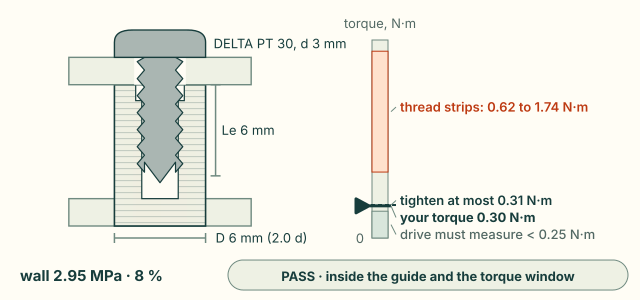
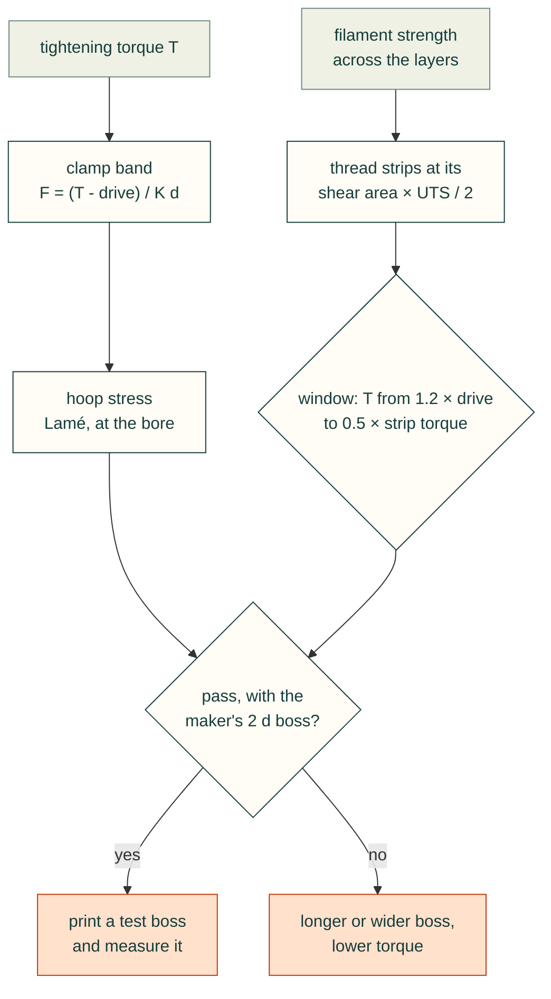

# Screw bosses for printed parts

A thread-forming screw, such as an EJOT DELTA PT, makes its own thread in a plain hole in a plastic boss. Three things
decide whether the joint holds: the clamp force a tightening torque gives, the force and torque at which the boss's
thread strips, and whether the boss wall survives. `cadagent.formulas.screw_boss` computes them for any plastic, and
`cadagent.mechanical.bosses.printed_boss` picks the numbers for a boss printed in one of the datasheet filaments.
**No published pull-out data for screws in printed bosses was found, so a result is a starting point to test, not a
rating.**

## Try it: the screw-boss explorer

On the left is the boss in section, with the hole, the thread and the clamped lid. The wall is coloured by its hoop
stress, and the faint lines are the print layers. On the right is the torque window, from 0 at the bottom. The pale
band at the bottom is the drive torque the screw may take to form its thread, the dashed line is the most you should tighten to,
and the peach band is where the boss's thread strips. The default is a DELTA PT 30 in PLA, in the maker's boss
(outside 2 d, engagement 2 d). Tightened to 0.30 N·m, it sits just inside the window, whose top is 0.31 N·m.

<cad-printed-boss material="pla-bambu-basic" size="30" outside="6" engagement="6" torque="0.3" axis="upright">

</cad-printed-boss>

Try these:
- **Tighten to 0.40 N·m.** That is past half the lowest stripping torque, so it fails. The thread itself strips
  somewhere from 0.62 to 1.74 N·m over the drive torque: the band is that wide because the friction of steel on plastic spans 0.20 to 0.65.
- **Cut the engagement to 3 mm (1 d).** The thread strips at half the force (383 N), and the most you should tighten
  to falls to 0.15 N·m.
- **Change the filament.** PETG HF is weaker across the layers (23 MPa), so the same boss strips at 569 N and 0.30 N·m
  is too much. CoPA strips at 1133 N and takes up to 0.45 N·m.
- **Make the boss 4 mm across.** The wall fails the maker's 2 d rule, though its hoop stress is only 18 %. The hoop
  stress here is the clamp's share only. Forming the thread pushes the wall out much harder, and the 2 d rule guards
  against that.
- **Lay the boss on its side.** Its hoop stress now crosses the layers, where the strength is lower. Expect it to
  split along a layer seam before the numbers say so.

## How it works

- **Clamp.** Torque gives clamp through the nut factor, T = K F d (Shigley, Eq. 8-27), with K from the friction on the
  thread's 30° flanks and under the head. The low friction gives the high clamp. Only the torque over the drive
  torque clamps. Until the drive torque is measured, the low end takes the most the window allows (T / 1.2).
- **Stripping.** The boss's thread shears along a cylinder at the screw's crest, of area 0.875 π d Le (the ISO 68-1
  internal-thread area). The shear strength is half the lowest tensile strength across the layers, since that cylinder
  crosses the layers whichever way the boss stands.
- **Window.** Covestro's guides ask for a tightening torque at least 1.2 times the drive torque (to form the
  thread) and at most half the stripping torque. The drive torque is not computed, so measure it on a test boss.
- **Wall.** The flanks push the wall out under the clamp, and a Lamé cylinder gives the hoop stress at the bore. It
  is checked against the strength in the layers for an upright boss and across them for one lying on its side.



## From Python

```python
from cadagent.mechanical.bosses import printed_boss

r = printed_boss("pla-bambu-basic", size="30", outside_mm=6, engagement_mm=6, torque_nm=0.3)
r["preload"]          # clamp band, N: {'low': 22.0, 'high': 373.9}, the drive torque unmeasured
r["strip_force"]      # 766.9 N
r["torque_ceiling"]   # 0.308 N m: tighten to at most this
r["passes"], r["limits"], r["material"]["source"]
printed_boss("pla-bambu-basic", "30", 6, 6, 0.3, drive_torque_nm=0.2)["preload"]   # measured: 44 to 125 N
```

`printed_boss` returns the inputs, the screw and its source, the filament's strengths and the datasheet editions they
come from, the friction band and the limits. `cadagent.formulas.screw_boss(diameter, pitch, engagement,
outside_diameter, torque, shear_strength, hoop_strength)` takes SI units and your own strengths, for any plastic.
The explorer runs the browser port of `screw_boss`, which is tested against the Python on shared vectors (see
[Engineering formulas](formulas.md)).

## Limits

- **Not a rating.** The datasheets' strengths are short-term, for bars printed at 100 % infill. A boss is a few
  perimeters round a hole, and its thread is formed across layer seams. Print a test boss and measure the drive
  torque, the stripping torque and the pull-out force.
- **The drive torque is not computed.** It depends on the hole, the filament and the screw, so it must be measured.
  It makes no clamp, so the clamp band stays wide until it is: pass it as `drive_torque_nm`.
- **The hoop stress is the clamp's share only.** Forming the thread pushes the wall out further, and the maker's hole
  and boss proportions keep that in check.
- **Held clamp.** A printed boss creeps, so the clamp relaxes over time, faster in PLA and when warm. Nothing here
  models that.
- **Closed forms.** Even load sharing over the engaged thread, frictionless flanks for the radial push, and a nut
  factor from a friction band, not a measured one. PLA and PETG are not in the friction table.

## Sources and survey

<details>
<summary>The guides, the screw maker's data, the relations and what the survey of 2026-11-01 found</summary>

- Screw sizes and boss proportions: Bulten AB, *DELTA PT: a superior thread-former for plastics*, brochure version
  250422, p. 4 (sizes and pitches) and p. 7 (hole 0.8 d, outside 2.0 d, engagement 2.0 d, a counterbore of d + 0.2 mm,
  0.3 to 0.4 d deep). Bulten makes DELTA PT under licence from EJOT. EJOT's own PDFs could not be downloaded on
  2026-11-01.
- Tightening window: Covestro, *Self-tapping screws for thermoplastics* (2016), Section A and Fig. 1, and
  *Engineering Polymers: Joining Techniques* (2015), Fig. 6: tighten to at least 1.2 times the drive torque and at
  most half the stripping torque. Covestro also gives a boss outside diameter of 1.8 to 2.5 D (the former, Fig. 3)
  and asks for an engagement of 2.3 D (the latter), a little more than the screw maker's 2 d.
- Friction: Covestro, *Snap-Fit Joints for Plastics: A Design Guide*, Table 3 (plastic on steel).
- Relations: Shigley's *Mechanical Engineering Design*, 10th ed., Section 8-2 (thread statics), Eq. 8-27 (torque and
  clamp), Section 3-14 (thick-walled cylinders), Section 5-4 (maximum shear stress); ISO 68-1 (thread profile).
- Filament strengths: the makers' data sheets, edition by edition, in
  [`allowables.py`](../src/cadagent/mechanical/compliant/allowables.py) (see [Snap fits](compliant.md)).
- **Survey (2026-11-01).** No open-source calculator for pull-out or stripping of thread-forming screws in plastic was
  found. The closest are resin makers' calculators for moulded bosses (SABIC's on UL Prospector, closed), and OpenSCAD
  thread libraries, which make geometry, not checks. So the closed forms are built here, each tested on golden vectors.
  No published test of thread-forming screws in FDM bosses was found. Bambu Lab sells self-tapping screws for printed
  parts and describes torque tests on its store pages, but those pages could not be read on 2026-11-01, so none of
  their numbers are used.

</details>

## Tests that keep it honest

`tests/formulas/test_torsion_snap_boss.py` checks the radial push against the flank's statics, the hoop stress against the
equilibrium of half the ring, `screw_boss` against its parts and the window, the strengths against the cautious
datasheet edition, the DELTA PT table, and this page's explorer numbers against the Python. The browser's port
matches the Python on the shared vectors (`tests/webkit/webkit-formulas.test.mjs`).
