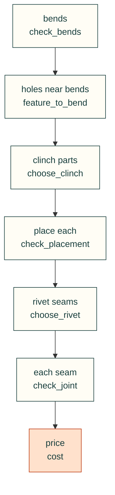
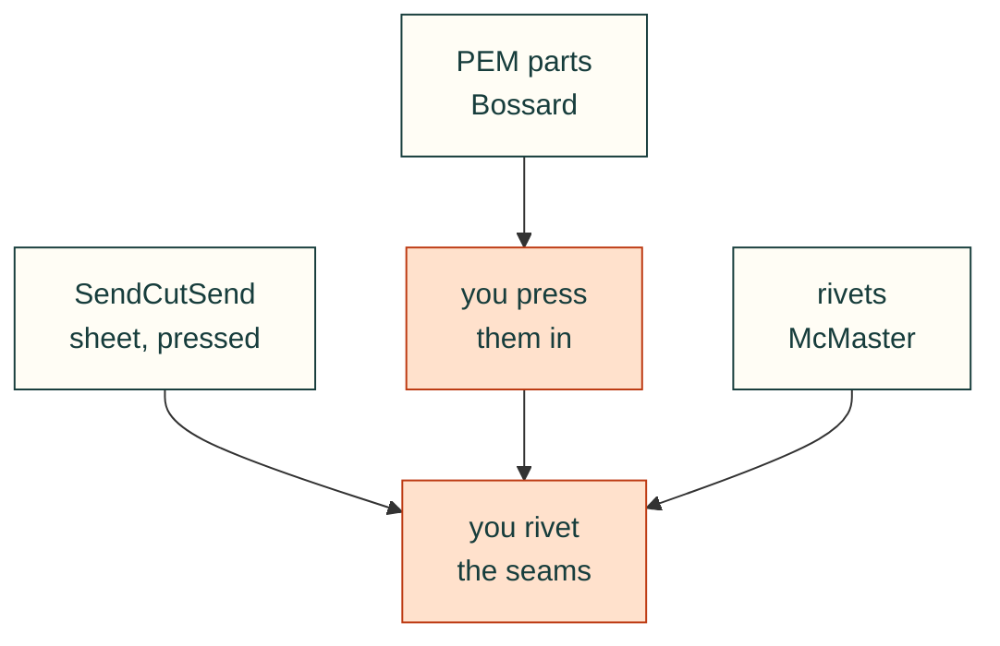

# Sheet-metal hardware: clinch parts and rivets

A laser-cut plate with one or two bends and a few pressed-in nuts or studs is a stiff, cheap mounting plate. Rivet two
of them together and you get a box that one part cannot fold into. This page covers the bought parts for that
pattern: which self-clinching (PEM-type) parts and blind rivets the checks know, what they cost and where to buy them.
The checks come first and the price second, so a part is only ever ranked once it fits.


*Drawn by `tools/process_figures.py` from `cadagent.mechanical.sheet_hardware` on `research/sheet-hardware.yaml`. A test
redraws it and fails if the committed chart differs. The prices are as read on the dates in the footer.*

## The pattern, step by step



*Each box is a function, and each one gives the next a number it needs: the bend allowance for the clinch part's
distance to the bend, and the stack for the rivet's grip. The [`sheet-metal-hardware` skill](../skills/sheet-metal-hardware/SKILL.md)
walks an agent through it.*

```python
from cadagent.manufacturing import sheet_metal as sm
from cadagent.mechanical import clinch, rivets, sheet_hardware as sh
sm.check_bends("5052", 1.6, [20, 20], relief_width_mm=1.6, hardware=True,   # flanges, relief, and the
               shop="sendcutsend")                    # shop's limits for a part with hardware
sh.choose_clinch("632", "5052-h32", 1.6)       # S-632-1 ($0.0847), then CLS-632-1 (no price read)
clinch.check_placement("S-632-1", "5052-h32", 1.6, edge_mm=6.5, to_bend_mm=8.0,
                       bend_allowance_mm=sm.bend("5052", 1.6)["allowance_mm"])
sh.choose_rivet(3.2, 3.0)                      # 1/8 in rivets for a 3.0 mm stack, cheapest first
rivets.check_joint("mcmaster-97447A015", [("5052-h32", 1.5), ("5052-h32", 1.5)], edge_mm=6.4, pitch_mm=25)
sh.cost({"S-632-1": 8, "mcmaster-97447A015": 24})   # $1.71 in pieces, $11.46 in packs; $6.16 to press the nuts in
```

## The common, cheap choice

| For | Take | Each, loose | Pressed in by SendCutSend |
|---|---|---|---|
| A thread in 5052 or mild steel | zinc-plated steel S nut, M3–M5 or #4-40 to #10-32 | $0.08–0.12 | $0.77 (the inch sizes) |
| A stud | steel FH, M3–M6 | $0.07–0.18 | $0.77–1.23 |
| A board on a plate | steel SO or BSO standoff | $0.21–0.68 | $1.23–1.33 |
| A seam between two aluminium parts | 1/8 in aluminium rivet | $0.04 | not offered |
| Where it must not rust | stainless CLS or CLSS nut | $0.15–0.68 | not in the feed |

*From `research/sheet-hardware.yaml`. Loose prices are Bossard Americas' prices for 1–249 pieces
([ref:bossard-pem-prices], read 2026-11-02). Rivet prices are McMaster-Carr's pack prices divided by the pack quantity
([ref:mcmaster-blind-rivets], read 2026-11-01). The pressed-in prices come from SendCutSend's ordering feed
([ref:sendcutsend-catalog]), which does not say whether its price includes the part.*

So pressing a part in costs 7 to 11 times the loose part for the nuts and studs up to #10 and M5, and 3.6 to 5.8
times for the larger parts and the standoffs. A riveted seam costs a few cents per rivet. Stainless
parts cost 1.8 to 3.3 times the steel ones, and none of the listed parts goes into stainless sheet.

## Where to buy



*Where each part comes from. A sheet part the shop has pressed its clinch parts into needs only riveting; loose
clinch parts from a distributor are pressed in first. Rivets come from a distributor.*


- **PEM parts:** Bossard Americas sells them loose without an account, with stock counts on each part page. PEM sells
  through distributors, so other sellers have them too.
- **Rivets:** McMaster-Carr sells them in packs of 100 or 250. POP rivets, whose ratings the rivet check
  also uses, are sold through distributors. No POP prices are recorded yet.
- **Pressed in:** SendCutSend presses in 151 hardware parts from its feed, when you order the sheet part with
  hardware. Check its own limits with the `shop="sendcutsend"` checks.

## Keeping it current

<details>
<summary>The data, the test that guards it, and how to refresh it</summary>

- **The data:** one item per orderable part number in `research/sheet-hardware.yaml`. Each item carries its price,
  the day it was read, its seller's page, its source in `research/references.yaml` and the part the checks know it as.
- **The test:** `tests/mechanical/test_sheet_hardware.py` loads the catalogue and fails on a part the checks do not
  know, a price with no date, or a source that is not cited.
- **To refresh:** re-read the part pages one at a time and update `price_usd`, `price_checked` and `specs` for each
  item. Then redraw the chart with `python3 tools/process_figures.py`.

</details>

**Limits.** These are dated public prices before shipping and tax. Minimum orders and tooling (a press or a rivet gun)
are not counted. They are not quotes. A part the checks list without a price comes last, with `offer` empty. The
strengths behind the checks are the makers' test averages, not allowables, so test a sample part.
