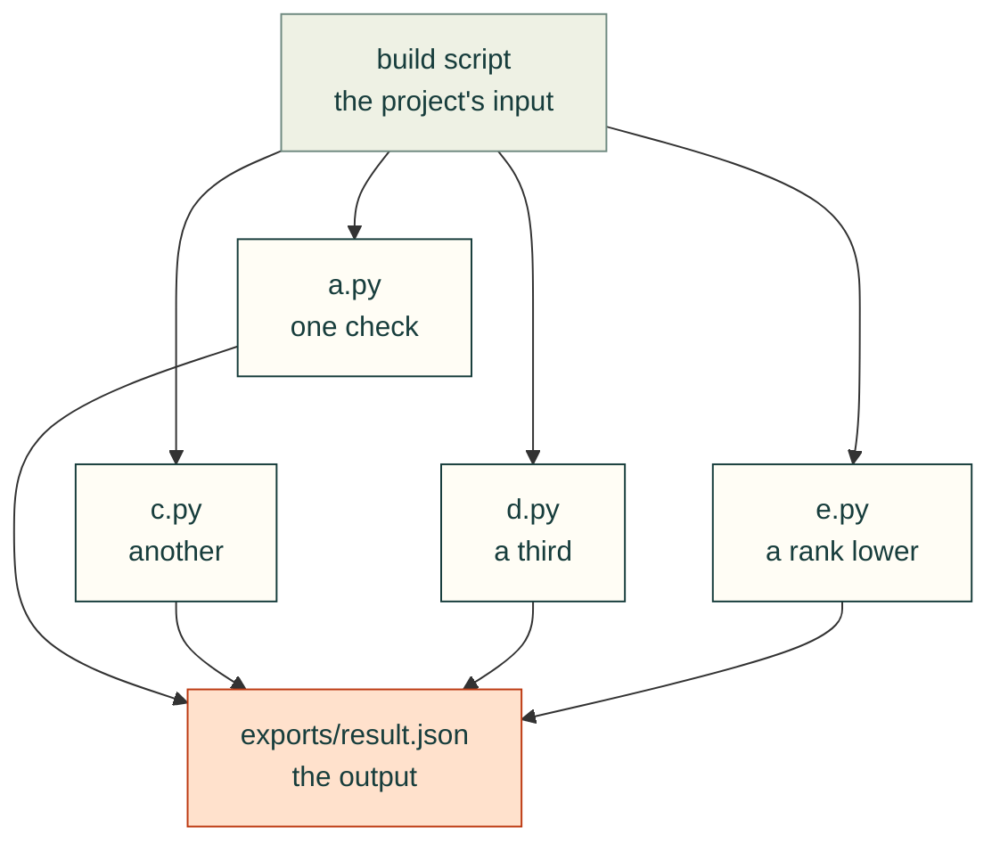

# README and diagram style guide

Every folder in this repo explains itself in a `README.md`, so a person or an agent landing anywhere can tell what the
folder is for, how its pieces connect, and where to go next. This page says how those READMEs look. The checker that
keeps them present and linked is tracked in #113.

## Which folders

- Every folder we write has a `README.md`.
- **Vendored trees** (`vendor/<name>/`, `src/cadagent/webkit/vendor/<name>/`) keep their upstream layout. One README at
  the vendor root covers them, with credits and licences.
- **Skill folders** (`skills/<name>/`) have `SKILL.md` instead; the `skills/` README lists them.
- `.github/` is documented in [CONTRIBUTING.md](../CONTRIBUTING.md).

## Shape of a README

1. `# <folder name>`, then one sentence: what the folder is for.
2. One Mermaid diagram (below).
3. **What's here**: a table, one row per file or subfolder, one plain line each.
4. **Related**: the parent README, neighbouring folders, the docs page that explains the topic.
5. Credits where the folder builds on someone's work: name the person or project and link it.

Short beats complete: details live in docstrings and the docs.

## Diagrams

The site's diagram check (#123) draws every page at a 1100 px window, the narrowest that shows the page tree, and
fails any diagram wider than the article column: 641 px, keeping 17 px spare for a classic scrollbar. These rules keep
a diagram inside that and readable on GitHub.

- **`flowchart TD`**, at most 12 nodes. Inputs at the top, outputs at the bottom; label an edge with a verb or the file
  it carries when that helps.
- **At most three boxes per rank.** Mermaid puts each node at least one rank below the nodes that point at it, so a
  fan-out of four lands four abreast. Push one down with an invisible link: `A ~~~ E` draws nothing and puts `E` at least one
  rank below `A`. Or group: one box can name several folders (`sim/ · explore/`).
- **Labels:** the real file or folder name on the first line, plain words after it. Split lines at about 24
  characters with `<br/>`. Three boxes of 24 characters still overflow, so keep lines shorter in a full rank, and
  avoid long edges that skip ranks: each one takes a lane of its own.
- **Draw from the code.** An arrow is an import, a call, or a file one piece writes and the next reads. Check each
  import arrow with grep or an AST scan, not from memory, and say in a sentence above the diagram what the arrows mean.
- **No meaning carried by colour alone (#113).** The palette sorts boxes into this folder's pieces, neighbours and
  outputs, but each label must say it too: a piece names its file, a neighbour its package, an output the file or page
  it is (`exports/hole-checks.json`).
- **Every diagram renders** through the kit's `diagrams.js` (the site) and on GitHub.
- **Left to right only for a two-column pairing**, sized to fit, with a note saying why. The one exception is
  `research/design-workflows.md` (#124): each incident symptom on the left, the check that catches it on the right.

Use the shared palette, so diagrams look the same on GitHub and on cad-agent.valpatel.com. These are the values the
site adds:

```
classDef here fill:#fffdf5,stroke:#173d3c,color:#173d3c      %% this folder's pieces
classDef near fill:#eef1e4,stroke:#6f8a80,color:#173d3c      %% neighbours and inputs
classDef out fill:#ffe1cc,stroke:#bd3a12,color:#173d3c       %% what comes out: files, pages, verdicts
```

**Skills and subagents leave the palette out.** Diagrams in `skills/` and `agents/` keep only their `class` lines
(`class A,B here`, `class M out`) and leave out the `classDef` lines, because agents load those files into their
context. The site build adds the `classDef`
lines that a diagram uses but does not define (#124); on GitHub those diagrams draw in Mermaid's default colours. Do
not paste the three `classDef` lines into a `SKILL.md` or a subagent file.

Example: four checks from one input, at most three per rank.



## Writing

Plain, short sentences. Say what a thing does and what it assumes, not how good it is. Name sources and people.
