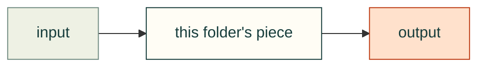

# README and diagram style guide

Every folder in this repo explains itself in a `README.md`, so a person or an agent landing anywhere can tell what the
folder is for, how its pieces connect, and where to go next. This page says how those READMEs look. The checker that
keeps them present and linked is tracked in #113.

## Which folders

- Every folder we write has a `README.md`.
- **Vendored trees** (`vendor/<name>/`, `src/cadagent/webkit/vendor/<name>/`) keep their upstream layout. One README at
  the vendor root covers them, with credits and licences.
- **Skill folders** (`skills/<name>/`) have `SKILL.md` instead; the `skills/` README lists them.
- `.github/` is documented in [CONTRIBUTING.md](../CONTRIBUTING.md).

## Shape of a README

1. `# <folder name>`, then one sentence: what the folder is for.
2. One Mermaid diagram (below).
3. **What's here**: a table, one row per file or subfolder, one plain line each.
4. **Related**: the parent README, neighbouring folders, the docs page that explains the topic.
5. Credits where the folder builds on someone's work: name the person or project and link it.

Short beats complete: details live in docstrings and the docs.

## Diagrams

- `flowchart LR` (or `TD` when the flow is a stack), at most 12 nodes, labels in plain words; `<br/>` for a second line.
- Show how the pieces connect: inputs on the left, outputs on the right, edges labelled with a verb when it helps.
- Use the shared palette, so diagrams look the same on GitHub and on cad-agent.valpatel.com:

```
classDef here fill:#fffdf5,stroke:#173d3c,color:#173d3c      %% this folder's pieces
classDef near fill:#eef1e4,stroke:#6f8a80,color:#173d3c      %% neighbours and inputs
classDef out fill:#ffe1cc,stroke:#bd3a12,color:#173d3c       %% what comes out: files, pages, verdicts
```

Example:



## Writing

Plain, short sentences. Say what a thing does and what it assumes, not how good it is. Name sources and people.
