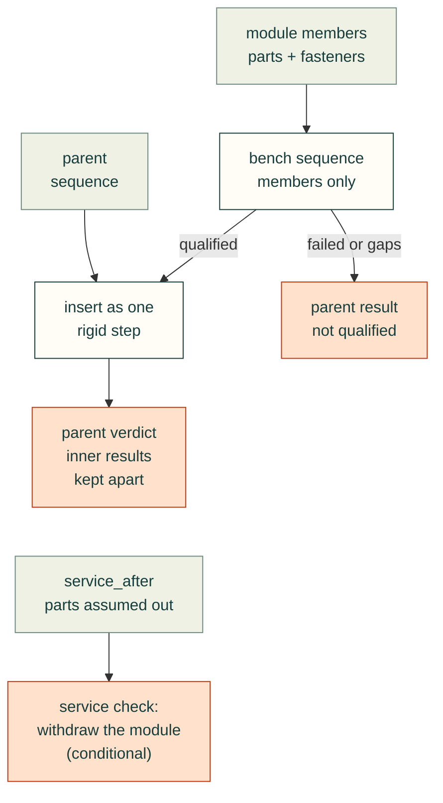

# Rigid subassembly insertion

A preassembled module needs two separately checked sequences: its internal bench assembly and its insertion into the parent. Treating its components as independent parent steps invents an installation order and can claim tool access in the wrong surrounding geometry.



Additive Python API (issue #68):

```python
assembly_gate(assembly, parent_steps, fasteners=specs, tools=tools,
    subassemblies={
        "electronics": {
            "members": ["carrier", "board", "insert", "board_screw#0", "board_screw#1"],
            "steps": bench_steps,
        },
    },
    service_after={"electronics": ["bumper", "retainer#0", "retainer#1"]},
)
# parent_steps contains an ordinary fit="electronics", direction="-X" step.
```

`members` names exact existing geometry instances, including every attached fastener solid. Members must be known, unique and disjoint; a module name cannot shadow a part or fastener. Nested modules and changed internal poses are outside this first API. Internal fasteners must connect only members of that module, with all their solids represented. External retainers remain parent fasteners with their actual geometric identities.

The internal plan is executed against only its members, using the same geometry, insertion directions and tool envelopes. Missing coverage, failed checks or unperformed insertion/tool checks prevent a qualified parent result. Scoped qualification therefore rejects `tool_access=False`; all steps need a direction. Internal screws are not driven again at the parent step. The parent treats the module as rigid: every member receives the same translation, and every member, including attached screw solids, participates in collision checks. A module name is not a blanket intended-overlap exemption; existing explicitly declared internal pair overlaps keep their recorded reason. Cross-boundary overlap exemptions are unsupported and rejected.

`service_after` is conditional evidence: listed parent parts/fastener instances are assumed already removed. Unknown, duplicate, target-member or otherwise ambiguous prerequisites are rejected. All external retaining fasteners must be listed. The whole module's reverse insertion path is checked against all remaining final geometry. This does not prove that the listed prerequisites can themselves be removed, that their tools can reach, or that harnesses are disconnected. Those claims need separate evidence. Internal fasteners travel with the module and are not removal prerequisites.

The ordinary `service=True` or `service=[module]` mode cannot silently stand in for module prerequisites: requesting a module that way requires its `service_after` entry. Explicit service targets must resolve to parent parts or modules. Individual module members (including instance-owner aliases), unknown names and fastener-only targets are rejected before geometry; member teardown is outside this API. A module's conditional withdrawal does not answer a request to remove one of its members. Supported parent part aliases are expanded to exact instances, each with its own service check. Other individual parent parts retain their existing service behavior. A conditional pass means only that withdrawal is clear in the stated remaining geometry; it is not an unconditional service-ready claim.

Existing single-part calls and their verdicts remain unchanged. The first interface is Python-only, through `run_sequence`, `assembly_gate` and the keyword pass-through in `assembly_from_build`; it does not silently extend registry/YAML/CLI schemas. Internal results and parent results are separate in JSON/Markdown. The adapter does not change the separate fastener-engagement, connectivity, tolerance or motion gates. Declaring a module rigid is an assumption, not proof that its joints hold it rigid.

Validation in `tests/test_gate_subassembly.py`: kernel-free structural/order/coverage and scoped-tool tests; rigid member and attached-screw path blockers; rejected cross-boundary/partial fastener declarations; failed internal-plan propagation; conditional removal with retained versus removed obstacles; unknown kernel responses; small BREP positive/negative fixtures. Existing assembly and fastener suites remain regressions. The same straight-line sampling, rigid geometry and tolerance limits apply: a model pass does not prove printed fit, strength, service ergonomics or hardware readiness.
