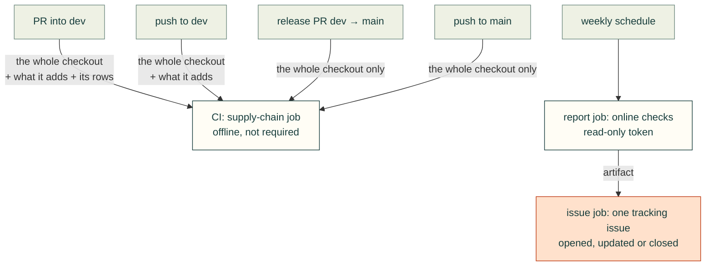

# Supply chain and resource safety

cad-agent depends on Python and npm packages, vendors other people's code into `vendor/` and the web kit, and sends
readers to hundreds of outside projects from its catalogue and pages. `tools/resource_audit.py` checks all of it the
same way every time: known advisories and malicious packages, pins and recorded hashes, vendored files against their
upstream, licences, and links that died, moved or now point somewhere else. Each pull request into `dev` gets the
offline checks; a weekly run adds the online ones and keeps one issue current. The latest run is in the
[supply-chain report](../research/security-report.md), and the [`cad-supply-chain` skill](../skills/cad-supply-chain/SKILL.md)
says what to do with each finding.


*Real output of `tools/resource_audit.py`, drawn from the committed [report](../research/security-report.md) of
this repository. A test redraws it from the report's JSON, so the two cannot disagree.*

## What it checks

| Area | Offline, on every PR (seconds, no network) | Online, weekly or on demand |
|---|---|---|
| Python dependencies (`pyproject.toml`, every extra) | lower bounds, readable requirements | OSV advisories at the newest release and the lowest one each range allows, and for every transitive package deps.dev resolves; PyPI releases, licences, "inactive" |
| npm packages (`package-lock.json`) | registry source over HTTPS, sha512 integrity, install scripts, licences, lockfile in step | OSV and `npm audit`, deprecations |
| Vendored projects (`vendor/`) | full-commit pins, licence files, reviewed baselines, notices | every file against upstream at the pinned commit (git blob hashes), upstream advisories since the import, archived or moved, Scorecard |
| Web kit (`src/cadagent/webkit/vendor/`) | every file against the SHA-256 in its receipt; each receipt names its npm tarball and integrity; the versions of the libraries a file bundles are in that file | OSV for each library, including DOMPurify and KaTeX inside `mermaid.min.js`; the tarball against its integrity, and each file against the package's bytes |
| Links (catalogue and every published page) | plain HTTP, missing licences, stale records | repository gone, moved, archived or relicensed; dead pages, redirects to another domain, HTTPS downgrades |
| Install advice in pages | installing skills or plugins from a registry, piping a download into a shell, running a package through npx or uvx without a version, pointing at a moving "latest" | |

Everything fetched is data: advisory text, package metadata, tarballs and pages are parsed, never run or followed as
instructions, and a tarball is read in memory, never unpacked to disk. Before building it we compared what exists
(the fold at the end of this page); the report calls those services rather than keeping its own advisory logic.

## Where it runs



What a change adds is judged only where new items enter the project: pull requests and pushes into `dev`
(`gate --into dev`). A dependency, vendored file or catalogue entry must have its row in the PR description, and
nothing it adds may have a medium or worse finding. A release PR from `dev` into `main` carries only items that
already passed that gate, each in its own PR with its rows; compared with `main` instead, "what it adds" would be
everything since the last release, which no release PR can describe, so it and the push to `main` after it get the
whole-checkout check alone: no high or critical finding anywhere. The online checks never gate anything, because a
service that does not answer must not fail a build; an unanswered check is reported as "not verified" (info), and the
weekly issue keeps its earlier findings open rather than calling them resolved.

## Run it

```bash
python3 tools/resource_audit.py report                               # the offline checks, as CI runs them
python3 tools/resource_audit.py rows --base origin/dev --online       # the rows to paste under "Supply chain"
python3 tools/resource_audit.py gate --base origin/dev --into dev --pr-body-file body.md   # CI's check, locally
python3 tools/resource_audit.py report --online --json research/security-report.json \
    --md research/security-report.md --svg docs/img/supply-chain/findings.svg   # refresh the committed report
```

Run the refresh from a checkout with nothing uncommitted: the report records the revision it read and says so when
the tree had changes. Repository settings (secret scanning, Dependabot alerts) need admin rights, so only the owner's
run with `--repo Valpatel/cad-agent` sees them.

## Making it required (owner)

The `supply-chain` job is not a required check, so a failure warns and does not block. To make it one, the owner adds
the check named `supply-chain` to the required checks of `dev` in the branch protection settings. Leave it off `main`
unless you want release PRs to wait for it as well: there it only repeats the whole-checkout check. The weekly
workflow uses only the `schedule` and `workflow_dispatch` events; if the repository's Actions event policy lists the
events each workflow file may use, it needs those two for `.github/workflows/supply-chain.yml`. Agents do not change
these settings (#153).

## Limits

- A clean report is not proof of safety. Advisory databases only know what has been reported.
- Licences are matched by keyword from licence files and registry metadata, not reviewed by a lawyer.
- Link checks see status codes and redirects, not content: a parked or replaced page that answers 200 passes, and
  domain expiry is not checked. GitHub links are checked per repository, not per file.
- Python ranges are checked at their newest and lowest releases; transitive packages at the versions deps.dev
  resolves, not the ones an existing environment holds.
- Libraries bundled inside a vendored file are checked at the versions its receipt records; whether the bundling
  library reaches the affected code is not assessed.
- The CI job runs the PR's own copy of the tool and of `research/security-accepted.yaml`: it keeps honest work honest,
  and a reviewer reads changes to those files.

<details>
<summary>What we looked at before building it, and what we adopted</summary>

- **[OSV.dev](https://osv.dev)** (adopted): the advisory database behind pip-audit and osv-scanner, with the OpenSSF
  malicious-packages feed (`MAL-` ids). The report asks its batch API directly.
- **[osv-scanner](https://github.com/google/osv-scanner)** (not adopted): it reads lockfiles, and our Python side is
  version ranges in `pyproject.toml`, not a lockfile. It would add a Go binary for what one OSV call does.
- **[pip-audit](https://github.com/pypa/pip-audit)** (not adopted): it resolves by installing into a temporary
  environment, so covering every extra means installing CadQuery, VTK and gmsh; its OSV backend is the source used
  here anyway. `--installed` checks the installed versions of our direct dependencies only.
- **`npm audit --package-lock-only`** (adopted): the npm registry's own advisories for the lockfile, no install.
- **[Open Source Insights (deps.dev)](https://deps.dev)** (adopted): resolved dependency graphs, for the
  direct-plus-transitive counts and the transitive packages OSV is asked about.
- **[OpenSSF Scorecard](https://scorecard.dev)** (adopted): repository hygiene scores, read from its API.
- **[lychee](https://github.com/lycheeverse/lychee)** (ideas adopted): fall back from HEAD to GET, and treat 403 and
  429 as not verified rather than broken. Its binary is not needed for a few hundred links.
- **GitHub's repository API** (adopted): archived, deleted, renamed and relicensed repositories, the vendored trees
  at their pinned commits, published repository advisories.

</details>
