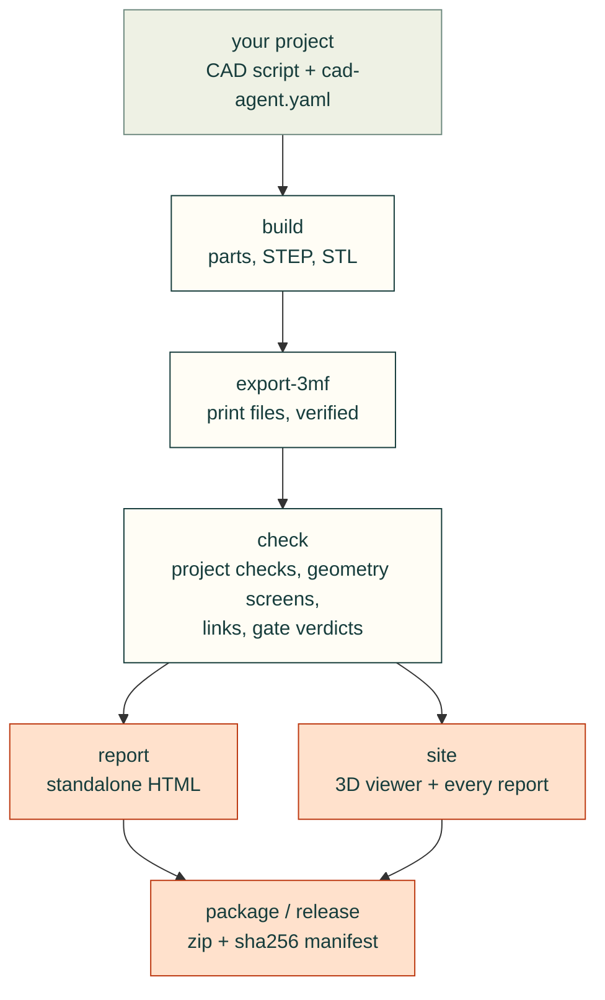

# Tools: the cad-agent command and Python package

cad-agent is a toolkit for agents doing hardware design, in the six domains of the [topic tree](vision.md):
mechanical design, manufacturing, thermal, simulation and validation, electrical design, and practice (how agents
work, design process, review and evidence, publishing, evaluation). It is made of [subagents and skills](agent-workflow.md), the references behind every rule
(cited on each page), code, calculators such as the [snap-fit calculator](compliant.md),
[lessons learned](../lessons/README.md) and a [catalogue of outside tools](https://cad-agent.valpatel.com/catalog).
This page is the reference for its code: the `cad-agent` command and the Python package `cadagent`.

[`docs/areas.yaml`](areas.yaml) lists each area's commands and APIs, at the maturity that area has reached; several
areas are still ideas, with no tool yet. The pipeline commands work on any project set up by
[the project contract](#the-project-contract): `cad-agent` runs a project's build
and checks, verifies its 3MF print files, and turns the results into a standalone HTML report and a review package.
The geometry and the design-specific checks stay in the project; the package provides the runner, the 3MF writer,
shared geometry screens, the renderer, link validation, the report, packaging and a local server.

<table><tr>
<td width="33%"><br><b>Site.</b> Every part in place, with explode and section, and one top bar linking every report.</td>
<td width="33%"><br><b>Strength.</b> FEA of a ribbed lid under a 300 N press, coloured by stress as a fraction of the material's strength.</td>
<td width="33%"><br><b>Less material.</b> Topology optimisation keeps only the floor that carries load.</td>
</tr></table>

```bash
pip install -e ".[cad]"          # in the cad-agent checkout; or install it into the project's own venv
cd my-cad-project
cad-agent all                    # build -> export-3mf -> check + report -> package
cad-agent check                  # re-collect results; exit 1 if anything fails
cad-agent report --open          # exports/cad-agent-results.json + docs/cad-agent-report.html
cad-agent serve --port 8000      # needed for "Open in Bambu Studio" links
```

Without the console script, `python -m cadagent.cli <subcommand>` does the same.
The toolkit started as `vptest cad` in the vptest framework; projects set up for
it keep working (see [Coming from vptest](#coming-from-vptest)).

The toolkit's pipeline, in order. `cad-agent all` runs it through `package`: build, export-3mf, holes, gates (only
when the project enables them), report (which runs `check` first) and package. `site` and `release` are commands of
their own:



## The project contract

```
my-cad-project/
  cad-agent.yaml         # cad: section (below)
  cad/parameters.json    # the single parameter authority (dimensions, clearances, revision)
  cad/build.py           # builds every part; exposes print_parts() and the print rotations
  tools/*.py             # project-specific checks, renders, docs; one JSON per check
  exports/               # <part>.stl/.3mf/.step, geometry-checks.json, <check>.json, logs
  preview/               # renders (part-<name>.png per part) + gallery index.html
  docs/                  # engineering review pages, BOM, registers, cad-agent-report.html
```

1. **One parameter authority.** Every dimension, clearance and the `revision`
   live in `cad/parameters.json`; scripts read it, nothing restates a number.
2. **`cad/build.py`** exposes `print_parts() -> {name: cadquery.Shape}` and a
   print-rotation table. Its `__main__` writes, per part, STEP in assembly
   coordinates and STL in print orientation, and the parts file
   `exports/geometry-checks.json`:
   `{part: {cad_valid, solid_count, watertight, print_bounds_mm, ...}}`.
   `cadagent.geometry` does the generic part:
   ```python
   from cadagent.geometry import export_print_stl, export_step, solid_report, pairwise_intersections
   report = {n: export_print_stl(s, OUT / f"{n}.stl", rotation=PRINT_ROTATION.get(n))
             for n, s in print_parts().items()}          # raises on a non-watertight STL
   for n, s in print_parts().items():
       export_step(s, OUT / f"{n}.step")                 # the same bytes for the same model
   ```
   Write STEP with `export_step`, not `cadquery.exporters.export`: OCCT stamps the write time into the header,
   names the product `Open CASCADE STEP translator <version> <n>` by export order and numbers assembly links
   across the process, so every rebuild would change every STEP file and stale every check bound to its sha256.
   `export_step` writes the same geometry with a fixed header date (`SOURCE_DATE_EPOCH` when set, the
   [reproducible-builds](https://reproducible-builds.org/specs/source-date-epoch/) convention, else
   2000-01-01T00:00:00), the product named after the file (or `name=`), and links numbered from 1 within the file.
   Another OCCT version can still write different bytes for the same geometry, and a cadquery `Assembly` is not
   covered (it is refused; `Assembly.save` is not reproducible yet, #150).
3. **Each check is a script** in `tools/` that writes `exports/<name>.json` with
   a top-level boolean `"pass"`. A check that cannot compute its answer writes
   `"pass": false` with the reason; it never omits the file or the key.
4. **Renders** go to `preview/`; `preview/part-<name>.png` is picked up as the
   evidence image for that part. `cadagent.publish.render.Renderer` renders cadquery
   shapes or STL files offscreen with a caption bar, subtitle, note bar and
   leader labels; set `CAD_AGENT_RENDER_ONLY=a.png,b.png` to re-render a subset.
5. **A gallery page** (`preview/index.html`) can embed the per-part download
   table from `cadagent.publish.report.downloads_snippet(project, page_dir=...)`:
   thumbnail, STL / 3MF / STEP links and a slicer link.

### Honest evidence

- CAD checks never claim physical fit. Every check JSON that touches fit should
  carry `"physical_fit_verified": false` (and `"slicer_run": false` for print
  screens) until someone has printed and fitted the part. The report records
  both as false and says so in a banner. `cad-agent` has no way to set them true.
- A check is green only when its `pass_key` value is the boolean `true`. A
  missing file, missing key, `"yes"`, `1` or a list all count as failures.
- In the results and the report, a row status other than the known pass, fail
  and skip spellings counts as a failure, never as a pass.
- The overhang screen (`geometry.downward_area`) is a screen, not a slicer.
- `export-3mf` re-reads every 3MF it writes and deletes it unless triangle count,
  edge-manifold watertightness and volume (within 0.1 %) match the STL.

### Print files

| File | Orientation | Notes |
|------|-------------|-------|
| `exports/<part>.stl` | print orientation, lowest point on z=0 | degenerate faces removed; must be watertight |
| `exports/<part>.3mf` | print orientation, centred on `printer.bed_mm` | written by `cad-agent export-3mf`, read back and verified; byte-reproducible (fixed zip dates), so a rebuild of unchanged geometry keeps the slice report current |
| `exports/<part>.step` | assembly coordinates | for CAD review and re-use |

"Open in Bambu Studio" uses `bambustudio://open?file=<url-encoded http URL of the 3MF>&name=<part>`.
The slicer fetches the file over http, so the link only works when the page is
served (`cad-agent serve`); from `file://` the link downloads the 3MF instead.

## The `cad:` section of `cad-agent.yaml`

`cad-agent` reads `<project>/cad-agent.yaml` when it exists, otherwise
`<project>/vptest.yaml`. Only the `cad:` section is read; other top-level
sections (such as vptest's `project:` and `projects:`) are ignored. The first
file found is the config: a `cad-agent.yaml` without a `cad:` section is an
error even if `vptest.yaml` has one.

| Key | Default | Meaning |
|-----|---------|---------|
| `name`, `title` | folder name | identity in reports and package names |
| `revision` / `revision_from` | none | literal, or `"path/file.json:dotted.key"` read at report time |
| `python` | `<root>/.venv/bin/python`, else cad-agent's python | interpreter for the steps |
| `exports_dir`, `preview_dir`, `docs_dir` | `exports`, `preview`, `docs` | |
| `steps` | `[]` | `{name, run, log?, timeout_s=1800, needs?}`; `run` is a script relative to the root, run with cwd = root and `CAD_AGENT_PROJECT` set to the root; `log` is a file in `exports_dir`; `needs` names earlier steps |
| `parts_file` | `exports/geometry-checks.json` | part -> `{cad_valid, solid_count, watertight, print_bounds_mm}` |
| `part_ids` | `{}` | part -> display id (`P1`) |
| `checks` | `[]` | `{id, title, file, pass_key="pass", evidence?, links?}`; `pass_key` may be a list (all must be `true`) |
| `printer` | none | `{name, bed_mm: [x, y, z]}`; parts must fit; 3MF files are centred on it |
| `package` | none | `{name, include: [globs]}`; zip + `<name>-manifest.json` (sha256) in `exports_dir` |
| `release` | every part, default source globs | the print release (`cad-agent release`): see [the print release](#the-print-release-cad-agent-release) |
| `serve` | `127.0.0.1`, port 0 (any free) | `{host, port}` |
| `html_pages` | `[]` | HTML / Markdown pages whose local links must resolve |

Unknown keys are reported as a warning, not an error.

### Worked example: j501-agx (Jetson AGX Orin enclosure)

```yaml
cad:
  name: j501-agx
  title: reServer J501 / Jetson AGX Orin enclosure
  revision_from: cad/parameters.json:revision
  printer: {name: Bambu Lab P1S, bed_mm: [256, 256, 256]}
  steps:
    - {name: build,             run: cad/build.py,              log: build.log}
    - {name: export-3mf,        run: tools/export_3mf.py,       needs: [build]}
    - {name: clearances,        run: tools/check_clearances.py, log: carrier-clearances.log, needs: [build]}
    - {name: shells,            run: tools/check_shells.py,     log: shell-clearances.log, needs: [build]}
    - {name: assembly-paths,    run: tools/assembly_paths.py,   log: assembly-paths.log, needs: [build]}
    - {name: print-review,      run: tools/print_review.py,     needs: [build]}
    - {name: design-metrics,    run: tools/design_metrics.py,   log: design-metrics.log, needs: [build]}
    - {name: mounts,            run: tools/check_mounts.py,     needs: [build]}
    - {name: storage,           run: tools/check_storage.py,    needs: [build]}
    - {name: docs,              run: tools/write_docs.py}
    - {name: check-sheet,       run: tools/check_sheet.py}
    - {name: detailed-assembly, run: tools/detailed_assembly.py, log: detailed-assembly.log}
    - {name: render,            run: tools/render.py,           log: render.log}
    - {name: package,           run: tools/package_review.py}
    - {name: validate,          run: tools/validate_review.py}
  part_ids: {base: P1, base_mount: P1M, cover: P2, front_gmsl: P3, front_no_gmsl: P4, rear_io: P5,
             mount_fit_template: P9, side_hatch: P10, m3_insert_coupon: P11, rail_coupon: P12,
             rail_key: P13, countersink_coupon: P14}
  checks:
    - {id: carrier, title: Carrier and hardware clearances, file: exports/carrier-clearances.json, evidence: [preview/open.png]}
    - {id: shells,  title: Open-shell clearances,           file: exports/shell-clearances.json}
    - {id: paths,   title: Plate insertion paths,           file: exports/assembly-paths.json, evidence: [preview/exploded.png]}
    - {id: mounts,  title: Mounting tabs and driver access, file: exports/mount-checks.json, evidence: [preview/mount-clearance.png]}
    - {id: storage, title: Storage trays and underside slots, file: exports/storage-checks.json, evidence: [preview/storage-stack.png]}
    - id: review
      title: Review validation
      file: exports/review-validation.json
      # this file has no top-level "pass"; every listed key must be true
      pass_key: [all_parts_single_valid_watertight, plastic_intersections_zero, carrier_and_hardware_pass,
                 open_shell_pass, mount_checks_pass, assembly_paths_pass, nominal_P1S_bounds_pass]
  package:
    name: j501-agx-fit-check
    include: [README.md, requirements.txt, cad/parameters.json, "docs/*", "exports/*.stl", "exports/*.3mf",
              "exports/*.step", "exports/*.json", references/sources.json]
  html_pages: [preview/index.html, README.md, docs/engineering-review.html]
```

Migration notes for this example. `tools/export_3mf.py`, `tools/package_review.py`
and `tools/serve_preview.py` duplicate `cad-agent export-3mf`, `package` and
`serve`; once those commands are adopted, drop the matching steps. Otherwise
`cad-agent all` writes the 3MF files twice (harmless) and two packages.
`tools/validate_review.py` can stay as a project check or give way to
`cad-agent check`, which covers parts, print files, the configured checks,
local links and, with `cad: dossier:` (or `cad: gates:`), the integrity gates' verdicts and the dossier lint.

A YAML flow mapping ends a value at the first comma, so a title with a comma
must be quoted: `{id: storage, title: "Storage trays, cable routes", file: ...}`.
Unquoted, the title is cut at the comma and the rest becomes a stray key.

## Commands

| Command | Does | Exit code |
|---------|------|-----------|
| `cad-agent build [--from STEP] [--only STEP ...]` | runs steps in order with the project python; per-step timing; stops at the first failure and prints the log tail | 1 on a failed step |
| `cad-agent export-3mf` | `<part>.stl` -> verified, bed-centred `<part>.3mf` for every part in the parts file | 1 on a read-back mismatch |
| `cad-agent holes [PART ...]` | checks every hole in every part is clear of material: finds the cylindrical holes and countersinks in `exports/<part>.step` (concave, at least 200° of wall, up to 30 mm across), probes each with a cylinder or cone just inside its wall, and writes `exports/hole-checks.json` bound to each STEP's sha256; `all` runs it and the report's "Holes clear" rows fail on material in a hole, a stale result or a check that did not run (config `cad: holes:`, [below](#holes-clear)) | 1 if a hole has material inside |
| `cad-agent check [--json]` | collects results (no build), prints a table or the results JSON | 1 if any row fails |
| `cad-agent report [--open]` | writes `exports/cad-agent-results.json` (schema 1.0, the vptest web shape, so `vptest web validate` and its renderer still accept it) and a standalone `docs/cad-agent-report.html` with inline styles (light and dark) that opens from `file://` | 1 if any row fails |
| `cad-agent package` | zip + sha256 manifest from `package.include` | |
| `cad-agent release [--out DIR] [--no-zip] [--revision TEXT] [--date D]` | the print release: `release/<name>-rev<revision>/index.html` (parts with thumbnails, print settings, slicer mass and time, STEP/STL/3MF links; assembly pages; hardware; source) and a reproducible zip next to it ([below](#the-print-release-cad-agent-release)) | 2 on a bad config (a path outside the project), a missing part file or a foreign `--out` folder |
| `cad-agent serve [--port N] [--host H]` | serves the project root; writes the URL to `preview/server-url.txt` | |
| `cad-agent site [--serve]` | builds `site/` from milestones, decisions, a designs summary, Markdown pages and git history (config `cad: site:`); `--serve` rebuilds on change and serves the web kit at `/_cadagent/kit/`. One top bar links every page: `site: nav:` (`[{id, title, href}]`, hrefs from the project root) or, when unset, the overview, docs, 3D model and each `html_pages` page plus the check and simulation reports, the design comparison and the search leaderboard. The server adds the bar to every HTML page it sends (files on disk unchanged; a bar the page mounts itself wins; `<meta name="cadagent-nav" content="off">` opts a page out). A project with a `dossier:` or `gates:` key also gets the review pages in `site/review/`: a page per dossier section, the requirements table and the gates page with the connectivity graph ([dossier.md](dossier.md#on-the-review-site)) | |
| `cad-agent view` | writes every part in assembly position to `exports/view/` (STL + `view.json`) for the 3D viewer (config `cad: view:` for colours, hidden variants, explode directions, extra parts from STEP or STL, list categories) | |
| `cad-agent webkit [DEST]` | copies the web kit (3D stage, model viewer, HUD panels, three.js, fonts) into the project, default `web/kit` | |
| `cad-agent dossier [--json] [--no-write] [--min-status S]` | lints the design dossier (`cad: dossier:`) against the build's geometry record, the gate verdicts, the configured checks and the reviewer records; writes each section's and part's status to `exports/dossier-status.json` and the lint verdict to `exports/gates/dossier-lint.json` ([dossier.md](dossier.md#lint-and-status)) | 1 on a lint error or a section below `--min-status` (default `gated`) |
| `cad-agent review-packet [SECTION ...] [--list] [--view V ...] [--size WxH] [--explode F] [--context C]` | renders each dossier section's review packet into `exports/review/<section>/` with `manifest.json` (`cad-agent.review-packet/1`): the gate measurements and findings first, captioned views with content hashes, the render checklist ([review-packet.md](review-packet.md)); `--list` plans without rendering | 2 on an unknown section or with no geometry record |
| `cad-agent review-section SECTION [--bundle-dir DIR] [--since REV]` | writes the reviewer's prompt bundle into `exports/review-bundle/<section>/` (`cad-agent.review-bundle/1`): the section YAML, the gate verdicts for its parts, the packet manifest and images, the checklist, the diff since the last sign-off and a record template ([dossier.md](dossier.md#the-reviewer-pass)) | 1 while a sign-off would be refused (stale packet, section below `gated`, open decision, unknown builder); 2 on an unknown section or with no build |
| `cad-agent review-section SECTION --submit RECORD` / `--check RECORD` | checks a filled-in reviewer record against the current build (hashes current, the reviewer, `CAD_AGENT_ACTOR`, is not the section's builder or author, every question, decision and requirement answered; for a sign-off: packet current, no open decision) and writes `dossier/reviews/<section>-<date>.json` (`--check` writes nothing) | 1 when the record is refused |
| `cad-agent gates [--only G ...] [--skip G ...] [--jobs N] [--no-cache] [--build] [--dry-run]` | runs every integrity gate that applies to the dossier geometry, each in its own process, then the dossier lint; writes `exports/gates/<gate>.json` and `.md`, bound to their inputs (config `cad: gates:`, [gates.md](gates.md#running-the-gates-cad-agent-gates)) | 1 if a gate (or its build) fails; 2 without a `dossier:`/`gates:` key, on a bad config, or with no geometry record and no build |
| `cad-agent all` | build, export-3mf, holes, gates and the dossier lint (when `cad: dossier:` or `cad: gates:` is set), check + report, package | 1 if anything failed |
| `cad-agent catalogue [--json] [--errors-only]` | checks the part catalogue and every design against it (config `cad: explore:`, [explore.md](explore.md)) | 1 on an error |
| `cad-agent compare [DESIGN ...] [--swaps] [--workers N] [--json] [--open]` | evaluates the designs with the project's evaluator, ranks them (Pareto fronts over the objectives) and writes `comparison.json`, `compare.html` and site design cards; `--swaps` tries every one-part swap | 1 if a design could not be evaluated |
| `cad-agent optimise [--trials N] [--workers N] [--sampler S] [--fresh]` | searches slots and parameters (random, grid; NSGA-II and TPE with optuna) and keeps a leaderboard | 1 if no trial is feasible |

`--project PATH` (default: cwd), before or after the subcommand, selects the
project. Exit code 2 means the project or environment is unusable: a missing or
invalid `cad:` section, a missing build output, or a missing optional
dependency. cad-agent names the dependency and the `cad` extra and does not
skip the work silently.

## Python API

### Package layout (v0.5.0)

Modules are grouped by domain, as the [topic tree](areas.yaml) groups the work: `cadagent.<domain>.<module>`, with the
practice domain's review and publishing areas as `cadagent.review` and `cadagent.publish`, and the shared core at the
top ([`src/cadagent/README.md`](../src/cadagent/README.md)). `tests/test_package_areas.py` keeps each package and its
domain's `api:` lists in step. The old flat paths (`cadagent.fea`, `from cadagent import report`, ...) still import the
same module, with a `DeprecationWarning`, until v0.7.0; so do the old package paths and everything under them
(`cadagent.gates.motion` is `cadagent.review.gates.motion`). Move imports to the new paths:

| New package (domain in `docs/areas.yaml`) | Modules and packages (old path `cadagent.<name>`) |
|---|---|
| `cadagent.mechanical` (mechanical) | `holes`, `fasteners`, `mcmaster`, `connectors`, `markings`, `compliant/`, `motion_trace` |
| `cadagent.manufacturing` (manufacturing) | `slicer`, `mesh3mf` |
| `cadagent.thermal` (thermal) | `heatsink` |
| `cadagent.simulation` (simulation) | `fea`, `cfd`, `topopt`, `explore/`, `robot`, `simviz`, `simreport` |
| `cadagent.electrical` (electrical) | `pcb`, `pcb_routing` |
| `cadagent.review` (practice: design process, review and evidence) | `gates/`, `dossier/`, `packet`, `evidence` |
| `cadagent.publish` (practice: publishing) | `report`, `htmlreport`, `site`, `site_review`, `view`, `serve`, `release`, `render`, `dotsvg` |
| shared core, unchanged | `project`, `cli`, `geometry`, `links`, `package`, `agentkit` |

Two published modules became packages and keep their paths: `cadagent.geometry` is still the shared CAD helpers
(`export_step` and the rest), and `cadagent.review` is still the review workbench (`review_html`), now also the review
domain's package.

Patching a name through an old path still reaches the code (`monkeypatch.setattr("cadagent.slicer.shutil.which",
...)`), because both paths are the same module. Replacing a *whole module* does not: cad-agent's own code imports the
new paths, so `sys.modules["cadagent.report"] = fake` or `cadagent.report = fake` is not seen. Replace the module at
its new path instead (`monkeypatch.setitem(sys.modules, "cadagent.publish.report", fake)`).

```python
from cadagent.project import load_project    # CadProject, Step, Check, CadConfigError
from cadagent.geometry import (solid_report, export_print_stl, export_step, step_timestamp, pairwise_intersections,
                               min_gap, downward_area, within_bed)
from cadagent.manufacturing.mesh3mf import write_3mf, read_3mf, verify_3mf, export_parts_3mf, is_edge_manifold
from cadagent.publish.render import Renderer
from cadagent.publish.report import collect, write_report, downloads_snippet, bambu_studio_url
from cadagent.publish.htmlreport import render_page, canonical_status, SCHEMA_VERSION
from cadagent.links import missing_links
from cadagent.mechanical.connectors import (PLUG_FAMILIES, plug_segments, window, window_margins, PanelFrame, envelope,
                                            check_ports, draw_ports)
from cadagent.package import build_package
from cadagent.publish.serve import make_server
from cadagent.simulation.fea import Study, MATERIALS, Material, plane_at, cylinder_at, in_box, near, any_of
from cadagent.simulation.robot import (Body, combine, box_body, cylinder_body, solid_mass_properties, printed_part_body,
                                       Link, Joint, Visual, Collision, Motor, write_urdf, write_mjcf, check_urdf)
from cadagent.simulation.explore import (explore_config, load_configured, check_catalogue, load_design, resolve, bom,
                                         load_evaluator, evaluate_design, compare_designs, comparison, write_comparison,
                                         swaps)
from cadagent.simulation.explore.optimise import run_search
from cadagent.review.gates import (Assembly, Tolerances, relation_table, relate_pair, relate, solid_interference,
                                   PairCache, shape_content_hash, Check, verdict, write_verdict)
from cadagent.review.gates.wall import check_wall, wall_gate, mesh_thickness, brep_thickness, brep_thickness_near
```

### Integrity gates (`cadagent.review.gates`)

Assembly-level checks: the pairwise relation table (apart, touching, overlapping, contains, with witnesses and a
content-hash pair cache), the verdict file every gate writes, and the minimum-wall gate. Reference and limits:
[gates.md](gates.md).

### Explore and compare designs (`cadagent.simulation.explore`)

For any product built from bought and made parts. A catalogue of parts (specs, prices with the date checked, sources,
confidence flags), designs that pick one part per slot plus parameters, and the project's own evaluator (a Python
function or any command speaking JSON) give every design its metrics and checks. `cad-agent compare` ranks the
designs into Pareto fronts over the configured objectives, tries one-part swaps, and writes a standalone page and
design cards for the site; `cad-agent optimise` searches parts and parameters (optuna's NSGA-II with the `explore`
extra). The physics stays in the project. The full guide is [explore.md](explore.md); a worked example is
[`examples/explore-two-wheel`](../examples/explore-two-wheel/).

### Mating connectors (`cadagent.mechanical.connectors`): standard practice for every port

Every external port's window is derived from its **mated plug**, never from the receptacle's bounding box. A bounding
box includes pins below the board, which pushes the window low, and it misses plugs that are larger than the
receptacle: a screw-flange terminal plug is 15 mm tall on an 8.4 mm header.

1. **Identify the receptacle and its mate.** Get the receptacle's exact part from the schematic. For the mating plug,
   prefer the manufacturer's drawing or STEP; otherwise use a catalogue or typical value, recorded as an assumption in
   `basis`.
2. **Measure the face and axis.** Slice the board model at the mating face; exclude pins and pegs below the board.
3. **Describe the port in `parameters.json`** as a `mate` spec in the panel frame (u along the wall, v up, w out):
   ```json
   "mate": {"face": [u0, v0, u1, v1], "face_w": 2.08, "centre_on": "receptacle", "clearance": 0.5,
            "plugs": [{"family": "rj45", "cavity": [u0, v0, u1, v1], "latch": "up"}], "basis": "..."}
   ```
   Families: `rj45`, `trs35`, `terminal_plug_flanged` (Phoenix MSTB STF), `overmold` (USB/HDMI/...),
   `face_plug` (plug already in the board model) and `box`. Add a family when a new plug type shows up.
4. **The build calls `window(mate, wall_w)`.** Only plug segments that start inside the wall's outer face (they pass
   through it on insertion) size the window. `centre_on` picks the visual centre: the receptacle face or the plug.
5. **A check step calls `check_ports()`** with the printed parts in assembly position. It sweeps each plug in from
   outside and requires:
   * zero interference;
   * zero interference after growing the plug by the clearance (corner radii included);
   * no plug-to-plug clash.

   `draw_ports()` makes the evidence image. Add the check to `checks:` and the review `pass_key`.

Worked example: j501-agx `cad/ports.py`, `tools/check_ports.py` and `exports/port-checks.json`.

### 3D viewer (`cad-agent view` + the web kit)

Works for any model: a housing, a bracket set, a mechanism or a robot. `cad-agent view` reads each part's STEP (assembly
coordinates) and writes a binary STL per part plus `exports/view/view.json`. `viewer.html` in the web kit shows the
assembly with a parts list (show/hide, colour), exploded view, section cut and standard views; the site links it when
the manifest exists. Wheel zoom (and trackpad pinch) uses one-quarter sensitivity for closer inspection; middle-button
drag and touch pinch keep full speed (`dragZoomSpeed`), and small trackpad deltas remain continuous at any device pixel
ratio. Custom stages can pass `createStage(el, {zoomSpeed: 1})` for the earlier wheel sensitivity. Update copied web kits, or restart a served site
after updating cad-agent. The viewer is scriptable for screenshots: `viewer.html?explode=0.5&view=iso&panel=0`.

Show everything the parts fit around in the same viewer, not in a second one: `extra` entries add bought parts and
reference boards from a STEP or an STL (`offset: [x, y, z]` mm moves the part into assembly position; `hidden: true`
starts it off). A `category` on an entry (`parts_category` for the parts file; `categories: {Test coupons: [part, ...]}` moves
parts by name) heads a section of the parts list with one box that shows or hides the whole section, e.g. *Printed parts*, *Cooler*, *Carrier board*. An extra whose file is
missing is listed as not exported, so reference models that are not redistributed drop out of a fresh checkout.
Configuration errors stop the export before anything is written: two parts with the same name (including an `extra`
glob that matches a part from the parts file, which used to overwrite its mesh silently), an `offset` that is not three
numbers, and a `categories` entry that is not a list, names a part that does not exist or lists a part twice.

### Stiffness and strength (`cadagent.simulation.fea`)

`pip install -e ".[cad,fea]"`. `Study(shape_or_step, material, mesh_mm)` meshes any part with gmsh (P2 tetrahedra),
`fix()`/`force()`/`torque()` pick faces with selectors (`plane_at`, `cylinder_at`, `in_box`, `near`, `any_of`). A `torque()` is a pure couple about the loaded faces' own centroid (no net force, exactly the torque along the axis); its `point` does not move the axis, so a force at a distance needs its own `force()`. Then
`solve()` returns deflection, stiffness, the design von Mises stress and the safety factor against `MATERIALS`. Stress spikes in the elements touching a clamp or a load patch
are artefacts of the idealised support, so the design stress and every failure view leave them out ("support
patches": capped at the design stress, never shown as failed, their share of the surface reported).

**Printed materials** (`pla`, `petg`, `petg_cf`, `pa_cf`, `pa6_cf_xy`, `pa6_cf_z`, `tpu95`) take their numbers from the
filament maker's data sheet (100 % infill test bars). Each names its sheet (`source`, an id in the reference registry),
says in `note` which sheet value E and the strength come from, and gives the print direction of E (`direction`). The
result's `assumptions` line repeats the modulus, the strength and the note, and the viewer shows the direction:

| Key | E (MPa) | Direction | Strength (MPa) | Data sheet |
|---|---:|---|---:|---|
| `pla` | 2060 | Z | 25 | Bambu PLA Basic V3.0 (X-Y 2580; Z tensile strength 31) |
| `petg` | 1120 | Z | 20 | Bambu PETG Basic V2.0 (X-Y 1460). V3.0 is a reformulated filament whose bars are not said to be annealed (2780 / 2550): not used |
| `petg_cf` | 1340 | Z | 22 | Bambu PETG-CF V3.0 (X-Y 2460; Z tensile strength 29) |
| `pa_cf` | 1820 | Z | 40 | Bambu PAHT-CF V3.0, dry (Z bending, the sheet's lowest; Z tensile 2180, X-Y 3860) |
| `pa6_cf_xy` | 2126 | X-Y | 49 | Bambu PA6-CF V3.0, dry X-Y x0.6 humid x0.8 print. Uncertain: the x0.6 is a strength ratio, and a part that takes up water may be about half this stiff (#157) |
| `pa6_cf_z` | 1042 | Z | 23 | Bambu PA6-CF V3.0, dry Z x0.6 humid x0.8 print. Uncertain in the same way |
| `tpu95` | 7.4 | Z | 8 | Bambu TPU 95A HF V1.0 (X-Y 9.8; Polymaker lists 33.6): indicative only |

The modulus is the sheet's lowest, across the layers, because the solver is isotropic and does not know how the part
was printed, so deflections come out higher than with the sheet's in-plane values. They are not an upper bound on a
print. The mesh is the solid CAD, and a print with sparse infill or thin walls can be softer still. The isotropic shear
modulus does not bound a print's shear stiffness between layers either, which matters for short, thick parts. The
two humid PA6-CF rows may be too stiff (table). Under forces and torques the stress does not depend on E, so only
deflection and stiffness change with it.

At a given travel it is different. `stiffness_n_per_mm` is lower than with the in-plane modulus. So a force worked out
from it at a given travel (a clip's retention, a flexure's preload, a spring rate) reads lower than for a solid part
bent in the layer plane, and so does the stress at that travel, which scales with E (a cantilever pushed to a tip
travel δ has σ = 3Ecδ/L²). For a part loaded in the layer plane that stress is E_Z / E_XY of what the in-plane modulus
gives: multiply by E_XY / E_Z (1.84 for PETG-CF, 1.25 for PLA) to get the in-plane figure, which is itself an estimate
for an isotropic solid. So a strength check at a given travel is unconservative with this modulus: check a flexure's
or a clip's strength at its travel with the in-plane modulus, or with a coupon. (The snap-fit tool, `cad-agent
snapfit`, uses strain allowables and its own moduli by direction, so it does not depend on this E.) A print with sparse
infill or thin walls is softer than either, and then the force at a given travel reads high: a retention check
needs a measured part.

A part whose bending stays in the layer plane is stiffer. Give it the X-Y modulus, keep the weak-direction strength,
and say so in the note, so the assumptions line stays true:

```python
dataclasses.replace(MATERIALS['petg_cf'], E_mpa=2460, direction='X-Y',
                    note='Bambu PETG-CF TDS V3.0: E is the X-Y tensile modulus; strength the Z allowable')
```

Before v0.5.0 the printed moduli were 31-305 % higher (PLA 2700, PETG 1800, PETG-CF 2900, PAHT-CF 4500, PA6-CF 3000 and
2400, TPU 30), so deflections computed with them read 24-75 % low (#125). A real print, with walls, seams and sparse
infill, is softer and weaker than a test bar, and no simulation proves that a part fits or holds: check it against a
printed coupon.

Stresses are element corner peaks, never averaged. The P2 strain is linear in a tetrahedron, so its extremes sit at the
corners; the safety factor, the hot spots and the per-vertex colours all use the highest corner stress there. The
volume-weighted average is exported too and shown as "smoothed". Where it falls well below the peak (a hot spot says
so), the mesh is coarse for that gradient. `overstressed_share(load_factor)` is the share of the volume in elements
whose peak is past the strength. It counts whole elements, so it is an upper bound on the overstressed volume.
`animate()` and the viewer both report it.

Showing how it fails, for the report:

- `render(png)`: the deformed part coloured by stress.
- `animate(mp4)`: the load ramped from zero through the design load to first failure (x safety factor) and past it;
  regions past the strength turn black, and every frame gives the overstressed volume share (an upper bound).
- `export_viewer(json)`: data for the interactive viewer in the web kit (`fea-viewer.js`, `fea.html`). The boundary
  surface only (a few MB at most at ~100k tets), with per-vertex displacement, peak and smoothed von Mises stress,
  each triangle's element peak, held/loaded/support flags, the loads, the overstressed volume as an exact step curve
  over the load factor, and up to eight **hot spots**: the highest stresses away from the supports, at least 4 mesh
  sizes apart. Each has the load factor at which it reaches the strength, a plain hint from the CAD faces it lies on
  ("edge of a Ø5.5 hole", "R4 inside fillet", "flat face, 1.9 mm from an R4 inside fillet", "sharp inside corner"),
  and a mesh note when the smoothed value is far below the peak.

Open a case with `kit/fea.html?case=../../exports/fea/<part>-<case>.json` (the kit copied by `cad-agent webkit`, or the
copy `cad-agent site --serve` serves at `/_cadagent/kit/fea.html`). The viewer has:

- a load-factor slider from 0 to 1.3 x the failure load, and a play button that ramps it (pausing at the design load
  and at first failure). Deformation and colours scale linearly. Triangles whose element is past the strength turn
  black (support patches never do), and the status card gives the peak stress and the overstressed volume share;
- colour by stress/strength, stress, local safety factor or displacement, with a legend;
- deformation exaggeration (true scale up to about 40 x), held faces in grey, and load arrows (curled for torques)
  labelled with the load at the current factor. Support patches can be greyed out ("not checked");
- the hot-spot list (click to fly there; numbered markers on the part), a section cut (axis and position; it cuts the
  surface skin, not the stress inside), a hover readout and a pinned probe (the peak stress, the smoothed stress, % of
  strength, local safety factor and displacement at a point; on a support patch it says "not checked");
- the assumptions: linear elastic, small deflection, isotropic with the weak-direction strength for prints. It shows
  where and at what load the part first fails, not crack growth.

Links and screenshots can set the state: `&load=1.5&field=ratio|stress|sf|disp&spot=1&clip=x:0.4&exag=20&panel=0&play=1`.
Values that do not parse are ignored, and `panel=0` hides the panel for that visit only. The page loads only cases
and `back` links on its own origin, and `root` must be a relative path.
From your own page, call `mountFeaViewer(element, url, { title, back, panel })`. It builds the kit layout inside the
element and returns `setLoad`, `setField`, `setExaggeration`, `setClip`, `flyTo`, `play`, `fit` and `dispose` (call it
before mounting another viewer on the same page).

### Robot export (`cadagent.simulation.robot`, optional)

Turns CAD parts into a simulator model with real mass properties:

- `solid_mass_properties(shape, density)` reads mass, centre of mass and inertia from the solid (OCP `BRepGProp`).
- `printed_part_body(shape, density, wall_mm, infill)` estimates a printed part: solid perimeters and skins plus
  sparse infill, with the inertia scaled to that mass. It is an estimate, so weigh the printed part.
- `box_body`, `cylinder_body` and `point_body` model bought parts from their catalogue mass. `Body` objects add with
  the parallel-axis theorem, so a link is the sum of everything bolted to it.
- `write_urdf` and `write_mjcf` write the same link tree. The MJCF adds motors, joint armature and friction, an IMU
  site and a floor. Both refuse a closed loop: model a four-bar or five-bar leg as an equivalent serial chain.
- `check_urdf` checks the tree, inertias (positive definite, triangle inequality), mesh files and joint limits.
  text-to-cad's `cadgen urdf validate` is a second, independent validator.

## Simulation and optimisation (standard practice for anything that carries load or heat)

Built on mature open-source tools, never reimplemented: OpenFOAM for airflow and heat, gmsh + scikit-fem for
stiffness and strength, pyMOTO for topology optimisation, Bambu Studio for real filament grams, PyVista/VTK for
pictures and animations. The survey that chose them, with licences and sources, is
[`research/simulation-tools.md`](../research/simulation-tools.md). Install: `pip install -e ".[cad,fea,sim]"`, plus
Docker (OpenFOAM runs in the official `opencfd/openfoam-default` image) and Bambu Studio for slicing.

**Standard practice.** For every design that holds a heat source, carries a load or will be printed in quantity:
1. **Slice it** (`cad-agent slice`): grams and print time per part, with the profile named. This is the number a
   material-reduction claim is judged on, never the CAD volume. The report shows `slicer_run: true` only while the
   sliced 3MF files are unchanged (sha256).
2. **Load it** (`cadagent.simulation.fea`): the real load cases (handling, stacking, mounting shock) with the printed
   material's layer-direction strength; report the safety factor and deflection, and the overload animation.
3. **Cool it** (`cadagent.simulation.cfd`): a conjugate-heat-transfer case of the enclosure in room air, from the same
   CAD. Report the hottest part against its limit, the fan's operating point, the air entering the fan (recirculation),
   and the wall temperatures against the plastic's heat-deflection temperature.
4. **Optimise with evidence**: topology optimisation (`cadagent.simulation.topopt`) shows where material carries load;
   the design change is made in the parametric CAD and re-checked by 1-3. Compare revisions side by side.
5. **State the limits** in every result (each module writes them): steady RANS, no radiation, compact models,
   linear elastic, isotropic. Simulation does not prove fit, strength or temperature; a test does.

### Airflow and heat (`cadagent.simulation.cfd`)
`ThermalCase(name, domain, cell_mm, ambient_c)` takes CAD (CadQuery shapes, trimesh meshes or STL), in mm:
- `wall(name, shape, level)`: no-slip adiabatic obstacles (enclosure, boards);
- `solid(name, shape, material, power_w, level)`: a conducting region, optionally a heat source (`SOLIDS` table);
- `contact(a, b, thickness_mm, k)`: a thermal pad or paste as an interface resistance;
- `fan(Fan(...))`: an actuator disc with a straight-line fan curve between the datasheet's free-air flow and zero-flow
  pressure, so the operating point comes out of the simulation;
- `porous_box(name, lo, hi, d, f, e1, e2, heat_w)`: a compact fin block (Darcy-Forchheimer, nearly closed across the
  fins) that releases the heat into the air passing through it;
- `refine(lo, hi, level)`.
`write()` produces a complete OpenFOAM case (snappyHexMesh, splitMeshRegions, chtMultiRegionSimpleFoam, function
objects); `run()` runs it natively or in Docker; `results()` returns temperatures, fan flow and pressure, the air
temperature through each fan, the heat leaving with the air against the heat put in (`energy_balance_pct`), the cells
each fan and fin zone caught, and the limits. Its histories cover the whole run, joined across continuations
(`restarts`, one entry per continuation; a second solve from the same saved time writes `<kind>_<time>.dat` and is read
too, and one that crashed at start and logged nothing is left out): residuals, each solid's hottest temperature and
`monitors` (fin-block and fan air temperatures, fan flow, heat leaving), each with its unit. `converged` needs the
temperatures, fan flow and heat leaving to have stopped changing *and* the energy balance within 5 %. The change is
measured over `convergence_window`: the iterations from 80 % of the last one onward, cut to the newest solve (after a
continuation shorter than a fifth of the run, that is the whole newest solve). `steady` holds each change to its entry
in `convergence_limits`: under 1 °C for each solid's hottest temperature and the air through each fan, under 2 % for the
fan flow and the heat leaving, and under 2 °C for a fin block's air (its key, `<block>_T_change_c`, does not end in
`_c_change`, the suffix that gets 1 °C). Exchanger fin blocks are set to their power by `calibrate_fins()` (secant steps
on the fin temperature, only once the heat leaving has settled; `calibrated` says whether it got there).

Two choices matter for honest numbers, and both are covered by tests:
- **The open boundary is hydrostatic** (`p_rgh` uniform): still room air stays still. A uniform *static* pressure
  there drives a fake draft through the room (0.6 m/s mean in a still, unheated test room), which once made every
  J501 result optimistic. The opt-in test `test_still_room_stays_still` runs that case for real.
- **Fan and fin sources are zone totals** (`volumeMode absolute`), so the fan's pressure rise and the fins'
  conductance do not depend on how many cells the zones catch.

### Heatsinks (`cadagent.thermal.heatsink`)
`PlateFin(...)` is the analytic plate-fin model (developing laminar channel flow, fin efficiency, spreading resistance,
entrance and exit losses; sources cited in the module): `resistance(q)`, `pressure_drop(q)`, `operating_point(hs,
FanCurve)`, and `porous_coefficients()` for the CFD fin block. It runs in microseconds, so it is the tool for heatsink
studies (fin pitch, thickness, height against a fan curve), with CFD to confirm the chosen design.

### Topology optimisation (`cadagent.simulation.topopt`)
`TopOpt(lo, hi, voxel_mm, E_mpa)` with `design()`, `keep(shape)`, `void(shape)`, `fix(lo, hi)`, `load(lo, hi, N)`,
then `run(volfrac, filter_mm, overhang='+z', maxit)`: minimum compliance with SIMP, a density filter (minimum member
about twice `filter_mm`) and Langelaar's overhang filter for support-free printing, solved with MMA. `render()`,
`animate()` (density evolution) and `export_stl()` show the result. It is a design guide: turn it into ribs, pockets
or vents in the CAD and check that with FEA.

### Pictures and animations (`cadagent.simulation.simviz`)
`CFDResult(case)` loads a finished case in mm and °C. `section()`, `flow()` (streamlines), `walls()` (wall temperature
with the region past a limit in the critical colour, named in the legend), `animate_flow()` (dashes moving at the
air's speed while the camera turns), `animate_sweep()` (a section sweeping through) and `convergence_chart()` (the
whole run: the air's residuals, then one panel per monitored quantity with its unit, restarts marked, the window
`convergence` measured shaded and its change stated, a run that stopped early said so; no solids panel without solid
regions, and a panel with no data says why). Colour follows the job: one-hue ramps for temperature (orange) and speed
(blue), never a rainbow.

### Real grams (`cadagent.manufacturing.slicer`, `cad-agent slice`)
Slices each part's 3MF with Bambu Studio's command line (an external AGPL program, run as a subprocess). The system
profiles resolve `inherits`, then ordered `include` templates, then explicit child settings (unresolved profiles
can report 0 g or retain generic startup G-code). Missing, cyclic, duplicate, malformed or escaping profile
dependencies fail explicitly. `flatten(kind, name)` returns the resolved settings; `resolve_profile(kind, name)`
also returns `files`, the relative paths and SHA-256 hashes of the exact consumed bytes. Individual slice results
record those dependency hashes and the settings JSON hashes. These identities describe the captured inputs, not
ongoing filesystem stability or validation of the resulting executable G-code. Inspect actual temperature waits
and startup order before printing; a filament label or successful slice does not establish physical readiness.
Configure under
`cad.slicer`: `printer`, `process`, `filament` (`pla`, `petg` or a profile name), `overrides` (process settings) and
`parts`. Writes `exports/slice-report.json`.

### The print release (`cad-agent release`)

What someone who wants to *print and build* the design downloads, as opposed to the review package
(`cad-agent package`), which carries the evidence. `cad-agent release [--out DIR] [--no-zip] [--revision TEXT]
[--date YYYY-MM-DD]` writes `release/<name>-rev<revision>/` (or `DIR`) and `<folder>.zip` next to it (with `--out
DIR`, the zip is `DIR.zip`):

| Path | Content |
|---|---|
| `index.html` | one standalone page (inline CSS, light and dark, no scripts, opens from `file://`): the release's parts and totals, the recommended print settings (`cad.slicer`, else those of a current slice report; with neither, the page says no slicer settings are configured), then each group of parts (with its own count, mass and time) as cards: thumbnail, quantity, material, notes, mass and time per copy, and the STEP, STL and 3MF; then the assembly pages, the hardware table and the source |
| `cad/` | `<part>.step`, `.stl`, `.3mf` from `exports_dir`, plus `extra_cad` |
| `images/` | the thumbnails |
| `docs/<project path>` | the `pages`, and the images they link to, at their project paths, so their relative links keep working; links to files the release carries elsewhere (`cad/`, `source/`) are rewritten in the copies; Markdown is also rendered to HTML (with the `markdown` package) |
| `source/<project path>` | the files matched by `include` minus `exclude` |
| `manifest.json` | `format: cad-agent.release/1`, `revision`, `date`, `git` (`commit`, `dirty`, `modified`, `untracked_released`), `slicer`, `parts` (`part`, `group`, `optional`, `pick_one`, `quantity`, `grams`, `minutes`), `build` (`title`, `parts`, `grams`, `minutes`; null without one; `grams` and `minutes` are null while any of its parts is not sliced), `warnings`, and `files` (the sha256 of every file) |

Rules the command enforces:

- **Inside the project only.** Every configured path and glob must be relative, without `..`; a file that resolves
  outside the project (a symlink) is skipped with a warning, and nothing is written outside the release folder.
- **No hidden or git-ignored files** from globs (`.env`, a gitignored vendor STEP; tracked files, even force-added
  ones, are kept); each skip is a warning, and so is a git error that stops the ignore check. Any file
  over `max_file_mb` (default 20) is a warning.
- **Slicer numbers only while current:** a part's mass and time are shown only when the slice report was made with
  the settings `cad.slicer` names now and the part's 3MF still has the sha256 recorded for it; otherwise the card says
  **not sliced** and the totals leave it out (run `cad-agent slice`).
- **Honest counts:** the page counts the parts in the release and each group's parts. It does not claim a number of
  pieces to print, because groups may hold alternatives (`pick_one: true`: one of two bases; its count line says
  "print one of these" instead of a total, and needs two parts or more) and optional parts (`optional: true`). With
  a pick-one group the page leaves out the filament and time over every part, which would add up the alternatives.
  For what one build takes, name it under `build`: the page's first figure is then that build's filament and time,
  at the listed quantities, while every part in it is sliced (otherwise it says "not sliced"). A build takes at most
  one part from a pick-one group; one that takes none from a group that is not optional is a warning.
- **What was built:** the release copies the working tree; uncommitted changes to tracked files are a warning and are
  recorded in the manifest (`git.dirty`, `git.modified`) and on the page; released files that are not in git at all
  are a warning too (`git.untracked_released`), since the recorded commit cannot rebuild them. The date is `--date`, `cad.release.date`,
  `SOURCE_DATE_EPOCH`, else the last commit's date; outside git with none of them it is today, with a warning, so the
  release is not reproducible across days.
- Parts in the parts file that no group lists are a warning. The folder is rewritten from scratch each run (a
  non-empty folder that is not an earlier release is refused); the zip has sorted entries with fixed dates, so the
  same files give the same bytes.

```yaml
cad:
  release:
    title: J501 enclosure                  # default: cad.title
    revision: 0.9.1                        # default: --revision, else cad.revision / revision_from
    groups:                                # or `parts: [a, b]`; default: every part in the parts file
      - {title: Enclosure, parts: [base, cover, rear_io], note: "Every build: one base and the cover."}
      - {title: Front plate (print one), parts: [front_gmsl, front_plain], pick_one: true}
      - {title: Drive storage, parts: [storage_35], optional: true}
    build: {title: Desktop build, parts: [base, cover, rear_io, front_plain]}   # one complete build, totalled
    quantities: {rail_key: 2}              # default 1
    material: PLA                          # default: the filament in cad.slicer
    notes:                                 # label -> text, shown on the part's card in this order
      cover: {orientation: roof down on the bed, supports: none}   # quote values that contain commas
    thumbnail: "{preview}/part-{part}.png" # the default; only {part} and {preview} (preview_dir)
    extra_cad: [exports/assembly.step]     # never vendor geometry
    pages: [ASSEMBLY.md, "docs/assembly/*"]
    hardware: docs/hardware.csv            # or a list of mappings: [{item: M3 x 10, qty: "4"}]
    include: ["cad/**", "tools/**", cad-agent.yaml, "requirements*.txt", README.md, "LICENSE*"]   # the default
    exclude: ["**/__pycache__/**", "**/*.pyc"]                                                  # the default
    max_file_mb: 20
    date: 2026-10-29
```

**Publishing.** The default `release/` folder is inside the project: add `release/` to `.gitignore`. Attach the
**zip** to the GitHub release: GitHub serves release assets as downloads and does not render an attached
`index.html`, and on its own that page's `images/`, `cad/` and `docs/` links would not resolve. Say in the release
notes to unpack the zip and open `index.html`, or publish the folder with GitHub Pages to browse it online.

## Tests

```bash
pip install -e ".[cad,dev]"
pytest
# or, with a CAD project's venv that already has cadquery, trimesh, vtk and PIL:
PYTHONPATH=src /path/to/project/.venv/bin/python -m pytest tests -q
```

The geometry and render tests skip unless cadquery and vtk are importable.

## Coming from vptest

| vptest cad | cad-agent |
|------------|-----------|
| `vptest cad <subcommand>` | `cad-agent <subcommand>` (same subcommands, options and exit codes) |
| `vptest.yaml` | `cad-agent.yaml`; `vptest.yaml` is still read when `cad-agent.yaml` is absent |
| `exports/vptest-cad-results.json` | `exports/cad-agent-results.json` (same schema) |
| `docs/vptest-cad-report.html` | `docs/cad-agent-report.html` |
| `VPTEST_CAD_PROJECT` (set for steps) | `CAD_AGENT_PROJECT`; the old name is still set |
| `VPTEST_CAD_RENDER_ONLY` | `CAD_AGENT_RENDER_ONLY`; the old name is read when the new one is unset |
| `from vptest.cad.x import ...` | `from cadagent.x import ...` |

Pages that link to the old report or results file names need their links
updated, or `html_pages` will report them as broken.

## Holes clear

A rib, boss or skirt unioned after the holes were cut refills part of a hole. The part is still one valid
watertight solid, and fit, FEA and slice checks all pass. `cad-agent holes` (run by `all`) catches it from each part's
STEP with no declarations. A hole is a set of concave cylindrical faces on one axis whose wall reaches at least 200°
around the circle, so a rib right across a hole still leaves one, while fillets and slot ends do not count. Holes are
up to 30 mm across. Each hole is probed with a cylinder 0.05 mm inside its wall over its full depth; material inside
above 0.05 mm³ fails, with the hole's axis, diameter, depth range and the centre of the intrusion. Coaxial holes in
opposite walls are separate holes. Two same-size bores with a smaller hole through the solid between them are a
stepped bore: the **ledge** is listed for a person to confirm, not failed.

**Countersinks** (and any concave cone on a hole: chamfered mouths, drill-point tips) are checked the same way: the
cone's faces are grouped by axis, apex and angle, and probed with a truncated cone 0.05 mm inside the surface. A rib
that reaches into a countersink without touching the bore below it fails as `kind: countersink`, with the included
angle and the two end diameters; a flat-head screw would not seat there. Cones are labelled by shape: `countersink`
(truncated, 55–130° included), `drill point` (closes to its apex) or `tapered hole` (drafted holes and pockets);
material in any of them fails. `max_diameter_mm` applies to a cone's largest diameter, so countersinks over 30 mm
(M16 flat heads and up) are only checked with a larger limit, and a countersink cut beside a wall takes its largest
diameter from the notch it leaves there.

The result (`exports/hole-checks.json`) is bound to each STEP's sha256 and to the check's version and settings. A
changed STEP or a changed `cad.holes` makes it stale, and a stale result fails its row like a failing one. `cad-agent
holes PART` rechecks one part and keeps the others' rows. `--out FILE` writes elsewhere, for a reviewer who must not
change the checkout. Expect about 10 s for a large enclosure part.

```yaml
cad:
  holes:
    exceptions:                 # holes with material in them on purpose, each with its reason
      base:
        - {at: [1.25, 46.5, 62], diameter_mm: 6.6, reason: anti-rotation flat for the RP-SMA bulkhead (D-hole)}
        # at: a point on the hole's axis (part coordinates); radius_mm: how far from the axis it may be (default 0.5)
    skip: {gasket: printed in TPU without fastener holes}   # parts not checked, with the reason
    # tol_mm: 0.05, min_volume_mm3: 0.05, min_arc_deg: 200, max_diameter_mm: 30
```

Limits:
- Only cylindrical and conical (countersink) holes are checked, not polygonal or helical-thread geometry. Only
  material inside the hole's own wall is measured, not tool or screw-head clearance beyond it.
- **Known misses.** A hole capped at one end by a later feature reads as a blind hole. A counterbore blocked right
  across, with a smaller hole cut through the block, reads as a ledge. Look at the listed ledges and the blind holes
  in a section view.
- A block from one side that covers half the hole or more over its full depth leaves too little wall to count as a
  hole; it reads as a slot end. Look at blocked holes in a section view.
- Concentric openings under 30 mm that are not holes fail: a small fan guard's rings, or a recess around a post. List
  them as exceptions. [common-issues.md](common-issues.md) lists this check with the other recurring review findings.
