# Tools: the cad-agent command and Python package

cad-agent is a toolkit for agents doing hardware design, in the six domains of the [topic tree](vision.md):
mechanical design, manufacturing, thermal, simulation and validation, electrical design, and practice (how agents
work, design process, review and evidence, publishing, evaluation). It is made of [subagents and skills](agent-workflow.md), the references behind every rule
(cited on each page), code, calculators such as the [snap-fit calculator](compliant.md),
[lessons learned](../lessons/README.md) and a [catalogue of outside tools](https://cad-agent.valpatel.com/catalog).
This page is the reference for its code: the `cad-agent` command and the Python package `cadagent`.

[`docs/areas.yaml`](areas.yaml) lists each area's commands and APIs, at the maturity that area has reached; several
areas are still ideas, with no tool yet. The pipeline commands work on any project set up by
[the project contract](#the-project-contract): `cad-agent` runs a project's build
and checks, verifies its 3MF print files, and turns the results into a standalone HTML report and a review package.
The geometry and the design-specific checks stay in the project; the package provides the runner, the 3MF writer,
shared geometry screens, the renderer, link validation, the report, packaging and a local server.

<table><tr>
<td width="33%"><br><b>Site.</b> Every part in place, with explode and section, and one top bar linking every report.</td>
<td width="33%"><br><b>Strength.</b> FEA of a ribbed lid under a 300 N press, coloured by stress as a fraction of the material's strength.</td>
<td width="33%"><br><b>Less material.</b> Topology optimisation keeps only the floor that carries load.</td>
</tr></table>

```bash
pip install -e ".[cad]"          # in the cad-agent checkout; or install it into the project's own venv
cd my-cad-project
cad-agent all                    # build -> export-3mf -> check + report -> package
cad-agent check                  # re-collect results; exit 1 if anything fails
cad-agent report --open          # exports/cad-agent-results.json + docs/cad-agent-report.html
cad-agent serve --port 8000      # needed for "Open in Bambu Studio" links
```

Without the console script, `python -m cadagent.cli <subcommand>` does the same.
The file names and environment variables it uses are listed in
[File names and environment variables](#file-names-and-environment-variables).

The toolkit's pipeline, in order. `cad-agent all` runs it through `package`: build, export-3mf, holes, gates (only
when the project enables them), report (which runs `check` first) and package. `site` and `release` are commands of
their own:

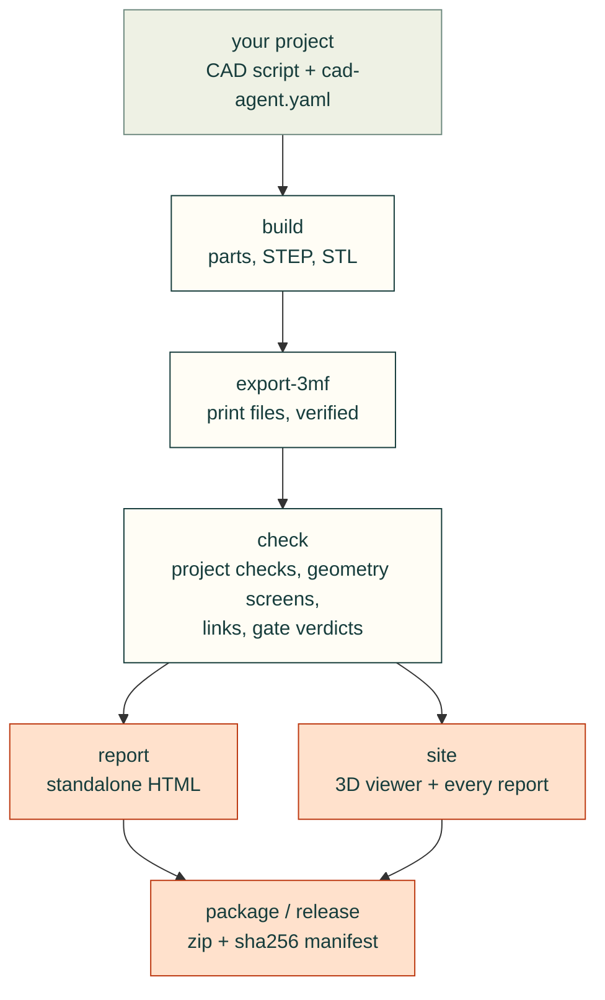

## The project contract

```
my-cad-project/
  cad-agent.yaml         # cad: section (below)
  cad/parameters.json    # the single parameter authority (dimensions, clearances, revision)
  cad/build.py           # builds every part; exposes print_parts() and the print rotations
  tools/*.py             # project-specific checks, renders, docs; one JSON per check
  exports/               # <part>.stl/.3mf/.step, geometry-checks.json, <check>.json, logs
  preview/               # renders (part-<name>.png per part) + gallery index.html
  docs/                  # engineering review pages, BOM, registers, cad-agent-report.html
```

1. **One parameter authority.** Every dimension, clearance and the `revision`
   live in `cad/parameters.json`; scripts read it, nothing restates a number.
2. **`cad/build.py`** exposes `print_parts() -> {name: cadquery.Shape}` and a
   print-rotation table. Its `__main__` writes, per part, STEP in assembly
   coordinates and STL in print orientation, and the parts file
   `exports/geometry-checks.json`:
   `{part: {cad_valid, solid_count, watertight, print_bounds_mm, ...}}`.
   `cadagent.geometry` does the generic part:
   ```python
   from cadagent.geometry import export_print_stl, export_step, solid_report, pairwise_intersections
   report = {n: export_print_stl(s, OUT / f"{n}.stl", rotation=PRINT_ROTATION.get(n))
             for n, s in print_parts().items()}          # raises on a non-watertight STL
   for n, s in print_parts().items():
       export_step(s, OUT / f"{n}.step")                 # the same bytes for the same model
   ```
   Write STEP with `export_step`, not `cadquery.exporters.export`: OCCT stamps the write time into the header,
   names the product `Open CASCADE STEP translator <version> <n>` by export order and numbers assembly links
   across the process, so every rebuild would change every STEP file and stale every check bound to its sha256.
   `export_step` writes the same geometry with a fixed header date (`SOURCE_DATE_EPOCH` when set, the
   [reproducible-builds](https://reproducible-builds.org/specs/source-date-epoch/) convention, else
   2000-01-01T00:00:00), the product named after the file (or `name=`), and links numbered from 1 within the file.
   Another OCCT version can still write different bytes for the same geometry. A cadquery `Assembly` goes through
   `export_step` too (`export_step(assy, OUT / "assembly.step")`, #150): the file `Assembly.save` writes, with the
   header and link ids fixed as for a part, each node added without a name called `<parent>.<k>` instead of a random
   uuid, and the colour records in one order. Sub-shape names and colours (`Assembly.addSubshape`) are refused.
   See [reproducible outputs](#reproducible-outputs) for the other files.

   Build the parts with `robust_union` and `robust_cut` where booleans meet nearly coincident faces: they check
   every boolean and fall back instead of returning a bad shape ([checked booleans](#checked-booleans-cadagentgeometry), #249).
3. **Each check is a script** in `tools/` that writes `exports/<name>.json` with
   a top-level boolean `"pass"`. A check that cannot compute its answer writes
   `"pass": false` with the reason; it never omits the file or the key.
4. **Renders** go to `preview/`; `preview/part-<name>.png` is picked up as the
   evidence image for that part. `cadagent.publish.render.Renderer` renders cadquery
   shapes or STL files offscreen with a caption bar, subtitle, note bar and
   leader labels; set `CAD_AGENT_RENDER_ONLY=a.png,b.png` to re-render a subset.

<!-- the site places a figure here (docs/pages.yaml) -->

5. **A gallery page** (`preview/index.html`) can embed the per-part download
   table from `cadagent.publish.report.downloads_snippet(project, page_dir=...)`:
   thumbnail, STL / 3MF / STEP links and a slicer link.

### Honest evidence

- CAD checks never claim physical fit. Every check JSON that touches fit should
  carry `"physical_fit_verified": false` (and `"slicer_run": false` for print
  screens) until someone has printed and fitted the part. The report records
  both as false and says so in a banner. `cad-agent` has no way to set them true.
- A check is green only when its `pass_key` value is the boolean `true`. A
  missing file, missing key, `"yes"`, `1` or a list all count as failures.
- In the results and the report, a row status other than the known pass, fail
  and skip spellings counts as a failure, never as a pass.
- The overhang screens (`geometry.downward_area`, `geometry.overhang_regions`, `cad-agent overhangs`) and the
  G-code bridge report (`manufacturing.gcode.bridge_report`) are screens, not a slicer ([below](#overhangs-and-bridges-cad-agent-overhangs)).
- `export-3mf` re-reads every 3MF it writes and deletes it unless triangle count,
  edge-manifold watertightness and volume (within 0.1 %) match the STL.

### Print files

| File | Orientation | Notes |
|------|-------------|-------|
| `exports/<part>.stl` | print orientation, lowest point on z=0 | open-edge vertices within 1 µm welded, degenerate faces removed; must be watertight |
| `exports/<part>.3mf` | print orientation, centred on `printer.bed_mm` | written by `cad-agent export-3mf`, read back and verified; byte-reproducible (fixed zip dates), so a rebuild of unchanged geometry keeps the slice report current |
| `exports/<part>.step` | assembly coordinates | for CAD review and re-use |
| `exports/<name>-plates.3mf` | print orientation, turned about z and laid out on build plates | every printed part at its quantity in one Bambu Studio project, one plate per bed; written by `export-3mf`, read back and verified; byte-reproducible for the same Bambu Studio version, or with none installed ([build plates](#build-plates-cadagentmanufacturingplates)) |
| `exports/<name>-plates.svg`, `-plates.json` | seen from above | the plates as a picture, and the layout as data: each copy's place and turn, each plate's filament and surface, the 3MF's sha256 |
| `<name>.3mf`, `<stem>-NN-<group>.3mf` (PrusaSlicer) | print orientation, placed on the bed | PrusaSlicer projects from `cadagent.manufacturing.prusa3mf`: objects of several volumes, each on its own tool, and the wipe tower's place; one 3MF per plate; read back and verified; byte-reproducible ([PrusaSlicer projects](#prusaslicer-projects-cadagentmanufacturingprusa3mf)) |

### Checked booleans (`cadagent.geometry`)

OpenCASCADE can fail a boolean without raising where faces nearly coincide: a multi-argument fuse of nearly
coincident solids can return an empty compound that `isValid()` passes, and a cut can raise
`Null TopoDS_Shape object`. `robust_union` and `robust_cut` check every boolean they run and fall back step by step;
they raise `GeometryError` rather than return a shape that fails the check.

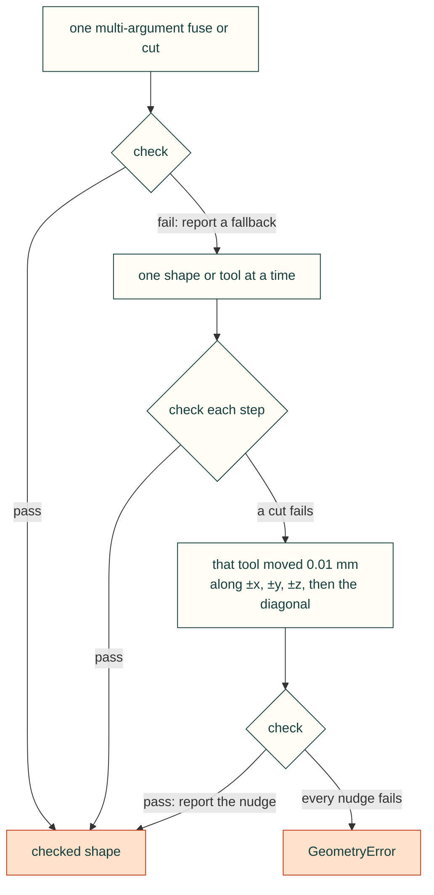

```python
from cadagent.geometry import robust_union, robust_cut
notes = []
boom = robust_cut(robust_union(*plates), *pin_holes, report=notes)
# notes, after a fallback: [{"op": "cut", "fallback": "one_at_a_time", ...},
#                           {"op": "cut", "tool": 2, "nudge_mm": [0.01, 0.0, 0.0], "reason": ...}]
```

<details>
<summary>The check, the report, the STL weld and the limits</summary>

- **The check**, after every boolean and on every input first: not null, valid, at least one solid, and a volume
  within the bounds the inputs set (a union between its largest input and their sum; a cut between the base less
  the tools and the base). Validity and volume are the relation gate's: `isValid()` and its stricter checks (open,
  inverted or free-faced shapes fail), and its adaptive integration, since the default volume can be off by several
  mm³ on curved, trimmed faces ([volume precision](volume-precision.md)). An invalid input is refused, not fused.
- **The report:** pass `report=[]` to get one dict per fallback and per nudge; each is also logged as a warning on
  `cadagent.geometry`. The nudges are `CUT_NUDGES_MM`, or pass `nudges=`. A nudge moves that cut by its length (0.01 mm on an
  axis, 0.017 mm on the default diagonal), so check it does not touch a fit that matters.
- **The STL weld:** `export_print_stl` welds the tessellation's open-edge vertices that lie within 1 µm of each other
  (`weld_mm=`, default `WELD_MM`, 0 turns it off; `weld_open_vertices` on a trimesh) before its watertight check:
  OCCT can split a vertex by less than that where faces meet tangentially, so a valid solid's STL came out open. Its
  report adds `vertices_welded`, `mesh_volume_before_weld_mm3` and `mesh_volume_mm3`. A gap wider than the weld
  still fails the check.
- **Limits:** the checks bound shape and volume; they do not prove the boolean is the one you meant, and a cut a
  tool does not reach is still a valid result.

</details>

### Build plates (`cadagent.manufacturing.plates`)

`export-3mf` also writes `exports/<name>-plates.3mf`: one Bambu Studio project that holds every printed part, at its
quantity and in its print orientation, packed onto as many plates as the printer's bed needs. Open it, check each
plate and slice. This is Gyropup's print set, from its committed STLs and print plan
(`tools/plates_figure.py` makes it; `docs/img/plates/SOURCE.json` records the revision and settings):


- **Footprints.** Each copy reserves the rectangle around its outline seen from above (the convex hull of its mesh).
  It keeps its print orientation and may turn about z: a quarter turn, or, for a part that fits neither way (a long
  leg on a square bed), the whole degree that gives the smallest rectangle that fits.
- **Packing.** MaxRects (Jylänki 2010): largest first, onto the first plate with room. Four sort orders times four
  fit rules are tried, and the layout with the fewest plates wins. Parts with different filaments never share a
  plate. Sizes are whole micrometres and every tie has a fixed order, so the same parts and settings give the same
  plates everywhere. `check_plates` then checks the result again on its own terms: every copy placed once, inside
  the bed less the margin, and at least the gap from every other copy and from the keep-out areas (never less than
  0.5 mm from those: a part turned to a whole degree is written rounded to 1e-4 mm, and Bambu Studio refuses a
  plate where a part touches its exclusion area).
- **The file.** 3MF core-spec meshes, one build item per copy on Bambu Studio's grid of plates, and Bambu's
  `Metadata/model_settings.config` with one `<plate>` per plate (named after its filament). Where Bambu Studio is
  installed, its own project settings for `cad.slicer` go in too, with the printer's own plate surface and each
  filament's colour and purge matrix sized to the filaments. Bambu Studio keeps the plates only with those settings:
  without them it opens the parts on one plate. The file is read back and deleted unless every copy is where the
  layout put it.
- **Checked in Bambu Studio 02.08.04.57.** Its command line loads the plates without re-arranging them and slices
  each plate with its own filament (`tests/test_plates.py` does this wherever Bambu Studio is installed). Its window
  opens the file on its plates, with the printer, filaments and process set and no errors.

<details>
<summary>The <code>cad.plates</code> keys (all optional; <code>cad.plates: false</code> writes no plates file)</summary>

| Key | Default | Meaning |
|---|---|---|
| `parts` | `cad.release.build`, else every part the release lists | a list of parts, or a mapping of part to `{quantity, filament}` |
| quantity | `cad.release.quantities`, else 1 | copies of the part |
| filament | `cad.slicer.filament` | `pla`, `petg` or a Bambu filament profile name; one filament per plate |
| `gap_mm`, `margin_mm` | 5, 5 | least distance between two footprints, and from the bed's edge |
| `rotate` | true | false keeps every part as modelled |
| `keep_out` | the printer's exclusion area (a P1S: its wiper corner), read from Bambu Studio's printer profile, so only where it is installed | more `[x0, y0, x1, y1]` areas in bed mm that every footprint stays the gap clear of. Without Bambu Studio there is no exclusion area, and the same project packs differently: list the corner here for the same layout on every machine |
| `bed_type` | the plate the printer ships with (a P1S: Textured PEI) | `Cool Plate`, `Engineering Plate`, `High Temp Plate`, `Textured PEI Plate` or `Supertack Plate`. A plate whose filament has no temperature for that surface gets the first one it has, with a warning (Bambu Studio will not slice PETG on the Cool Plate) |

</details>

`export-3mf` exits 1 when a part fits no plate (too large or too tall at any turn) or the parts need more than the 36
plates Bambu Studio holds.

<details>
<summary>Why it is built, not adopted, and its limits</summary>

- **[rectpack](https://github.com/secnot/rectpack)** (Apache-2.0) implements the same MaxRects method. It has had no
  release since 2021, and cad-agent's core install is PyYAML and NumPy only. The method is about a hundred lines
  here, in integer micrometres, with its tests.
- **PrusaSlicer** arranges with [libnest2d](https://github.com/tamasmeszaros/libnest2d) (no-fit polygons, C++).
  **Bambu Studio's own arrange** (`--arrange 1`) re-places and re-turns parts on every run and ignores filaments.
  Both are C++ programs, not libraries cad-agent can call.
- **Format facts** came from Bambu Studio's source (`bbs_3mf.cpp`, `PartPlate.cpp`, `Plater.cpp` at v02.08.04.57;
  AGPL-3.0, read for the format only, no code taken) and from project files Bambu Studio saved.
- **Limits.** A footprint is a rectangle, so an L-shaped part reserves its whole rectangle, and parts never nest
  inside one another: tighter nesting (hulls, no-fit polygons) would save plates. The layout says nothing about
  whether a plate prints well (adhesion, warping, how much one failure costs): that is the slicer's and the
  printer's evidence. Per-part supports, brims and process settings are not written; set them in Bambu Studio.

</details>

### PrusaSlicer projects (`cadagent.manufacturing.prusa3mf`)

`export-3mf` writes Bambu Studio files. For PrusaSlicer, a build script calls `cadagent.manufacturing.prusa3mf`:

```python
from cadagent.manufacturing.prusa3mf import write_project, write_plates
# one object, two volumes: the body on tool 1, the inlay on tool 3, at the bed centre + (0, 40) mm
write_project("exports/lid.3mf", [("lid", [(body, "body", 1), (inlay, "inlay", 3)], (0, 40))],
              bed=(360, 360, 360), wipe_tower=(20, 20))
# every part at its quantity, packed by the tools it uses, one 3MF per plate: exports/plates/plate-01-t1-t3.3mf, ...
write_plates("exports/plates", {"lid": [(body, "body", 1), (inlay, "inlay", 3)], "pin": [(pin, "pin", 2)]},
             bed=(360, 360, 360), quantities={"pin": 4})
```

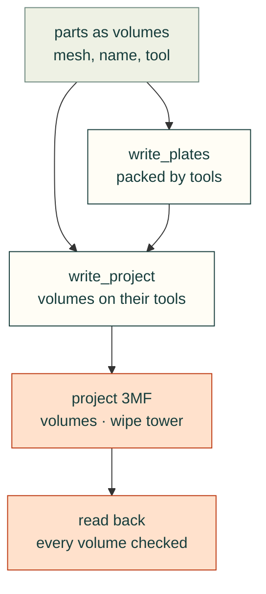

**Limits.** No printer, print or filament settings are written: load them in PrusaSlicer or pass them to its
command line. Whether the tower clears the parts is the slicer's check, and nothing here says a part prints well.

<details>
<summary>Objects and volumes, the wipe tower, plates, the read-back and the PrusaSlicer check</summary>

- **Objects and volumes.** An object is `(name, [(mesh, volume name, tool)], (dx, dy[, angle]))`: the meshes (a
  trimesh, or `(vertices, faces)`) in print orientation and the object's own coordinates, so the volumes keep their
  places relative to one another. The object's outline is centred on the bed centre plus `(dx, dy)`, its lowest point
  on z = 0, turned `angle` degrees about z. The file is PrusaSlicer's: one mesh per object, and
  `Metadata/Slic3r_PE_model.config` with a `firstid`/`lastid` triangle range, name and extruder per volume.
- **The wipe tower.** PrusaSlicer 2.9 keeps its place in the project
  (`Metadata/Prusa_Slicer_wipe_tower_information.xml`: `position_x`, `position_y`, `rotation_deg` for the bed), not
  in the print config, and refuses `wipe_tower_x` as an override. With more than one tool it is written at
  `wipe_tower` (default `(20, 20)`, the front-left corner, clear of a part centred on the bed); `False` writes none.
  PrusaSlicer's own default place can collide with a part centred on a large bed (`gcode path conflicts found
  between WipeTower and <part>`).
- **Plates.** `write_plates` packs with the [build plates](#build-plates-cadagentmanufacturingplates) MaxRects
  layout: parts that use different tools (or different `groups`, such as filaments) never share a plate, and on a
  plate with more than one tool the parts keep the gap clear of the tower's corner area (`wipe_tower_size`, 60 x 60
  mm by default: an estimate, as PrusaSlicer sizes the tower from the purge volumes). It removes earlier
  `<stem>-NN-*.3mf` files first and returns each plate's layout and read-back report.
- **Read-back.** Each file is read back and deleted unless every volume has its source mesh's triangle count and
  volume (within 0.1 %), is watertight and is on its tool, every object is where it was placed, and the tower is
  where it was asked. Entries are sorted with a fixed date, so the same objects give the same bytes.
- **Checked in PrusaSlicer 2.9.4.** Its command line loads the volumes on their tools, puts the wipe tower where the
  file says and slices (`tests/test_prusa3mf.py` does this wherever PrusaSlicer is installed, natively or from
  Flathub, with a two-tool printer from PrusaSlicer's defaults).

</details>

### Part cache (`cadagent.geometry.cache`)

A build that makes every part on every run spends most of its time on parts nothing touched: a 46-part machine took
about 13 minutes per run when most edits changed one or two parts. `PartCache` stores each built part as a BREP file
under a hash of the files and values it was built from, and loads it back while that hash is unchanged, so a run
rebuilds only the parts whose sources changed, and the clearance, render and slice steps can share one build.

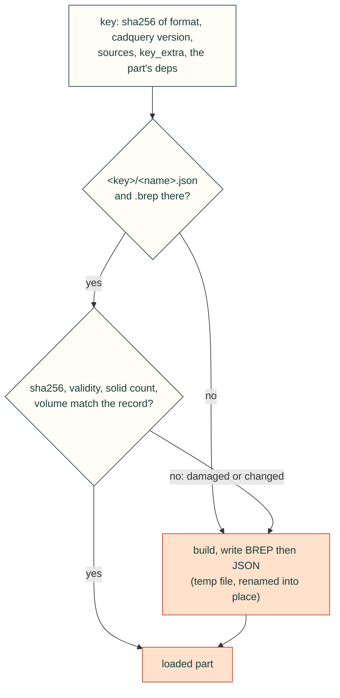

```python
from cadagent.geometry.cache import PartCache

cache = PartCache(".cadagent-cache/parts",                        # the default; any folder of its own
                  sources=["cad/parameters.json", "cad/common.py"],   # files or folders every part reads
                  key_extra={"variant": "long-reach"},                # other values the build depends on
                  max_bytes=2_000_000_000)                            # optional size cap
boom = cache.get_or_build("boom", build_boom, deps=["cad/boom.py"])  # builder: () -> cadquery Shape or Workplane
parts = cache.get_all({"boom": (build_boom, ["cad/boom.py"]),        # name -> builder, or (builder, deps)
                       "pin": build_pin})
cache.clear()                                                        # forget every stored part
```

- **Where it lives.** `root` defaults to `.cadagent-cache/parts`, beside the gates' pair cache
  (`.cadagent-cache/gates`), and out of `exports/`, which projects commit. Give it a folder of its own (a root that
  holds other files is refused). The root holds a
  `.gitignore` that ignores everything in it, so the cache is never committed, and a `CACHEDIR.TAG`, so
  `cad-agent package` never zips it, even from a glob that reaches into it. Deleting it is always safe.

<details>
<summary>Layout, checks on load, parallel runs and the size cap</summary>

- **Layout.** `<root>/<key>/<name>.brep` and `<name>.json`, where `<key>` is 16 hex digits. Parts without `deps`
  share one folder; a part's `deps` (files or folders) go into its own key, so editing `cad/boom.py` rebuilds the
  boom only, and editing a `sources` file rebuilds everything. A missing source or dependency is an error, not
  skipped. Folders count every file under them except `__pycache__`, `.git` and `*.pyc`.
- **Checks on load.** The JSON records the BREP's sha256, `isValid()`, the solid count and the volume. A missing
  or unreadable record, a different sha256, a BREP that does not import, or a validity, solid count or volume that
  differs from the record (beyond 1e-7 relative) means the part is built again and stored again; `cache.rebuilt`
  names those parts and why. `hits` and `misses` count lookups.
- **Parallel runs.** Each file is written next to its name and renamed into place, BREP first and then the JSON that
  vouches for it, so a run never reads half a file; two runs that build the same part both store it, and the last
  rename wins.
- **Size cap.** With `max_bytes`, after each part is stored the least recently used key folders (by the time a run
  last loaded or wrote one) are removed until the cache fits; folders the current run used are kept. `prune()` and
  `size()` do the same by hand.

</details>

Limits: the key covers only what it is given. A builder that reads a file or setting not in `sources`, `deps` or
`key_extra` is not rebuilt when that changes: list it, or `clear()`. The checks catch a damaged file, not a stale one, and not a planted one: the record is not signed, so anyone who
can write the folder can change a part (as they could change the build script); never load someone else's cache.
A hit loads the stored B-rep; the builder's warnings and side effects do not happen. Another cadquery version starts
a fresh key (its OCCT can build the same source differently); other library versions are not in the key, so pass
them in `key_extra` if they matter.

### Reproducible outputs

The same project at the same commit gives the same bytes on every rebuild and in every checkout, so `git diff`
after a rebuild shows real changes only, and checks bound to a file's sha256 stay current (#91, #150). Where a file
records a time, it is the source date, never the wall clock:

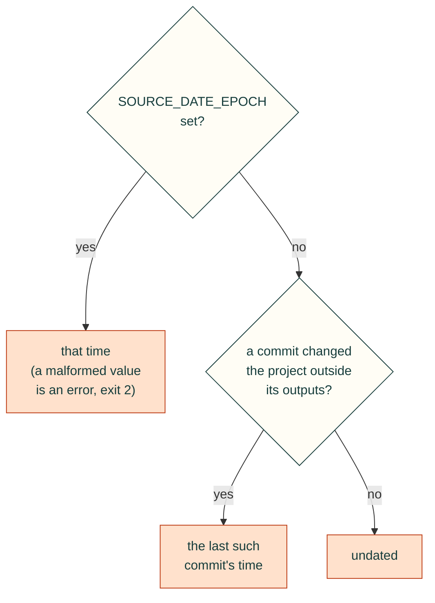

The outputs left out of that history are `exports_dir`, `preview_dir`, `site/`, `release/`, the report page and the
file being written (`cadagent.project.source_time`), so a project that commits its report or site does not move
their date by committing them. The site's "Recent changes" table leaves out the same commits. A `simreport` page is
dated by the project that holds it (the nearest folder above it with `cad-agent.yaml`), wherever the script runs
from. `SOURCE_DATE_EPOCH` is the
[reproducible-builds](https://reproducible-builds.org/specs/source-date-epoch/) convention: seconds since
1970-01-01 UTC, for example `SOURCE_DATE_EPOCH=$(git log -1 --format=%ct)`.

<details>
<summary>What each output fixes</summary>

| Output | What is fixed |
|---|---|
| part STEP (`export_step`) | header date `2000-01-01T00:00:00` (or `SOURCE_DATE_EPOCH`), product named after the file, link ids |
| assembly STEP (`export_step(assy)`) | the same, plus unnamed nodes named `<parent>.<k>` and the colour records in one order; names cadquery's reader would refuse or misread (a child with its parent's name or a sibling's) are refused |
| `exports/<part>.3mf`, `exports/<name>-plates.3mf`, the release zip | sorted entries, fixed date (1980-01-01), mode and host |
| review package (`cad-agent package`) | sorted entries; the source date, mode `rw-r--r--` and a Unix host on every entry |
| results JSON (`header_meta.generated`), report page, `simreport` pages (`Generated`), the site's footer, the explore comparison (`generated`), the review bundle (`created`) | the source date, shown with where it came from: `2026-10-30 12:00 UTC (last commit)` |
| the site's document cards | each page's last commit date, not its file time (which a fresh checkout resets) |

</details>

Limits: another OCCT, cadquery or zlib build (stock zlib or zlib-ng) can write different bytes for the same model;
a shallow clone sees a later commit than a full one (set `SOURCE_DATE_EPOCH` in CI that compares outputs); two pages
a project writes outside those folders and commits count each other as sources (keep them in `exports_dir` or
`preview_dir`). A review record's `timestamp` is the time it was submitted, and stays so.

"Open in Bambu Studio" uses `bambustudio://open?file=<url-encoded http URL of the 3MF>&name=<part>`.
The slicer fetches the file over http, so the link only works when the page is
served (`cad-agent serve`); from `file://` the link downloads the 3MF instead.

## The `cad:` section of `cad-agent.yaml`

`cad-agent` reads `<project>/cad-agent.yaml`. Only the `cad:` section is read;
other top-level sections are ignored, so the file can carry other tools'
settings too. A `cad-agent.yaml` without a `cad:` section is an error. With no
`cad-agent.yaml` at all, commands exit 2, and the error names any other
`*.yaml` or `*.yml` file in the project root with a top-level `cad:` key, so it
can be renamed: no other file name is read.

| Key | Default | Meaning |
|-----|---------|---------|
| `name`, `title` | folder name | identity in reports and package names |
| `revision` / `revision_from` | none | literal, or `"path/file.json:dotted.key"` read at report time |
| `python` | `<root>/.venv/bin/python`, else cad-agent's python | interpreter for the steps |
| `exports_dir`, `preview_dir`, `docs_dir` | `exports`, `preview`, `docs` | |
| `steps` | `[]` | `{name, run, log?, timeout_s=1800, needs?}`; `run` is a script relative to the root, run with cwd = root and `CAD_AGENT_PROJECT` set to the root; `log` is a file in `exports_dir`; `needs` names earlier steps |
| `parts_file` | `exports/geometry-checks.json` | part -> `{cad_valid, solid_count, watertight, print_bounds_mm}` |
| `part_ids` | `{}` | part -> display id (`P1`) |
| `checks` | `[]` | `{id, title, file, pass_key="pass", evidence?, links?}`; `pass_key` may be a list (all must be `true`) |
| `printer` | none | `{name, bed_mm: [x, y, z]}`; parts must fit; 3MF files are centred on it |
| `package` | none | `{name, include: [globs]}`; zip + `<name>-manifest.json` (sha256) in `exports_dir` |
| `release` | every part, default source globs | the print release (`cad-agent release`): see [the print release](#the-print-release-cad-agent-release) |
| `plates` | every released part, 5 mm gap and margin | the build plates file (`export-3mf`): see [build plates](#build-plates-cadagentmanufacturingplates) |
| `serve` | `127.0.0.1`, port 0 (any free) | `{host, port}` |
| `html_pages` | `[]` | HTML / Markdown pages whose local links must resolve |

Unknown keys are reported as a warning, not an error.

### Worked example: j501-agx (Jetson AGX Orin enclosure)

```yaml
cad:
  name: j501-agx
  title: reServer J501 / Jetson AGX Orin enclosure
  revision_from: cad/parameters.json:revision
  printer: {name: Bambu Lab P1S, bed_mm: [256, 256, 256]}
  steps:
    - {name: build,             run: cad/build.py,              log: build.log}
    - {name: export-3mf,        run: tools/export_3mf.py,       needs: [build]}
    - {name: clearances,        run: tools/check_clearances.py, log: carrier-clearances.log, needs: [build]}
    - {name: shells,            run: tools/check_shells.py,     log: shell-clearances.log, needs: [build]}
    - {name: assembly-paths,    run: tools/assembly_paths.py,   log: assembly-paths.log, needs: [build]}
    - {name: print-review,      run: tools/print_review.py,     needs: [build]}
    - {name: design-metrics,    run: tools/design_metrics.py,   log: design-metrics.log, needs: [build]}
    - {name: mounts,            run: tools/check_mounts.py,     needs: [build]}
    - {name: storage,           run: tools/check_storage.py,    needs: [build]}
    - {name: docs,              run: tools/write_docs.py}
    - {name: check-sheet,       run: tools/check_sheet.py}
    - {name: detailed-assembly, run: tools/detailed_assembly.py, log: detailed-assembly.log}
    - {name: render,            run: tools/render.py,           log: render.log}
    - {name: package,           run: tools/package_review.py}
    - {name: validate,          run: tools/validate_review.py}
  part_ids: {base: P1, base_mount: P1M, cover: P2, front_gmsl: P3, front_no_gmsl: P4, rear_io: P5,
             mount_fit_template: P9, side_hatch: P10, m3_insert_coupon: P11, rail_coupon: P12,
             rail_key: P13, countersink_coupon: P14}
  checks:
    - {id: carrier, title: Carrier and hardware clearances, file: exports/carrier-clearances.json, evidence: [preview/open.png]}
    - {id: shells,  title: Open-shell clearances,           file: exports/shell-clearances.json}
    - {id: paths,   title: Plate insertion paths,           file: exports/assembly-paths.json, evidence: [preview/exploded.png]}
    - {id: mounts,  title: Mounting tabs and driver access, file: exports/mount-checks.json, evidence: [preview/mount-clearance.png]}
    - {id: storage, title: Storage trays and underside slots, file: exports/storage-checks.json, evidence: [preview/storage-stack.png]}
    - id: review
      title: Review validation
      file: exports/review-validation.json
      # this file has no top-level "pass"; every listed key must be true
      pass_key: [all_parts_single_valid_watertight, plastic_intersections_zero, carrier_and_hardware_pass,
                 open_shell_pass, mount_checks_pass, assembly_paths_pass, nominal_P1S_bounds_pass]
  package:
    name: j501-agx-fit-check
    include: [README.md, requirements.txt, cad/parameters.json, "docs/*", "exports/*.stl", "exports/*.3mf",
              "exports/*.step", "exports/*.json", references/sources.json]
  html_pages: [preview/index.html, README.md, docs/engineering-review.html]
```

Migration notes for this example. `tools/export_3mf.py`, `tools/package_review.py`
and `tools/serve_preview.py` duplicate `cad-agent export-3mf`, `package` and
`serve`; once those commands are adopted, drop the matching steps. Otherwise
`cad-agent all` writes the 3MF files twice (harmless) and two packages.
`tools/validate_review.py` can stay as a project check or give way to
`cad-agent check`, which covers parts, print files, the configured checks,
local links and, with `cad: dossier:` (or `cad: gates:`), the integrity gates' verdicts and the dossier lint.

A YAML flow mapping ends a value at the first comma, so a title with a comma
must be quoted: `{id: storage, title: "Storage trays, cable routes", file: ...}`.
Unquoted, the title is cut at the comma and the rest becomes a stray key.

## Commands

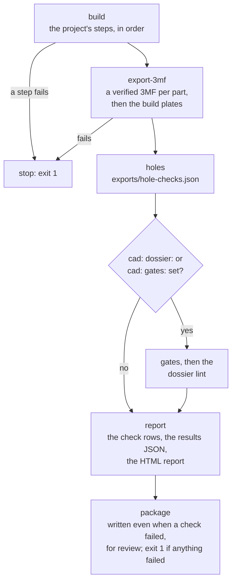

*What `cad-agent all` runs, in order (`cmd_all` in `src/cadagent/cli.py`): a failed build step or 3MF export stops it;
after that every step runs, and the exit code says whether anything failed.*

| Command | Does | Exit code |
|---------|------|-----------|
| `cad-agent build [--from STEP] [--only STEP ...]` | runs steps in order with the project python; per-step timing; stops at the first failure and prints the log tail | 1 on a failed step |
| `cad-agent export-3mf` | `<part>.stl` -> verified, bed-centred `<part>.3mf` for every part in the parts file, then every printed part on [build plates](#build-plates-cadagentmanufacturingplates) in `<name>-plates.3mf` | 1 on a read-back mismatch, or when the parts cannot be laid out |
| `cad-agent holes [PART ...]` | checks every hole in every part is clear of material: finds the cylindrical holes and countersinks in `exports/<part>.step` (concave, at least 200° of wall, up to 30 mm across), probes each with a cylinder or cone just inside its wall, and writes `exports/hole-checks.json` bound to each STEP's sha256; `all` runs it and the report's "Holes clear" rows fail on material in a hole, a stale result or a check that did not run (config `cad: holes:`, [below](#holes-clear)) | 1 if a hole has material inside |
| `cad-agent overhangs [PART ...] [--limit DEG] [--min-area MM2]` | groups each part's (`exports/<part>.stl`, every part in the parts file) downward faces flatter than `--limit` (slope from horizontal, 0° a flat ceiling; default 45°) into connected regions, each with area, bounds, centre and flattest angle, and writes `exports/overhang-screen.json`; a screen, not a slicer: bridges anchored on both sides are listed too ([below](#overhangs-and-bridges-cad-agent-overhangs)) | 1 if a part's STL is missing or unreadable |
| `cad-agent check [--json]` | collects results (no build), prints a table or the results JSON | 1 if any row fails |
| `cad-agent report [--open]` | writes `exports/cad-agent-results.json` (results schema 1.0) and a standalone `docs/cad-agent-report.html` with inline styles (light and dark) that opens from `file://` | 1 if any row fails |
| `cad-agent package` | zip + sha256 manifest from `package.include`; the same files give the same zip ([reproducible outputs](#reproducible-outputs)) | 2 on a malformed `SOURCE_DATE_EPOCH` |
| `cad-agent release [--out DIR] [--no-zip] [--revision TEXT] [--date D]` | the print release: `release/<name>-rev<revision>/index.html` (parts with thumbnails, print settings, slicer mass and time, STEP/STL/3MF links; assembly pages; hardware; source) and a reproducible zip next to it ([below](#the-print-release-cad-agent-release)) | 2 on a bad config (a path outside the project), a missing part file or a foreign `--out` folder |
| `cad-agent serve [--port N] [--host H]` | serves the project root; writes the URL to `preview/server-url.txt` | |
| `cad-agent site [--serve]` | builds `site/` from milestones, decisions, a designs summary, Markdown pages and git history (config `cad: site:`); `--serve` rebuilds on change and serves the web kit at `/_cadagent/kit/`. One top bar links every page: `site: nav:` (`[{id, title, href}]`, hrefs from the project root) or, when unset, the overview, docs, 3D model and each `html_pages` page plus the check and simulation reports, the design comparison and the search leaderboard. The server adds the bar to every HTML page it sends (files on disk unchanged; a bar the page mounts itself wins; `<meta name="cadagent-nav" content="off">` opts a page out). A project with a `dossier:` or `gates:` key also gets the review pages in `site/review/`: a page per dossier section, the requirements table and the gates page with the connectivity graph ([dossier.md](dossier.md#on-the-review-site)) | |
| `cad-agent view` | writes every part in assembly position to `exports/view/` (STL + `view.json`) for the 3D viewer (config `cad: view:` for colours, hidden variants, explode directions, extra parts from STEP or STL, list categories) | |
| `cad-agent webkit [DEST]` | copies the web kit (3D stage, model viewer, HUD panels, three.js, fonts) into the project, default `web/kit` | |
| `cad-agent dossier [--json] [--no-write] [--min-status S]` | lints the design dossier (`cad: dossier:`) against the build's geometry record, the gate verdicts, the configured checks and the reviewer records; writes each section's and part's status to `exports/dossier-status.json` and the lint verdict to `exports/gates/dossier-lint.json` ([dossier.md](dossier.md#lint-and-status)) | 1 on a lint error or a section below `--min-status` (default `gated`) |
| `cad-agent review-packet [SECTION ...] [--list] [--view V ...] [--size WxH] [--explode F] [--context C]` | renders each dossier section's review packet into `exports/review/<section>/` with `manifest.json` (`cad-agent.review-packet/1`): the gate measurements and findings first, captioned views with content hashes, the render checklist ([review-packet.md](review-packet.md)); `--list` plans without rendering | 2 on an unknown section or with no geometry record |
| `cad-agent review-section SECTION [--bundle-dir DIR] [--since REV]` | writes the reviewer's prompt bundle into `exports/review-bundle/<section>/` (`cad-agent.review-bundle/1`): the section YAML, the gate verdicts for its parts, the packet manifest and images, the checklist, the diff since the last sign-off and a record template ([dossier.md](dossier.md#the-reviewer-pass)) | 1 while a sign-off would be refused (stale packet, section below `gated`, open decision, unknown builder); 2 on an unknown section or with no build |
| `cad-agent review-section SECTION --submit RECORD` / `--check RECORD` | checks a filled-in reviewer record against the current build (hashes current, the reviewer, `CAD_AGENT_ACTOR`, is not the section's builder or author, every question, decision and requirement answered; for a sign-off: packet current, no open decision) and writes `dossier/reviews/<section>-<date>.json` (`--check` writes nothing) | 1 when the record is refused |
| `cad-agent gates [--only G ...] [--skip G ...] [--jobs N] [--no-cache] [--build] [--dry-run]` | runs every integrity gate that applies to the dossier geometry, each in its own process, then the dossier lint; writes `exports/gates/<gate>.json` and `.md`, bound to their inputs (config `cad: gates:`, [gates.md](gates.md#running-the-gates-cad-agent-gates)) | 1 if a gate (or its build) fails; 2 without a `dossier:`/`gates:` key, on a bad config, or with no geometry record and no build |
| `cad-agent all` | build, export-3mf, holes, gates and the dossier lint (when `cad: dossier:` or `cad: gates:` is set), check + report, package | 1 if anything failed |
| `cad-agent catalogue [--json] [--errors-only]` | checks the part catalogue and every design against it (config `cad: explore:`, [explore.md](explore.md)) | 1 on an error |
| `cad-agent compare [DESIGN ...] [--swaps] [--workers N] [--json] [--open]` | evaluates the designs with the project's evaluator, ranks them (Pareto fronts over the objectives) and writes `comparison.json`, `compare.html` and site design cards; `--swaps` tries every one-part swap | 1 if a design could not be evaluated |
| `cad-agent optimise [--trials N] [--workers N] [--sampler S] [--fresh] [--no-confirm]` | searches slots and parameters (random, grid; NSGA-II and TPE with optuna), keeps a leaderboard, and re-evaluates the leaders at a higher fidelity (`search.confirm`) | 1 if no trial is feasible |

`--project PATH` (default: cwd), before or after the subcommand, selects the
project. Exit code 2 means the project or environment is unusable: a missing or
invalid `cad:` section, a missing build output, or a missing optional
dependency. cad-agent names the dependency and the `cad` extra and does not
skip the work silently.

## Python API

### Package layout (v0.5.0)

Modules are grouped by domain, as the [topic tree](areas.yaml) groups the work: `cadagent.<domain>.<module>`, with the
practice domain's review and publishing areas as `cadagent.review` and `cadagent.publish`, and the shared core at the
top ([`src/cadagent/README.md`](../src/cadagent/README.md)). `tests/test_package_areas.py` keeps each package and its
domain's `api:` lists in step. The old flat paths (`cadagent.fea`, `from cadagent import report`, ...) still import the
same module, with a `DeprecationWarning`; so do the old package paths and everything under them
(`cadagent.gates.motion` is `cadagent.review.gates.motion`), and `python -m` through an old path runs the module at its
new path. Type checkers and IDEs do not see the old paths. Move imports to the new paths:

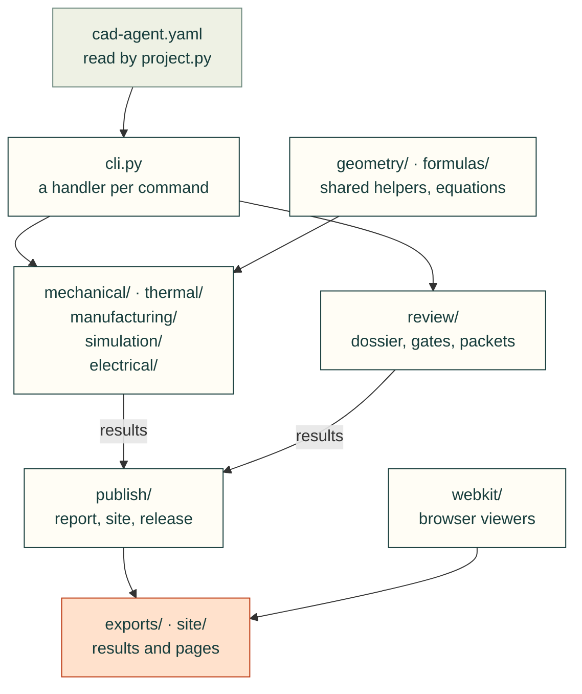

*The packages and how a command runs through them (the same diagram as
[`src/cadagent/README.md`](../src/cadagent/README.md)); the table maps each old path to its package.*

| New package (domain in `docs/areas.yaml`) | Modules and packages (old path `cadagent.<name>`) |
|---|---|
| `cadagent.mechanical` (mechanical) | `holes`, `fasteners`, `mcmaster`, `connectors`, `markings`, `compliant/`, `motion_trace` |
| `cadagent.manufacturing` (manufacturing) | `slicer`, `mesh3mf` |
| `cadagent.thermal` (thermal) | `heatsink` |
| `cadagent.simulation` (simulation) | `fea`, `cfd`, `topopt`, `explore/`, `robot`, `simviz`, `simreport` |
| `cadagent.electrical` (electrical) | `pcb`, `pcb_routing` |
| `cadagent.review` (practice: design process, review and evidence) | `gates/`, `dossier/`, `packet`, `evidence` |
| `cadagent.publish` (practice: publishing) | `report`, `htmlreport`, `site`, `site_review`, `view`, `serve`, `release`, `render`, `dotsvg` |
| shared core, unchanged | `project`, `cli`, `geometry`, `links`, `package`, `agentkit` |

<details>
<summary>When the old paths go, which modules became packages, and patching through an old path</summary>

**When the old paths go:** not yet. Up to v0.8.0 the docs and the warning said v0.7.0, which shipped with every old
path. They stay until a release whose CHANGELOG announces their removal at least one minor release ahead, under
**Projects must change** (announced in vX.Y.0, removed no earlier than vX.(Y+1).0). The warning then names that
release. A project that hashes its source folders in evidence receipts can move its imports when it next regenerates
them. `tests/test_package_layout.py` pins the old paths, so none can go unannounced.

Two published modules became packages and keep their paths: `cadagent.geometry` is still the shared CAD helpers
(`export_step` and the rest), and `cadagent.review` is still the review workbench (`review_html`), now also the review
domain's package.

Patching a name through an old path still reaches the code (`monkeypatch.setattr("cadagent.slicer.shutil.which",
...)`), because both paths are the same module. Replacing a *whole module* does not: cad-agent's own code imports the
new paths, so `sys.modules["cadagent.report"] = fake` or `cadagent.report = fake` is not seen. Replace the module at
its new path instead (`monkeypatch.setitem(sys.modules, "cadagent.publish.report", fake)`).

</details>

```python
from cadagent.project import load_project    # CadProject, Step, Check, CadConfigError
from cadagent.geometry import (solid_report, export_print_stl, export_step, step_timestamp, pairwise_intersections,
                               min_gap, downward_area, overhang_regions, within_bed, robust_union, robust_cut,
                               weld_open_vertices)
from cadagent.geometry.cache import PartCache
from cadagent.manufacturing.mesh3mf import write_3mf, read_3mf, verify_3mf, export_parts_3mf, is_edge_manifold
from cadagent.manufacturing.gcode import bridge_report, extrusions, FEATURES
from cadagent.publish.render import Renderer
from cadagent.publish.report import collect, write_report, downloads_snippet, bambu_studio_url
from cadagent.publish.htmlreport import render_page, canonical_status, SCHEMA_VERSION
from cadagent.links import missing_links
from cadagent.mechanical.connectors import (PLUG_FAMILIES, plug_segments, window, window_margins, PanelFrame, envelope,
                                            check_ports, draw_ports, cable_spec, cable_bend, bend_reach)
from cadagent.mechanical.linkages import (sweep_fourbar, sweep_fivebar, sweep_fivebar_tip, fivebar_workspace,
                                          fivebar_reach, Linkage)
from cadagent.mechanical.clearance import collisions, sweep, swept_envelope, envelope_profile
from cadagent.package import build_package
from cadagent.publish.serve import make_server
from cadagent.simulation.fea import Study, MATERIALS, Material, plane_at, cylinder_at, in_box, near, any_of
from cadagent.simulation.robot import (Body, combine, box_body, cylinder_body, solid_mass_properties, printed_part_body,
                                       Link, Joint, Visual, Collision, Motor, LoopClosure, write_urdf, write_mjcf,
                                       check_urdf)
from cadagent.simulation.explore import (explore_config, load_configured, check_catalogue, load_design, resolve, bom,
                                         load_evaluator, evaluate_design, compare_designs, comparison, write_comparison,
                                         swaps)
from cadagent.simulation.explore.optimise import run_search
from cadagent.review.gates import (Assembly, Tolerances, relation_table, relate_pair, relate, solid_interference,
                                   PairCache, shape_content_hash, Check, verdict, write_verdict)
from cadagent.review.gates.wall import check_wall, wall_gate, mesh_thickness, brep_thickness, brep_thickness_near
```

### Integrity gates (`cadagent.review.gates`)

Assembly-level checks: the pairwise relation table (apart, touching, overlapping, contains, with witnesses and a
content-hash pair cache), the verdict file every gate writes, and the minimum-wall gate. Reference and limits:
[gates.md](gates.md).

### Range-of-motion clearance (`cadagent.mechanical.clearance`)

`cad-agent motion-trace` checks that rendered pivots sit where the CAD says; this checks that the moving parts do not
*hit* each other anywhere over their range. Give it the solids placed at each pose, and it relates every pair whose
bounding boxes meet with the relation gate's exact narrow phase (`relations.relate`, [gates](gates.md)). An
assembly that declares its joints gets the [motion gate](gates.md) instead, which samples them itself;
this is for kinematics that live in the build script as a function from pose to placed solids.

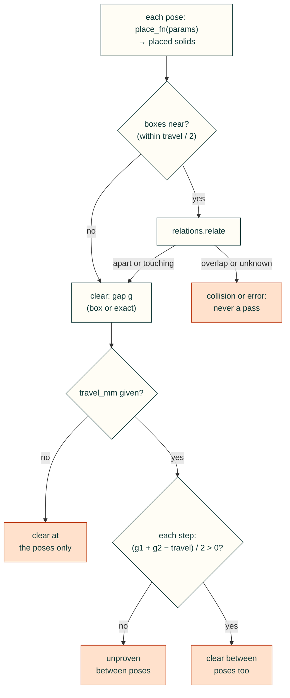

```python
from cadagent.mechanical.clearance import collisions, sweep, swept_envelope

def place(q):                       # the project's own kinematics: {instance: (part, placed cadquery shape)}
    q1, q2 = q
    return {"link1": ("link", link1.rotate((0, 0, 0), (0, 0, 1), q1)),
            "link2": ("link", link2.rotate((0, 0, 0), (0, 0, 1), q1 + q2).translate(tip(q1))),
            "barrel": ("cyl_barrel", barrel_at(q)), "rod": ("cyl_rod", rod_at(q)),
            "base": ("base", base)}

poses = {f"q1={a}_q2={b}": (a, b) for i, a in enumerate(range(0, 91, 15))   # snake order: each pose one step
         for b in (range(-120, 1, 15) if i % 2 == 0 else range(0, -121, -15))}  # from the last (travel_mm needs it)
report = sweep(poses, place, out_path="exports/clearance-checks.json",
               tolerance_mm3=2.0, skip={("cyl_rod", "cyl_barrel")})   # the rod is meant to run inside its barrel
assert report["pass"], [(p, r.get("collisions") or r.get("error"))
                        for p, r in report["poses"].items() if not r.get("pass")]
```

<details>
<summary>The arguments, the between-poses bound, the swept-volume cutter and the limits</summary>

- **`collisions(instances, tolerance_mm3=2.0, skip=None, only=None)`** returns one row per pair that overlaps by more
  than the tolerance: `{"a", "b", "part_a", "part_b", "volume_mm3"}`. `instances` maps a name to `(part, shape)` or to
  a bare shape. `skip` is pairs of instance or part names that are meant to overlap, or a callable
  `skip((name_a, part_a), (name_b, part_b))`. `only(name)` limits the check to pairs with at least one selected
  instance (the arm against everything, not the track against itself). A pair the relation gate cannot decide
  (`unknown`: a kernel error, a volume that does not add up, a crossing the boolean missed) is a row with `"error"`:
  an error is never a pass.
- **`sweep(poses, place_fn, out_path=None, travel_mm=None, **collisions_args)`** runs `collisions` at every pose. A
  `place_fn` that raises (an unreachable pose) is that pose's error. The check has a row per pose (its parameters,
  the pairs it related, its collisions), and a top-level `pass` that is true only when at least one pose was checked
  and none has a collision or an error. `physical_fit_verified` is always `false`.
- **Between poses.** Pass `travel_mm`, the most any point of one part moves relative to another between two
  consecutive poses, in the order given, measured along its path, not the chord (for a rotation step, the step in
  radians times the largest radius it carries; order the poses so each is one step from the last), and each pair
  clear at both ends of a step must be proven clear between them: the gap there is at least `(g1 + g2 - travel) / 2`,
  the bound the assembly gate's `sweep_pair` uses on an insertion path. A step it cannot prove, or a pair placed at
  only one end of it, is a row in `between_poses` and fails the check; `gap_lower_bound_mm` is the smallest bound
  over the sweep. Pairs meant to touch cannot be proven clear: `skip` them.
- **`swept_envelope(pieces, step=0.5, max_slope_deg=45.0, taper_ends=False)`** makes the cutter that clears a
  neighbour. Describe the moving part's radius along its own axis as pieces `(x0, x1, r0, r1)` (a barrel, then a rod,
  then an eye), and get a cadquery `Solid` of revolution about +x. Its radius is the largest piece at each x, raised so
  it never changes faster than `max_slope_deg` from the axis: a step becomes a 45° cone, not a flat shoulder (which
  prints as a ceiling when the axis is near the neighbour's build direction). `taper_ends=True` closes the ends with cones too. The profile is one polygon revolved once:
  place one envelope per pose and cut them from the neighbour, rather than fusing many small tools, which is where OCC
  booleans fail. `envelope_profile` gives the same `(xs, rs)` profile without a CAD kernel.
- **Limits.** Without `travel_mm` the poses are samples, not a continuous sweep: two parts can pass through each
  other between two poses and no pose sees it. With it, the bound holds only if the stated travel does. Only the
  solids passed in are checked: a pin, bolt or hose left out of the model is not. Parts meant to touch on a face
  pass the tolerance; a part sunk into another by more than the tolerance is a hit unless `skip` names it. CAD
  clearance does not prove physical fit: tolerances, deflection under load and wear are not modelled.
  `swept_envelope` samples the profile every `step` mm (and at every piece's ends), so a cone's foot between
  samples is placed to within a fraction of a step.

</details>

### Explore and compare designs (`cadagent.simulation.explore`)

For any product built from bought and made parts. A catalogue of parts (specs, prices with the date checked, sources,
confidence flags), designs that pick one part per slot plus parameters, and the project's own evaluator (a Python
function or any command speaking JSON) give every design its metrics and checks. `cad-agent compare` ranks the
designs into Pareto fronts over the configured objectives, tries one-part swaps, and writes a standalone page and
design cards for the site; `cad-agent optimise` searches parts and parameters (optuna's NSGA-II with the `explore`
extra). The physics stays in the project. The full guide is [explore.md](explore.md); a worked example is
[`examples/explore-two-wheel`](../examples/explore-two-wheel/).

### Mating connectors (`cadagent.mechanical.connectors`): standard practice for every port

Every external port's window is derived from its **mated plug**, never from the receptacle's bounding box. A bounding
box includes pins below the board, which pushes the window low, and it misses plugs that are larger than the
receptacle: a screw-flange terminal plug is 15 mm tall on an 8.4 mm header.

1. **Identify the receptacle and its mate.** Get the receptacle's exact part from the schematic. For the mating plug,
   prefer the manufacturer's drawing or STEP; otherwise use a catalogue or typical value, recorded as an assumption in
   `basis`.
2. **Measure the face and axis.** Slice the board model at the mating face; exclude pins and pegs below the board.
3. **Describe the port in `parameters.json`** as a `mate` spec in the panel frame (u along the wall, v up, w out):
   ```json
   "mate": {"face": [u0, v0, u1, v1], "face_w": 2.08, "centre_on": "receptacle", "clearance": 0.5,
            "plugs": [{"family": "rj45", "cavity": [u0, v0, u1, v1], "latch": "up"}], "basis": "..."}
   ```
   Families: `rj45`, `trs35`, `terminal_plug_flanged` (Phoenix MSTB STF), `overmold` (USB/HDMI/...),
   `face_plug` (plug already in the board model) and `box`. Add a family when a new plug type shows up.
4. **The build calls `window(mate, wall_w)`.** Only plug segments that start inside the wall's outer face (they pass
   through it on insertion) size the window. `centre_on` picks the visual centre: the receptacle face or the plug.
5. **A check step calls `check_ports()`** with the printed parts in assembly position. It sweeps each plug in from
   outside and requires:
   * zero interference;
   * zero interference after growing the plug by the clearance (corner radii included);
   * no plug-to-plug clash.

   `draw_ports()` makes the evidence image. Add the check to `checks:` and the review `pass_key`.
6. **Give each mate its cable** (below), so `check_ports()` also checks that the cable can bend behind the plug.

Worked example: j501-agx `cad/ports.py`, `tools/check_ports.py` and `exports/port-checks.json`.

#### The cable behind the plug

A plug that fits is no use if its cable has no room to turn. Give the mate a `cable` with the diameter and minimum
bend radius from the cable's data sheet, in the form the data sheet uses: millimetres, as here, or a multiple of the
diameter, `{"x_od": 5}`:

```json
"cable": {"od": 6.1, "min_bend_radius": {"mm": 25}, "basis": "Belden CAT6+ UTP PVC patch cord, rev 0.202: 6.1 mm, 25 mm"}
```

`cable_bend(mate, obstacles, frame)` lets the cable leave the boot straight along the mating axis, then turns it 90°
at that radius towards `+v`, `-v`, `+u` and `-u` in turn. For each direction it measures the clearance to every
obstacle: the distance from the cable's centreline less its radius, negative where it runs into a part. It returns
`pass` when some direction clears by at least `margin` (1 mm by default), `warn` when the best one clears by less,
and `fail` when none clears, with the clearance, the direction that works (`direction`, and every one in `works`)
and the assumptions it made. `check_ports()` runs it for every mate with a cable, against the printed parts and the
other ports' plugs, and fails a port whose cable cannot turn. `bend_reach()` gives the room a bend needs, in closed
form: a 90° turn needs the inside radius plus one diameter, ahead and beside (31.1 mm for the cable above).


*An illustration of the check on the RJ45 port in `tests/test_connectors.py`, in section: the clearances are
`cable_bend`'s.*

`cable_bend()` takes CadQuery shapes in assembly position, placed through the port's `PanelFrame`, or boxes in the
panel frame (`{"u": [..], "v": [..], "w": [..]}`), which need no CAD kernel: use boxes for what the project's CAD does
not hold, such as the shelf or the cabinet door in front of the port. `check_ports()` takes CAD shapes only, and
refuses a box; place one as a solid through the port's frame.

<details>
<summary>What it assumes, the optional keys, and where bend radii come from</summary>

**Assumptions** (each result lists them):
- one bend in one plane, starting at the boot's end, `turn_deg` degrees (90 by default), then `run` mm straight
  (0 by default);
- a rigid boot: the cable leaves it straight along the mating axis, from the centre of the plug's far end, or from
  `exit: [u, v]`;
- the radius is measured to the inside of the bend (`measured_to: centreline` for a data sheet that says otherwise);
- the cable is a round tube taken as balls of its radius along its axis, so it reaches half a diameter past each end of
  what is checked, and a gap there is never overstated. Its stiffness, droop and diameter tolerance are not modelled;
- nothing past the end of the bend is checked, or past the run: a pass is room to turn, not a route. Give `run` to check
  the length that follows the turn;
- only the minimum radius is tried. Against a wall, a floor or a door ahead that is the best case, but a gentler bend can
  clear a part beside the path that the tightest one hits: a fail means the tightest single bend from the boot's end
  collides;
- the directions tried are `directions` (names, or angles in degrees from `+u` towards `+v`).

A bend that clears in CAD does not prove that the cable fits: route the real cable at a printed part.

**Where the radius comes from.** Take it from the data sheet of the cable you will use, and record it in `basis`.
These are examples; the check has no default radius:

| Cable | Data sheet | Minimum bend radius |
|---|---|---|
| Ethernet patch cord | Belden CAT6+ UTP PVC patch cord, technical data rev 0.202 (2025-02-07) | 25 mm (overall cable), 6.1 mm nominal diameter |
| Ethernet patch cord | Belden C602106010 CAT6+ patch cord, technical data rev 0 (2011-07-14) | 26.416 mm, 6.045 mm nominal diameter |
| USB 2.0, A to B | Phoenix Contact VS-04-C-SDA/SDB/1,8, item 1405578 (online catalogue, 2013-11-12) | 5 × D fixed and flexible, 6.7 mm diameter |
| Power and control, 300/500 V | LAPP ÖLFLEX CLASSIC 100 300/500V, data sheet DB00100004EN version 06 (valid from 2024-05-21) | 4 × outer diameter fixed, 15 × occasional flexing |

A cable that is plugged and unplugged flexes at the boot: when the data sheet gives a flexing radius as well, check
with that one. For harnesses, IPC/WHMA-A-620C (January 2017), section 14.3.2 *Bend Radius* and Table 14-1 *Minimum
Bend Radius Requirements*, sets workmanship minimums by cable type and product class; take the multiple from your
copy of the standard, as `{"x_od": k}`.

**Survey (adopt or build).** [WireViz](https://github.com/wireviz/WireViz) (GPL-3.0) documents harnesses as diagrams
and bills of materials; its cables carry gauge, length, colours and part numbers, but no diameter, bend radius or
geometry. The FreeCAD [Cables workbench](https://github.com/sargo-devel/Cables) (LGPL-3.0) routes cables as 3D
solids and reports the smallest radius along a drawn route, but checks it against no limit and needs FreeCAD. Neither
checks a bend against the parts around it, so this check is built here, on the plug model and the OpenCASCADE
distance cadquery already uses.

</details>

### 3D viewer (`cad-agent view` + the web kit)

Works for any model: a housing, a bracket set, a mechanism or a robot. `cad-agent view` reads each part's STEP (assembly
coordinates) and writes a binary STL per part plus `exports/view/view.json`. `viewer.html` in the web kit shows the
assembly with a parts list (show/hide, colour), exploded view, section cut and standard views; the site links it when
the manifest exists. Wheel zoom (and trackpad pinch) uses one-quarter sensitivity for closer inspection; middle-button
drag and touch pinch keep full speed (`dragZoomSpeed`), and small trackpad deltas remain continuous at any device pixel
ratio. Custom stages can pass `createStage(el, {zoomSpeed: 1})` for the earlier wheel sensitivity. Update copied web kits, or restart a served site
after updating cad-agent. The viewer is scriptable for screenshots: `viewer.html?explode=0.5&view=iso&panel=0`.

Show everything the parts fit around in the same viewer, not in a second one: `extra` entries add bought parts and
reference boards from a STEP or an STL (`offset: [x, y, z]` mm moves the part into assembly position; `hidden: true`
starts it off). A `category` on an entry (`parts_category` for the parts file; `categories: {Test coupons: [part, ...]}` moves
parts by name) heads a section of the parts list with one box that shows or hides the whole section, e.g. *Printed parts*, *Cooler*, *Carrier board*. An extra whose file is
missing is listed as not exported, so reference models that are not redistributed drop out of a fresh checkout.
Configuration errors stop the export before anything is written: two parts with the same name (including an `extra`
glob that matches a part from the parts file, which used to overwrite its mesh silently), an `offset` that is not three
numbers, and a `categories` entry that is not a list, names a part that does not exist or lists a part twice.

### Stiffness and strength (`cadagent.simulation.fea`)

`pip install -e ".[cad,fea]"`. `Study(shape_or_step, material, mesh_mm)` meshes any part with gmsh (P2 tetrahedra),
`fix()`/`force()`/`torque()` pick faces with selectors (`plane_at`, `cylinder_at`, `in_box`, `near`, `any_of`). A `torque()` is a pure couple about the loaded faces' own centroid (no net force, exactly the torque along the axis); its `point` does not move the axis, so a force at a distance needs its own `force()`. Then
`solve()` returns deflection, stiffness, the design von Mises stress and the safety factor against `MATERIALS`. Stress spikes in the elements touching a clamp or a load patch
are artefacts of the idealised support, so the design stress and every failure view leave them out ("support
patches": capped at the design stress, never shown as failed, their share of the surface reported).

<details>
<summary>On aarch64 Linux (ARM compute hosts), gmsh does not install from PyPI</summary>

PyPI has no aarch64 Linux wheel and no source package for gmsh 4.15.2 (nor for any gmsh release), so `pip install
gmsh`, and with it the `fea` extra, stops with "No matching distribution". pypardiso cannot install there either: it
needs Intel MKL, which has no aarch64 wheel. conda-forge builds gmsh for aarch64. Put it in its own environment with
micromamba and link its Python module into the project's venv:

```bash
micromamba create -y -p <gmsh-env> -c conda-forge python-gmsh=4.15.2   # gmsh.py, and libgmsh built for aarch64
pip install -e "<cad-agent>[cad]" scikit-fem pyamg       # the fea extra without gmsh and pypardiso
ln -s <gmsh-env>/lib/python3.*/site-packages/gmsh.py \
      "$(python -c 'import sysconfig; print(sysconfig.get_paths()["purelib"])')/"
python -c "import hashlib, gmsh; gmsh.initialize(); print(gmsh.__version__)"   # the check
```

`gmsh.py` looks for `libgmsh` relative to its own real path (in the environment's `lib/`), so the link is enough. If the
check fails with an `OSError` saying version `OPENSSL_3.4.0` was not found, the venv's Python has already loaded the
system OpenSSL (anything that imports `hashlib` or `ssl` first does), and a library in the gmsh environment needs a
newer one. Preload the environment's own OpenSSL in the run's launcher:
`LD_PRELOAD=<gmsh-env>/lib/libcrypto.so.3:<gmsh-env>/lib/libssl.so.3`.

Without pypardiso the solver falls back to SciPy, and to pyamg for big meshes, which is slower. pyamg has no aarch64
wheel, so pip builds it from source; that needs a C++ compiler. A conda-forge gmsh is a different build from the PyPI
wheel and can mesh a part slightly differently, so compare before and after on one build. gmsh reads the STEP with
its own OCCT: the newest conda-forge build of 4.15.2 (build 11) links OCCT 8.0.1, and one of the two build-10 variants
links 8.0.0, while cadquery-ocp 7.9.3.1.1, builds 0 to 9 and the other build-10 variant use OCCT 7.9.3.
</details>

**Printed materials** (`pla`, `petg`, `petg_cf`, `pa_cf`, `pa6_cf_xy`, `pa6_cf_z`, `tpu95`) take their numbers from the
filament maker's data sheet (100 % infill test bars). Each names its sheet (`source`, an id in the reference registry),
says in `note` which sheet value E and the strength come from, and gives the print direction of E (`direction`). The
result's `assumptions` line repeats the modulus, the strength and the note, and the viewer shows the direction:

<details>
<summary>The printed materials: modulus, direction, strength, layer allowables and data sheet</summary>

| Key | E (MPa) | Direction | Strength (MPa) | Layer check X-Y / Z (MPa) | Data sheet |
|---|---:|---|---:|---:|---|
| `pla` | 2060 | Z | 25 | 27.9 / 25 | Bambu PLA Basic V3.0 (X-Y 2580; Z tensile strength 31) |
| `petg` | 1120 | Z | 20 | 24.6 / 20 | Bambu PETG Basic V2.0 (X-Y 1460). V3.0 is a reformulated filament whose bars are not said to be annealed (2780 / 2550): a spool does not say which it is, and the lower modulus is the cautious one for deflection (`cad-agent snapfit` takes V3.0's, the cautious one for forces) |
| `petg_cf` | 1340 | Z | 22 | 26.6 / 22 | Bambu PETG-CF V3.0 (X-Y 2460; Z tensile strength 29) |
| `pa_cf` | 1820 | Z | 40 | 78.3 / 40 | Bambu PAHT-CF V3.0, dry (Z bending, the sheet's lowest; Z tensile 2180, X-Y 3860) |
| `pa6_cf_xy` | 1029 | X-Y | 40.8 | 40.8 / 18.1 | Bambu PA6-CF V3.0, dry X-Y, humid (modulus x0.290, strength x0.500: Polymaker PA6-CF20 V1.1, water-saturated / dry) x0.8 print (#157) |
| `pa6_cf_z` | 488 | Z | 18.1 | 40.8 / 18.1 | Bambu PA6-CF V3.0, dry Z, humid (x0.281, x0.472) x0.8 print |
| `tpu95` | 7.4 | Z | 8 | 9.8 / 8 | Bambu TPU 95A HF V1.0 (X-Y 9.8; Polymaker lists 33.6): indicative only |

</details>

The modulus is the sheet's lowest, across the layers, because the solver is isotropic and does not know how the part
was printed, so deflections come out higher than with the sheet's in-plane values. They are not an upper bound on a
print. The mesh is the solid CAD, and a print with sparse infill or thin walls can be softer still. The isotropic shear
modulus does not bound a print's shear stiffness between layers either, which matters for short, thick parts. The
two humid PA6-CF rows take the modulus ratio of a water-saturated print (0.28–0.29 of dry). That is a judgement for
the cautious end: no sheet gives a print conditioned in room air, where moulded PA6 keeps 0.31–0.58 of its dry
modulus (unfilled to 30 % glass), so in room air these rows may be up to about 2x too soft, and a force at a given
travel reads low ([research](../research/compliant-mechanisms.md), section 5). Under
forces and torques the stress does not depend on E, so only deflection and stiffness change with it. The metals
(`al6061`, `al7075`, `steel`) use design minimums from MIL-HDBK-5J, not typical values (#157); `cf_tube` is typical.

At a given travel it is different. `stiffness_n_per_mm` is lower than with the in-plane modulus. So a force worked out
from it at a given travel (a clip's retention, a flexure's preload, a spring rate) reads lower than for a solid part
bent in the layer plane, and so does the stress at that travel, which scales with E (a cantilever pushed to a tip
travel δ has σ = 3Ecδ/L²). For a part loaded in the layer plane that stress is E_Z / E_XY of what the in-plane modulus
gives: multiply by E_XY / E_Z (1.84 for PETG-CF, 1.25 for PLA) to get the in-plane figure, which is itself an estimate
for an isotropic solid. So a strength check at a given travel is unconservative with this modulus: check a flexure's
or a clip's strength at its travel with the in-plane modulus, or with a coupon. (The snap-fit tool, `cad-agent
snapfit`, uses strain allowables and its own moduli by direction, so it does not depend on this E.) A print with sparse
infill or thin walls is softer than either, and then the force at a given travel reads high: a retention check
needs a measured part.

<details>
<summary>Giving a part the in-plane modulus, and the moduli before v0.5.0</summary>

A part whose bending stays in the layer plane is stiffer. Give it the X-Y modulus, keep the weak-direction strength,
and say so in the note, so the assumptions line stays true:

```python
dataclasses.replace(MATERIALS['petg_cf'], E_mpa=2460, direction='X-Y',
                    note='Bambu PETG-CF TDS V3.0: E is the X-Y tensile modulus; strength the Z allowable')
```

Before v0.5.0 the printed moduli were 31-305 % higher (PLA 2700, PETG 1800, PETG-CF 2900, PAHT-CF 4500, PA6-CF 3000 and
2400, TPU 30), so deflections computed with them read 24-75 % low (#125). A real print, with walls, seams and sparse
infill, is softer and weaker than a test bar, and no simulation proves that a part fits or holds: check it against a
printed coupon.

</details>

**Across the layers or along them** (`layer_check`). The study is isotropic, so its safety factor uses one strength
everywhere: across the layers, the weak one, for every default printed row. `layer_check(normal)` resolves the same stress against the layers of a print whose
layer normal (its build direction) is `normal`. At every element corner it splits the traction on the layer plane into
σn, across the layers, and τn, along them, and runs two checks:

- **bond:** √(max(σn, 0)² + 3τn²) against the across-layer allowable S_z;
- **bulk:** von Mises against the in-plane allowable S_xy.

```python
lc = st.layer_check((0, 0, 1))          # printed flat on the XY plane; strengths from the material
lc.safety_factor, lc.governed_by        # e.g. 2.07, 'bond'
lc.worst                                # the worst corner: where, sigma_n, tau_n, von Mises, which check
lc.factor, lc.mode                      # per element: safety factor and governing check
lc.as_dict()                            # for a record, with its assumptions
```

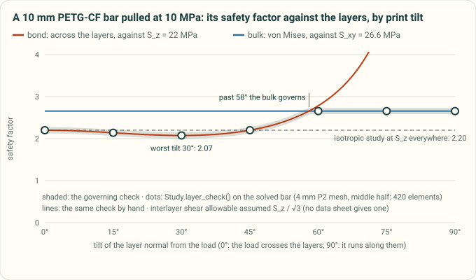

The chart is a real study: a PETG-CF bar pulled along its length, checked at seven print tilts (`tools/fea_layer_figure.py`
regenerates it). Pulled straight across the layers it holds 2.20, the bond against S_z. Lying down, it holds 2.66, the
bulk against S_xy. At 30° it holds less than either, 2.07, because the layers then also carry shear.

That dip comes from the shear term, and the shear term is an assumption. No filament data sheet gives an interlayer
shear strength, so unless `strength_shear` is given it is S_z / √3, the ratio von Mises gives an isotropic solid. Pass
`strength_shear` from a coupon (a short-beam or lap-shear test of the same print) when there is one.

The strengths default to the material's `layer_strengths_mpa` (the table above): every printed row has them. A metal or a
material of your own needs `strength_xy` and `strength_z`. `judge` (one bool per element) picks the elements judged; by
default that is all but the clamp and load patches, as for the safety factor. `st.sig_corner` keeps the corner stress
tensors (elements × 4 corners × 3 × 3, MPa) for checks of your own.

**Which bond criterion** (`criterion`, `bulk_stress`). The bond check weighs the opening stress and the shear
together. A maximum-stress check weighs each on its own, and some projects use one. Both are options, and the defaults
give the results `layer_check` gave before the options existed:

- `criterion='combined'` (the default): the bond check above, one check.
- `criterion='max-stress'`: `tension`, ⟨σn⟩ against S_z, and `shear`, τn against S_s, as two separate checks.
- `bulk_stress='full'` (the default): von Mises of the whole stress tensor, against S_xy.
- `bulk_stress='in-plane'`: von Mises of the stress in the layer plane alone, against S_xy; σn and τn are the bond's.

```python
lc = st.layer_check((0, 0, 1), criterion='max-stress', bulk_stress='in-plane', strength_shear=11)
lc.modes['tension'], lc.modes['shear'], lc.modes['bulk']    # per element; lc.mode names the one that governs
```


The figure is one solved bracket under the two criteria (`tools/fea_layer_figure.py` regenerates it). Its upright is
printed standing, so the push makes its R2 root fillet pull across the layers while they carry shear. The combined
criterion fails a band along the fillet, 55 elements and 2 mm³ (SF 0.94). The maximum-stress one passes it (1.07).

Which is the more cautious depends on the corner. With one S_s, the combined bond is never below the max-stress one.
It is up to √2 above it, where tension and shear peak together, as at that fillet. The full von Mises is lower than
the in-plane one where σn has the sign of the in-plane stresses' sum and is smaller, and little shear runs between the
layers. That is layers squeezed while the layer plane is compressed harder (a gear tooth, a clamped boss), and layers
pulled while the plane is pulled harder (triaxial tension at a notch root, a pressurised wall). There the in-plane
check is the more cautious; elsewhere the full one is the same or higher.

Gyropup's turret checks its parts as `criterion='max-stress'`, `bulk_stress='in-plane'` and S_s = S_z / 2 do. On its
pan pinion, at one corner where the layers are squeezed, the full von Mises is 20.4 MPa and the in-plane one 23.4.
Against its target safety factor of 2.0, the defaults pass that corner (2.0) and the turret's check fails it (1.75).
Neither S_s is measured: S_z / 2 is 13 % below S_z / √3, so it is the stricter in shear. A coupon settles it.

**How far past the worst corner** (`stats`, `worst['resolution']`, `render(field=)`). The safety factor comes from
one element corner, so it cannot tell a peak at one re-entrant edge from a region. `lc.stats` can. For each check, and
for the governing one (`utilisation`), it gives:

- `max`, the peak utilisation;
- `p99`, the utilisation 99 % of the judged volume stays at or below;
- `over_1`, the number of judged elements past the allowable, and their volume (`over_1_volume_mm3`, and its share
  of the judged volume).

```python
lc.stats['utilisation']    # {'max': 1.06, 'p99': 0.59, 'over_1': 55, 'over_1_volume_mm3': 1.98, ...}
lc.worst['resolution']     # where that corner sits, the wall round it, elements across, an inside radius
st.render('exports/fea/bracket-layers.png', field=lc, vmax=1.0)    # or field=lc.modes['shear']
```

The p99 is weighted by volume, so a mesh made finer round the peak with `refine=` does not pull it up. A count of
elements past 1 grows with such a mesh; their volume settles. Each element counts whole, from its highest corner, so
the volume is an upper bound. `lc.worst['resolution']` measures the mesh at the worst corner, as `result['mesh']['peak']`
does at the design peak. A corner at a sharp re-entrant edge, or in a wall one or two elements thick, is not a
result. `st.render(path, field=lc)` draws the check, as in the bracket figure: black past the allowable, grey where
not judged.


The chart is the bracket's two checks as `stats` sees them. Left of 1 %, round the root fillet, the combined curve
sits above the max-stress one, where tension and shear meet. The plateau near 0.55 is the base, bent evenly in its
layer plane: a region.

Its limits:

- It is a screening check, not a qualification.
- The stress comes from the isotropic solve. A print whose load path depends on its stiffness can carry the load
  differently.
- Walls, seams and infill are not modelled.
- Test a printed part.

<details><summary>Where the checks come from, hand corners, and the in-plane allowables</summary>

The traction on a plane with normal n is t = σ·n; σn = n·t, and τn = |t − σn n|. The bond check is the quadratic
interaction of the opening stress and the shear on the bond plane, (⟨σn⟩ / S_z)² + (τn / S_s)² = 1 at failure. This is
the form of Brewer and Lagace's delamination-onset criterion (J. Compos. Mater. 22 (1988) 1141–1155), applied at a point
here, without their averaging over a distance. Compression across the layers closes the bond, so it is left out of the
bond check, and stays in the bulk check. With S_s = S_z / √3 it reads √(⟨σn⟩² + 3τn²) / S_z.

The maximum-stress criterion takes each stress against its own strength, with no interaction (R. M. Jones, *Mechanics
of Composite Materials*, 2nd ed., 1999, chapter 2): here ⟨σn⟩ / S_z and τn / S_s. For one S_s,
√(a² + b²) ≥ max(a, b), so the combined bond is never below it; the two are equal where either term is zero, and √2
apart where the terms are equal.

The bulk check is the study's own von Mises check, against the in-plane allowable. Gyropup used both checks for its
hip frame before they were in the toolkit (#144). The in-plane one takes the plane-stress von Mises of the layer
plane's own stress, √(σ11² − σ11σ22 + σ22² + 3σ12²) in any two in-plane axes. Written in those axes, the full one is

vm² = vm_in² + σn² − σn(σ11 + σ22) + 3τn²,

so it is the lower exactly where σn(σ11 + σ22 − σn) > 3τn². That needs σn of the same sign as the in-plane sum and
smaller, with too little shear between the layers to make up the difference. The layers are then squeezed while the
plane is compressed harder, or pulled while it is pulled harder.

Hand corners, with S_z = 20, S_s = 20 / √3 and S_xy = 30 MPa and the layer normal z (utilisations; `tests/test_fea_layers.py`
checks each, and that the options reproduce a project's own three maximum-stress checks):

| Corner (MPa) | Bond, combined | Bond, max-stress | Bulk, full | Bulk, in-plane |
|---|---:|---:|---:|---:|
| σn 10, τn 5: tension and shear together | 0.66 | 0.50 | 0.44 | 0 |
| σn 10, τn 5.77: the two terms equal | 0.71 | 0.50 | 0.47 | 0 |
| σ11 20, τn 5: in-plane tension, interlayer shear | 0.43 | 0.43 | 0.73 | 0.67 |
| σ11 −32, σn −12: squeezed, the plane compressed harder | 0 | 0 | 0.93 (28 MPa) | 1.07 (32 MPa) |
| σ11 30, σn 10: pulled, the plane pulled harder | 0.50 | 0.50 | 0.88 (26.5 MPa) | 1.00 (30 MPa) |

S_z is the row's strength, an allowable below the sheet's Z tensile strength. S_xy is that allowable times the sheet's
X-Y / Z tensile strength ratio, the lowest over the editions read. So in the layer plane it sits at least as far below
each sheet, as a ratio, as the row's strength does across the layers. The humid PA6-CF rows share one pair, their two strengths. `tests/test_fea_materials.py` pins the rule, and
`tests/test_fea_layers.py` checks the check against hand-computed cases.

</details>

<details>
<summary>What a result records about its material, and checking a record on another toolkit</summary>

**What a result used** (`material_data`). `solve()` records the material data in `result['material_data']`:

- `key`, the built-in row (None for a material of your own or a changed copy);
- the constants: `E_mpa` and the print direction it is for, `nu`, `strength_mpa`, the layer allowables and
  `density_g_cm3`;
- where they come from: `source`, and `note`, which names the data sheet and its edition;
- `constants_hash`, a hash of the constants alone.

A record made on one toolkit can be checked on another. `material_changes(old_result, new_result)` lists each constant
that differs, with now / recorded. Under forces and torques, deflections scale by the inverse of the E ratio, safety
factors by the strength ratio and masses by the density ratio. A built-in material's numbers are result-changing. A
change to any of them needs a `**Projects must change**` fragment in [`changelog.d/`](../changelog.d/README.md), and
`tests/test_fea_layers.py` pins every row's hash so it cannot slip through.

</details>

Stresses are element corner peaks, never averaged. The P2 strain is linear in a tetrahedron, so its extremes sit at the
corners; the safety factor, the hot spots and the per-vertex colours all use the highest corner stress there. The
volume-weighted average is exported too and shown as "smoothed". Where it falls well below the peak (a hot spot says
so), the mesh is coarse for that gradient. `overstressed_share(load_factor)` is the share of the volume in elements
whose peak is past the strength. It counts whole elements, so it is an upper bound on the overstressed volume.
`animate()` and the viewer both report it.

**Meshing** (`refine`, `converge`, `result['mesh']`). `mesh_mm` is one size for the whole part. A sharp re-entrant
corner has no finite peak, so a finer mesh only raises it; a fillet's peak settles. `refine=[(point_mm, radius_mm,
size_mm)]` makes the mesh fine round one spot and leaves the rest as it was, so one corner converges without the whole
part paying 8x the elements for each halving:

```python
st = Study(part, MATERIALS['petg_cf'], mesh_mm=4, refine=[((12, 0, 30), 3, 0.5)])   # 0.5 mm within 3 mm of a fillet
res = st.solve()
res['mesh']['peak']    # where the design peak sits, the wall round it and how many elements lie across that wall
st.converge()          # the same loads on a mesh 0.75x as fine: the peak's change, and whether it moved
```


The chart is a real study (`tools/fea_mesh_figure.py` regenerates it). Sharp, the corner's peak grows about 1.34x
for each halving of the elements there (1.22x to 1.47x step to step), close to Williams' 2^0.455 = 1.37x, and never
settles. With an R1.5 fillet it stays within 3.4 %. Model the fillet the part will have, then refine it in steps
until the peak settles, with elements smaller than its radius. Every result's `mesh` says how far to trust it, but
none of its checks is that study:

- `mesher`: the gmsh and OpenCASCADE versions, the build's OS and date, a hash of the gmsh library and the platform.
  Two builds of one gmsh version can mesh a part differently. Gyropup's hip frame got 151,459 and 151,136 tets, and
  its sharp-corner peak came out 6 % apart. So a gate read at one mesh size names the build, and before and after
  are compared on one build.
- `peak`: the design peak's place (`where`, read off the CAD faces), the thinnest wall round it, the element size
  there and `elements_across`, the wall over the element size. Under 3 it is flagged (`wall_resolved` false, a
  `MeshWarning`): a peak in a wall one or two elements thick is not a result. At an inside fillet or a hole,
  elements larger than its radius (`radius_mm`) are flagged too (`radius_resolved` false). A stepped bar's R0.5 fillet
  had 5 elements across its wall at a 4 mm mesh and read 9 % low. A rounded outside edge does not count: bending
  stress round it is linear, which the elements carry.
- `refine` and `slivers`: the zones used, and the slivers found before meshing.

The same bracket, step by step: what each result's `mesh` record and `converge()` said as each step halved the
element size `refine=` asks for at the corner.


*A recorded run of the toolkit, not a drawing: cad-agent 0.7.0's `Study` and `converge()` on gmsh 4.15.2 with
OpenCASCADE 7.8.1 (Linux x86-64, 2026-11-01). `tools/readme_anim.py` redraws it from
`tools/anim/fea-convergence.scene.json` and `--check` fails when it is stale; `--extract convergence` records it again
(about a minute, about 3 GB). Each step shows the front face's mesh, the design peak (the dot), the result's flags and
`converge()`'s verdict, which judges the 0.75x finer mesh's flags, not this mesh's. The chart's x axis is the size
asked for; gmsh's curvature sizing already meshes the R1.5 arc at about 0.95 mm, so the fillet's first two steps are
nearly one mesh. The open squares are the whole part meshed that fine, without `refine=`: 11,829 tets at
0.5 mm for the sharp bracket, against 1,233 refined.
Linear-elastic FEA: a converged peak does not prove that the part holds.*

**Slivers and refusals.** Before meshing, `Study` lists faces under (mesh_mm/10)² in area, long faces under
mesh_mm/10 in width (2 × area / perimeter), and edges under mesh_mm/10 (`Study.slivers`; a refine ball's size counts where it covers the
whole face or edge). It warns by default. With `slivers='raise'` it stops with a
`MeshRefusal` in seconds, before a long mesh, which suits an optimiser's evaluator. When gmsh refuses a part ("PLC
Error: A segment and a facet intersect at point", or "Could not recover boundary mesh"), `Study` raises a
`MeshRefusal` with the point and the nearest faces and their areas (`err.point`, `err.faces`, `err.edges`), when gmsh
gives a point. `faces_near(point)` names the faces round any point.

<details><summary>How the refinement, the wall count, the convergence check and the refusal work</summary>

- **Refinement:** each entry is a gmsh Ball field: size_mm inside the radius, growing linearly back to mesh_mm over
  2 × (mesh_mm − size_mm). A Min field joins them, under the global `Mesh.MeshSizeMax`. `Mesh.MeshSizeMin` must drop
  to the smallest refine size. It is also the floor of gmsh's curvature sizing, so a size callback keeps the old floor
  (mesh_mm / 4) outside the balls. Without `refine`, a study meshes exactly as it did before.
- **Wall:** from each surface triangle within two element sizes of the peak corner, a ray goes into the material
  along its CAD face's normal until it leaves, and the shortest is the wall. A ray that leaves at a grazing angle
  (more than 60° off head-on) ran along a wall to an edge, so it does not count. Elements across is the wall over the mean edge length of the
  tetrahedra at the peak corner: the layers a structured mesh would put there. A ray through a tet mesh crosses more
  tets than that, so this is the cautious count.
- **converge(factor=0.75, tolerance=0.05):** a new Study at factor × mesh_mm (and factor × each refine size), with
  the same faces fixed and loaded. It is converged when the design peak changes by at most the tolerance and the
  finer mesh resolves it (its wall and radius checks pass): two under-resolved meshes can agree. A peak at a sharp
  inside corner (on either mesh) is never converged, whatever the change: two meshes of a singular corner can agree
  by chance (the bracket's sharp corner at 0.25 mm moved +1.8 %, then rose 32 % at 0.125 mm). A peak that moves
  more than two mesh sizes is noted: an artefact when its value changed too, else two places near the peak value. One
  step is a check, not a convergence study.
- **Radius:** the smallest radius of the cylindrical faces within one element of the peak. On a stepped bar's R0.5
  and R1 fillets, elements 1.1 to 3 times the radius read the peak 6 to 17 % low, and elements under it within 2 %.
- **Refusal:** gmsh's volume mesher (TetGen's boundary recovery) throws on the first line of its report, before it
  prints the point, and stays locked until gmsh is finalized. So `Study` meshes once more in a new session with errors
  logged, not thrown, and `parse_gmsh_refusal()` reads the point and the surfaces gmsh names. Distances are measured to
  the surface mesh, so to its chords on a curved face. gmsh's failing runs are not always repeatable: the point is one
  of several, "Could not recover boundary mesh" often comes with none, and a second try that meshes is used, with a
  `MeshWarning`.

</details>

Showing how it fails, for the report:

- `render(png, scale=None, vmax=None)`: the deformed part coloured by stress. `scale` exaggerates the deformation; `vmax` (MPa) fixes the colour scale, so variants under the same load compare by eye.
- `animate(mp4)`: the load ramped from zero through the design load to first failure (x safety factor) and past it;
  regions past the strength turn black, and every frame gives the overstressed volume share (an upper bound).
- `export_viewer(json)`: data for the interactive viewer in the web kit (`fea-viewer.js`, `fea.html`). The boundary
  surface only (a few MB at most at ~100k tets), with per-vertex displacement, peak and smoothed von Mises stress,
  each triangle's element peak, held/loaded/support flags, the loads, the overstressed volume as an exact step curve
  over the load factor, and up to eight **hot spots**: the highest stresses away from the supports, at least 4 mesh
  sizes apart. Each has the load factor at which it reaches the strength, a plain hint from the CAD faces it lies on
  ("edge of a Ø5.5 hole", "R4 inside fillet", "flat face, 1.9 mm from an R4 inside fillet", "sharp inside corner"),
  and a mesh note when the smoothed value is far below the peak.

Open a case with `kit/fea.html?case=../../exports/fea/<part>-<case>.json` (the kit copied by `cad-agent webkit`, or the
copy `cad-agent site --serve` serves at `/_cadagent/kit/fea.html`). The viewer has:

- a load-factor slider from 0 to 1.3 x the failure load, and a play button that ramps it (pausing at the design load
  and at first failure). Deformation and colours scale linearly. Triangles whose element is past the strength turn
  black (support patches never do), and the status card gives the peak stress and the overstressed volume share;
- colour by stress/strength, stress, local safety factor or displacement, with a legend;
- deformation exaggeration (true scale up to about 40 x), held faces in grey, and load arrows (curled for torques)
  labelled with the load at the current factor. Support patches can be greyed out ("not checked");
- the hot-spot list (click to fly there; numbered markers on the part), a section cut (axis and position; it cuts the
  surface skin, not the stress inside), a hover readout and a pinned probe (the peak stress, the smoothed stress, % of
  strength, local safety factor and displacement at a point; on a support patch it says "not checked");
- the assumptions: linear elastic, small deflection, isotropic with the weak-direction strength for prints. It shows
  where and at what load the part first fails, not crack growth.

Links and screenshots can set the state: `&load=1.5&field=ratio|stress|sf|disp&spot=1&clip=x:0.4&exag=20&panel=0&play=1`.
Values that do not parse are ignored, and `panel=0` hides the panel for that visit only. The page loads only cases
and `back` links on its own origin, and `root` must be a relative path.
From your own page, call `mountFeaViewer(element, url, { title, back, panel })`. It builds the kit layout inside the
element and returns `setLoad`, `setField`, `setExaggeration`, `setClip`, `flyTo`, `play`, `fit` and `dispose` (call it
before mounting another viewer on the same page).

### Robot export (`cadagent.simulation.robot`, optional)

Turns CAD parts into a simulator model with real mass properties:

- `solid_mass_properties(shape, density)` reads mass, centre of mass and inertia from the solid (OCP `BRepGProp`).
- `printed_part_body(shape, density, wall_mm, infill)` estimates a printed part: solid perimeters and skins plus
  sparse infill, with the inertia scaled to that mass. It is an estimate, so weigh the printed part.
- `box_body`, `cylinder_body` and `point_body` model bought parts from their catalogue mass. `Body` objects add with
  the parallel-axis theorem, so a link is the sum of everything bolted to it.

<!-- the site places a figure here (docs/pages.yaml) -->

- `write_urdf` and `write_mjcf` write the same link tree. The MJCF adds motors, joint armature and friction, an IMU
  site and a floor. A tree cannot hold a closed loop, such as a four-bar or a five-bar leg. Cut it at one pin and
  pass that pin to `write_mjcf` as a `LoopClosure`: MuJoCo holds it with an equality constraint. Build the model in a
  pose where the loop closes (give `other_anchor` and it is checked). URDF has no way to close the loop, so keep it
  in the controller. `cadagent.mechanical.linkages` solves the loop's poses ([Linkages](linkages.md)).
- `check_urdf` checks the tree, inertias (positive definite, triangle inequality), mesh files and joint limits.
  text-to-cad's `cadgen urdf validate` is a second, independent validator.

## Simulation and optimisation (standard practice for anything that carries load or heat)

Built on mature open-source tools, never reimplemented: OpenFOAM for airflow and heat, gmsh + scikit-fem for
stiffness and strength, pyMOTO for topology optimisation, Bambu Studio or PrusaSlicer for real filament grams, PyVista/VTK for
pictures and animations. The survey that chose them, with licences and sources, is
[`research/simulation-tools.md`](../research/simulation-tools.md). Install: `pip install -e ".[cad,fea,sim]"`, plus
Docker (OpenFOAM runs in the official `opencfd/openfoam-default` image) and Bambu Studio or PrusaSlicer for slicing.

**Standard practice.** For every design that holds a heat source, carries a load or will be printed in quantity:
1. **Slice it** (`cad-agent slice`): grams and print time per part, with the profile named. This is the number a
   material-reduction claim is judged on, never the CAD volume. The report shows `slicer_run: true` only while the
   sliced 3MF files are unchanged (sha256).
2. **Load it** (`cadagent.simulation.fea`): the real load cases (handling, stacking, mounting shock) with the printed
   material's layer-direction strength; report the safety factor and deflection, and the overload animation.
3. **Cool it** (`cadagent.simulation.cfd`): a conjugate-heat-transfer case of the enclosure in room air, from the same
   CAD. Report the hottest part against its limit, the fan's operating point, the air entering the fan (recirculation),
   and the wall temperatures against the plastic's heat-deflection temperature.
4. **Optimise with evidence**: topology optimisation (`cadagent.simulation.topopt`) shows where material carries load;
   the design change is made in the parametric CAD and re-checked by 1-3. Compare revisions side by side.
5. **State the limits** in every result (each module writes them): steady RANS, no radiation, compact models,
   linear elastic, isotropic. Simulation does not prove fit, strength or temperature; a test does.

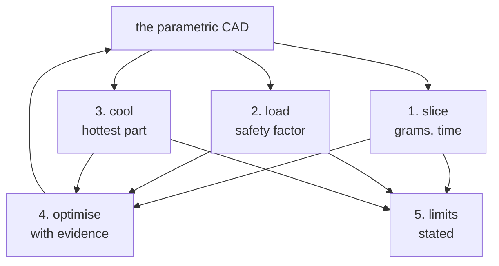

*The standard practice above as a loop: a change found by optimising is made in the parametric CAD, and steps 1-3 run
again on it.*

### Airflow and heat (`cadagent.simulation.cfd`)
`ThermalCase(name, domain, cell_mm, ambient_c)` takes CAD (CadQuery shapes, trimesh meshes or STL), in mm:
- `wall(name, shape, level)`: no-slip adiabatic obstacles (enclosure, boards);
- `solid(name, shape, material, power_w, level)`: a conducting region, optionally a heat source (`SOLIDS` table);
- `contact(a, b, thickness_mm, k)`: a thermal pad or paste as an interface resistance;
- `fan(Fan(...))`: an actuator disc with a straight-line fan curve between the datasheet's free-air flow and zero-flow
  pressure, so the operating point comes out of the simulation;
- `porous_box(name, lo, hi, d, f, e1, e2, heat_w)`: a compact fin block (Darcy-Forchheimer, nearly closed across the
  fins) that releases the heat into the air passing through it;
- `refine(lo, hi, level)`.
`write()` produces a complete OpenFOAM case (snappyHexMesh, splitMeshRegions, chtMultiRegionSimpleFoam, function
objects); `run()` runs it natively or in Docker; `results()` returns temperatures, fan flow and pressure, three
temperatures for each fan (below), the heat leaving with the air against the heat put in (`energy_balance_pct`), the
cells each fan and fin zone caught, and the limits. With adiabatic walls every watt put in must leave with the air:
when the heat leaving is more than 5 % off (`energy_check()`; 0.5 W when nothing is put in), `energy_conserved` is
False and `warnings` says so, and the temperatures are not an answer yet.

**When a result is an answer.** `converged` needs the temperatures, fan flow and heat leaving to have stopped
changing *and* the energy balance within 5 %. `steady` holds each change, over `convergence_window`, to its entry in
`convergence_limits`: under 1 °C for every temperature (each solid's hottest, a fin block's air, and each fan's zone,
inlet and outlet) and under 2 % for the fan flow and the heat leaving.

<details>
<summary>How the histories are joined across continuations, the convergence window, and how fin blocks are calibrated</summary>

Its histories cover the whole run, joined across continuations
(`restarts`, one entry per continuation; a second solve from the same saved time writes `<kind>_<time>.dat` and is read
too, one that crashed at start and logged nothing is left out, and one that stopped before its first temperature
sample still replaces the rows after its start): residuals, each solid's hottest temperature and `monitors` (fin-block
and fan air temperatures, fan flow, heat leaving), each with its unit. The window is the iterations from 80 % of the
last one onward, cut to the newest solve (after a continuation shorter than a fifth of the run, that is the whole
newest solve; after one that logged no temperature rows, there is no window and nothing is steady). Exchanger fin
blocks are set to their power by `calibrate_fins()` (secant steps on the fin temperature, only once the heat leaving
has settled; `calibrated` says whether it got there).

</details>

**A fan's three temperatures.** Each fan has an inlet and an outlet face: the faces where its zone's cells meet the
cells beyond each end, oriented along its axis. The solver logs three values on each face every 10 iterations: the
mass-flow-weighted temperature, Σφ T / Σφ (`surfaceFieldValue`, `operation weightedAverage; weightField phi;`), the
net mass flow, Σφ, and the gross flow, Σ|φ|.


*Two recorded runs (`tools/cfd_fan_figure.py`; `docs/img/cfd/SOURCE.json` holds the revision and the numbers). Here
the three temperatures agree within 0.1 K; #47 expects about 1 K with a dead hub and tip recirculation. What differs
is where the fan's air goes. The ducted fan carries the heat that leaves the room. A fan that takes back its own air
counts that air each time it passes, so `heat_carried_w` is more than the heat leaving. Its ṁ is then not the flow
through the parts upstream, and T<sub>fan</sub> − Q / (ṁ c<sub>p</sub>) does not give the air there. Both plumes
swing, and the numbers are the last iteration's. The ducted run ends on a low swing (−10.9 %), which
`energy_conserved` flags.*

| In `fans[<fan>]` | What it is | Use it for |
|---|---|---|
| `inlet_c`, `outlet_c` | Mass-flow-weighted (bulk) temperature on each face: the one whose ṁ c_p ΔT is the heat the air carries through it | Energy balances, Q = ṁ c_p ΔT |
| `inlet_kg_s`, `outlet_kg_s` | Net mass flow through each face, along the axis | The ṁ in that balance |
| `inlet_backflow_kg_s`, `outlet_backflow_kg_s` | Mass flow back through each face, against the axis | Whether the temperature is of the air or only of its net heat flow |
| `inlet_area_m2`, `outlet_area_m2` | Each face's area, as the solver summed it | A check that both ends caught the same cells |
| `heat_carried_w` | ṁ c_p (`outlet_c` − room), from `stream_heat_w()`: the net heat carried along the axis, exact whatever flows back | A check against the heat leaving (`heat_out_w`): more means the fan moves its own air again |
| `air_through_fan_c` | Volume average over the fan zone (also `zones[<fan>]['T_c']`) | How warm the fan sits, not heat: it counts still and returning air like air that flows |

<details>
<summary>How the faces are built, and their limits</summary>

- **Built in the case, computed by the solver.** topoSet takes every face whose two cells lie either side of one of
  two planes, 0.1 µm inside and 0.1 µm outside each end of the fan zone (`planeToFaceZone`, oriented from the cell
  behind the plane to the cell ahead, along the axis). It then removes every face that is not on the zone's boundary
  (`cellToFace` with `option outside`, synchronised across processors). What is left is the zone's own end faces,
  chosen by their cells, not by where they lie. Two planes are needed because a cell centred on an end plane joins the
  zone or not by rounding, and one plane would miss its column either way: on a mesh whose cell centres sit on the end
  planes, one plane caught 23–98 of 100 columns, and two catch all 100. A test on where a face lies (`searchableDisk`) checks the radius at the owning cell's centre, so where coarser
  cells meet the zone it took faces over the hub and missed the rim. Keywords are from OpenFOAM v2512's own headers in
  the `opencfd/openfoam-default:2512` image: `surfaceFieldValue.H`, `planeToFaceZone.H`, `setToFaceZone.H` and
  `cellToFace.H`. `empty-surface warn` makes a face that caught nothing write NaN, not stop the run.
- **Checked against each other.** The two ends are the ends of the same cells, so `warnings` names a fan whose
  inlet and outlet areas, or net flows, are more than 10 % apart. `zone_faces` is the solver's count of each face (an
  empty one is an `error`).
- **The fluxes are exact for the zone.** Σφ on the inlet is the air entering the zone's cells from beyond that end.
  On a snapped mesh the faces step with the cells, so their area can differ from the annulus by the mesh's own error.
  Where a cell beyond an end flanks the zone's rim, the side face between them counts too. In the run under the
  opening, 16 such faces at the rim give the outlet 2.8 % more area than the inlet's 408 faces.
- **Face values are interpolated** between the two cells either side. The solver's own energy flux is upwind, so the
  two can differ slightly where the temperature changes sharply across a cell.
- **The hub is not counted.** Air that returns through the hub of an actuator disc crosses neither face. Under the
  opening above, it shows as the fan carrying more heat than leaves the room.
- **Backflow.** Air flowing back through a face pulls Σφ T / Σφ away from the forward air's temperature, by the
  backflow over the net flow times the gap between the two streams. The value still gives the exact heat in
  ṁ c<sub>p</sub> ΔT. Past 10 % of the net flow, a warning says it is the temperature of the net heat flow, not of
  the air. At the net flow or more, or with the net flow reversed, it is `None`, because it could lie outside the air's
  own range.
- **Too little net flow to weight by** (under 1 % of the fan's free-air mass flow) gives `None` and a warning.
  `weightedAverage` divides by the net flow.
- **Old cases.** A case written before these faces has none, and continuing it does not add them: write it again.

</details>

Two choices matter for honest numbers, and both are covered by tests:
- **The open boundary is hydrostatic** (`p_rgh` uniform): still room air stays still. A uniform *static* pressure
  there drives a fake draft through the room (0.6 m/s mean in a still, unheated test room), which once made every
  J501 result optimistic. The opt-in test `test_still_room_stays_still` runs that case for real.
- **Fan and fin sources are zone totals** (`volumeMode absolute`), so the fan's pressure rise and the fins'
  conductance do not depend on how many cells the zones catch.

### Heatsinks (`cadagent.thermal.heatsink`)
`PlateFin(...)` is the analytic plate-fin model (developing laminar channel flow, fin efficiency, spreading resistance,
entrance and exit losses; sources cited in the module): `resistance(q)`, `pressure_drop(q)`, `operating_point(hs,
FanCurve)`, and `porous_coefficients()` for the CFD fin block. It runs in microseconds, so it is the tool for heatsink
studies (fin pitch, thickness, height against a fan curve), with CFD to confirm the chosen design.

### Topology optimisation (`cadagent.simulation.topopt`)
`TopOpt(lo, hi, voxel_mm, E_mpa)` with `design()`, `keep(shape)`, `void(shape)`, `fix(lo, hi)`, `load(lo, hi, N)`,
then `run(volfrac, filter_mm, overhang='+z', maxit)`: minimum compliance with SIMP, a density filter (minimum member
about twice `filter_mm`) and Langelaar's overhang filter for support-free printing, solved with MMA. `render()`,
`animate()` (density evolution) and `export_stl()` show the result. It is a design guide: turn it into ribs, pockets
or vents in the CAD and check that with FEA.

### Pictures and animations (`cadagent.simulation.simviz`)
`CFDResult(case)` loads a finished case in mm and °C. `section()`, `flow()` (streamlines), `walls()` (wall temperature
with the region past a limit in the critical colour, named in the legend), `animate_flow()` (dashes moving at the
air's speed while the camera turns), `animate_sweep()` (a section sweeping through) and `convergence_chart()` (the
whole run: the air's residuals, then one panel per monitored quantity with its unit, restarts marked, the window
`convergence` measured shaded and its change stated, a run that stopped early said so; no solids panel without solid
regions, and a panel with no data says why). Colour follows the job: one-hue ramps for temperature (orange) and speed
(blue), never a rainbow.

### Real grams (`cadagent.manufacturing.slicer`, `cad-agent slice`)
Slices each part's 3MF with Bambu Studio's command line, or PrusaSlicer's with `cad.slicer.engine: prusa`
(`cadagent.manufacturing.slicer_prusa`). Both are external AGPL programs, only ever run as a separate process.
It writes `exports/slice-report.json`: grams and time per part, the settings used and each 3MF's SHA-256, so a stale
row is told from a current one. A PrusaSlicer row also keeps what PrusaSlicer's log said, and its `ok` is false when
PrusaSlicer reports an error or a print stability issue. That is PrusaSlicer's own heuristic: an ok part can still
print badly, and a slice does not prove a part prints or fits.

<details>
<summary>Bambu Studio profiles, and the <code>cad.slicer</code> keys</summary>

Bambu Studio's system
profiles resolve `inherits`, then ordered `include` templates, then explicit child settings (unresolved profiles
can report 0 g or retain generic startup G-code). Missing, cyclic, duplicate, malformed or escaping profile
dependencies fail explicitly. `flatten(kind, name)` returns the resolved settings; `resolve_profile(kind, name)`
also returns `files`, the relative paths and SHA-256 hashes of the exact consumed bytes. Individual slice results
record those dependency hashes and the settings JSON hashes. These identities describe the captured inputs, not
ongoing filesystem stability or validation of the resulting executable G-code. Inspect actual temperature waits
and startup order before printing; a filament label or successful slice does not establish physical readiness.

Configure under
`cad.slicer`: `engine` (`bambu`, the default, or `prusa`), `printer`, `process`, `filament` (`pla`, `petg` or a
profile name), `overrides` (settings, named as that slicer names them) and `parts`: a list of the parts to slice
(default all), or a mapping of part name to `{overrides: {...}}`, that part's own settings on top of
`cad.slicer.overrides` (tall parts a brim, thin shells fewer perimeters, pin-loaded links denser infill; a part with
none: `name: {}`). Writes `exports/slice-report.json`; a row records its `part_overrides`, and changing them makes
it stale. A PrusaSlicer report records `engine: prusa`, and a report made with one slicer is not current for the
other.

</details>

<details>
<summary>PrusaSlicer: profiles, overrides, what its log says, and an example</summary>

Runs `prusa-slicer` (on PATH, or the flatpak `com.prusa3d.PrusaSlicer`).
- **Profiles:** PrusaSlicer's vendor bundles and your own saved presets, from `$CADAGENT_PRUSA_PROFILES` when set,
  else the first of `~/.config/PrusaSlicer/vendor`, the flatpak's config folder, `/usr/share/PrusaSlicer/profiles`
  and `/usr/share/prusa-slicer/profiles` that holds any.
- **Resolution:** PrusaSlicer itself resolves the three presets (`--save`, on a private copy of the profile folder),
  as its window does. A multi-tool printer such as the XL gets each filament setting once per tool, and a print or
  filament preset that does not fit the printer is refused with PrusaSlicer's reason.
- **Overrides:** PrusaSlicer names, one value each (one value applies to every tool). A key PrusaSlicer does not
  have, such as Bambu's `wall_loops`, is an error.
- **Defaults:** `Original Prusa MK4S 0.4 nozzle` and `0.20mm SPEED @MK4S 0.4`; `pla` and `petg` mean the MK4S
  Prusament profiles, so for another printer name its filament profile, e.g. `Prusament PLA @XLIS`.
- **Records:** G-code is written as text (`binary_gcode = 0`) because grams and time are read from its footer. The
  slice records the SHA-256 of its `config.ini` and of every profile file read; bundles change when PrusaSlicer
  updates them.
- **What PrusaSlicer said:** it runs with `--loglevel 3` and the whole log goes next to the G-code
  (`build/slicer/<part>/out/slicer.log`). A part that slices but will print badly shows only there, with exit code 0:
  "Detected print stability issues" (long bridging extrusions, floating bridge anchors, collapsing overhang, low bed
  adhesion, loose extrusions) or an error such as `gcode path conflicts found between WipeTower and …`. Each report
  row keeps `warnings`, `errors` (each message once), `stability_issues` (the categories PrusaSlicer names),
  `benign_log_lines` (a count of lines that say nothing about the print: a multi-tool printer's "SupportSpotsGenerator
  does not currently handle different materials" and Arachne's "Detected … Voronoi … rotated back and forth"), `log`
  and `ok`: true only with exit code 0, G-code written and no error or stability issue. Other warnings are listed but
  do not fail a part. `cad-agent slice` prints them under each part and exits 1 when any part is not ok. The
  stability check is PrusaSlicer's own heuristic, run with the settings sliced: an ok part can still print badly, and
  turning supports or a brim on may clear an issue rather than fix the geometry.
- **Limits:** the flatpak cannot read `/tmp`, so keep the project under your home folder. `export-3mf` plates carry
  no Bambu Studio project settings for a PrusaSlicer project.

```yaml
cad:
  slicer:
    engine: prusa                                        # default: bambu
    printer: Original Prusa XL - 5T Input Shaper 0.4 nozzle
    process: 0.20mm SPEED @XLIS 0.4
    filament: Prusament PLA @XLIS                        # or pla / petg (the MK4S variants)
    overrides: {perimeters: "3", fill_density: "20%"}    # PrusaSlicer names
    parts:                                               # default: every part, cad.slicer.overrides only
      tower: {overrides: {brim_width: "10"}}
      link: {overrides: {perimeters: "4", fill_density: "40%"}}
      lid: {}
```

</details>

### Overhangs and bridges (`cad-agent overhangs`)

A slicer names a stability problem ("Long bridging extrusions", "Floating bridge anchors") but not where it is. Two
screens point at the feature: `cadagent.geometry.overhang_regions` (and `cad-agent overhangs`, which writes
`exports/overhang-screen.json`) on the part's STL, and `cadagent.manufacturing.gcode.bridge_report` on the sliced
G-code.

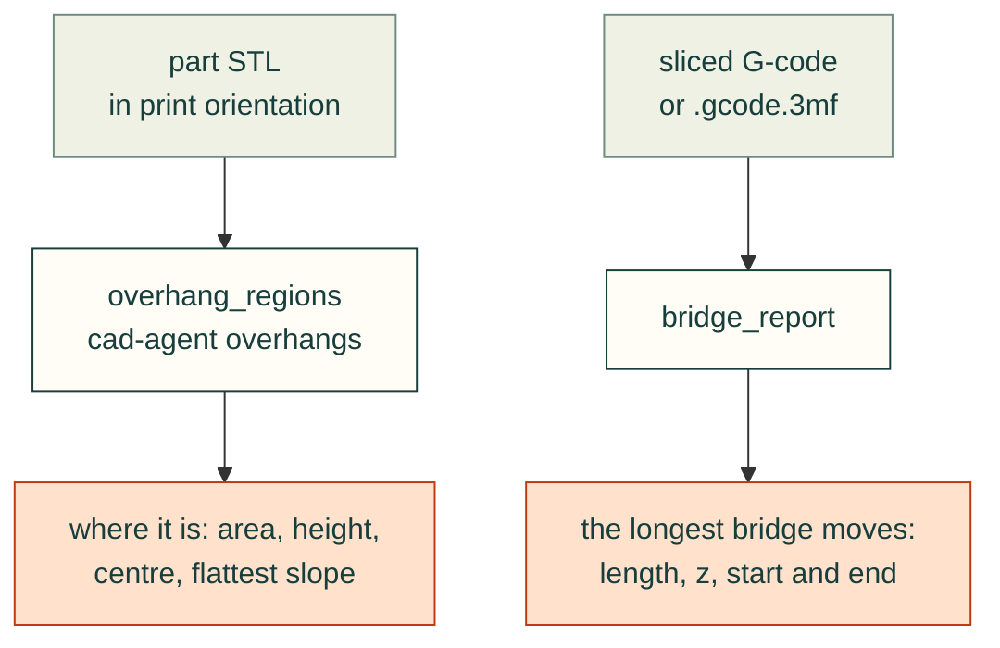

Limits: both are screens, not a slicer or a print. A bridge anchored on both sides prints fine and shows up in both;
a listed region may print well with the slicer's overhang settings and cooling, and an unlisted one can still sag.
The G-code report sees only what the slicer labelled, and a file with no labels lists nothing (`"labelled": false`).
Check the slicer preview, and a test print, before changing geometry.

<details>
<summary>Overhang regions: the angle, the regions and the JSON</summary>

**Overhang regions** (`cadagent.geometry.overhang_regions(mesh_or_path, limit_deg=45, min_area=4)`, `cad-agent
overhangs`). The angle is a face's slope from horizontal, as PrusaSlicer's support threshold and Bambu Studio's
threshold angle measure it: 0° is a flat ceiling, 90° a vertical wall, and a downward face flatter than the limit is
flagged (a face at the limit, such as a 45° chamfer, is not). Faces within 0.3 mm of the part's lowest point sit on
the bed. Flagged faces that share an edge are one region, listed largest first with `area_mm2`, `faces`, `bounds_mm`,
`centre_mm`, `flattest_deg` and `mean_slope_deg`; regions under `min_area` mm² are only counted. The regions point
at what to change: a flat ring left by a cutter's end, a cavity roof, a wall that starts above the bed.
`downward_area` gives one total, and its `max_angle_deg` is the normal's angle below horizontal (90° minus this
slope). `cad-agent overhangs` writes `exports/overhang-screen.json` (`version`, `limit_deg`, `min_area_mm2`,
`parts: {part: {stl, sha256, downward_area_mm2, regions, small_regions, small_area_mm2}}`, or `{error}` for a missing
or unreadable STL); `cad-agent overhangs PART` redoes one part and keeps the other rows when the settings match.
Needs trimesh and scipy (`sim` extra).

</details>

<details>
<summary>Bridges in the G-code: the labels, merging and arcs</summary>

**Bridges in the G-code** (`cadagent.manufacturing.gcode.bridge_report(path, n=10)`). Lists the `n` longest bridge
and overhang-perimeter extrusions the slicer labelled (PrusaSlicer `;TYPE:Bridge infill`, `;TYPE:Overhang
perimeter`; Bambu Studio and OrcaSlicer `; FEATURE: Bridge`, `Internal Bridge`, `Overhang wall`; `features=` takes
other labels), each with `length_mm`, `z_mm`, `height_mm`, XY `start_mm` and `end_mm` and the G-code `line`, and a
summary per feature. Collinear moves of one feature (split where the speed changes) are one extrusion; G2/G3 arcs
count with their arc length; M82/M83, G92, G90/G91 and G20 are followed. `path` is a `.gcode` file or a sliced
Bambu Studio `.gcode.3mf`. Pure Python. Many long bridges are internal (the first solid layer over sparse infill,
which can run the part's full width): slicer settings fix those (PrusaSlicer `solid_infill_below_area`, for one),
not geometry. A long overhang perimeter or a bridge under a feature's underside is the geometry's.

</details>

### The print release (`cad-agent release`)

What someone who wants to *print and build* the design downloads, as opposed to the review package
(`cad-agent package`), which carries the evidence. `cad-agent release [--out DIR] [--no-zip] [--revision TEXT]
[--date YYYY-MM-DD]` writes `release/<name>-rev<revision>/` (or `DIR`) and `<folder>.zip` next to it (with `--out
DIR`, the zip is `DIR.zip`):

<details>
<summary>What the release folder holds</summary>

| Path | Content |
|---|---|
| `index.html` | one standalone page (inline CSS, light and dark, no scripts, opens from `file://`): the release's parts and totals, the recommended print settings (`cad.slicer`, else those of a current slice report; with neither, the page says no slicer settings are configured), then each group of parts (with its own count, mass and time) as cards: thumbnail, quantity, material, notes, mass and time per copy, and the STEP, STL and 3MF; then the assembly pages, the hardware table and the source |
| `cad/` | `<part>.step`, `.stl`, `.3mf` from `exports_dir`, plus `extra_cad` |
| `images/` | the thumbnails |
| `docs/<project path>` | the `pages`, and the images they link to, at their project paths, so their relative links keep working; links to files the release carries elsewhere (`cad/`, `source/`) are rewritten in the copies; Markdown is also rendered to HTML (with the `markdown` package) |
| `source/<project path>` | the files matched by `include` minus `exclude` |
| `manifest.json` | `format: cad-agent.release/1`, `revision`, `date`, `git` (`commit`, `dirty`, `modified`, `untracked_released`), `slicer`, `parts` (`part`, `group`, `optional`, `pick_one`, `quantity`, `grams`, `minutes`), `build` (`title`, `parts`, `grams`, `minutes`; null without one; `grams` and `minutes` are null while any of its parts is not sliced), `warnings`, and `files` (the sha256 of every file) |

</details>

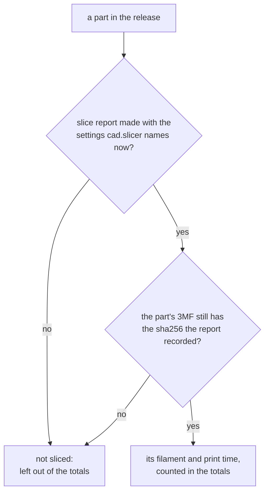

*When the release page shows a part's slicer numbers: the rule "slicer numbers only while current" below. A stale
slice is never shown as a weight.*

<details>
<summary>Rules the command enforces: inside the project only, no hidden files, current slicer numbers, honest counts, what was built</summary>

- **Inside the project only.** Every configured path and glob must be relative, without `..`; a file that resolves
  outside the project (a symlink) is skipped with a warning, and nothing is written outside the release folder.
- **No hidden or git-ignored files** from globs (`.env`, a gitignored vendor STEP; tracked files, even force-added
  ones, are kept); each skip is a warning, and so is a git error that stops the ignore check. Any file
  over `max_file_mb` (default 20) is a warning.
- **Slicer numbers only while current:** a part's mass and time are shown only when the slice report was made with
  the settings `cad.slicer` names now and the part's 3MF still has the sha256 recorded for it; otherwise the card says
  **not sliced** and the totals leave it out (run `cad-agent slice`).
- **Honest counts:** the page counts the parts in the release and each group's parts. It does not claim a number of
  pieces to print, because groups may hold alternatives (`pick_one: true`: one of two bases; its count line says
  "print one of these" instead of a total, and needs two parts or more) and optional parts (`optional: true`). With
  a pick-one group the page leaves out the filament and time over every part, which would add up the alternatives.
  For what one build takes, name it under `build`: the page's first figure is then that build's filament and time,
  at the listed quantities, while every part in it is sliced (otherwise it says "not sliced"). A build takes at most
  one part from a pick-one group; one that takes none from a group that is not optional is a warning.
- **What was built:** the release copies the working tree; uncommitted changes to tracked files are a warning and are
  recorded in the manifest (`git.dirty`, `git.modified`) and on the page; released files that are not in git at all
  are a warning too (`git.untracked_released`), since the recorded commit cannot rebuild them. The date is `--date`, `cad.release.date`,
  `SOURCE_DATE_EPOCH`, else the last commit's date; outside git with none of them it is today, with a warning, so the
  release is not reproducible across days.
- Parts in the parts file that no group lists are a warning. The folder is rewritten from scratch each run (a
  non-empty folder that is not an earlier release is refused); the zip has sorted entries with fixed dates, so the
  same files give the same bytes.

</details>

<details>
<summary>A full <code>cad.release</code> section</summary>

```yaml
cad:
  release:
    title: J501 enclosure                  # default: cad.title
    revision: 0.9.1                        # default: --revision, else cad.revision / revision_from
    groups:                                # or `parts: [a, b]`; default: every part in the parts file
      - {title: Enclosure, parts: [base, cover, rear_io], note: "Every build: one base and the cover."}
      - {title: Front plate (print one), parts: [front_gmsl, front_plain], pick_one: true}
      - {title: Drive storage, parts: [storage_35], optional: true}
    build: {title: Desktop build, parts: [base, cover, rear_io, front_plain]}   # one complete build, totalled
    quantities: {rail_key: 2}              # default 1
    material: PLA                          # default: the filament in cad.slicer
    notes:                                 # label -> text, shown on the part's card in this order
      cover: {orientation: roof down on the bed, supports: none}   # quote values that contain commas
    thumbnail: "{preview}/part-{part}.png" # the default; only {part} and {preview} (preview_dir)
    extra_cad: [exports/assembly.step]     # never vendor geometry
    pages: [ASSEMBLY.md, "docs/assembly/*"]
    hardware: docs/hardware.csv            # or a list of mappings: [{item: M3 x 10, qty: "4"}]
    include: ["cad/**", "tools/**", cad-agent.yaml, "requirements*.txt", README.md, "LICENSE*"]   # the default
    exclude: ["**/__pycache__/**", "**/*.pyc"]                                                  # the default
    max_file_mb: 20
    date: 2026-10-29
```

</details>

**Publishing.** The default `release/` folder is inside the project: add `release/` to `.gitignore`. Attach the
**zip** to the GitHub release: GitHub serves release assets as downloads and does not render an attached
`index.html`, and on its own that page's `images/`, `cad/` and `docs/` links would not resolve. Say in the release
notes to unpack the zip and open `index.html`, or publish the folder with GitHub Pages to browse it online.

## Tests

```bash
pip install -e ".[cad,dev]"
pytest
# or, with a CAD project's venv that already has cadquery, trimesh, vtk and PIL:
PYTHONPATH=src /path/to/project/.venv/bin/python -m pytest tests -q
```

The geometry and render tests skip unless cadquery and vtk are importable.

## File names and environment variables

<details>
<summary>Every file name and environment variable</summary>

| Name | What it is |
|------|------------|
| `cad-agent.yaml` | the project config at the project root; only its `cad:` section is read ([above](#the-cad-section-of-cad-agentyaml)) |
| `cad-agent <subcommand>` | the commands ([above](#commands)); `python -m cadagent.cli <subcommand>` without the console script |
| `exports/cad-agent-results.json` | the results, schema 1.0, written by `cad-agent report` |
| `docs/cad-agent-report.html` | the standalone report page (in `docs_dir`), written by `cad-agent report` with the results |
| `CAD_AGENT_PROJECT` | set to the project root for every build step and design evaluator |
| `CAD_AGENT_RENDER_ONLY` | comma-separated picture names: a `Renderer` made without `only=` renders just those |
| `SOURCE_DATE_EPOCH` | seconds since 1970-01-01 UTC: the date STEP headers, zips and report pages record ([reproducible outputs](#reproducible-outputs)); a value that is not a whole number stops the command |
| `from cadagent.<package> import ...` | the Python API ([package layout](#package-layout-v050)) |

</details>

## Holes clear

A rib, boss or skirt unioned after the holes were cut refills part of a hole. The part is still one valid
watertight solid, and fit, FEA and slice checks all pass. `cad-agent holes` (run by `all`) catches it from each part's
STEP with no declarations. A hole is a set of concave cylindrical faces on one axis whose wall reaches at least 200°
around the circle, so a rib right across a hole still leaves one, while fillets and slot ends do not count. Holes are
up to 30 mm across. Each hole is probed with a cylinder 0.05 mm inside its wall over its full depth; material inside
above 0.05 mm³ fails, with the hole's axis, diameter, depth range and the centre of the intrusion. Coaxial holes in
opposite walls are separate holes. Two same-size bores with a smaller hole through the solid between them are a
stepped bore: the **ledge** is listed for a person to confirm, not failed.

**Countersinks** (and any concave cone on a hole: chamfered mouths, drill-point tips) are checked the same way: the
cone's faces are grouped by axis, apex and angle, and probed with a truncated cone 0.05 mm inside the surface. A rib
that reaches into a countersink without touching the bore below it fails as `kind: countersink`, with the included
angle and the two end diameters; a flat-head screw would not seat there. Cones are labelled by shape: `countersink`
(truncated, 55–130° included), `drill point` (closes to its apex) or `tapered hole` (drafted holes and pockets);
material in any of them fails. `max_diameter_mm` applies to a cone's largest diameter, so countersinks over 30 mm
(M16 flat heads and up) are only checked with a larger limit, and a countersink cut beside a wall takes its largest
diameter from the notch it leaves there.

The result (`exports/hole-checks.json`) is bound to each STEP's sha256 and to the check's version and settings. A
changed STEP or a changed `cad.holes` makes it stale, and a stale result fails its row like a failing one. `cad-agent
holes PART` rechecks one part and keeps the others' rows. `--out FILE` writes elsewhere, for a reviewer who must not
change the checkout. Expect about 10 s for a large enclosure part.

```yaml
cad:
  holes:
    exceptions:                 # holes with material in them on purpose, each with its reason
      base:
        - {at: [1.25, 46.5, 62], diameter_mm: 6.6, reason: anti-rotation flat for the RP-SMA bulkhead (D-hole)}
        # at: a point on the hole's axis (part coordinates); radius_mm: how far from the axis it may be (default 0.5)
    skip: {gasket: printed in TPU without fastener holes}   # parts not checked, with the reason
    # tol_mm: 0.05, min_volume_mm3: 0.05, min_arc_deg: 200, max_diameter_mm: 30
```

Limits:
- Only cylindrical and conical (countersink) holes are checked, not polygonal or helical-thread geometry. Only
  material inside the hole's own wall is measured, not tool or screw-head clearance beyond it.
- **Known misses.** A hole capped at one end by a later feature reads as a blind hole. A counterbore blocked right
  across, with a smaller hole cut through the block, reads as a ledge. Look at the listed ledges and the blind holes
  in a section view.
- A block from one side that covers half the hole or more over its full depth leaves too little wall to count as a
  hole; it reads as a slot end. Look at blocked holes in a section view.
- Concentric openings under 30 mm that are not holes fail: a small fan guard's rings, or a recess around a post. List
  them as exceptions. [common-issues.md](common-issues.md) lists this check with the other recurring review findings.
