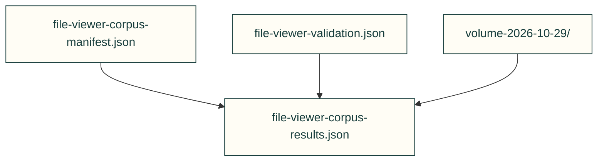

# Recorded validation receipts

Dated validation records bind specific source and tool inputs. They are historical observations, not current production or physical acceptance.

| File or folder | Purpose |
|---|---|
| [file-viewer-corpus-manifest.json](file-viewer-corpus-manifest.json) | Source identity and corpus item inventory. |
| [file-viewer-corpus-results.json](file-viewer-corpus-results.json) | Recorded corpus results bound to that manifest. |
| [file-viewer-validation.json](file-viewer-validation.json) | Earlier browser validation receipt. |
| [volume-2026-10-29/](volume-2026-10-29/) | Dated numeric precision outputs; owned as one evidence collection. |

[Parent map](../README.md)
