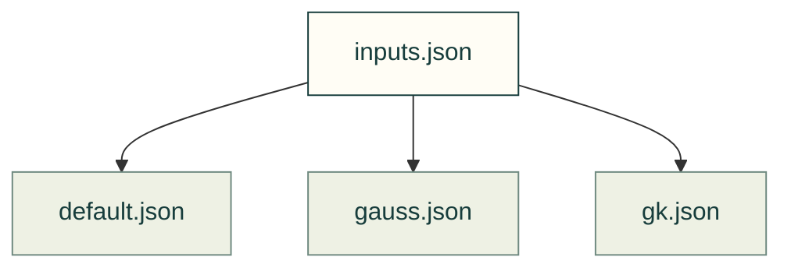

# Volume precision — 2026-10-29

Immutable observations from the dated volume-precision comparison. They describe those inputs and methods, not a current acceptance run.

Files and sources

| File or folder | Purpose |
|---|---|
| [inputs.json](inputs.json) | Recorded comparison inputs. |
| [default.json](default.json) | Recorded default-method output. |
| [gauss.json](gauss.json) | Recorded Gauss-method output. |
| [gk.json](gk.json) | Recorded Gauss–Kronrod-method output. |

[Validation index](../README.md) · [Method and limits](../../practice/volume-precision.md)
