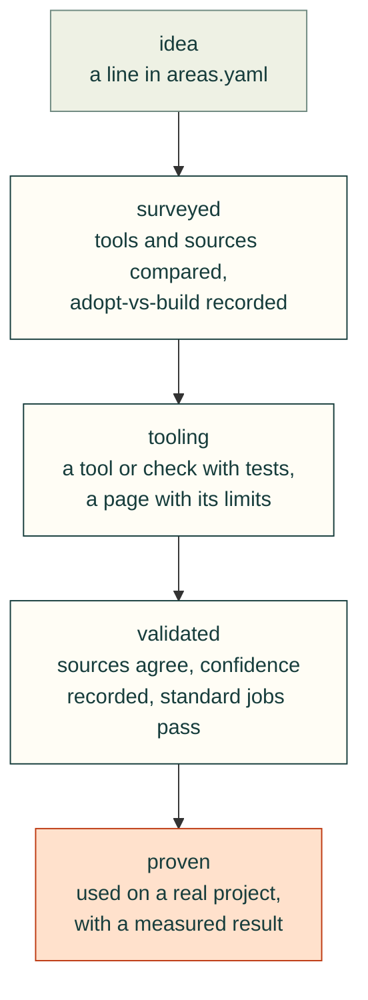
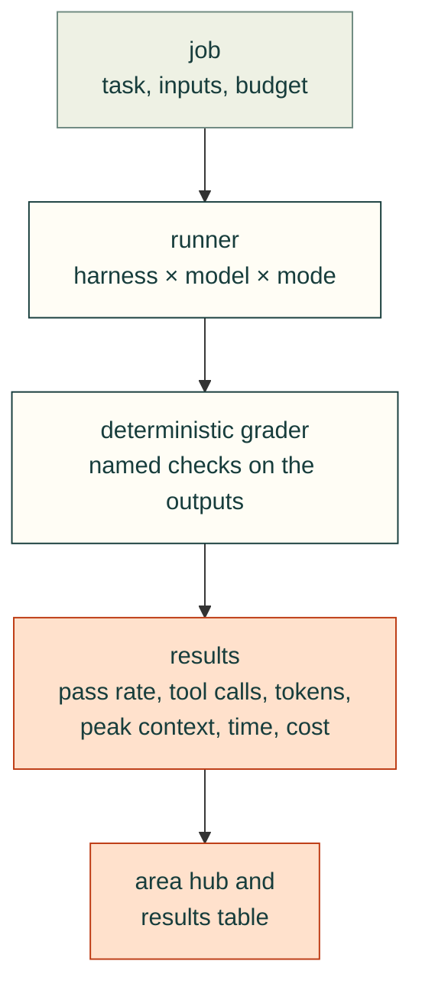
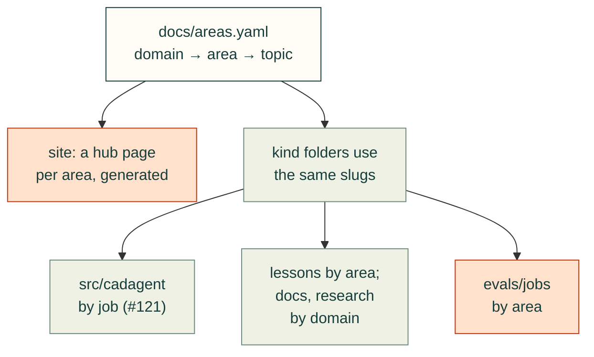

# Vision and structure

cad-agent grows into a well-ordered map of hardware design. It covers mechanisms and enclosures, manufacturing
processes, thermal design, simulation, and electrical work from harnesses to test systems. Every area sits at its own
stage of maturity, and each has tools, checks, lessons, cited research and standard example jobs. Those jobs measure
which models and agent harnesses can do the work, and whether our tooling helps or gets in the way. Tracking: #139.

The structure comes first so that many areas can grow in parallel without a reorganisation later. The work itself
still goes where it is needed first: what [Gyropup](https://github.com/Valpatel/gyropup) needs to become real, then
what makes good demos and videos.

## Requirements

Any layout, page format or tool added here should serve these:

- **One clear hierarchy by topic:** domain → area → topic. One file names them all, [`docs/areas.yaml`](areas.yaml).
  The tree is a starting point, not a lock; areas are added, split or merged as the work shows where the seams are.
- **Many parallel paths at different maturity.** An area can exist as a single line before anything is built, so work
  has a place to land and readers can see what is missing.
- **Deterministic tools, validated.** We adopt good open-source tools first and build only for the gaps. Every tool
  and rule carries a confidence level, which may be an estimate, backed by its sources and by results from our own
  projects.
- **A standard evaluation.** Example jobs per area, each with a deterministic grader, run across models, harnesses and
  local models, with and without cad-agent. The results are real numbers.
- **Discovery in few steps.** A person or an agent finds the right tool for a problem in the fewest calls and the
  least context. This is the long-term aim; today it is enough not to work against it.
- **Honest limits.** CAD, calculation and simulation narrow a design down; they do not prove that a part fits or
  holds. A measured print does. Pages say which one they rest on.

## The topic tree

The full tree, with what already exists for each node, is [`docs/areas.yaml`](areas.yaml). The site will generate a
hub page per area from it (#141). In outline:

| Domain | Areas |
|---|---|
| Mechanical design | mechanisms, housings and enclosures, compliant mechanisms, gears, belt and chain drives, wheels and driving, walking, fasteners, bought hardware and assembly, fixtures and jigs (pogo-pin PCBA test fixtures, general fixtures), mould design |
| Manufacturing | 3D printing, CNC machining, laser cutting (plastics, metals), sheet metal, mould making (silicone moulds, urethane casting) |
| Thermal | conduction and heat sinks, airflow and fans, thermal validation |
| Simulation and validation | structural FEA, CFD, motion and dynamics, topology optimisation, design exploration, results and visuals, physical tests and coupons |
| Electrical design | electrical panels, wiring harnesses, circuit boards (breakout, adapter, pass-through tap, power converters, relay boards, DAQ and signal conditioning), test systems (HIL simulators, test benches on extrusion frames) |
| Practice | agent process and workflow, design process, review and evidence, publishing, evaluation |

Practice cuts across every domain: how agents work, review and publish here.

## Maturity: how an area grows

Each domain, area and topic records one maturity level. It moves up only when the evidence for the next level exists.

Most areas start at `idea` on purpose. A hub page that says "idea, nothing built yet" with its issue is more useful
than an area nobody can find.

Areas and topics are judged on their own evidence, and an area is never rated below its most mature topic. A domain
takes the highest level among its areas. That says how far its best-developed area has got, not the domain as a whole,
so its hub shows every area's level beside it. `tests/test_areas.py` checks both rules.

## Confidence on tools and rules

This is planned, not built (#143). Every tool and rule will get a confidence level and the evidence behind it. The
level will be stored with each rule, in the reference registry (#118, draft PR #119) and the process profiles (#99),
and with each tool in the catalogue.

The estimate is the chance that the tool or rule gives a right answer, within its stated tolerance, for inputs inside
its stated limits. It rates one tool or rule. It is not a probability to multiply or average along a chain of tools,
because their errors are not independent.

| Level | Rough estimate | Evidence |
|---|---|---|
| `high` | ≈ 0.9 | Two or more independent primary sources agree, tests reproduce their worked examples and, for a physical claim, a measured result exists |
| `medium` | ≈ 0.7 | One primary source with reproduced examples, or several secondary sources that agree |
| `low` | ≈ 0.4 | A single secondary source, a search snippet, or untested judgement |
| `unknown` | — | Not assessed yet; still written down, so a missing rating is a visible choice |

## Evaluation framework

Standard jobs answer two questions with numbers: which models and harnesses can do which jobs, and how cad-agent's
tooling changes the result (#142; related #39).

Nothing here exists yet: no `evals/` folder and no runner. This is the plan #142 builds from.

- **Survey first.** Before building a runner, #142 will survey existing evaluation harnesses and CAD benchmarks (some
  are already listed in `research/landscape.json`) and record adopt-vs-build, as for any new capability.
- **Jobs** will live at `evals/jobs/<domain>/<area>/<job>/`: the task as the user would write it, input files, a time
  and token budget, and a reference solution that passes.
- **Graders** will be code, not opinions. They measure geometry, read `cad-agent` check results, or compare numbers
  within a stated tolerance. Each says what it cannot see.
- **The runner** will try a job with a harness (Claude Code, Codex, Hermes and others) and a model (hosted, or local
  through a configurable endpoint). It runs in two modes: `bare` (no cad-agent) and `kit` (cad-agent and its skills
  installed).
- **Credentials:** each run gets a fresh sandbox holding only what the model needs. That is the hosted model's API
  key, passed in for that run alone, or a local endpoint's address. Repository and GitHub tokens, deploy keys and any
  other secrets stay out.
- **Results** will be one JSON line per run, summarised as pass rates with intervals over repeated runs. The same
  runner will measure discovery: how many calls and tokens it takes to reach the right tool.

## Discovery

The long-term aim is that a person or agent reaches the right tool from the site root or `llms.txt` in about three
steps: root, then the area hub (a small page and its Markdown twin), then the tool's page or `cad-agent` command. The
pieces:

- **Area hubs** (#141) list each area's tools with their confidence, pages, lessons, research, skills, jobs, real
  projects and open issues.
- **Machine-readable indexes:** `catalog.json` gains an `area` on every entry; `areas.json` mirrors the YAML; and
  `llms.txt` groups pages by domain (#106).
- **Every folder** has a README and a map (#113).

We will measure this with the runner rather than guess, and not over-optimise it before there is data.

## Folder design

Recommendation: **one taxonomy, kind folders that share its slugs, and generated area hubs.**

- **The kind folders keep their jobs:**
  - `src/cadagent` is grouped by job (geometry, sim, make, publish; #121), because one tool serves many areas. FEA
    checks a leg frame and a lid alike.
  - `skills/` and `agents/` stay flat, because harnesses install them by name.
  - `lessons/` is grouped into six folders (#133). They are broader than single areas, so for now the `lessons:`
    field maps each folder to the node that owns it. Renaming them to taxonomy slugs waits for #145's batches, once
    the taxonomy has settled.
  - `docs/` and `research/` gain domain folders once an area has a few pages (#145).
  - `evals/jobs/` is laid out by domain and area from the start.
- **The taxonomy ties them together.** Each node lists its pages, commands, modules, skills, lessons and issues, and
  the site generates one hub per area. Browsing by topic costs no file moves.

**Why not topic-first folders** (`areas/<domain>/<area>/` holding the code, lessons, research and jobs together)?

- Python code cannot be split by topic without duplicating shared tools.
- Harnesses need skills in one flat folder.
- Code, prose and data have different tests and review rules.
- Cross-cutting content (fasteners, FEA, the review process) would need a home in many places at once.
- It would undo #121's and #133's fresh moves.

The hubs give the topic-first view without those costs.

## Migration path

Existing content moves in small batches, never in one big reorganisation (#145):

1. **Now:** the taxonomy places every existing page, command, skill, agent and lesson folder. A test fails when a new
   one is not placed, so the map cannot fall behind. A PR that adds one adds its line to `docs/areas.yaml` (the rule is
   in CONTRIBUTING.md, AGENTS.md and the PR template). When two open PRs cross, the one that merges second adds it,
   after merging dev and re-running its CI, because dev does not require branches to be up to date.
2. **After #123, #124 and #133:** the site generates the area hubs and `areas.json` (#141).
3. **Before the first move:** `tools/build-site.mjs` publishes only top-level `docs/` and `research/` pages today. Its
   docs and research sections must be widened by one domain level, as #133 widened the lessons section, or a moved
   page would get no site page and its redirect would point at nothing.
4. **Then, batch by batch:** `docs/` and `research/` pages move into domain folders when their area has three or more
   pages, or when a page is being edited anyway. Each move follows the #133 pattern:
   - a `<!-- moved-to: … -->` stub at the old path, kept for one minor release;
   - a line in the site's permanent redirect list, kept for good;
   - every reference updated;
   - a README and map for the new folder (#113).
5. **As jobs land:** `evals/jobs/` fills in area by area, starting with areas at `tooling`, since those have something
   to measure.

## Priorities

1. **Gyropup first** (#144, in the order of Valpatel/gyropup#31):
   - motor mounts for the RS-04 leg actuators and the 3115 flywheel motors (mechanisms; fasteners, bought hardware and assembly;
     3D printing);
   - the first leg: five-bar kinematics (walking, with #137's equations), frame and bearing strength (structural FEA),
     the wheel interface (wheels and driving), and cable routing (wiring harnesses);
   - the carrier and turret (circuit boards, wiring harnesses, heat sinks, housings);
   - covers with snap and compliant features (compliant mechanisms).
2. **Demos and videos:** interactive simulations and animated figures (#137, #136), linkage and gait animations, and
   FEA, CFD and topology renders.
3. **Everything else** grows in parallel at its own maturity, from the issues filed against its area.

The `priority` flags in [`docs/areas.yaml`](areas.yaml) mark these areas, so hubs and tools can sort by them.
