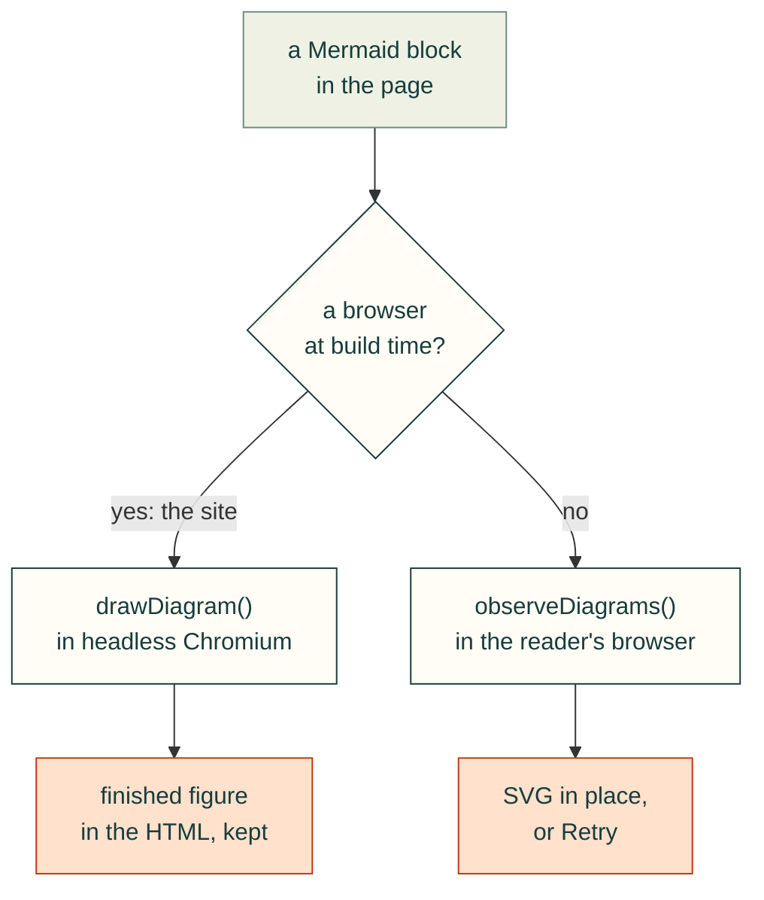

# Mermaid diagrams in published documents

`webkit/diagrams.js` exports `renderDiagrams(root=document)`, `observeDiagrams(root=document.body)` and `drawDiagram(source, options)`. The observer renders existing and subsequently inserted `pre > code.language-mermaid` and `pre.mermaid` blocks. Its `dispose()` disconnects observation; removed nodes never receive a late result. Include `diagrams.css` before the module so pending source is represented as a loading indicator instead of flashing code.

Mermaid 11.17.2 is pinned and self-hosted in `vendor/mermaid`, with its MIT license and SHA-256 receipt (`SOURCE.json`: the npm tarball, its integrity and each file's hash). The helper loads it only when a diagram needs drawing. It uses explicit queued render calls, strict security mode, generic fonts, unique SVG identifiers and isolated error/retry feedback. Source is available in a closed disclosure; a failed graph cannot remove other diagrams. No CDN connection is required. A runtime load has a 20-second bound; a retry issues a fresh request.

Set `data-diagram-theme="light"` or `"dark"` on a containing element to match the actual page surface. Otherwise CSS `color-scheme` then the system preference determines the theme at insertion. Existing diagrams are not recolored by an unrelated theme toggle. Large diagrams retain readable text and scroll inside their own keyboard-focusable region. A visible sideways-scroll hint appears only when the graph overflows. The stylesheet decides this from the drawing's width (`--cad-diagram-w`) and the figure's, so it also works without script and keeps up with resizing. Tests scroll to the rightmost semantic node on phones and desktop.

The Python site builder ships these assets in `site/assets` and initializes the observer on every generated page. Bootstrap failures show a reload control; runtime and syntax failures show an individual retry control. Browser tests require actual visible SVG geometry and semantic labels, hidden default source, dynamic rendering, both themes, phone overflow containment and failure recovery. Merely finding a Mermaid fence in generated HTML is not evidence that it rendered.

## How a diagram gets onto the page

On this site, the build draws it (#132). On a project's own pages, and wherever no browser was at hand to build with, the reader's browser does.

## Drawn at build time

Drawn in the reader's browser, a diagram near the top of a page moved the text twice as it loaded: once when its placeholder went in, again when the drawing settled. The layout shift was up to 0.58 on a phone (`/lessons/process/agent-process`), against Google's "good" limit of 0.1. So the site build draws every diagram itself, with the kit's own `drawDiagram`, in the headless Chromium the browser tests use. Each page then arrives with `<figure class="cad-diagram" data-state="ready">`: the SVG, sized, with its source in the disclosure. Nothing moves while it loads, it shows without script, and no page downloads Mermaid. The Markdown twin keeps the Mermaid fence for agents.

- **The same bytes every time:** the SVG id is a hash of the source, theme, Mermaid build, kit and font. Each drawing gets a fresh Mermaid instance, because sequence and class diagrams number their elements with counters that run on from one drawing to the next, and Math.random is seeded. Every diagram is drawn twice and kept only if both match. Labels are measured in the site's own webfont, not in the build machine's Arial: Inter, which every reader downloads, at 15px. That reads at the size of 16px Arial and keeps each diagram as wide as before. A test builds the site twice with empty caches and compares every page byte for byte.
- **Themes:** the build draws in the page's `data-diagram-theme` (the site is light). If the page's theme turns out different, `observeDiagrams` draws that figure again in the right theme. A dark or HUD page drawn in the browser works as before.
- **Cached:** figures are kept in `.cache/site-diagrams/` under that hash (`CAD_AGENT_DIAGRAM_CACHE` moves it). A rebuild draws only what changed, and a warm cache needs no browser.
- **Safe:** Mermaid draws in strict mode, and a drawing with a script, an event handler or a `javascript:` link is refused. The pages keep the site's CSP: no inline script, and inline styles are allowed as before.
- **Never fatal:** with no Chromium (`npx playwright install chromium`, or Google Chrome), or with `--client-diagrams`, the build says so and leaves the blocks for `observeDiagrams`, as before. The same happens to a diagram Mermaid cannot draw. `npm run deploy:site` deploys either way.

Measured in Chrome, once every diagram had finished: the sum of the layout shifts while the page loaded, median of three loads. WebKit does not report layout shifts.

| Page | 360 px before | 360 px after | 1366 px before | 1366 px after |
|---|---|---|---|---|
| `/lessons/process/agent-process` | 0.576 | 0 | 0.272 | 0 |
| `/docs/style-guide` (3 diagrams) | 0.088 | 0 | 0.098 | 0 |
| `/docs/vision` (3 diagrams) | 0 | 0 | 0 | 0 |
| `/docs/toolkit` | 0 | 0 | 0 | 0 |

Before, 53 of the 106 page-and-width cases with a diagram scored 0.1 or more. After, the worst of all 106 is 0.012. On `/docs/toolkit` and `/docs/vision` the diagrams sit below the first screen, so their shift no longer counts: a layout shift only counts what moves on screen. The browser test holds every page with a diagram under 0.05 at 1366 px, and these four at 360 px as well. On them it also checks that each diagram shows without script, at the same size as with script.
