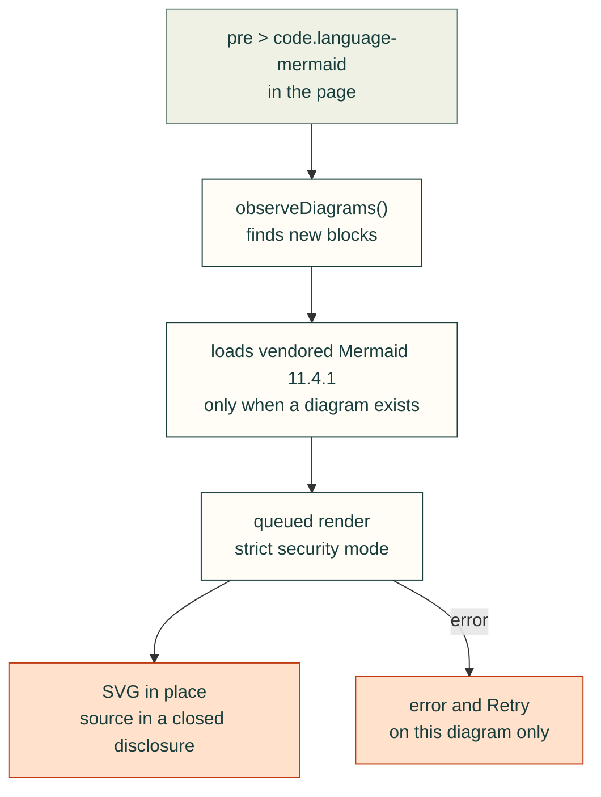

# Mermaid diagrams in published documents

`webkit/diagrams.js` exports `renderDiagrams(root=document)` and `observeDiagrams(root=document.body)`. The observer renders existing and subsequently inserted `pre > code.language-mermaid` and `pre.mermaid` blocks. Its `dispose()` disconnects observation; removed nodes never receive a late result. Include `diagrams.css` before the module so pending source is represented as a loading indicator instead of flashing code.

Mermaid 11.4.1 is pinned and self-hosted in `vendor/mermaid`, with its MIT license and SHA-256 receipt. The helper loads it only when a diagram exists. It uses explicit queued render calls, strict security mode, generic fonts, unique SVG identifiers and isolated error/retry feedback. Source is available in a closed disclosure; a failed graph cannot remove other diagrams. No CDN connection is required. A runtime load has a 20-second bound; a retry issues a fresh request.

Set `data-diagram-theme="light"` or `"dark"` on a containing element to match the actual page surface. Otherwise CSS `color-scheme` then the system preference determines the theme at insertion. Existing diagrams are not recolored by an unrelated theme toggle. Large diagrams retain readable text and scroll inside their own keyboard-focusable region. A visible sideways-scroll hint appears only when the graph overflows, and updates after viewport resizing. Tests scroll to the rightmost semantic node on phones and desktop.

The Python site builder ships these assets in `site/assets` and initializes the observer on every generated page. Bootstrap failures show a reload control; runtime and syntax failures show an individual retry control. Browser tests require actual visible SVG geometry and semantic labels, hidden default source, dynamic rendering, both themes, phone overflow containment and failure recovery. Merely finding a Mermaid fence in generated HTML is not evidence that it rendered.

## How a diagram gets onto the page

This diagram is drawn by the helper it describes.

