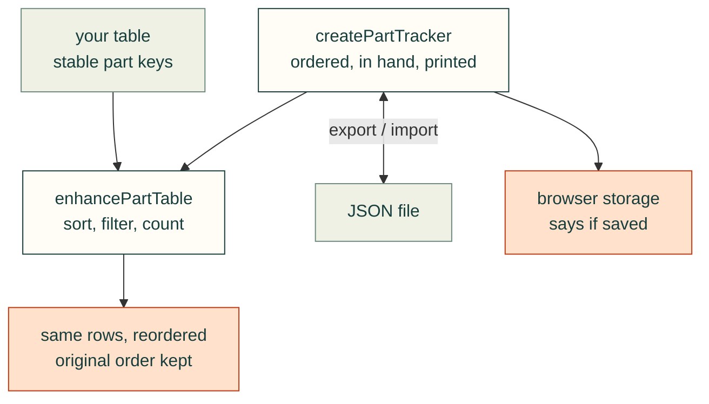

# Shared parts browser and build tracking

Shared modules for [issue 62](https://github.com/Valpatel/cad-agent/issues/62). The table/tracker implementation is available on the feature branch; the original-file viewer is being implemented alongside it.

The webkit will provide reusable sortable part tables, browser-local build status, and direct interactive viewing of STL, STEP and 3MF files. Projects supply their own catalogs, images, engineering context and downloads. Checking a status box never places an order.

The table must preserve stable part identities through sorting and filtering, sort numbers numerically, retain unknown values, support keyboard and touch use, and explain whether state was saved. Exported state must identify its project and schema; invalid or unrelated imports must not overwrite current progress.

The viewer must display geometry from the selected original file, fit its bounds, support fine wheel/pinch zoom and orbit/pan, and retain an original-download link. Loading and parse failures must remain readable and recoverable. CAD parsing must not freeze the interface. Format, units and triangulation limitations belong in the integration documentation and evidence.

Acceptance evidence includes generic fixtures, actual project files, narrow/landscape layouts, numeric/text sorting, persistence and import/export, malformed/stalled responses, invalid geometry, and the existing viewer/packaging checks. CAD display does not certify fit, manufacturability or physical safety.

This feature is developed on `feat/web-parts`, targeting `dev`. Gyropup may test the feature worktree while its PR is open, following CONTRIBUTING.md. Toolkit integration and release still follow the repository's review and explicit merge-instruction rules.



## Tables and status

Include `part-table.css`, then progressively enhance a semantic table. Keep numeric source values in `data-sort-value` rather than asking the component to guess units, pack quantities or currency from display text. Unknown values use an empty sort value and remain last in either direction. Put totals in `tfoot` (or mark a body total `data-fixed`).

```html
<div id="progress"></div>
<div class="cad-table-scroll"><table id="parts">
  <caption>Frame parts</caption>
  <thead><tr><th data-sort="text">Part</th><th data-sort="number">Cost</th></tr></thead>
  <tbody><tr data-part-key="frame/bracket" data-part-label="Bracket">
    <td>Bracket</td><td data-sort-value="12.5">$12.50</td>
  </tr></tbody>
</table></div>
```

```js
import { createPartTracker } from './kit/part-tracker.js';
import { enhancePartTable, mountProgressTools } from './kit/part-table.js';
const tracker = createPartTracker({ project: 'my-project' });
const tools = mountProgressTools(document.getElementById('progress'), tracker);
const table = enhancePartTable(document.getElementById('parts'), {
  tracker,
  statuses: [{ id: 'ordered', label: 'Ordered' }, { id: 'inHand', label: 'In hand' }],
});
// Before replacing the table or navigating within a single-page application:
table.dispose(); tools.dispose(); tracker.dispose();
```

`enhancePartTable` supplies visible header sort buttons, `aria-sort`, an alternate native sort selector, text search and visible row counts. It preserves the row nodes and original order. Sorting/filtering never changes a part's tracking identity. Each trackable table requires unique `data-part-key` values; use stable project identifiers, not the row index or translated display label. Different tables may intentionally share an identity and tracker.

`createPartTracker({project, fields, storage, events})` defaults to `ordered`, `inHand` and `printed`; projects may configure other Boolean fields. Its API provides `get`, `set`, `subscribe`, `export`, `import` and `dispose`, plus `persistent` and `warning`. Statuses are independent: an already-owned part can be in hand without being ordered. Storage is scoped by project and schema version, and valid cross-tab updates synchronize. Blocked storage or a full quota preserves in-tab changes and shows an export reminder instead of claiming a save.

Imports validate the entire file before changing anything, require the same project/schema and configured Boolean fields, then merge by part identity. Explicit imported false values replace the corresponding field; unrelated parts/fields remain. Files are limited to 10,000 parts and 2 MB, including after merging, so exported state remains importable. No server, account, order submission, inventory quantity reconciliation or multi-user conflict resolution is supplied.

## Validation

Run `npm ci`, `npm run test:webkit-unit`, and `npm run test:part-table`. Set `PLAYWRIGHT_CHANNEL=chromium` for the installed Playwright browser or `PLAYWRIGHT_BROWSER=webkit` for WebKit. The browser harness exercises native controls, correct numeric and natural text sorting, unknown values, filter counts, row identity, reload/cross-tab persistence, atomic import, actual file download, blocked storage and four phone/tablet layouts. Unit cases cover validation and state-file limits. These checks do not certify arbitrary application styling or other projects' part identifiers.
