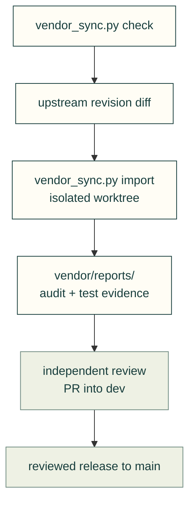

# Weekly upstream update

A maintainer compares pinned upstream revisions, reviews the diff and evidence, then proposes a normal reviewed PR. Updates never bypass the integration or release gates.

The arrows show the files and review steps in an upstream update.

1. Run `python tools/vendor_sync.py check`. It lists moved upstreams without downloading code.
2. For each candidate, inspect its upstream revision and release notes before running it. Start a separate `feat/` worktree from current `origin/dev`, claim its issue and open an early draft PR ([contributing](../.github/CONTRIBUTING.md)). Run `python tools/vendor_sync.py import <name>` there; never import into someone else's checkout or a protected branch.
3. Read the generated `vendor/reports/<name>-<sha>.md` and the complete diff. Explain every new HIGH finding. Inspect network calls, subprocesses, telemetry, dependency changes, install hooks and license changes. Reapply only the patches still needed.
4. Run the relevant sandboxed tests and engineering evaluation cases for the changed integration. Record commands, results and limits; an import audit is not evidence that the tool works on our models. Long runs use the maintainer compute workflow.
5. If the evidence supports adoption, run `python tools/vendor_sync.py accept <name>`, commit the report and registry changes, and obtain independent review plus required CI. Merge through `dev`; releases reach `main` through the release PR and gates. An `accept` command records the reviewed security fingerprint baseline; it does not merge the update.
6. Record the outcome in the normal CHANGELOG fragment and the issue. Offer generally useful patch fixes upstream only when authorised to contact others.

The earlier root-level procedure incorrectly described merging directly to `main`; this page follows the current [branch and gate rules](../.github/CONTRIBUTING.md#gates). The registry lives at [upstreams/registry.yaml](../upstreams/registry.yaml); the source tool's docstring states what import and accept actually change.

[Guides](README.md) · [Tools](../tools/README.md) · [Supply chain](supply-chain.md) · [Repository](../README.md)
