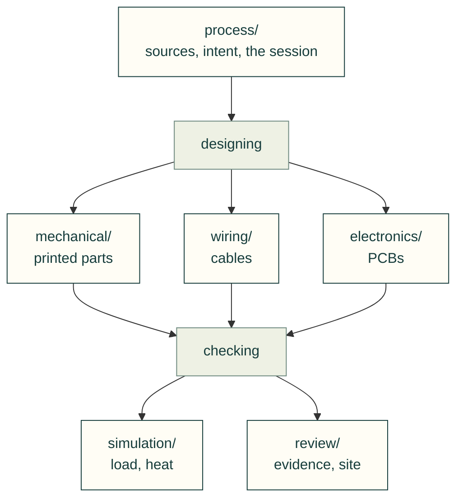

# Lessons from the J501 enclosure session

Lessons for an AI hardware-design agent, mined from **one** Claude Code session: the J501 AGX enclosure design
session (session `d8e464a0-f4a5-4edd-9190-6fd66a0508b0`, 2026-10-24 to 2026-10-25). In that session the agent and the
user designed a 3D-printed enclosure for a Seeed reServer J501 carrier with a Jetson AGX Orin module, plus storage
trays, SATA cable routing and a review website. No other session histories were mined; the user asked for this one only.

## How they were mined

- **Input:** a scrubbed, chronological transcript produced by `mining/extract_session.py`. It keeps only the prose of
  user messages, mid-turn user messages and assistant replies. Tool calls and tool output are left out. Personal data
  (addresses, paths, hostnames) is replaced with placeholders such as `<ip>` and `<scratch>`.
- **Gaps in the transcript:**
  - Context was compacted at 2026-10-24T08:35. A summary covers the 07:00–07:41 work.
  - The session restarted between 2026-10-24T18:03 and 2026-10-25T00:31. Most of the storage-tray, chimney and
    standoff work happened in that window, so it appears only in later assistant summaries.
- **Cross-check:** facts were confirmed read-only against the project files `README.md`, `cad/parameters.json` and
  `exports/*.json`. When a lesson relies on a project file, its **Source** line names the file.
- **What counts as a lesson:** user corrections, requirements as the user stated them, assumptions that turned out
  wrong, checks that caught real bugs (or raised false alarms), and process choices the user endorsed or pushed back on.
- **Limits:**
  - Nothing in this session was printed, sliced or test-fitted. Lessons about fit describe design intent and CAD checks,
    not physical validation.
  - Where the brief for this mining run mentioned an incident that could not be found in the transcript or the project
    files, the lesson says so rather than inventing details.

The [review](review/) area's review-site lessons also include an explicitly attributed later CAN-project wheel-zoom
follow-up (2026-10-27). The [electronics](electronics/) lessons come from a different project: the incident notes of a
CAN breakout PCB and housing designed on 2026-10-26. Their Source lines name those notes, which stay in that
project's repository.
The [simulation](simulation/) area's [meshes](simulation/meshes.md) lessons come from Gyropup's hip-frame and
front-link FEA studies (October 2026, Valpatel/gyropup#29), as written up for the toolkit in #144.
The mechanical area's [printing-without-supports](mechanical/printing-without-supports.md) lessons, and the last two
[agent-process](process/agent-process.md) lessons, come from a Claude Code session on 2026-11-01 that designed a 1/8
Cat 323 excavator (46 parts for a Prusa XL 5T) and sliced every part with no supports and no stability warning
(#253). That project is in the user's private repository; its Source lines name its files. It was not printed in the
session either.

## Areas

The lessons are grouped by the part of the work they apply to. Each area has a README with its own map; a new area
(sheet metal, printing) starts when its first lessons arrive.



| Area | Files | Lessons on |
|---|---|---|
| [process/](process/) | [verify-from-source](process/verify-from-source.md), [user-intent-and-requirements](process/user-intent-and-requirements.md), [agent-process](process/agent-process.md) | Facts from the board's sources, the user's requirements, how a long session runs |
| [mechanical/](mechanical/) | [design-rules](mechanical/design-rules.md), [fasteners-and-assembly-access](mechanical/fasteners-and-assembly-access.md), [enclosure-features](mechanical/enclosure-features.md), [printing-without-supports](mechanical/printing-without-supports.md) | Strength and printability, screws and assembly order, what the enclosure carries, printing without supports and reading slicer warnings |
| [wiring/](wiring/) | [cables-connectors-and-routing](wiring/cables-connectors-and-routing.md) | Mated-plug windows, routes, bend radius, wiring rules |
| [electronics/](electronics/) | [pcb-evidence-and-review](electronics/pcb-evidence-and-review.md) | KiCad evidence, routing geometry, STEP handedness, release packaging |
| [simulation/](simulation/) | [simulation-and-material](simulation/simulation-and-material.md), [meshes](simulation/meshes.md) | Bought parts, slicer grams, thinner shells, thermal models, shared compute, meshes and mesh-dependent peaks |
| [review/](review/) | [verification-and-evidence](review/verification-and-evidence.md), [review-site-ux](review/review-site-ux.md), [original-file-viewer](review/original-file-viewer.md) | Checks and honest claims, the review site, original-file previews |

The old numbered files (`01-verify-from-source.md` … `12-original-file-viewer.md`) are one-line stubs pointing here
until v0.6.0, and the site redirects their pages.

## Lesson format

```markdown
### <short rule, imperative>
- **Rule:** one or two sentences, usable on any project.
- **Incident:** what happened in this session (specific and factual; brief user quotes where they matter).
- **Check:** how an agent or tool verifies it (a concrete check, threshold or artefact).
- **Source:** transcript timestamp(s) such as 2026-10-24T16:35, and/or a project file.
```

Timestamps are UTC as they appear in the transcript, truncated to the minute. Part numbers (P1, P9, P15 and so on)
are the project's printed-part IDs.

## Later rendered-motion incidents

The 2026-10-28 Gyropup pivot validation lesson is maintained in
[the rendered-motion domain](../.agents/domains/rendered-motion.md), with a
[symptom index](../.agents/SYMPTOM-INDEX.md). It is not part of the original J501 transcript mining.
