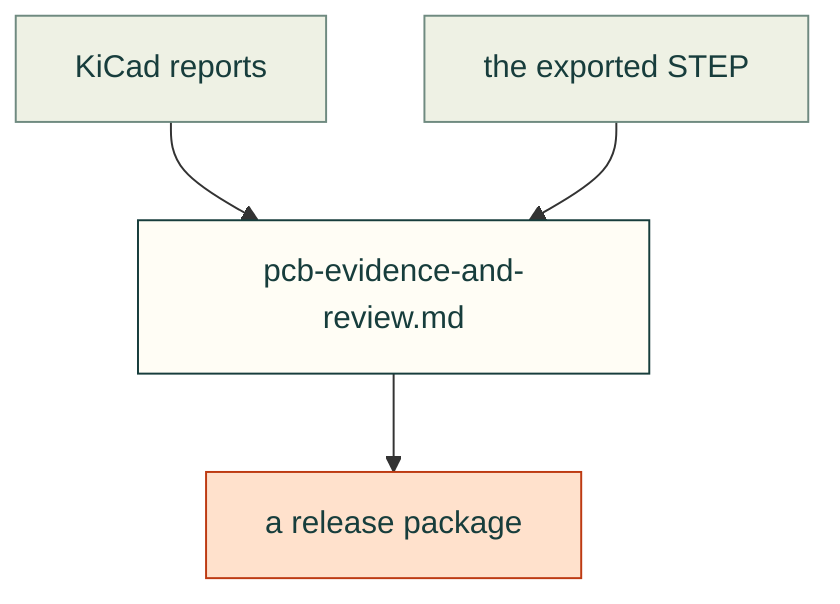

# Lessons — electronics

PCB evidence, the board in its enclosure, and release packaging. From a second project, a CAN breakout board and housing (2026-10-26); its Source lines name that project's incident notes.

| File | Lessons on |
|---|---|
| [pcb-evidence-and-review.md](pcb-evidence-and-review.md) | KiCad report severities and waivers, parity, source hashes, routing geometry, STEP handedness, readback renders, release allowlists |

Each lesson follows the [lesson format](../README.md#lesson-format): a rule, the incident, a check and its source. Back to [all lessons](../README.md).
