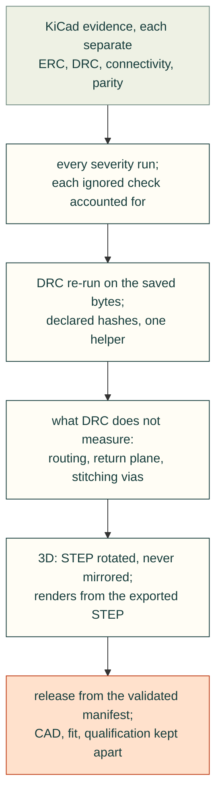

# PCB evidence, enclosure readback and release packaging

Distilled from the incident notes of a second project: a two- and four-port CAN breakout PCB with a printed housing,
designed with KiCad 10 and cad-agent on 2026-10-26 (repository `mvalancy/pcb-agx-thor-can-breakout`). The board-specific
detail (coordinates, net names, project tools) stays in that repository's `.agents/` notes; each **Source** line names
the note. Nothing here was electrically or physically tested; the lessons are about CAD evidence.

### Treat ERC, DRC, connectivity and schematic parity as separate evidence
- **Rule:** a routed board with zero unconnected items is not a verified board. Keep ERC, DRC violations, unconnected
  items and schematic parity as separate results, and never reduce a DRC report to its `violations` array.
- **Incident:** the first routed KiCad 10 reports showed 0 unconnected items but 100/131 schematic parity warnings.
  The PCB net names lacked the schematic's root `/` namespace, no-connect pads had no isolated net, and footprint
  fields were missing. Netlist-based synchronisation and board-only mount attributes closed the parity gap.
- **Check:** `cad-agent pcb-check` (docs/pcb.md) fails on any error, warning, unconnected item or parity finding.
- **Source:** `.agents/inbox/2026-10-26-pcb-evidence.md` (cad-agent PR #1).

### Run every severity, and account for every ignored check
- **Rule:** generate ERC/DRC with `--severity-all`. A default kicad-cli run leaves excluded violations out of the report
  and `--severity-error` drops warnings, yet both reports look clean. Checks a project switched off (`ignored_checks`)
  are findings too: accept each one only by name, with a written reason.
- **Incident:** the committed DRC report recorded `included_severities: ["error","warning"]` and five ignored checks
  (for example `missing_courtyard`). The first evidence adapter passed it with no trace of either. A review of the
  adapter caught it by re-running DRC with `--severity-error`, which still passed.
- **Check:** the adapter fails a report whose `included_severities` lacks error, warning or exclusion, and fails every
  ignored or excluded check key the evidence manifest does not waive with a reason.
- **Source:** cad-agent PR #1 review (finding on `pcb.py`); `exports/2port/drc.json` in the PCB project.

### Re-run DRC on the bytes you saved
- **Rule:** bind reports to source hashes taken after the last write to the sources. `kicad-cli pcb drc
  --refill-zones --save-board` writes the board after its JSON, so the report describes the board before the save; run
  DRC again on the saved board without saving. Touching a report's timestamp is not evidence.
- **Incident:** a refill-and-save run produced a report older than the board it described; the export sequence now
  runs a second, read-only DRC.
- **Check:** the bundle records `source_sha256` and `report_sha256`; binding rejects reports older than any source.
- **Source:** `.agents/inbox/2026-10-26-report-freshness-formats.md`.

### Check each report's declared hashes with one shared helper
- **Rule:** different reports declare different evidence (source hashes, report hashes, mechanical sources, exported
  solids). Verify whichever maps a report declares, all through one containment-aware function, and use it everywhere a
  pass is displayed. An empty or invalid declared map fails.
- **Incident:** the review workbench applied the PCB-bundle checker to every report with `source_sha256`, so current
  routing and fabrication reports showed STALE. The standalone report had the opposite gap: it trusted `pass: true`
  without checking hashes, so a changed solid still passed. Later, the design card and the workbench disagreed about
  a bundle whose source path left the project root.
- **Check:** `cadagent.review.evidence.hashes_are_current`; regression tests change one source byte and expect STALE in
  the workbench, the report row and the design card.
- **Source:** `.agents/inbox/2026-10-26-report-freshness-formats.md`; cad-agent PR #1 review.

### Measure routing geometry and the return plane; DRC does not
- **Rule:** connectivity and clearance checks say nothing about differential pairing or return-path continuity.
  Measure the shortest layer-aware copper path per signal (excluding stubs such as termination branches), require the
  protection pads on that path, compare pair imbalance and layer changes, and sample the reference copper under each
  trace. Route constrained pairs first and reserve the plane beneath them before routing anything else.
- **Incident:** boards that passed ERC, DRC and parity had separated pair conductors, and an auxiliary track left a
  19.3 mm gap in the reference plane under one pair. A total-copper-length sum hid it by adding the termination branch.
- **Check:** `cadagent.electrical.pcb_routing` graph/path and paired-spacing measurements, with project-defined limits.
  They do not establish impedance, data rate, EMC or transient immunity.
- **Source:** `.agents/inbox/2026-10-26-can-routing-is-not-connectivity.md`.

### Prove a stitching via joins the main plane, not another island
- **Rule:** a via touching copper on both layers may join two isolated islands. When a zone-to-zone ratsnest remains,
  inspect the filled, connected regions and re-run native connectivity after each stitch. Never disable the unconnected
  check or treat a zone-to-zone finding as cosmetic.
- **Incident:** one DRC `unconnected_items` finding persisted after stitching; the via had joined a small bottom island
  to a separate front region. A second via where the island overlapped the main-plane region closed it.
- **Check:** DRC with `--refill-zones` reports zero unconnected items.
- **Source:** `.agents/inbox/2026-10-26-ground-islands-need-a-real-bridge.md`.

### A part substitution is a new design: re-source and re-check it
- **Rule:** identify a bought part by manufacturer plus exact MPN plus full supplier code. A short name, pitch or
  category is not substitution approval. After changing a footprint, rerun electrical and mechanical checks, even within
  the same connector family.
- **Incident:** exact connector pad geometry replaced a generic footprint of the same family and changed clearances,
  which needed a fresh DRC. A TVS part was referred to by a short family name that matches several products.
- **Check:** BOM rows carry exact C-codes (`cadagent.electrical.pcb.check_jlc_files`), and a C-code is still not proof
  of stock or orientation.
- **Source:** `.agents/inbox/2026-10-26-pcb-evidence.md`, `.agents/domains/pcb.md` (cad-agent PR #1).

### Align a PCB STEP with a rotation, never a mirror
- **Rule:** reorient native or manufacturer STEP assemblies with proper rotations and translations (determinant +1).
  A mirror can make a symmetric outline fit while reversing every asymmetric connector. Record the transform and apply
  the same map to labels, port centres, mating envelopes and clamps.
- **Incident:** the enclosure import used `mirror('XZ')` to make the board's Y positive. Outline collision checks
  passed while the ribbon header sat on the mirrored side. A 180° rotation about Z plus a translation fixed it.
- **Check:** check one asymmetric feature (a header, a polarised connector) in housing coordinates after import.
- **Source:** `.agents/inbox/2026-10-26-preserve-pcb-handedness.md`.

### Give joined features positive overlap; a valid BREP can still mesh badly
- **Rule:** a boss or rib that only touches a wall tangentially can give a valid single solid and a non-manifold STL.
  Joined features need positive volume overlap. Check the solid, the STL and the 3MF separately after every change.
- **Incident:** a Ø9.2 mm corner boss touched the inner wall with no overlap; the CAD was valid but the STL had six
  edges not shared by exactly two faces. Ø9.6 mm (0.2 mm overlap) fixed it.
- **Check:** the watertight-mesh check in `cad-agent check`.
- **Source:** `.agents/inbox/2026-10-26-tangent-boss-mesh.md`.

### Render final review images from the exported STEP
- **Rule:** final assembly pictures should show the deliverable: re-import the exported STEP for each scene and compare
  visible placement to model coordinates, especially for text, repeated instances and exploded views.
- **Incident:** an in-memory render showed two lid labels run together although their centres were 42 mm apart; the
  STEP readback rendered them correctly. The exported solids were right; the preview was not.
- **Check:** render from readback; record export hashes next to the images.
- **Source:** `.agents/inbox/2026-10-26-review-export-readbacks.md`.

### Engrave panel artwork in bounded operations
- **Rule:** do not subtract one compound of many overlapping text and stroke tools. Cut item by item, fusing only each
  polyline's own stroke and cap solids, and validate the final solid count and the exported mesh.
- **Incident:** one aggregate subtraction ran for more than twelve minutes without finishing; the staged cuts finished a
  probe in about 109 s with one valid solid.
- **Check:** `cadagent.mechanical.markings.PanelMarkings.engrave`; timing depends on the artwork and is not guaranteed.
- **Source:** `.agents/inbox/2026-10-26-panel-engraving-overlap-cost.md` (cad-agent PR #1).

### Package releases from the validated manifest, not a folder glob
- **Rule:** release membership comes from the validated public file list. Compare the member hashes of a local package
  with one built from a clean checkout.
- **Incident:** local PCB packages contained KiCad's Git-ignored `.kicad_prl` UI-state files; CI packages built from
  clean checkouts did not. Both passed source validation because the glob, not the manifest, chose the files.
- **Check:** package candidates are filtered through the allowlist; local and clean-checkout ZIP membership match.
- **Source:** `.agents/inbox/2026-10-26-release-manifest-allowlist.md`.

### Don't let `.github/README.md` replace the repository overview
- **Rule:** GitHub picks the landing README from `.github/`, then the root, then `docs/`. When the root README is the
  overview, do not create `.github/README.md`; document CI in `.github/workflows/README.md`. After publishing, check the
  hosted `/readme` API and the visible page, not only local links.
- **Incident:** a README-in-every-folder generator created `.github/README.md`, and the public page showed only "CI
  validation and prerelease publication".
- **Check:** `gh api repos/<owner>/<repo>/readme --jq .path` returns `README.md`.
- **Source:** `.agents/inbox/2026-10-26-github-readme-precedence.md`;
  https://docs.github.com/en/repositories/managing-your-repositorys-settings-and-features/customizing-your-repository/about-readmes

### Keep CAD checks, fit and qualification as separate gates
- **Rule:** a clean CAD check never turns fabrication, physical fit, transient protection, bus timing, stock or supplier
  orientation green. Check the enclosure against the native PCB STEP with its components, mating plugs, cables,
  fasteners and tool access, not a bare-board proxy; record physical qualification as pending until measured.
- **Incident:** the review playbook for the breakout listed eight steps from carrier revision to physical
  qualification; the evidence bundle keeps `physical_fit_verified` and `electrical_tested` false and release gates open.
- **Check:** design cards show CAD status and open release gates separately (docs/pcb.md).
- **Source:** `.agents/playbooks/pcb-review.md`, `.agents/issues/pcb-evidence.md` (cad-agent PR #1).
