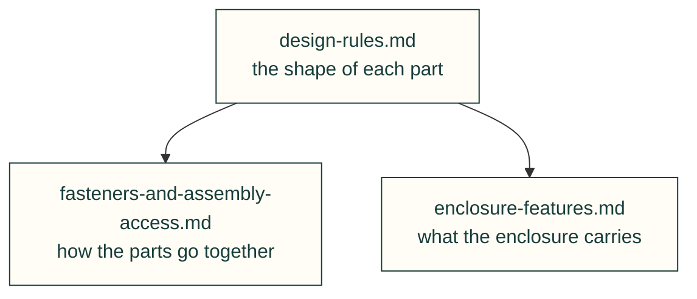

# Lessons — mechanical

Printed parts: strength, printability, fasteners and the enclosure's own features.

| File | Lessons on |
|---|---|
| [design-rules.md](design-rules.md) | Strength, printability, landings, reliefs, windows, grilles, shell |
| [fasteners-and-assembly-access.md](fasteners-and-assembly-access.md) | Tool access, assembly order, screw length, inserts, drive screws |
| [enclosure-features.md](enclosure-features.md) | Antennas, service pins, storage trays, mount plate, cap, power budget |

Each lesson follows the [lesson format](../README.md#lesson-format): a rule, the incident, a check and its source. Back to [all lessons](../README.md).
