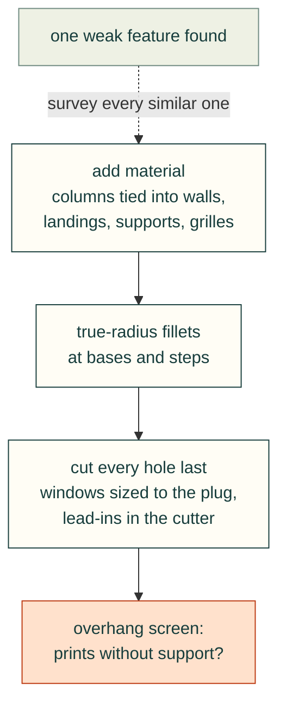

# Mechanical design rules

These rules come from printed-enclosure work (FDM, Bambu P1S bed) around a real carrier board.

### Tie tall slender columns into the nearest wall
- **Rule:** A tall screw column near a wall should be fused to the wall: a full-height buttress, concave fillets where
  it meets the wall, and a fillet at its base. It should not stand free.
- **Incident:** The user: "P1M and P1 base have 4 long tall skinny standoffs for the lid, can you make them better
  connected to the outside walls ... so they don't snap off like toothpicks?" Each lid-screw column was Ø10 × 68 mm,
  with its centre 8.8 mm from the outside face, so it reached only 0.2 mm into the 4 mm wall. The fix had three parts:
  - a full-height buttress from the wall face to the column centre (a D-shaped pillar);
  - 4 mm concave fillets on both sides where it meets the wall;
  - a 45° flare at the floor, later replaced by a 3 mm radius fillet.

  The lid's 34 mm hanging columns got the same treatment. Clearance to the antenna spot faces stayed at 1.25 mm, and to
  the nearest vent at 1.0 mm.
- **Check:** For each post, compute how far it reaches into the adjacent wall and its height-to-diameter ratio. Flag a
  post if the wall overlap is near zero. After the change, re-check the clearance to nearby features.
- **Source:** 2026-10-25T01:39, 01:45, 02:15.

### When one weak feature is found, survey all similar ones
- **Rule:** After fixing one slender feature, rank every similar feature by risk and either fix it or write down why
  it is left alone.
- **Incident:** The user: "What other skinny parts might snap...?" The survey found three more risks:
  - the board posts and cooler columns, whose flat landing shoulder carries the cooler clamp load;
  - the storage-tray standoff sleeves, which touched the 3 mm tray wall by only 0.3 mm;
  - the P9 template posts.

  Some features were kept on purpose. The lid tongue is supported along its full length, the ribs are 3 × 3 mm, and the
  rails are fused to the floor. The SSD clip got no fillet, because a fillet in its inside corner would push the drive
  off.
- **Check:** A table of slender features with risk, decision and reason. Fixed items are re-checked for overlaps.
- **Source:** 2026-10-25T01:50, 01:51, 01:57.

### Fillet both ends of a stepped standoff with true radii
- **Rule:** Put concave radius fillets at the base of each standoff and at each diameter step. Keep the fillets below
  the bearing face, and re-apply component reliefs after filleting.
- **Incident:** The user pointed at a render: "the small standoffs need the same fillet on the bottom that connects them
  to the base of the housing, as well as the top of the standoff (the small section) needing a fillet connecting to the
  fat part". The agent had used 45° chamfers there. These became radius fillets: 3 mm at the floor and 2 mm at the
  landing shoulder, on the board posts, the cooler columns and the P9 template. The lid columns and tray sleeves were
  given 3 mm floor or roof fillets for consistency. The fillets narrow as they rise, so they print without supports.
- **Check:** The landing-top area is unchanged after filleting. The component-relief cuts run after the fillets, so the
  carrier clearance check still reports 0 collisions.
- **Source:** 2026-10-25T02:04, 02:15; `cad/parameters.json` (`support_fillet_note`).

### Size landings to the pad's annular ring, limited by nearby components
- **Rule:** Make the plastic landing under a PCB mounting hole as large as the pad, for full contact. Keep a set margin
  to the nearest component, and give a fit template the same landings and reliefs.
- **Incident:** The user asked whether the fit template needed built-in standoffs, and: "Do you have the mounting hole
  pad sizes to match the plastic to the annular ring ... max contact area without colliding with components?" The
  landings were set to Ø6.9 (board) and Ø7.14 (cooler), from the STEP pad bodies. The nearest underside part is at least
  4.14 mm from any hole centre, so the edges clear components by at least 0.5 mm. The P9 template became a cradle with
  the base's posts and reliefs on a 3 mm frame, 12 mm tall, with 2.5 mm under the lowest component.
- **Check:** Landing radius + margin ≤ the distance from the hole centre to the nearest component's bounding box. The
  template must pass the same carrier clearance check as the base.
- **Source:** 2026-10-24T16:39, 16:42, 17:10; `cad/parameters.json` (`landing_basis`).

### Envelope underside cards and relieve the supports around them
- **Rule:** Model envelopes for the cards that plug into underside slots, including their plugs, and cut reliefs into
  any support they reach.
- **Incident:** The user asked whether there was "height clearance on the bottom side of the board for the large double
  stacked pcie slots". The stacked Mini PCIe and M.2 Key B cards need about 10 mm of the 16 mm available. The M.2 Key E
  Wi-Fi card envelope clipped a support by 74 mm³, so that support was cut back with a 0.5 mm margin.
- **Check:** For each envelope, the intrusion into plastic after relief is 0 mm³ and the gap to the floor is reported
  (`underside_envelopes` in `storage-checks.json`).
- **Source:** 2026-10-24T17:33; 2026-10-25T00:36; `README.md`; `exports/storage-checks.json`.

### Size connector windows to the mating plug's overmold
- **Rule:** Work out where the receptacle face sits relative to the outside of the panel. If the plug's overmold has to
  enter the window, size the window to the overmold, not to the receptacle. Bridge webs that would be too thin.
- **Incident:** In Rev 0.4 the 6 mm panels put receptacle faces 7–7.6 mm behind the outside, and the USB-C slot was
  5.7 mm tall where typical overmolds are 6.5–8 mm, so plugs could not mate. Rev 0.5 uses 3 mm plates with the inner
  faces unchanged. Windows were sized to typical overmold envelopes: USB-A 16.5 × 8.5, USB-C 13 × 8, HDMI 11.5 × 21.5
  (rotated). Webs under 1.8 mm were bridged. These sizes are typical values, still to be checked against the user's
  cables.
- **Check:** For each port: receptacle depth behind the outside face, window size ≥ envelope, web ≥ the minimum (1.8 mm).
  Record the sizing basis per port in `ports`.
- **Source:** 2026-10-24T07:41; `README.md` (Port windows); `cad/parameters.json` (`plug_envelopes_note`).
- **Superseded check:** a size-only check missed windows that were 2 mm off-centre and a plug taller than its header.
  Model the mated plug and sweep it in (see [cables](../wiring/cables-connectors-and-routing.md), "Model every mating connector …").

### Build printable lead-ins into the cutter, and confirm with an overhang screen
- **Rule:** Make lead-ins and transitions self-supporting (45° or a shape that narrows as it builds). Prefer tapered
  cutters to edge chamfers on complex edges. Compare the overhang screen before and after each change.
- **Incident:** An edge chamfer on the bridged windows failed (StdFail_NotDone), so the agent built the 45° lead-in into
  the cutter as a tapered extrude. The horizontal antenna and 12 V jack holes are teardrops with a 45° roof
  (`teardrop_x` / `teardrop_y` in `cad/build.py`), capped below the split line. Fillets were checked to narrow as they rise.
- **Check:** Downward-facing area from `print-review.json` before and after the change. For example, the lid stayed at
  803.5 mm² after the cell chamfer was added.
- **Source:** 2026-10-24T07:17, 14:50, 17:10.

### Make grilles finger-safe, and shape the fan side for flow
- **Rule:** Keep the smallest opening of a grille over a fan below the test-finger size. Taper the inlet side rather
  than leaving a sharp edge, and do not claim an airflow gain without testing it.
- **Incident:** The Rev 0.4 roof cells (25 × 29 mm) let a finger reach the fan. Rev 0.5 has 216 hex cells, 10 mm across
  flats, which a 12 mm test finger cannot pass. On request ("internal chamfer on the fan side"), each cell got a 1.0 mm
  deep inlet that opens to 11.2 mm across flats, with a 0.6 mm web edge. That is 31° off the cell axis, chosen over 45°
  for a longer lead-in on thin webs. The outer 5 mm keeps full 1.8 mm webs. The airflow gain was stated as untested.
- **Check:** Smallest opening < test-finger diameter. The overhang screen is unchanged. Any airflow claim is labelled as
  untested until CFD or a physical test.
- **Source:** 2026-10-24T07:41, 14:42, 15:09.

### Keep the shell flush and let the lid capture the loose plates
- **Rule:** Prefer a flush shell without overhangs or protruding rails. Have the closing part hold the slide-in panels
  down, so one set of screws retains everything.
- **Incident:** Rev 0.4 overhung by 6.4 mm and had rails protruding 11 mm. Rev 0.5 is a flush R8 shell,
  206 × 181 × 112 mm. Plates and the hatch slide down channels, and the lid's ledges over the plates and its skin over the
  hatch keep all three from lifting. Four M3 screws go in from the top, so the lid opens while the base is bolted to a
  wall.
- **Check:** `assembly-paths.json` shows that the plates slide vertically (0.37 mm front, 0.25 mm rear clearance). Every
  loose part is either screwed or captured by a screwed part.
- **Source:** 2026-10-24T07:41; `README.md` (Assembly step 9).

### Cut every hole last, after all the added features

- **What happened:** Rev 0.9 of the J501 lid (2026-10-29) added four stiffening ribs from the fan to the lid-screw
  corners. The build cut the counterbores and clearance holes first and unioned the ribs afterwards. Each rib ran
  into its socket-head counterbore, and the lid was printed that way. Every check passed: the lid was a valid watertight
  solid, it cleared the cooler, and its FEA and slice were fine.
- **Rule:** in the build, cut fastener holes, counterbores, countersinks and insert bores after every rib, boss, skirt
  and gusset has been added. Run `cad-agent holes` (part of `cad-agent all`), which probes every cylindrical hole and
  countersink in each part's STEP for material inside it. A finding is a build-order bug unless it is a deliberate
  D-flat or bridge layer, which is listed in `cad.holes.exceptions` with its reason.
- **Index:** [docs/common-issues.md](../../docs/common-issues.md) lists this and the other recurring review findings.
- **Source:** mvalancy/j501-agx-orin#9; Valpatel/cad-agent#85.
